<p align="center">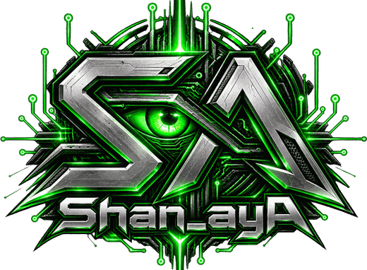</p>

<h1 align="center">RecalBoxDMD — RawEdition</h1>

<p align="center">
  <b>Un verdadero marquee LED para tu mueble arcade Recalbox.<br>El logo de cada juego se enciende en 15 ms — incluso con un fullset MAME de 30 000 juegos.</b>
</p>

<p align="center">
  
  
  <a href="LICENSE"></a>
  
  
  
  
  <a href="https://buymeacoffee.com/shan_aya"></a>
</p>

<p align="center">
  <a href="README.md">🇬🇧 English</a> · <a href="README.fr.md">🇫🇷 Français</a> · 🇪🇸 <b>Español</b>
</p>

<p align="center">
  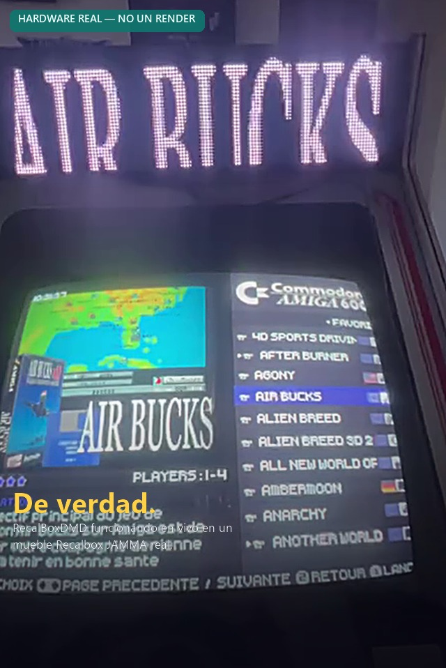
</p>

<p align="center">
  <a href="#-empezar-en-5-minutos"><b>🚀 Empezar</b></a> &nbsp;·&nbsp;
  <a href="#-instalación-esp32"><b>🔌 Instalar en ESP32</b></a> &nbsp;·&nbsp;
  <a href="#-instalación-raspberry-pi"><b>🥧 Instalar en Raspberry Pi</b></a> &nbsp;·&nbsp;
  <a href="#-la-caja-de-herramientas-pc--el-centro-de-la-instalación"><b>🧰 Caja de herramientas</b></a> &nbsp;·&nbsp;
  <a href="#-configuración-web"><b>🌐 Config web</b></a> &nbsp;·&nbsp;
  <a href="https://shan-aya.github.io/RecalBoxDMD/"><b>✨ Página interactiva</b></a>
</p>

<p align="center">
  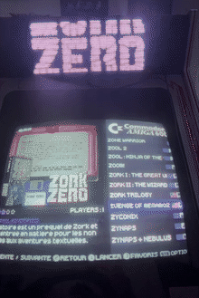<br>
  <sub>📹 Imágenes reales, no un montaje — el marquee sigue la navegación en vivo · <a href="medias/dmd_in_action.mp4">clip completo (MP4)</a></sub>
</p>

<p align="center">
  <a href="https://youtu.be/xF8O88XXSwU"></a><br>
  <sub>🎬 <b>El vídeo</b> — presentación, montaje e instalación, por Jamyz Gaming · <a href="https://youtu.be/xF8O88XXSwU">YouTube</a></sub>
</p>

> 🔄 **¿Ya usabas una versión anterior?** Lee **[UPGRADING.es.md](UPGRADING.es.md)** (qué cambia, un único paso opcional) y el **[CHANGELOG](CHANGELOG.es.md)**.

---

## 📑 Contenido

| | |
|---|---|
| **Entender** | [¿Qué es esto?](#-qué-es-esto) · [Qué puedes mostrar](#-qué-puedes-mostrar) · [Cómo funciona](#-cómo-funciona) |
| **Instalar** | [Empezar en 5 minutos](#-empezar-en-5-minutos) · [Vía ESP32](#-instalación-esp32) · [Vía Raspberry Pi](#-instalación-raspberry-pi) · [Scripts de Recalbox](#-los-scripts-de-recalbox-modo-9) |
| **Controlar** | [Caja de herramientas PC — todos los modos](#-la-caja-de-herramientas-pc--el-centro-de-la-instalación) · [Configuración web](#-configuración-web) |
| **Explorar** | [Las pantallas en detalle](#-las-pantallas-en-detalle) · [Pantallas en juego y Pinball](#-pantallas-en-juego-recalbox-nativo-y-pinball) · [Pack de 600 GIFs](#-el-pack-de-600-gifs) · [Diagnóstico](#-diagnóstico-wi-fi--recalbox) · [Tutoriales](#-tutoriales-paso-a-paso) |
| **Referencia** | [Referencia técnica](#-referencia-técnica) · [Solución de problemas](#-solución-de-problemas) · [Créditos y licencia](#-créditos-y-licencia) |

---

## 🎮 ¿Qué es esto?

**RecalBoxDMD** convierte un **panel LED 128×32** (dos módulos HUB75 64×32 encadenados) en un verdadero marquee para tu mueble **Recalbox**. Lanzas un juego: su logo se enciende en pocos milisegundos. El resto del tiempo el panel reproduce tus GIF, muestra la hora, el tiempo, un quiz, la clasificación del desafío de Recalbox…

Es un fork de [RetroBoxLED de Jamyz](https://github.com/Jamyz/RetroBoxLED), reconstruido en torno a un formato de píxeles propio, el **raw565**, y una **caja de herramientas PC** que prepara toda la tarjeta SD. Resuelve un problema concreto: en las colecciones grandes (fullset MAME, FBNeo…), el firmware original en PNG/GIF se congelaba o mostraba pantalla negra varios segundos entre juegos.

|                            | PNG/GIF original       | **RecalBoxDMD RawEdition**        |
|----------------------------|------------------------|-----------------------------------|
| Tiempo de visualización por juego | 500 ms – 3 s+   | **5 – 15 ms**                     |
| RAM necesaria (ESP32)      | 50 – 100 KB            | **8 KB**                          |
| Fullset MAME (30 000 juegos) | congelaciones de 5-10 s | **sin congelaciones, sin pantalla negra** |
| Puesta en marcha           | manual, imagen a imagen | **caja de herramientas PC, un clic** |

### Dos versiones, un mismo DMD

| | 🔌 **ESP32** | 🥧 **Raspberry Pi** |
|---|---|---|
| Cerebro | ESP32 DevKit V1 + placa DMDos | Raspberry Pi 3B (validada) + placa de interfaz HUB75 |
| Paneles | 2 × P4 64×32 | 2 × P5 64×32 |
| Instalación | Flashear el firmware (navegador) + tarjeta SD | Tarjeta SD **en blanco** preparada de una vez por la caja de herramientas |
| Actualizaciones | Wi-Fi (Modo 14 o página web) | Wi-Fi (Modo 17 o página web) |
| Scripts de Recalbox, páginas web, widgets, temas | **idénticos** | **idénticos** |

> ### 🚀 Lo esencial
> Apunta la **caja de herramientas PC** a tu carpeta de ROMs y pulsa **Iniciar** (**Modo 1 — AUTO**). Encadena todo ella sola — detección de la versión de Recalbox, conversión raw565, cachés, imágenes por defecto, scripts de Recalbox — hasta una tarjeta SD lista para usar. **Insértala en el DMD, enciende: listo.** Ninguna configuración archivo por archivo, nunca.

---

## 🖼️ Qué puedes mostrar

El panel mezcla **dos mundos**, en la proporción que quieras, desde la página web *Widgets*:

<table>
<tr>
<td width="50%" valign="top">

### 🎬 La lista de reproducción y el marquee
- ⚡ **Marquee del juego en vivo** — fijo o animado, por juego o por sistema, imágenes de reserva (4 incluidas, o la tuya).
- 🎞️ **~600 GIF retro gratis** + pestaña *Playlist* para componer tus rotaciones de espera.
- 🏆 **Pantallas en juego** — Hi-Score, Info del juego, RetroAchievements, Desafío Recalbox.
- 🎨 **El DMD sigue tu tema de Recalbox** — logos de sistemas según tema, idioma y región, al vuelo.
- 🎯 **Pinball** — las mesas de Visual Pinball muestran su DMD.
- 🎮 **Modo nativo de Recalbox** — EmulationStation maneja el panel directamente.

</td>
<td width="50%" valign="top">

### 🧩 Los widgets
Pantallas vivas, dibujadas sobre un **cielo que sigue el sol y el tiempo reales de tu lugar**.
- 🕰️ **15 relojes** — 10 temas pixel-art + 5 animados
- 📅 Fecha · 🌅 Efemérides · ⏳ Cuenta atrás
- 🌦️ Tiempo · 🌀 8 ambientes
- 💬 Citas y quiz
- 🏆 **3 widgets de Recalbox** — desafío, recompensas, salud

Cada widget: **desactivado**, **en lugar del reloj** o **además**, con su propia duración. Cada N GIF o cada N minutos — o **solo widgets**, un reloj de escritorio vivo.

</td>
</tr>
</table>

<p align="center">
  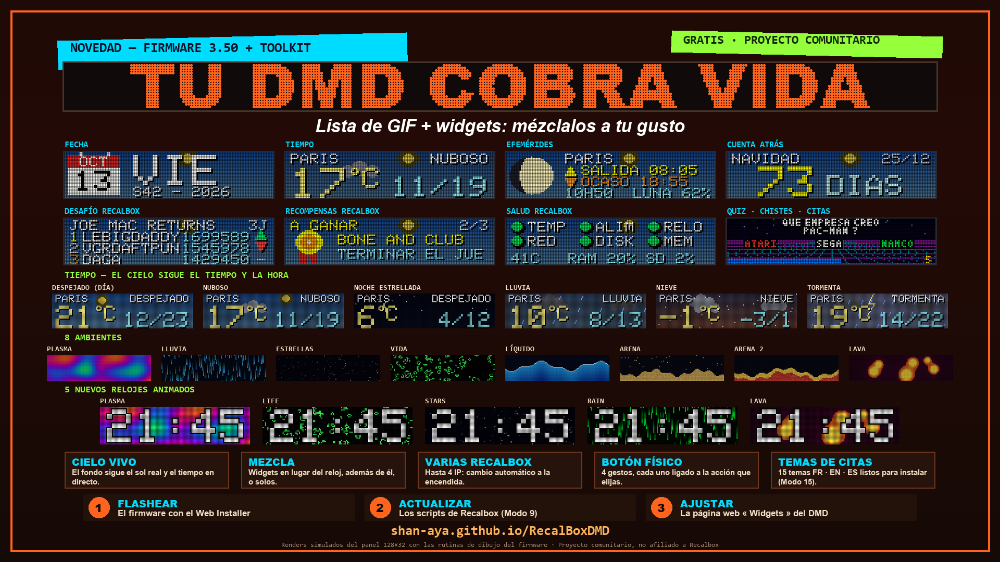
</p>

<p align="center">
  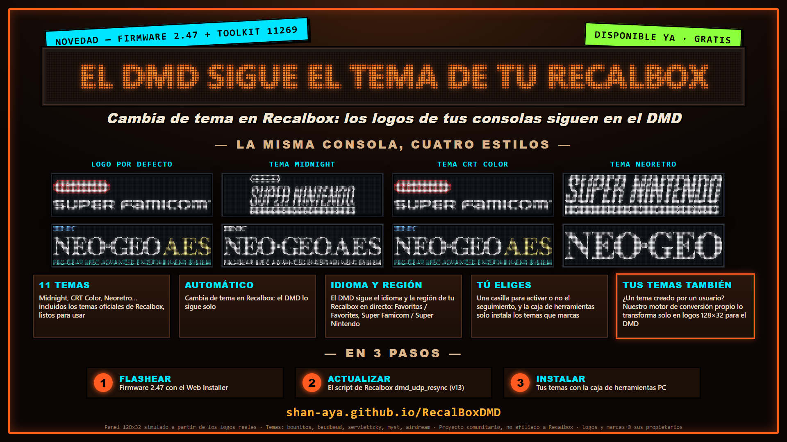
  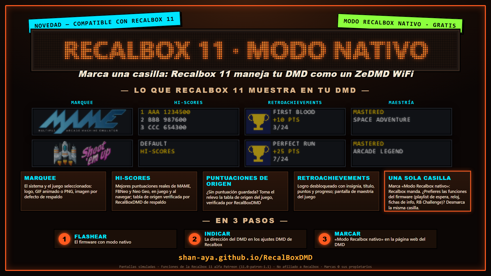
</p>

<p align="center">
  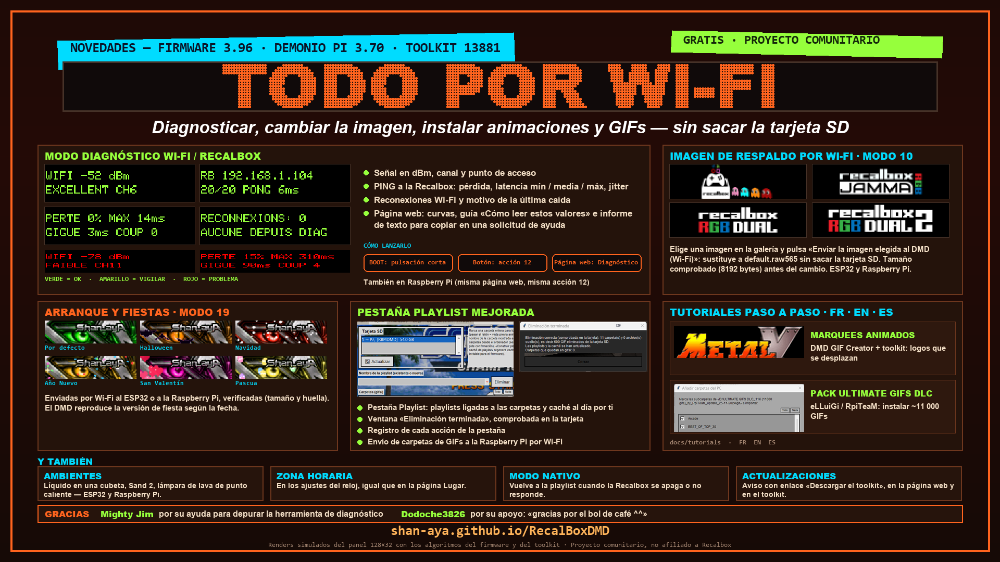
</p>

👉 El detalle de cada pantalla: [Las pantallas en detalle](#-las-pantallas-en-detalle).

### Y además
- 🔁 **Varias Recalbox, un solo DMD** — hasta 4 IP; el DMD **cambia solo** a la que esté encendida.
- 🔘 **Botón físico** (GPIO 21) — pulsación corta / doble / larga / muy larga, cada una con la acción que elijas.
- 📶 **Diagnóstico Wi-Fi / Recalbox** — señal, punto de acceso, pérdida, latencia y jitter hacia la Recalbox, en el panel (pulsación corta de BOOT, o una acción del botón) y en una página web que explica cómo leer los valores. [Detalles](#-diagnóstico-wi-fi--recalbox).
- 🌗 **Planificador de brillo** — 24 franjas, una por hora.
- ⬆️ **Actualizaciones sin cable** — firmware y demonio del Pi desde la página web o la caja de herramientas, con vuelta atrás automática.
- 🛡️ **`config.ini` blindado** — escritura atómica, guardado verificado, rechazo de una página vacía.

---

## ⚙️ Cómo funciona

```
┌───────────────────────────────┐   UDP    ┌────────────────────────────────────────┐
│           RECALBOX            │ ───────▶ │  DMD (ESP32 o Raspberry Pi) + LED      │
│ Lanzas un juego → un script   │          │                                        │
│ envía « mame/kof98 »          │          │ 1. /systems/mame/kof98.raw565(pack)    │
│ (juego, fin de juego, reposo, │          │ 2. si no: índice games_cache.bin       │
│  hi-score, logros…)           │          │ 3. si no: _defaults/mame.raw565        │
└───────────────────────────────┘          │ 4. si no: _defaults/default.raw565     │
                                           │        ⏱ 5-15 ms, sea cual sea el      │
┌───────────────────────────────┐          │          tamaño de la colección        │
│ CAJA DE HERRAMIENTAS PC       │  tarjeta └────────────────────────────────────────┘
│ (Windows)                     │    SD
│ gamelist.xml → raw565, cachés,│ ────────▶   (o, para el Pi: la tarjeta entera,
│ imágenes por defecto, scripts,│              sistema incluido)
│ temas, GIF, copia SD…         │
└───────────────────────────────┘
```

El DMD es una pantalla « tonta » de principio a fin: **toda la lógica** (qué enviar, cuándo, durante cuánto tiempo) vive en pequeños scripts del lado de Recalbox, nunca en el firmware.

---

## 🚀 Empezar en 5 minutos

<table align="center">
<tr><td align="center" width="70"><h2>1️⃣</h2></td><td>

**[Instala la caja de herramientas PC](#instalar-la-caja-de-herramientas)** — ella hace todo el trabajo.
Haz scraping de tus juegos en Recalbox, elige tu carpeta de ROMs, pulsa **Iniciar**.

</td></tr>
<tr><td align="center"><h2>2️⃣</h2></td><td>

**Monta el hardware y pon el firmware** — ESP32: [montaje + flasheo](#-instalación-esp32) (~5 min, sin soldar). Raspberry Pi: [la caja de herramientas prepara la tarjeta](#-instalación-raspberry-pi).

</td></tr>
<tr><td align="center"><h2>3️⃣</h2></td><td>

**Inserta la tarjeta SD, enciende.**
El primer arranque te guía con el Wi-Fi y luego la **[página de configuración web](#-configuración-web)** se encarga de todo lo demás.

</td></tr>
<tr><td align="center"><h2>4️⃣</h2></td><td>

**Instala los [scripts de Recalbox](#-los-scripts-de-recalbox-modo-9)** (Modo 9 — el Modo 1 ya lo hace) y lanza un juego: aparece el logo. 🎉

</td></tr>
</table>

### Instalar la caja de herramientas

Descárgala en la **[página de Releases](https://github.com/shan-aya/RecalBoxDMD/releases)** (Windows 10/11; los binarios no están en el repositorio, solo se publican allí):

| Opción | Para quién | Cómo |
|---|---|---|
| **A — Instalador** *(recomendado)* | todo el mundo | `RecalBoxDMD_Toolkit_Setup.exe`: menú Inicio, desinstalador |
| **B — Portable** | sin instalación | `RecalBoxDMD_GUI.exe`: un solo archivo, sin Python |
| **C — `.msi`** | despliegue con scripts / GPO | `msiexec /i "RecalBoxDMD Toolkit-1.0.0-win64.msi"` |
| **D — Fuentes Python** | curiosos, desarrolladores | carpeta `tools/` → `install_and_run.bat` (o `pip install Pillow Markdown && python run_gui.py`) |

**Primer arranque**: haz scraping de tus juegos en Recalbox (botón **« ¿Cómo hacer scraping? »** de la herramienta) → pestaña *Main* → elige tu versión de Recalbox y tu carpeta de ROMs (p. ej. `D:\Recalbox\share\roms`) → **Iniciar**. El botón parpadeante te propone luego copiar a tu tarjeta SD.

---

## 🔌 Instalación ESP32

> **Vía 1/2** — el DMD basado en ESP32 + placa DMDos. *(¿Tienes una Raspberry Pi? → [Vía Raspberry Pi](#-instalación-raspberry-pi).)*

### 1. El hardware

🛒 **Dónde comprar la placa DMDos:**
-  **Francia** — [Benfactory.fr](https://benfactory.fr/produit/dmdos/) · placa DMDos + ESP32 · código promo **`retrobat10`** (−10 %)
-  **España** — [Mortaca Store](https://www.mortaca.com/) · guía y novedades en [dmdos.net](https://www.dmdos.net/)

| Componente | Referencia | Precio orientativo |
|---|---|---|
| 🧠 Microcontrolador | ESP32 DevKit V1 USB-C (38 pines) | ~5 € |
| 🖥️ Panel LED | 2× HUB75 RGB **P4, 64×32, 256×128 mm**, lado a lado (→ 128×32) | ~15-25 € / panel |
| 🔌 Placa de conexión | **DMDos Board V3** (recomendada: lector SD integrado, sin soldar) | ~15 € |
| 💾 Lector SD | Micro SD SPI (integrado en la DMDos Board) — **tarjeta ≥ 8 GB, FAT32** | ~2 € |
| ⚡ Alimentación | 5 V 4 A+ | ~10 € |

<p align="center">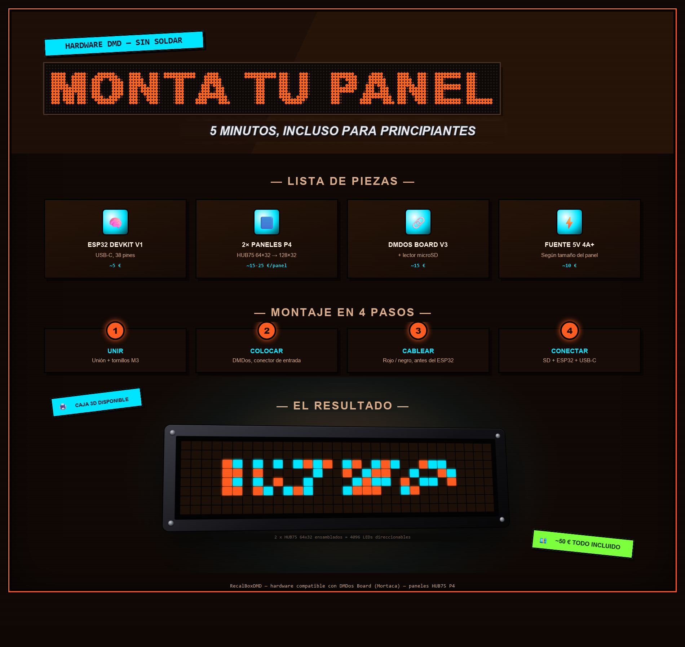</p>

### 2. El montaje (~5 minutos, sin soldar)

Idéntico a la guía oficial de **[dmdos.net](https://www.dmdos.net/)** (Mortaca) — basta un destornillador:

1. **Une los dos paneles** con las piezas de unión incluidas (tornillos M3 no incluidos).
2. **Coloca la placa DMDos** sobre el conector de **entrada** (la placa solo funciona de ese lado).
3. **Cablea la alimentación**: rojo↔rojo, negro↔negro según la serigrafía, y une los dos paneles con la cinta incluida.
4. **Tarjeta SD, ESP32, alimentación**: inserta la tarjeta SD preparada, coloca el ESP32 flasheado sobre la placa, alimenta por el USB-C.

<p align="center">
  <a href="https://www.dmdos.net/#montaje">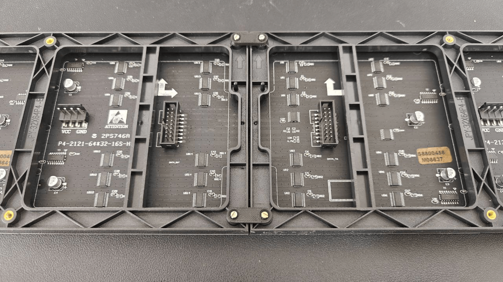</a>
  <a href="https://www.dmdos.net/#montaje">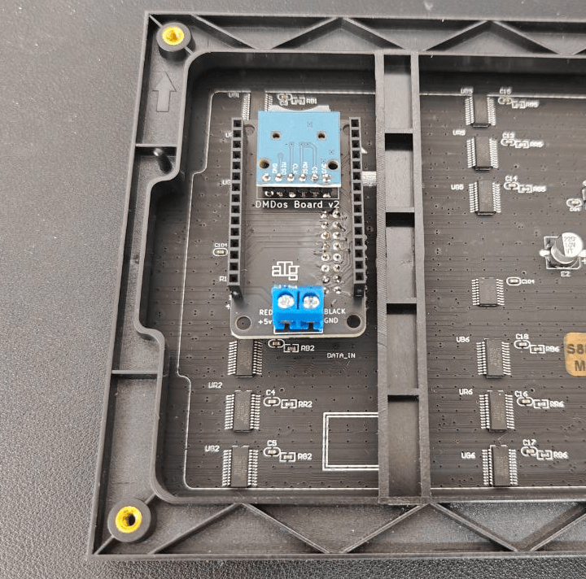</a>
  <a href="https://www.dmdos.net/#montaje">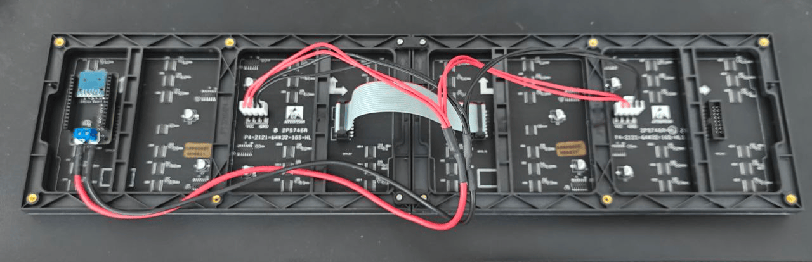</a>
  <a href="https://www.dmdos.net/#montaje">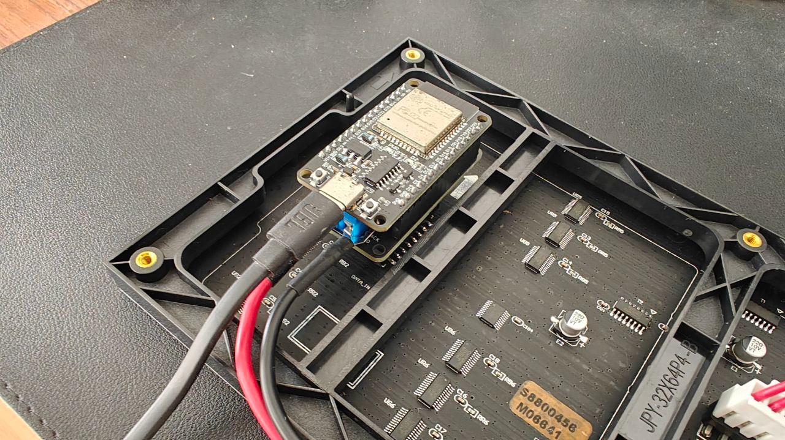</a><br>
  <sub>Las miniaturas enlazan con la guía oficial paso a paso · <a href="https://www.dmdos.net/#hardware">Hardware</a> · <a href="https://www.dmdos.net/#montaje">Montaje</a> · <a href="https://www.dmdos.net/#mueble">Mueble</a></sub>
</p>

> ⚠️ El sitio DMDos ofrece su propio firmware, distinto. **No flashees el firmware de DMDos**: solo se reutilizan el **hardware** y la **guía de montaje**; el firmware y el contenido de la tarjeta SD vienen de este repositorio.
> 🖨️ Caja imprimible en 3D de **Janibol** ([Retromojones](https://www.youtube.com/@retromojones)) en [Thingiverse](https://www.thingiverse.com/thing:6704880).

### 3. El firmware

**🌐 Lo más fácil — desde el navegador** (nada que instalar)

> 👉 **[Abrir el instalador web de RecalBoxDMD](https://shan-aya.github.io/RecalBoxDMD/install/)**

Con **Chrome o Edge**, conecta el ESP32 por USB, pulsa **Instalar**, elige el puerto COM: un minuto. Marca **« Erase device »** en una primera instalación (o si vienes de otro firmware, p. ej. DMDos). La página muestra la versión que instala.

<details>
<summary><b>🛠️ Otros métodos: Arduino IDE · esptool · pinout</b></summary>

**Arduino IDE** (compilar / personalizar) — abre `RecalBox_DMD.ino`, instala las bibliotecas siguientes, luego *Herramientas → ESP32 Dev Module*, flash **4 MB**, esquema de particiones **Minimal SPIFFS (1.9MB APP with OTA/190KB SPIFFS)** (dos ranuras de firmware, necesarias para las actualizaciones por Wi-Fi).

| Biblioteca | Utilidad |
|---|---|
| [ESP32-HUB75-MatrixPanel-I2S-DMA](https://github.com/mrfaptastic/ESP32-HUB75-MatrixPanel-I2S-DMA) | Control DMA del panel |
| [AnimatedGIF](https://github.com/bitbank2/AnimatedGIF) | Decodificación GIF (reserva) |
| [pngle](https://github.com/kikuchan/pngle) | Decodificación PNG (reserva, incluida) |
| [WiFiManager](https://github.com/tzapu/WiFiManager) | Configuración Wi-Fi |
| [Adafruit GFX Library](https://github.com/adafruit/Adafruit-GFX-Library) | Texto / formas |
| [ArduinoJson](https://github.com/bblanchon/ArduinoJson) | Config y página web |

**`esptool.py`** — los binarios precompilados están en [`binaries/`](binaries/):

```bash
esptool.py --chip esp32 --port COM3 --baud 921600 write_flash -z 0x10000 RecalBoxDMD_app.bin
# o, en un solo archivo:
esptool.py --chip esp32 --port COM3 write_flash 0x0 RecalBoxDMD_merged.bin
```

**Pinout por defecto**

| Tarjeta SD (SPI) | GPIO |  | HUB75 | GPIO |  | HUB75 | GPIO |
|---|---|---|---|---|---|---|---|
| CS | 5 | | CLK | 16 | | R1 / R2 | 25 / 14 |
| MOSI | 23 | | OE | 15 | | G1 / G2 | 26 / 12 |
| MISO | 19 | | LAT | 4 | | B1 / B2 | 27 / 13 |
| SCLK | 18 | | A/B/C/D | 33 / 32 / 22 / 17 | | E | -1 |

</details>

### 4. La tarjeta SD y el primer arranque

1. Lanza el **[Modo 1 de la caja de herramientas](#-la-caja-de-herramientas-pc--el-centro-de-la-instalación)**: construye toda la tarjeta SD y propone copiarla.
2. Tarjeta en el DMD, enciende: aparece el título `RawEdition v…` y luego la lista de reposo.
3. **Wi-Fi indicado en el Modo 1** → el DMD se une solo a tu red. **Si no**, abre su propio punto de acceso Wi-Fi: conéctate y sigue la página (red de 2,4 GHz + IP de la Recalbox).
4. Abre la **[página de configuración web](#-configuración-web)** (la IP aparece en el panel) para ajustarlo todo.
5. Lanza un juego en la Recalbox: el panel pasa a su marquee.

---

## 🥧 Instalación Raspberry Pi

> **Vía 2/2** — el mismo DMD, con una **Raspberry Pi** en lugar del ESP32. *(¿Tienes un ESP32? → [Vía ESP32](#-instalación-esp32).)*

<p align="center">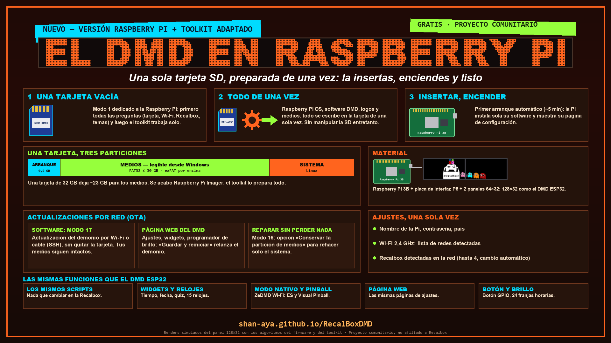</p>

> ✅ **Validada: Raspberry Pi 3B** (Raspberry Pi OS Lite 32 bits « Bookworm »).
> ⚠️ **Prevista, sin probar: Pi 4 / 400 / CM4, Pi 2, Zero 2.** El software ajusta `gpio_slowdown` según el modelo (Pi 4: 4; Pi 2/3: 2; Pi 1/Zero: 1); si tu Pi parpadea, ajusta `gpio_slowdown=1..4` en `config.ini`.

### 1. El hardware
- **Raspberry Pi 3B** + una **placa de interfaz HUB75** (tipo RPI2DMD: mapeo GPIO « regular », reloj RTC DS1307 opcional).
- **Dos paneles P5 64×32** encadenados (128×32), barrido 1/16: `--led-cols=64 --led-rows=32 --led-chain=2 --led-pwm-bits=11`.
- Un botón físico opcional entre GPIO 21 y GND.
- El audio del Pi está desactivado y un núcleo se reserva para la pantalla (`isolcpus=3`): la instalación se encarga.

### 2. La instalación — todo desde la caja de herramientas

1. Lanza la **caja de herramientas PC** y elige el destino **Raspberry Pi** arriba en la ventana.
2. **Modo 1**: responde a todas las preguntas de entrada (tarjeta, Wi-Fi, usuario / SSH, Recalbox, temas…); luego el asistente trabaja solo, **desde una tarjeta SD en blanco**: formateo, Raspberry Pi OS Lite, software del DMD, logos convertidos en una partición `RBPIDMD`. Windows pide permiso de administrador (escritura directa en disco); el contenido de la tarjeta se borra **tras confirmación**.
3. Tarjeta en el Pi, enciende, **espera 2 a 3 minutos**: el DMD muestra *Página de configuración* y su dirección (o abre `http://rbpidmd.local/`). Sin Wi-Fi válido, el Pi abre la red **RecalBox-DMD-Config** (192.168.4.1): configúralo desde un móvil.
4. Indica la IP de tu Recalbox en los ajustes Wi-Fi y lanza el **[Modo 9](#-los-scripts-de-recalbox-modo-9)**: los scripts de Recalbox son **los mismos** que para el ESP32.

Una tarjeta, tres particiones: **arranque** (0,5 GB) · **medios** (FAT32 ≤ 30 GB, exFAT más allá — legible desde Windows) · **sistema** (Linux). Se acabó Raspberry Pi Imager.

### 3. Los modos dedicados al Pi

| Modo | Función |
|---|---|
| **16** | **Preparar una tarjeta** — sustituye a Raspberry Pi Imager: descarga Raspberry Pi OS Lite (SHA-256 verificado), lo escribe, añade Wi-Fi / usuario / SSH y el software del DMD. La opción *Conservar la partición de medios* rehace solo el sistema. |
| **17** | **Instalar o actualizar** el software en un Pi ya arrancado (encontrado vía `rbpidmd.local`, si no por barrido) y copiar el contenido de la tarjeta SD del DMD (copia incremental; la configuración nunca se sobrescribe). |

El software del Pi se **descarga de GitHub** (release `pi-v…`, SHA-256 verificado); sin red, se usa la copia del PC.

### 4. Actualizar
- **Desde la página web** (v3.59+): la página **Ajustes** avisa de una nueva versión y ofrece **Actualizar ahora** — descarga, verificación SHA-256, instalación, reinicio del servicio y **vuelta atrás automática** a la versión anterior si el arranque falla (~1 min).
- **Modo 17**, o a mano: `RecalBoxDMD_pi_payload.zip` de la última release `pi-v…`, luego `sudo bash install.sh`.

📖 Detalles, compilación, licencia (GPL-2.0+) y límites conocidos: **[RASPBERRY-PI.es.md](RASPBERRY-PI.es.md)**.

---

## 📜 Los scripts de Recalbox (Modo 9)

*Comunes al ESP32 y a la Raspberry Pi.* El DMD solo muestra lo que Recalbox le dice: el vínculo es un conjunto de pequeños **scripts** que Recalbox ejecuta en sus eventos (juego lanzado, juego terminado, salvapantallas…). El **Modo 1** los instala; el **Modo 9** los instala o los **actualiza** (repítelo tras cada actualización de la caja de herramientas).

<p align="center">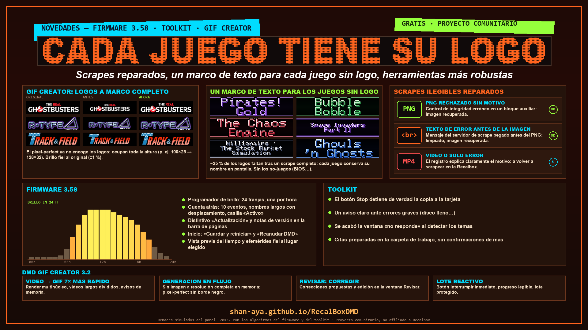</p>

**Cómo:** *Avanzado* → *SCRIPTS RECALBOX* → **Modo 9** → indica la **IP o el nombre** de la Recalbox (varias posibles, separadas por comas: se instala en cada una) → **Instalar / Actualizar**. Copia por el recurso compartido de red, o por SSH si está bloqueado. Recalbox inaccesible: queda una copia lista en `recalbox_userscripts` (cópiala a mano en `share/userscripts`).

| Categoría | Contenido |
|---|---|
| **Scripts de eventos** (automáticos) | puente *marquee* · *hi-score / info del juego / Desafío RB* · *RetroAchievements* · `dmd_vpx_config` (configura Visual Pinball **solo** si *Modo Pinball (VPX)* está marcado en el DMD) · ayudas en `dmd_helpers/` |
| **Widgets de Recalbox** (automáticos) | `dmd_rbwidgets` envía cada 2 min un resumen del **desafío**, las **recompensas** y la **salud** de la Recalbox |
| **Scripts manuales** (menú *Scripts de usuario*) | **WiFi Recovery DMD** · **Config Web DMD** · **Reboot DMD** · **Brillo DMD +10 % / −10 %** |
| **Archivos hi-score `.hi`** | ~3000 archivos (FBNeo, MAME 0.278) añadidos a `share/saves` — **un `.hi` existente nunca se sobrescribe** |

> **Reinicia EmulationStation** (o la Recalbox) tras la instalación; si no, el menú *Scripts de usuario* queda en gris: Recalbox solo busca los scripts al arrancar.

---

## 🧰 La caja de herramientas PC — el centro de la instalación

La aplicación Windows (FR / EN / ES, 9 aspectos visuales) que **lo construye todo**: tarjeta SD, scripts, temas, GIF, actualizaciones — tanto para el ESP32 como para la Raspberry Pi. Manual completo: [`HELP.es.md`](tools/RecalBoxDMD_tool_v13881/HELP.es.md) (también en la pestaña *Ayuda*).

| Main · SNES | Ajustes · Dreamcast |
|---|---|
| 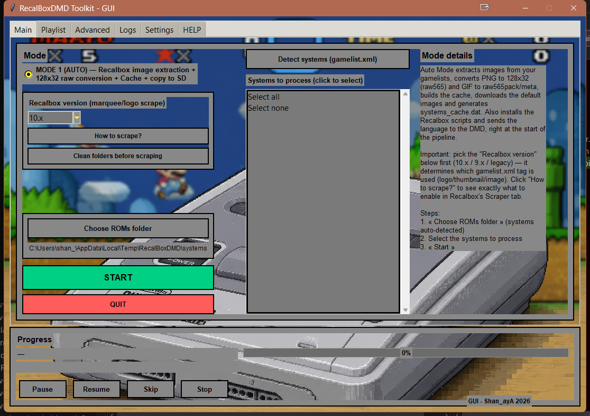 | 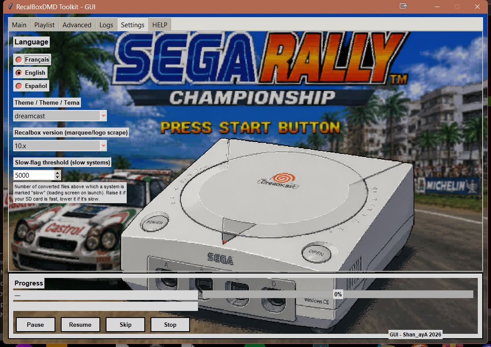 |
| **Main · PlayStation** | **Avanzado · Atari 2600** |
| 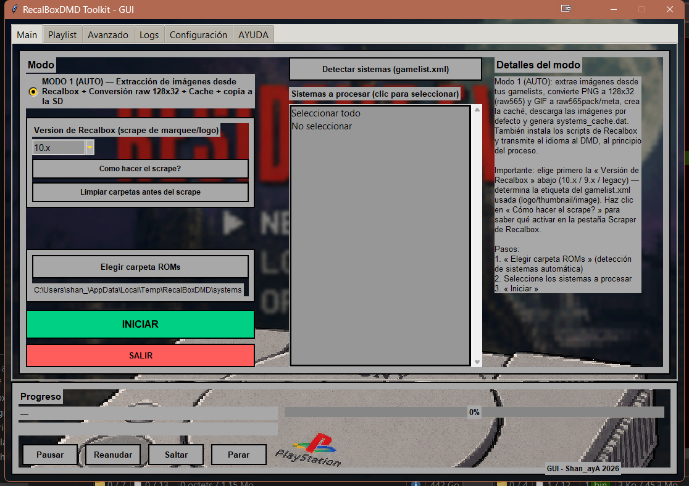 | 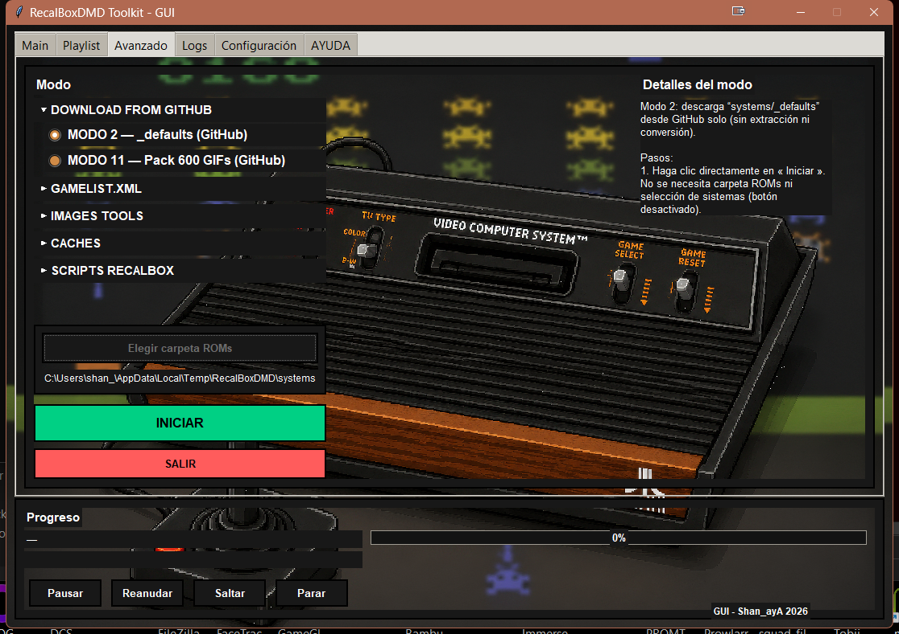 |

### Las seis pestañas

| Pestaña | Función |
|---|---|
| **Main** | El **Modo 1** automático: carpeta de ROMs, sistemas, versión de Recalbox, **INICIAR** |
| **Playlist** | Componer tus listas de reposo desde la tarjeta SD o carpetas de GIF del PC |
| **Avanzado** | Los modos 2 a 18 uno a uno, por categorías |
| **Logs** | Toda la salida de texto, con filtro de nivel — cópiala para informar de un problema |
| **Ajustes** | Idioma, tema de colores, perfil de versión de Recalbox, umbral « L » (sistemas lentos) |
| **Ayuda** | El manual, abrible en el navegador |

Abajo, **Pausa / Reanudar · Saltar · Stop** (Stop detiene de verdad la copia). El número de la barra de título es el **build**: indícalo al pedir ayuda. Al arrancar, un **aviso** señala toolkit, firmware, scripts o citas más recientes (enlace *Notas de versión*).

### ⭐ Modo 1 — AUTO: todo, de un clic

Tras **INICIAR**, todas las preguntas se hacen de entrada (luego dejas trabajar al PC):

1. **Wi-Fi del DMD** *(opcional)* — red de **2,4 GHz**, contraseña verificada por el PC; IP fija opcional (un solo método: reserva en el router **o** IP fija).
2. **Recalbox** — detección en la red, confirmación de la IP, **otras Recalbox** (4 en total, separadas por comas).
3. **Imagen de reserva** — elegida o importada (redimensionada automáticamente).
4. **Imágenes de sistema** — inglés, francés y español instalados; el DMD toma el idioma de tu Recalbox.
5. **Temas de Recalbox** — activar el seguimiento, marcar los temas a copiar (los de tu Recalbox, premarcados).
6. **Tarjeta SD** — unidad FAT32, 8 GB mínimo.
7. **Temas de citas** — vista previa, luego Modo 15 en la tarjeta elegida.
8. **Pack de GIF gratuito** — ~600 GIF, descargados en segundo plano.
9. **GIF personalizados** — paso por la pestaña *Playlist*.

Luego el pipeline: preparación → **scripts de Recalbox** (Modo 9) → extracción de marquees desde los `gamelist.xml` → conversión raw565 → `games_cache.bin`, `_defaults`, logos de temas, GIF, playlists, `systems_cache.dat` → **copia SD reanudable** (una copia interrumpida se reanuda donde se detuvo). De unos minutos a mucho rato según la colección (un set MAME de 30 000 juegos es el caso lento).

### Todos los modos (pestaña Avanzado)

| Categoría | Modo | Qué hace |
|---|---|---|
| ⭐ *(pestaña Main)* | **1 — AUTO** | Todo el pipeline anterior (ESP32 **o** Pi: para un Pi, tarjeta en blanco → tarjeta lista) |
| 📥 **Descargar de GitHub** | **2 — `_defaults`** | Extrae los marquees *y* descarga las imágenes por defecto (logos de sistemas, géneros, reserva) |
| | **11 — Pack 600 GIF** | Descarga el pack gratuito en `gifs/` |
| | **13 — Temas de Recalbox** | Descarga los logos de los temas elegidos en la carpeta de trabajo |
| | **15 — Temas de citas** | 15 temas listos (citas, galleta china, chistes, adivinanzas, quiz retro) × 3 idiomas, directamente en la SD |
| 🗂️ **Gamelist** | **3 — Extracción** | Extrae marquees/logos según tu perfil de versión de Recalbox |
| | **8 — Imágenes que faltan** | Informe por sistema/juego de lo que realmente falta (ROMs / trabajo / SD) |
| | **18 — Solo tarjetas de texto** | Regenera **solo** las tarjetas de texto (nombre del juego) de los juegos sin imagen, en `.raw565` |
| 🖼️ **Herramientas de imagen** | **4 — PNG/GIF → raw565** | PNG → `.raw565`, GIF → `.raw565pack` + `.meta` |
| | **5 — 128×32** | Solo redimensiona, sin conversión |
| | **10 — Imagen de reserva** | Elige/reinicia la imagen mostrada cuando nada coincide, y la **envía al DMD por Wi-Fi** (ESP32 y Pi) sin sacar la tarjeta SD |
| 🧮 **Cachés** | **6 — `games_cache.bin`** | Índice de bigramas (703 entradas por sistema) |
| | **7 — `systems_cache.dat`** | Índice de sistemas + flags lento/rápido **« L »/« N »** |
| 📜 **Scripts Recalbox** | **9 — Instalar los scripts** | [Ver arriba](#-los-scripts-de-recalbox-modo-9) |
| 🎨 **Temas de Recalbox** | **12 — Gestión de temas** | Ventana que compara GitHub / tu Recalbox / la tarjeta SD, actualiza los obsoletos, convierte los que GitHub no tiene |
| 🔄 **Firmware del DMD** | **14 — Actualización Wi-Fi** | Encuentra el DMD, compara con la última versión, actualiza sin cable (~2 min, vuelta atrás automática) |
| | **19 — Animaciones de arranque (Wi-Fi)** | Envía por Wi-Fi al DMD (ESP32 o Pi) la animación por defecto y las cinco de fiesta (Halloween, Navidad, Año Nuevo, San Valentín, Pascua), verificadas (tamaño y huella) |
| 🥧 **Raspberry Pi** | **16 — Preparar una tarjeta** · **17 — Instalar / actualizar** | [Ver la vía Raspberry Pi](#-instalación-raspberry-pi) |

<details>
<summary><b>📚 Detalle de los modos que merecen una explicación</b> (Modos 12-13 temas · 14 firmware · 15 citas · herramientas anexas)</summary>

**Temas de Recalbox (Modos 12 y 13).** El DMD muestra los logos de sistema del tema que usas en Recalbox. El **Modo 13** descarga de GitHub los temas elegidos (mismas preguntas que el Modo 1). El **Modo 12** abre la gestión de temas: compara GitHub, tu Recalbox y la **tarjeta SD** (la referencia), señala los temas más antiguos o nunca convertidos, y los actualiza (**Actualizar los obsoletos**) o convierte los que GitHub no tiene (**Convertir la selección**). Un tema ya al día nunca se vuelve a descargar. Se usan los logos listos del paquete de GitHub cuando la versión coincide (unos segundos); si no, la caja de herramientas **convierte desde tu Recalbox** (que sigue siendo la referencia). Cada tema se prepara en la carpeta de trabajo y luego se copia; si la copia se interrumpe, **Copiar a la SD (n)** continúa. **Idioma y región son automáticos**: se instalan todas las variantes y el DMD toma las de tu Recalbox, y las sigue en unos segundos si las cambias (firmware ≥ 2.38, script `dmd_udp_resync` v8 del Modo 9). También se ofrecen los temas propios de Recalbox (`recalbox-next`, `recalbox-240p`); si no pueden venir del paquete, se descargan de GitLab y se convierten en tu PC para uso personal (licencia). Los logos se reducen como hace Recalbox 11 para su DMD (letras sin deformar, niveles de gris conservados).

**Actualización del firmware por Wi-Fi (Modo 14).** Desde el firmware 2.44, el DMD se actualiza desde GitHub: el Modo 14 lo encuentra, compara versiones y, con *Actualizar ahora*, le hace descargar la nueva versión (~2 min; pantalla apagada un rato, varios reinicios, no cortes la alimentación). Se verifican el tamaño y el SHA-256; vuelta atrás automática a la versión anterior si la nueva no arranca. El botón de la página web hace lo mismo. Tras una actualización, repite el Modo 9 si se anuncian scripts nuevos.

**Temas de citas (Modo 15).** La ventana lista los temas por idioma con su estado en la SD: *por instalar*, *al día*, *actualización disponible*, *modificado por ti* (nunca premarcado). Un archivo que modificaste se copia antes a `widgets/quotes/_backup/<fecha>/`; no se borra nada, tus propios temas nunca se tocan; el DMD los usa enseguida.

**Herramientas anexas.** **« ¿Cómo hacer scraping? »** (capturas anotadas según tu versión), **« Limpiar carpetas antes del scrape »** (solo las imágenes scrapeadas, nunca ROMs ni `gamelist.xml`), **pasar el ratón** sobre los modos 2/11/13/15 para ver una vista previa, **umbral « L »** ajustable (5 000 archivos convertidos por defecto; súbelo si tu SD es rápida).

**Perfiles de scraping.**

| Perfil | Ajuste del scraper de Recalbox | Se lee |
|---|---|---|
| **10.x / 11** *(recomendado)* | tipo de logo = **CLEAR** | `media/wheels/`, etiqueta `<logo>` |
| **9.x** | miniatura = **MARQUEE** | `media/thumbnails/`, etiqueta `<thumbnail>` |
| **legacy** | imagen = **LOGO RECORTADO** o **MARQUEE** | `media/images/`, etiqueta `<image>` |

</details>

### La pestaña Playlist

Una **playlist** = los GIF que el DMD reproduce cuando no pasa nada en la Recalbox. Marca una carpeta entera, o haz clic en su nombre para elegir archivo por archivo (pasar el ratón = vista previa animada); **Añadir carpeta PC…** importa tus GIF; **Construir la playlist** la guarda con un nombre; **Eliminar** limpia; **Regenerar la caché de playlist** reconstruye `cache_master_gifs.dat`. *Cuál* playlist está activa se elige en la página web del DMD. **Enviar a la Pi (Wi-Fi)…** (Raspberry Pi) envía tus carpetas de GIF por Wi-Fi sin sacar la tarjeta. Tras **Eliminar**, una ventana *Eliminación terminada* da el resultado comprobado en la tarjeta, y cada acción de la pestaña se escribe en la pestaña **Logs** (pon *Nivel* en *Todo*). Para un pack grande (~11 000 GIF): [tutorial ULTIMATE](docs/tutorials/ultimate-gif-pack.es.md).

---

## 🌐 Configuración web

Escribe la IP del DMD (se muestra en el panel; o `rbpidmd.local` para un Pi) en el navegador de un **móvil o PC**: un sitio de configuración completo, **trilingüe**, de páginas rápidas y con ayuda integrada. **Ninguna aplicación, ninguna recompilación, sin tocar la tarjeta SD.** Cada ajuste se aplica en caliente y la configuración se escribe en la tarjeta (`config.ini`).

<p align="center">
  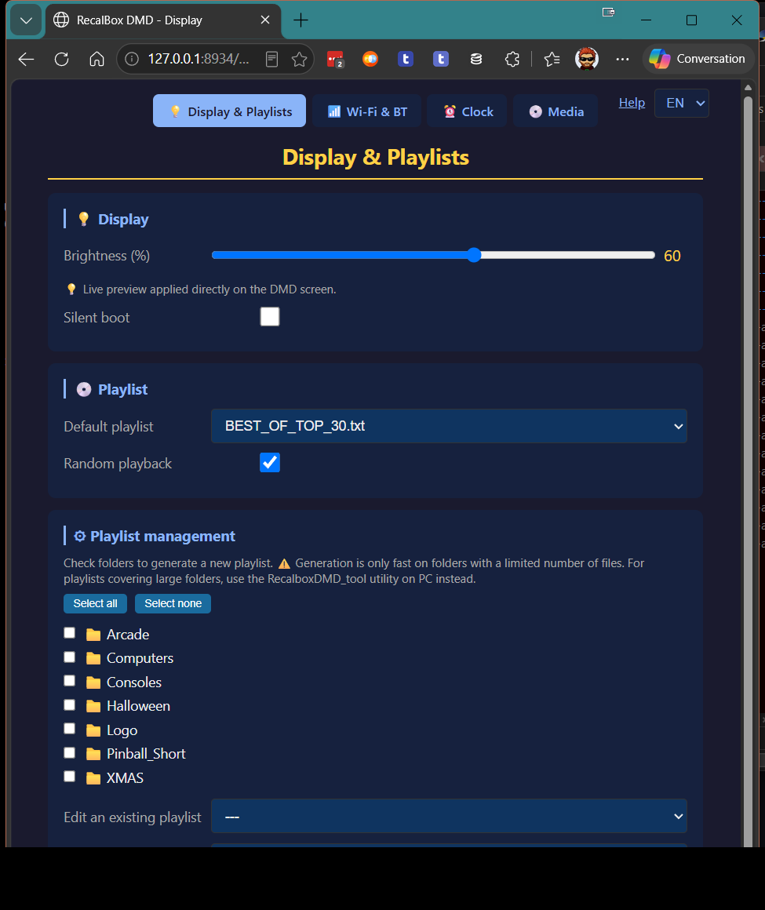
  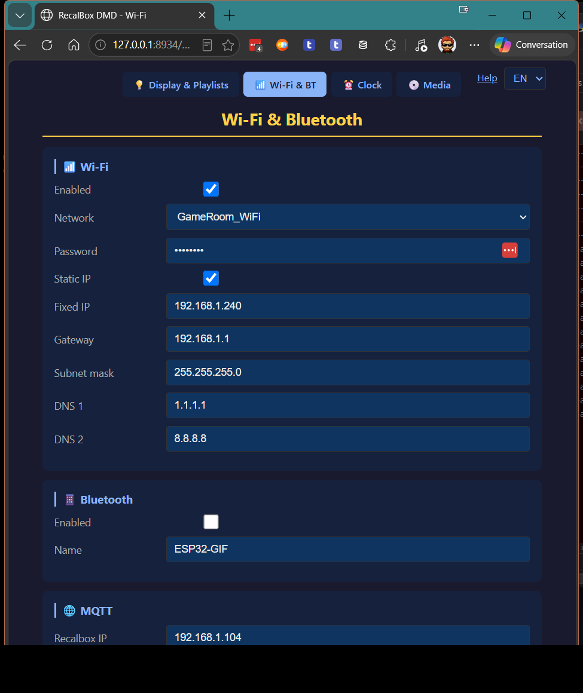
  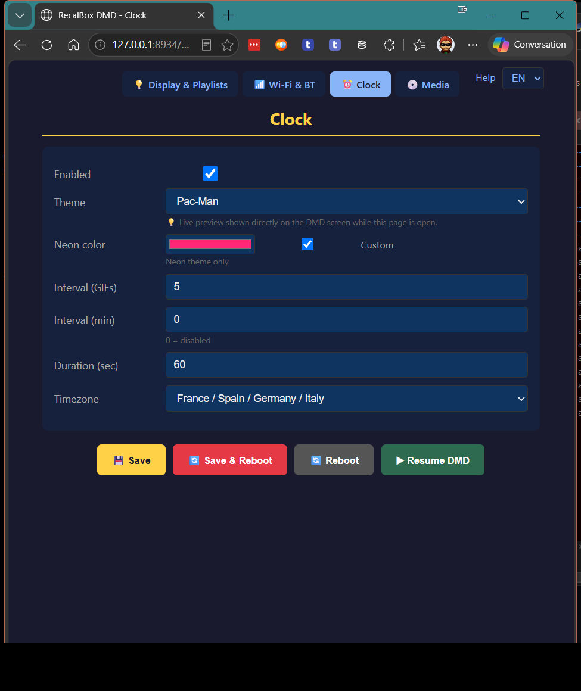
  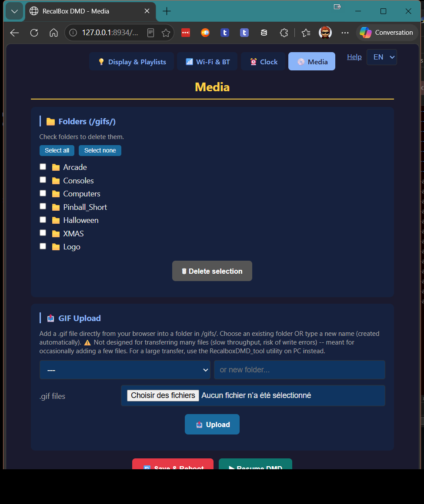
</p>

### Las páginas

| Página | Qué se ajusta |
|---|---|
| 🏠 **Inicio** | El menú: un botón por página, **⚙ Ajustes** primero. *Guardar y reiniciar*, *Reanudar DMD* |
| ⚙ **Ajustes** | **Brillo** (vista previa en vivo enviada al panel mientras mueves el control) · arranque silencioso/normal · **Modo Pinball (VPX)** · alertas **RetroAchievements** · **modo Recalbox nativo** · **versión del firmware** + *Actualizar*. El guardado se confirma en la línea 2 del DMD |
| 💡 **Pantalla y Playlists** | Pantallas en juego · **reposo de Recalbox** (seguir el logo del juego durante los salvapantallas « demos / clips », o playlist simple) · **tema de Recalbox** (seguir el tema activo o logos por defecto) · playlist por defecto + aleatorio · **crear / editar / eliminar playlists** a partir de las carpetas de GIF de la SD |
| 📶 **Wi-Fi** | Escaneo y elección de red, contraseña, IP estática (puerta de enlace / máscara / DNS) · **IP de las Recalbox** (hasta 4, separadas por comas) + **Recalbox objetivo** (*Automático* o 1-4); se muestra la Recalbox activa |
| ⏰ **Reloj** | Activación, **tema con vista previa instantánea en el panel**, color neón, intervalo (en GIF o minutos), duración, zona horaria |
| ✨ **Widgets y Reloj** | La **mezcla** (estado y duración de cada widget, disparador, orden, fondo *playlist / solo widgets*), ambientes y colores, tema de citas, **Vista previa** de cada widget en el panel |
| 📍 **Lugar** · 📅 **Eventos** | Lugar para cielo / efemérides / tiempo · eventos de la cuenta atrás (anuales o únicos) |
| 💬 **Citas** | Crear, editar, **importar un `.txt`** o eliminar tus temas de citas / quiz |
| 🔘 **Botón** | La acción de cada gesto del botón físico |
| 💿 **Medios** | Explorar / eliminar las carpetas de GIF de la SD, **subir GIF** desde el navegador (unos pocos archivos; en masa, usa la caja de herramientas) |
| 📡 **Diagnóstico** | Inicia / detiene el **modo diagnóstico**: señal, PING a la Recalbox, curvas, guía de lectura, informe de texto — véase [Diagnóstico Wi-Fi / Recalbox](#-diagnóstico-wi-fi--recalbox) |

### Lo más útil de saber

- 🔔 **Un banner arriba en cada página** anuncia un firmware, scripts de Recalbox (→ Modo 9) o una caja de herramientas más recientes. La comprobación la hace **tu navegador**: el DMD no necesita acceso a Internet.
- 👁️ **Vista previa en vivo**: brillo, tema de reloj y widgets se reproducen enseguida en el panel físico.
- 🆘 **Rescate Wi-Fi**: sin red válida, el DMD abre su propio punto de acceso (Pi: **RecalBox-DMD-Config**, 192.168.4.1); el script manual *WiFi Recovery DMD* lo relanza a distancia.
- 🛡️ **Config a prueba de cortes**: escritura atómica (`config.tmp` y luego intercambio), guardado verificado antes de responder *OK*, rechazo de campos Wi-Fi / playlist vacíos.
- 🔗 **Páginas directas**: `/config/widgets`, `/config/button`, `/config/clock`, `/config/network`, `/config/media`, `/config/quotes`…
- 🖧 **Consola Telnet** para diagnóstico: `telnet <ip>` y luego `help`.

<details>
<summary><b>📝 El archivo <code>config.ini</code> (referencia — no hace falta tocarlo a mano)</b></summary>

Lo crea la caja de herramientas (Modo 1) o el propio DMD; después todo se modifica desde la página web. A modo de referencia:

```ini
info=1                        # 0 = sin info al arrancar
brightness=40                 # brillo 0-100 %
playlist=RecalBox_intros.txt  # leída desde /playlist
random=1                      # 0 = en orden, 1 = aleatorio

# Wi-Fi
wifi_enabled=1
wifi_ssid=mi_wifi
wifi_password=mi_contraseña
wifi_static_enabled=1
wifi_static_ip=192.168.1.240
wifi_gateway=192.168.1.1
wifi_subnet=255.255.255.0

# Enlace con Recalbox (UDP)
recalbox_ip=192.168.1.104     # la Recalbox ACTIVA
recalbox_ips=192.168.1.104,192.168.1.105   # hasta 4; cambia a la primera que responda
recalbox_target=0             # 0 = automático, 1..4 = fuerza esa Recalbox

# Pinball (VPX) y reposo de Recalbox
feat_vpinball_dmd=0           # 1 = mesas VPX en vivo (en el próximo reinicio)
feat_demo_follow=1            # 1 = seguir el logo durante el reposo « demos de juegos »
feat_clip_follow=1            # igual para « clips de vídeo »

[CLOCK]
CLOCK_ENABLED=1
CLOCK_THEME=-1                # -1 = aleatorio, 0 = Mario ... 9 = Level 1-1
CLOCK_INTERVAL=5              # número de GIF antes del reloj
CLOCK_DURATION=60             # segundos
TZ=CET-1CEST,M3.5.0,M10.5.0/3

[BUTTON]                      # página /config/button
BTN_ENABLED=1                 # GPIO 21 a GND
BTN_ACT_SHORT=11
BTN_ACT_DOUBLE=6
BTN_ACT_LONG=2
BTN_ACT_VLONG=10

[WIDGETS]                     # página /config/widgets ; WIDGET_MODE_n: 0 off, 1 en lugar del reloj, 2 además
WIDGET_BG=0                   # 0 = playlist de GIF, 1 = solo widgets
WIDGET_TRIGGER=0              # 0 = cada N GIF, 1 = cada N minutos
WIDGET_AMB=8                  # ambiente (1 plasma ... 8 lámpara de lava)
WIDGET_LAT=43.3852
WIDGET_LON=5.7081
WIDGET_PLACE=Casa
WIDGET_MODE_8=2               # 8 desafío, 9 recompensas, 10 salud (Recalbox)
WIDGET_DUR_9=30
```

</details>

---

## 📡 Diagnóstico Wi-Fi / Recalbox

¿Un DMD que va a tirones, pierde la Recalbox o se «cae»? El **modo diagnóstico** (firmware 3.96, demonio Pi 3.70) mide en directo la calidad del Wi-Fi y del enlace con la Recalbox, en el panel y en una página web.

<p align="center">
  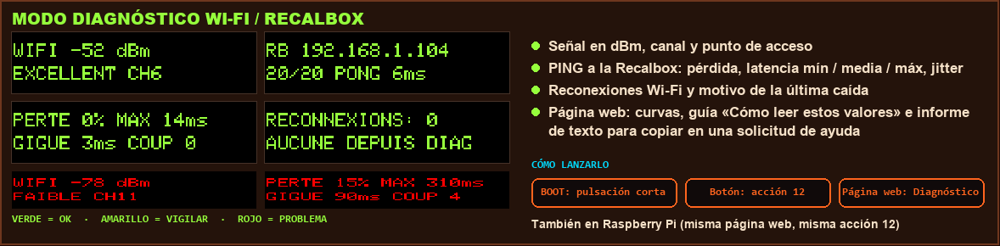
</p>

### Cómo iniciarlo

| Desde | Cómo |
|---|---|
| **Botón BOOT del ESP32** | pulsación corta (sin botón físico que cablear) |
| **Botón físico** (GPIO 21) | acción 12 «Diagnóstico Wi-Fi / Recalbox» de la página *Botón* |
| **Página web** | botón 🩺 **Diagnóstico** del menú de inicio (`/config/diag`) |

Funciona en bucle hasta una nueva pulsación. También se detiene al salir de la página, cambiar de pestaña o cerrar el navegador (8 s sin señal de vida de la página).

### Qué mide

Una vez por segundo, sobre una ventana deslizante de las últimas 20 pruebas:

- la **señal** (dBm) y su calidad, el **canal** y el **punto de acceso** (BSSID);
- un **PING a la Recalbox**: **pérdida**, latencia **mín / media / máx**, **jitter**, antigüedad del último paquete, cortes UDP;
- en el ESP32, las **reconexiones Wi-Fi con el motivo de la última desconexión** y el historial de las 8 últimas conexiones (qué punto de acceso, y cuándo).

### Leer el panel

Cuatro páginas de 4 s, en color (los textos del panel están en francés, abreviados):

| Página | Ejemplo | Color |
|---|---|---|
| Señal | `WIFI -52 dBm` / `EXCELLENT CH6` | verde ≥ −67 dBm · amarillo ≥ −75 · rojo por debajo (Excelente ≥ −55, Buena ≥ −67, Media ≥ −75, Débil ≥ −82) |
| Enlace Recalbox | `RB 192.168.1.104` / `20/20 PONG 6ms` | verde / amarillo / rojo según pérdida y latencia |
| Pérdida y jitter | `PERTE 0% MAX 14ms` / `GIGUE 3ms COUP 0` | verde: 0 % de pérdida y media < 80 ms · amarillo: ≤ 10 % y < 200 ms · rojo más allá |
| Reconexiones | `RECONNEXIONS: 0` / `AUCUNE DEPUIS DIAG` | verde si ninguna, amarillo en caso contrario |

### La página web

Valores en directo, **dos curvas** (señal y latencia), una guía **«Cómo leer estos valores»** (umbrales, causas probables, qué hacer) y un **informe de texto** para copiar o descargar y adjuntar a una solicitud de ayuda.

### Hallazgos típicos

- **Buena señal pero muchas pérdidas**: el problema está más bien en la Recalbox o en la red (router, repetidor, PLC) que en el DMD.
- **Señal débil** (por debajo de unos −75 dBm): acerca el DMD al router.
- **Dos direcciones de punto de acceso que se alternan**: el DMD salta entre puntos de acceso de una red mallada o de un repetidor.

Más detalles en la [FAQ](FAQ.es.md).

### Raspberry Pi

Mismo modo diagnóstico (acción 12 y la misma página web). Sin botón BOOT en la Pi; el historial de reconexiones solo existe **durante un diagnóstico**; en Ethernet el panel muestra «ETHERNET / PAS DE WIFI».

> 🙏 Gracias a **Mighty Jim** por su valiosa ayuda para depurar la herramienta de diagnóstico.

---

## 🧩 Las pantallas en detalle

### 🕰️ Relojes — 10 temas pixel-art + 5 animados

Se muestran entre juegos (intervalo / duración ajustables) o de forma continua, con una **vista previa instantánea en el panel** al elegir uno. Temas pixel-art: Super Mario · Tetris · Pac-Man · Space Invaders · Pong · Neon · Matrix · Fire · Rainbow · Level 1-1 (con desplazamiento). Relojes animados: **Plasma · Life · Stars · Rain · Lava**.

<p align="center">
  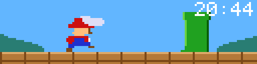 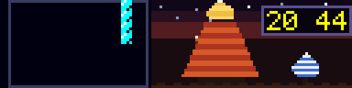
  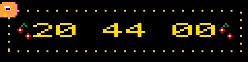 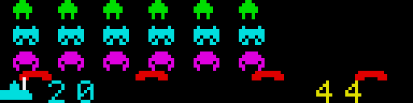
  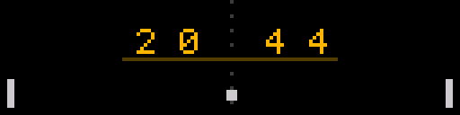<br>
  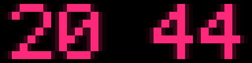 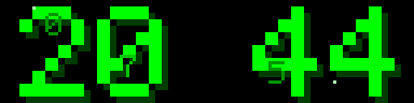
  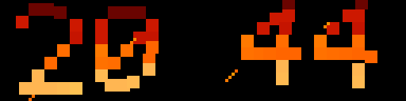 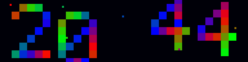
  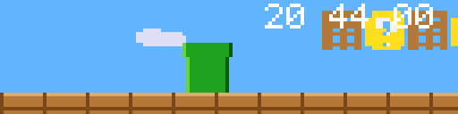<br>
  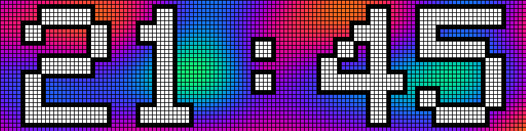 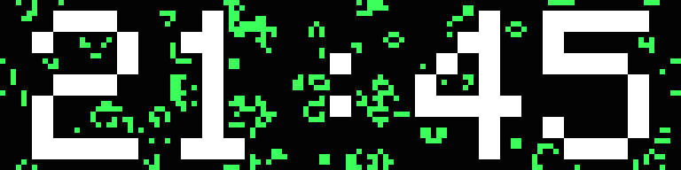
  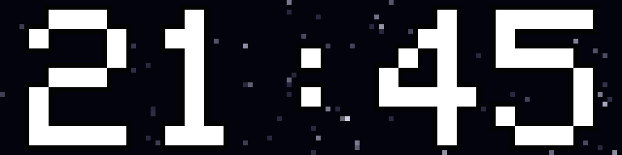 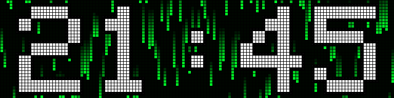
  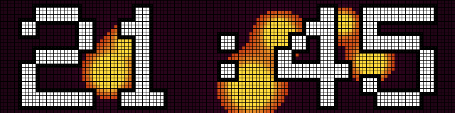
</p>

### 🧩 Los widgets

Página web **Widgets** (`/config/widgets`). Cada uno está **desactivado**, **en lugar del reloj** (alterna con él en la franja principal) o **además** (se reproduce después), con su duración en segundos. **Disparador**: cada N GIF o cada N minutos; franja principal en rotación o aleatoria; extras todos o N al azar. **Fondo**: playlist de GIF o **solo widgets**. Un juego, una página web o un comando recupera la pantalla en cualquier momento; el botón **Vista previa** reproduce un widget al instante.

| Widget | Qué muestra | Necesita |
|---|---|---|
| 🕰️ **Reloj** | 10 temas pixel-art + 5 animados, colores ajustables | — |
| 📅 **Fecha** | tarjeta de calendario con el día de la semana; domingos y festivos en color | hora (NTP) |
| 🌅 **Efemérides** | salida, puesta, duración del día, **fase de la luna** | lugar |
| ⏳ **Cuenta atrás** | días que faltan para tus eventos (10 máx., anual o único) | hora |
| 🌀 **Ambiente** | 8 animaciones: plasma, lluvia, estrellas, juego de la vida, líquido, arena, **arena 2**, **lámpara de lava**; colores ajustables | — |
| 🌦️ **Tiempo** | temperatura, ▲▼ mín/máx, condiciones; los nombres de lugar largos se desplazan | lugar + Internet (open-meteo.com, cada 30 min) |
| 💬 **Citas y quiz** | citas, chistes, adivinanzas, **quiz de 3 opciones**, fondos ilustrados | — |
| 🏆 **Recalbox: desafío** | desafío en curso, días restantes, **top 3 con ▲▼**, tu puesto y tus GG | scripts de Recalbox |
| 🎁 **Recalbox: recompensas** | lo que puedes ganar (avatar, insignia, título) y cómo | scripts de Recalbox |
| 🩺 **Recalbox: salud** | indicadores de temperatura, alimentación, reloj, red, disco, memoria | scripts de Recalbox |

**El cielo** sigue la **salida y puesta de sol reales** de tu lugar y el tiempo en directo (sol, luna, estrellas, nubes, lluvia, nieve, tormenta) detrás de fecha, tiempo, efemérides y cuenta atrás; los tres widgets de Recalbox llevan una **ilustración** de fondo.

<p align="center">
  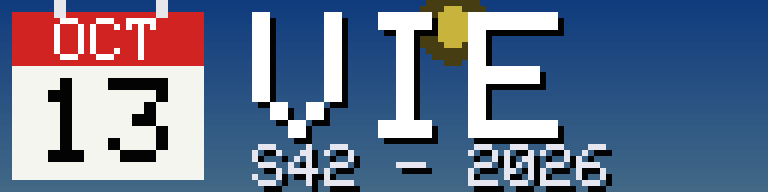 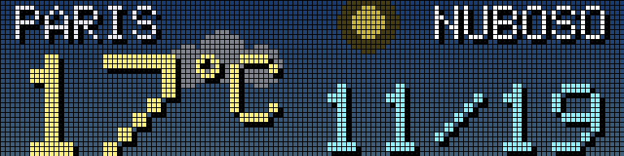 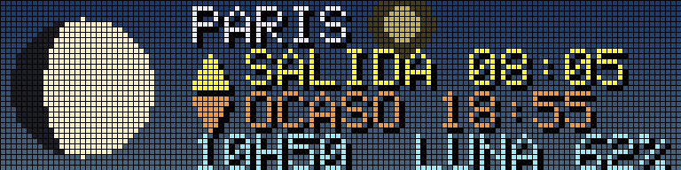 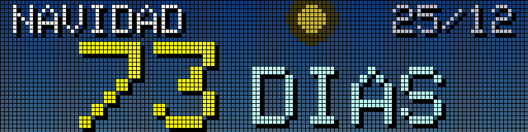 <br>
    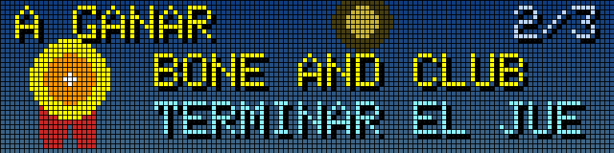 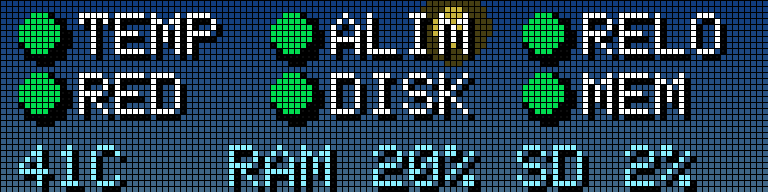 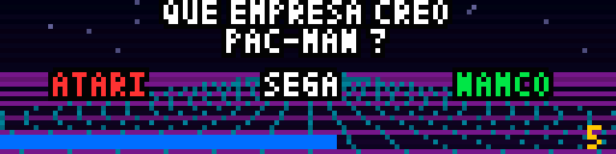<br>
  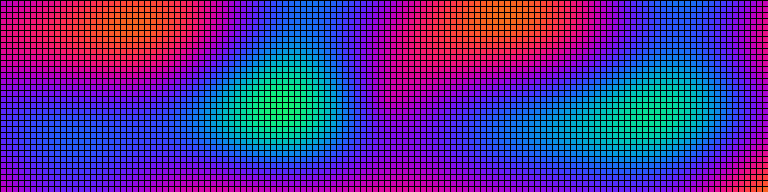 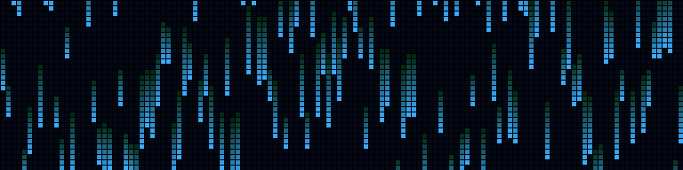 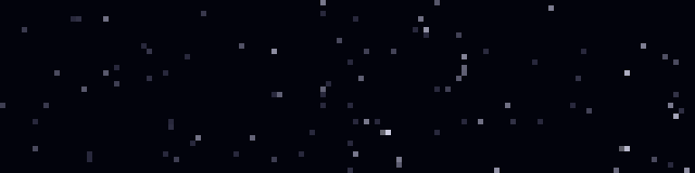 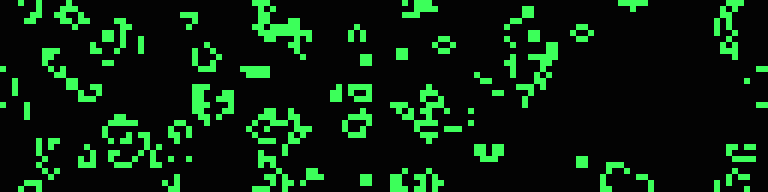 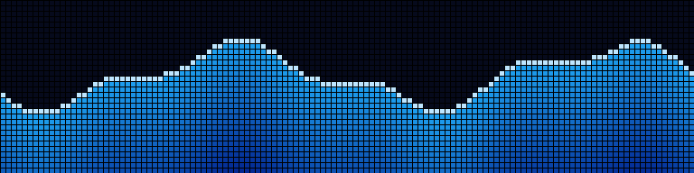   <br>
  <sub>Renders simulados del panel 128×32, dibujados con las propias rutinas del firmware.</sub>
</p>

<details>
<summary><b>💬 Citas y quiz — formato de los archivos, temas, fondos</b></summary>

**Un tema = un archivo de texto, una cita por línea**, cuatro formatos:

| Línea | Lo que muestra el panel |
|---|---|
| `Texto de la galleta` | el texto, centrado y con saltos de línea |
| `Texto \| Autor` | la cita y luego el autor |
| `¿Pregunta? \| Respuesta` | adivinanza / chiste: la respuesta se revela tras una pausa |
| `¿Pregunta? \| A / B / C \| 3` | **quiz de 3 opciones** (rojo / blanco / verde), barra de cuenta atrás, luego la respuesta correcta parpadea y **se queda en pantalla** |

- **Listos para usar**: el **Modo 15** instala 15 temas de 50 entradas (FR/EN/ES) en `widgets/quotes/<idioma>/`; también hay temas integrados por idioma (botón *Restaurar*).
- **Los tuyos**: página *Widgets → Citas* (crear, editar, eliminar, **importar un `.txt`**, 64 KB máx., acentos convertidos) o `.txt` colocados en `/widgets/quotes/<idioma>/`.
- **Fondos ilustrados**: una imagen raw565 128×32 (`/widgets/quotes/bg/<tema>.raw565`, 8 192 bytes) pasa a ser el fondo; un `<tema>.col` opcional ajusta colores, sombra/contorno, brillo y zona de texto. Los fondos originales están **integrados en el firmware**.
- La **duración del widget** es un número de citas reproducidas seguidas.

</details>

<details>
<summary><b>🏆 Widgets de Recalbox · 🔁 Varias Recalbox · 🔘 Botón físico</b></summary>

**Widgets de Recalbox.** Un pequeño script en la Recalbox lee sus propios archivos (desafío, clasificación, movimientos, líneas `[Health]` del registro, temperatura, memoria, disco) y envía un resumen al DMD por UDP (`CMD=rbw`) **cada 2 minutos** (`dmd_rbwidgets[watch](permanent).sh` + `dmd_helpers/dmd_rbwidgets.py`, instalados por el Modo 9). Sin datos recibidos, los widgets se saltan sin ruido. Duraciones por defecto: desafío 15 s, **recompensas 30 s** (8 s mínimo por recompensa, los textos largos se desplazan), salud 15 s.

**Varias Recalbox, un solo DMD.** Indica hasta **4 IP** (página Wi-Fi, o `recalbox_ips=`) y elige **Objetivo = Automático** o una Recalbox impuesta. El DMD se queda en la que responde; cuando se apaga, **sondea las demás y cambia solo**, sin reconfigurar ni reiniciar. Los paquetes de la otra Recalbox listada se ignoran para no mezclar nunca dos consolas. La caja de herramientas (Modos 1 y 9) también acepta varias IP.

**Botón físico.** Un botón entre **GPIO 21 y GND** (pull-up interna). La página **Botón** asocia una acción a cada gesto: **corto**, **doble**, **largo** (~1,5 s), **muy largo** (~5 s) — siguiente GIF, pausa/reanudar, reloj ya, brillo, pantalla apagada, pantalla de info, URL de config, reiniciar… (las acciones de mantenimiento solo en el muy largo).

</details>

### 🎞️ Marquee, imágenes de reserva, tema de Recalbox

- **Marquee por juego o por sistema**, fijo (`.raw565`) o animado (`.raw565pack`). Para un juego sin imagen, **una tarjeta de texto** con su nombre (Modo 18); si no, una **imagen de reserva** — 4 incluidas o la tuya.
- **El DMD sigue el tema activo de Recalbox**: logos de sistemas del tema, en el idioma y la región de tu Recalbox, al vuelo (firmware ≥ 2.38).

<p align="center">
   
   
</p>

---

## 🏆 Pantallas en juego, Recalbox nativo y Pinball

### Pantallas superpuestas en juego

<p align="center">
   
   
</p>

Mientras un juego se ejecuta de verdad (nunca en reposo / playlist), el panel alterna el marquee con hasta **cuatro** pantallas — a pantalla completa, sin bloqueo y **autolimitadas**: cada una vuelve al marquee con un temporizador que vive **íntegramente en el DMD**, para que un script lento o fallido nunca lo bloquee.

- 🏆 **Hi-Score (MAME / FBNeo)** — decodifica el archivo de puntuaciones del propio emulador (`.hi`) mediante un manifiesto comunitario convertido de **hi2txt-xml** (4 087 juegos). Sin lectura de RAM, sin receta por juego: si un juego no está cubierto o su archivo falta, **no se muestra nada — nunca una puntuación errónea**.
- ℹ️ **Info del juego** — descripción, género, desarrollador, año, tomados de tu `gamelist.xml`.
- 🎖️ **RetroAchievements** — aparece en cuanto se desbloquea un logro.
- 📅 **Desafío RB** — la clasificación oficial del Desafío mensual de Recalbox, leída del recurso compartido de Recalbox.

**Cero configuración en el DMD**: instala los scripts (Modo 9) y todo funciona para cada juego que tenga datos.

### 🎮 Modo DMD nativo de Recalbox

Con Recalbox 11, **EmulationStation puede manejar directamente el panel**, que se comporta entonces como un **ZeDMD-WiFi**. Activa *modo Recalbox nativo* en **Ajustes**. Cuando la Recalbox se apaga o deja de responder, el DMD vuelve solo a su lista de reproducción.

> **Actualizar el firmware en modo nativo**: con un firmware **3.84 o anterior**, la actualización desde la página web falla (`echec:heure`: la hora no se sincroniza en este modo). Desmarca *modo Recalbox nativo*, **Guardar y reiniciar**, lanza la actualización y vuelve a marcarlo. Desde la 3.85, no hay que hacer nada.

### 🎯 Mesas de Visual Pinball (VPX)

El DMD habla el protocolo **ZeDMD-WiFi** (apretón de manos HTTP y luego imágenes por **UDP puerto 3333**) del plugin **DMDUtil** de Visual Pinball: lanza una mesa desde Recalbox y el DMD muestra en vivo la imagen DMD de la mesa. *Sin reinicio*; playlist y pantallas de Recalbox suspendidas durante la mesa; vuelta a la normalidad al terminar la partida (los scripts avisan al DMD) o ~5 s tras la última imagen; brillo restaurado. Los DMD grandes (p. ej. 192×64) se reducen a 128×32, las mesas coloreadas se muestran en color.

**Puesta en marcha (una sola vez)** — marcado por defecto desde el firmware 3.58:

1. **En el DMD**: *Modo Pinball (VPX)* marcado en **Ajustes**, luego *Guardar y reiniciar*.
2. **En la Recalbox** — `/recalbox/share/system/configs/vpinball/VPinballX-configgen.ini`:
   ```ini
   [Plugin.DMDUtil]
   Enable = 1
   ZeDMDWiFiEnabled = 1
   ZeDMDWiFiAddr = 192.168.1.240
   ```
   (`192.168.1.240` = **la IP de este DMD**; sin comentario al final de la línea.) **Automático con el Modo 9**: el script `dmd_vpx_config` (v4) escribe lo que falte en cada arranque, antes de cada lanzamiento y tras cada partida — nunca mientras corre una mesa. La dirección es la de la opción ZeDMD de Recalbox (`dmd.zedmd.wifi`) o, si no, la del DMD que responde (una dirección caducada se corrige); también vuelve a poner la opción « DMD externo » en ZeDMD antes de cada lanzamiento (Recalbox la borra si no), sin tocar otra pantalla que hayas elegido. **Marcar la opción es lo que lo autoriza**; para desactivarlo definitivamente, crea `/recalbox/share/userscripts/dmd_helpers/vpx_autoconfig.disabled` (registro: `/recalbox/share/system/logs/dmd_vpx_config.log`).
3. **Scripts de Recalbox** (Modo 9): el DMD sale del modo Pinball al instante al terminar una partida.

> ⚠️ Modifica este `.ini` **solo cuando no corra ninguna mesa**: VPX lo reescribe al cerrarse. Una actualización de Recalbox también puede reiniciarlo. Comprobación: `vpinball.log` debe contener `ZeDMD WiFi enabled, connected to <IP>`.

**Según la mesa**: *mesas con display alfanumérico* (Bally/Williams) → plugin **AlphaDMD** (`[Plugin.AlphaDMD]` → `Enable = 1`); *mesas coloreadas Serum* → `[Plugin.Serum]` / `SerumPath = <carpeta de la mesa>/altcolor` en el `.ini` de la mesa (si no, `Serum: No colorization file found`).

**Compatibilidad**: probado en mesas DMD 128×32 (Batman), Big Bang Bar (192×64), 6 mesas alfanuméricas de 8 (Black Hole y Farfalla no las gestiona AlphaDMD) y una mesa coloreada (Diner). Nada que mostrar en las mesas electromecánicas ni en las que usan PinUP Player (p. ej. Batman 66). **Probado solo con Recalbox**; un Visual Pinball Standalone con los mismos ajustes `ZeDMDWiFi*` debería funcionar (sin probar).

---

## 🎞️ El pack de 600 GIFs

El **Modo 11** (o el botón *Pack 600 GIFs* de la pestaña Playlist) descarga ~**600 GIF retro** de este repositorio (`carte SD/gifs/`) — sin sitio externo, sin cuenta:

| | | |
|---|---|---|
| Arcade | Consolas | Ordenadores |
| Pinball (corto) | Pinball (historia) | Logo |
| Halloween | Navidad | Otros / prueba |

Apunta una playlist a cualquier subconjunto (pestaña Playlist). Los GIF animados siguen el mismo camino rápido `.raw565pack` que los marquees: reproducción fluida incluso en el ESP32.

> ℹ️ Una categoría (`XXX_Mature`) contiene pixel-art de temática adulta, totalmente opcional, nunca seleccionada por defecto.

**¿De dónde viene este pack?** Es la **muestra gratuita** de la colección « pixel perfect » de **eLLuiGi** ([RpiTeaM](https://rpiteam.carrd.co/)), redistribuida con permiso. La colección completa — el **« ULTIMATE GIFS DLC »**, ~11 000 animaciones (1 441 Arcade, 3 601 Consolas, 849 Ordenadores…) — es el pack de pago del creador: [rpiteam.carrd.co](https://rpiteam.carrd.co/) · [hilo del foro](https://www.neo-arcadia.com/forum/viewtopic.php?t=67065).

📖 **Tutorial paso a paso, con capturas**: [instalar el pack ULTIMATE GIFS DLC en la tarjeta del DMD](docs/tutorials/ultimate-gif-pack.es.md).

> ✅ Añade siempre los GIF con la **pestaña Playlist** de la caja de herramientas o la página **Medios** de la config web — **nunca copiando directamente en la SD**: eso es lo que reconstruye la playlist y la caché que lee el firmware.

---

## 📚 Tutoriales paso a paso

| Tutorial | Qué obtienes |
|---|---|
| [Marquees animados](docs/tutorials/animated-marquees.es.md) | DMD GIF Creator + la caja de herramientas: una tarjeta SD con marquees animados (`.raw565pack`) para los juegos que elijas |
| [Instalar el pack ULTIMATE GIFS DLC](docs/tutorials/ultimate-gif-pack.es.md) | ~11 000 GIF de eLLuiGi / RpiTeaM en la tarjeta del DMD, con playlists y caché coherentes |

Cada tutorial está disponible en 🇬🇧 🇫🇷 🇪🇸, con capturas de pantalla reales.

---

## 🔬 Referencia técnica

<details>
<summary><b>El formato raw565 · la caché de bigramas · el sistema de máscara</b></summary>

**`.raw565`** — imagen fija: `128 × 32 × 2 = 8 192 bytes` de RGB565 en bruto, leída en una operación SD y enviada directamente. **`.raw565pack` + `.meta`** — imagen animada: fotogramas concatenados + retardos por fotograma (`uint16`, ms) cargados una vez en RAM; una apertura SD + un seek por fotograma, **cero decodificación GIF en el dispositivo**.

**Caché de bigramas** (`games_cache.bin`) — índice de 703 entradas por sistema (una por prefijo de 2 letras, p. ej. `KO` para `kof98`): nunca se lista una carpeta de decenas de miles de archivos.

**Sistema de máscara** — un sistema marcado **« L »** (por encima del umbral, 5 000 archivos por defecto — MAME, FBNeo…) muestra *inmediatamente* su imagen por defecto mientras una tarea en segundo plano localiza y decodifica la real: el panel **nunca se queda en negro**.

</details>

<details>
<summary><b>La estructura de la tarjeta SD</b></summary>

```
📁 TARJETA SD (FAT32)
├── config.ini
├── systems/
│   ├── <sistema>/
│   │   ├── <juego>.raw565           ← marquee fijo
│   │   ├── <juego>.raw565pack       ← marquee animado (fotogramas)
│   │   └── <juego>.meta             ← marquee animado (tiempos)
│   └── _defaults/
│       ├── default.raw565           ← reserva global
│       └── <sistema>.raw565         ← reserva por sistema (idioma elegido)
├── gifs/                            ← playlists de reposo (el pack de 600 GIF aterriza aquí)
│   ├── Arcade/  Consoles/  Computers/  Pinball_Short/  Pinball_Story/
│   └── Halloween/  XMAS/  Logo/  Other/ ...
├── widgets/
│   └── quotes/
│       ├── <fr|en|es>/<tema>.txt        ← temas de citas / quiz
│       └── bg/<tema>.raw565 (+ .col)    ← fondos ilustrados
├── playlists/<nombre_playlist>.txt
├── games_cache.bin                  ← índice de bigramas
└── systems_cache.dat                ← índice de sistemas + flags L/N
```

En una Raspberry Pi, este contenido vive en la partición de medios `RBPIDMD`.

</details>

<details>
<summary><b>El enlace UDP, paso a paso</b></summary>

```
Recalbox → marquee[rungame,endgame,...].sh → UDP → DMD → panel LED

1. Lanzas "King of Fighters '98"
2. El script detecta el evento y publica "mame/kof98"
3. El DMD busca, por orden:
   a. /systems/mame/kof98.raw565 (o .raw565pack)   ← instantáneo
   b. índice de bigramas de games_cache.bin         ← acelerado
   c. /systems/_defaults/mame.raw565                ← reserva del sistema
   d. /systems/_defaults/default.raw565             ← reserva global
4. Mostrado en menos de 15 ms
```

</details>

<details>
<summary><b>La estructura del repositorio</b></summary>

```
binaries/        ← imágenes de firmware ESP32 precompiladas (bootloader / particiones / app / fusionada)
raspberry-pi/    ← el demonio de la Raspberry Pi (C++17, GPL-2.0+) y sus guías
tools/           ← caja de herramientas PC (GUI Python FR/EN/ES), scripts de Recalbox, paquete de temas, hi-score
carte SD/        ← contenido de tarjeta SD listo para copiar (GIF, imágenes por defecto, widgets, playlists)
medias/          ← capturas, GIF de demostración, láminas, kit de prensa
docs/            ← GitHub Pages: página de presentación (shan-aya.github.io/RecalBoxDMD) + instalador web (…/install/)
history/         ← versiones archivadas
```

</details>

---

## 🩺 Solución de problemas

Congelaciones, pantalla corrupta, bucles Wi-Fi, DMD desincronizado de Recalbox: consulta primero las **[FAQ y solución de problemas](FAQ.es.md)** (alimentación USB, calidad de la microSD, revisión del chip ESP32…).

| Problema | Solución |
|---|---|
| « Pillow no está instalado » | Se instala en el primer arranque; si no, `pip install Pillow` |
| « API de GitHub inaccesible » | Las descargas requieren Internet; reintenta más tarde (posible límite de tasa) |
| Ninguna unidad extraíble detectada | Comprueba que la tarjeta SD sea visible en el Explorador de Windows (FAT32, ≥ 8 GB) |
| El ESP32 no muestra nada | Alimentación (5 V 4 A mín.), `config.ini` en la raíz de la SD, cableado HUB75; prueba el Telnet `help` |
| ESP32 no detectado (sin puerto COM) | Controladores USB: [CP2102](https://www.silabs.com/developers/usb-to-uart-bridge-vcp-drivers) o [CH340/CH341](https://learn.sparkfun.com/tutorials/how-to-install-ch340-drivers/all) |
| El Pi parpadea | Ajusta `gpio_slowdown=1..4` en `config.ini`; ver [RASPBERRY-PI.es.md](RASPBERRY-PI.es.md) |
| Pantalla lenta / negra entre juegos | ¿Has lanzado el **Modo 1**? ¿El sistema está marcado `L` en `systems_cache.dat`? Sube el umbral si tu SD es rápida |
| Imagen equivocada (carátula en vez de logo) | Revisa el perfil de **versión de Recalbox**, usa **« ¿Cómo hacer scraping? »** y luego el **Modo 8** |
| No aparece nada al iniciar un juego | Scripts ausentes o antiguos → **Modo 9**, luego reinicia EmulationStation; revisa la IP de la Recalbox en la página web |
| Menú *Scripts de usuario* en gris | Reinicia EmulationStation (o la Recalbox) |
| Wi-Fi inestable, pérdidas, juegos que no siempre se muestran | Lanza el **diagnóstico** (pulsación corta de BOOT, o la página *Diagnóstico*) y lee [Diagnóstico Wi-Fi / Recalbox](#-diagnóstico-wi-fi--recalbox) |

¿Sigues atascado? Copia la pestaña **Logs** y el número de **build**, y abre una incidencia en la [página de GitHub](https://github.com/shan-aya/RecalBoxDMD).

---

## 🙏 Créditos y licencia

- **Proyecto original RetroBoxLED**: [Jamyz](https://github.com/Jamyz/RetroBoxLED) — la base del firmware ESP32 y la idea original
- **RawEdition**: **Shan_ayA** — formato raw565, caché de bigramas, sistema de máscara, caja de herramientas PC, temas de reloj, widgets, versión Raspberry Pi
- **Inspiración**: [RetroPixelLED](https://github.com/fjgordillo86/RetroPixelLED) de fjgordillo86 · **Pantalla del Pi**: [rpi-rgb-led-matrix](https://github.com/hzeller/rpi-rgb-led-matrix) de Henner Zeller
- **Pack de 600 GIF**: **eLLuiGi** / [RpiTeaM](https://rpiteam.carrd.co/)
- **Manifiesto Hi-Score**: convertido del formato comunitario **hi2txt-xml** (proyecto `hiscore.dat` de MAME) — 4 087 juegos
- **Hardware y montaje**: [Mortaca — DMDos Board](https://www.mortaca.com/) / [dmdos.net](https://www.dmdos.net/) · tienda francesa: [Benfactory.fr](https://benfactory.fr/produit/dmdos/) (código `retrobat10`)
- **Caja 3D**: Janibol — [Retromojones](https://www.youtube.com/@retromojones)
- **Comunidad**: [Recalbox](https://www.recalbox.com/)
- **Agradecimientos**: **Mighty Jim** por su ayuda para depurar la herramienta de diagnóstico · **Dodoche3826** por su apoyo — «gracias por el bol de café ^^»
- **Desarrollo**: escrito con la ayuda de [Claude](https://www.anthropic.com/claude) (Anthropic) — código asistido por IA en todo el firmware y la caja de herramientas PC

📜 [CHANGELOG](CHANGELOG.es.md) · [FAQ](FAQ.es.md) · [UPGRADING](UPGRADING.es.md) · [QUICK-START](QUICK-START.es.md) · [Raspberry Pi](RASPBERRY-PI.es.md) — bajo licencia [MIT](LICENSE) (el demonio de la Raspberry Pi: GPL-2.0+).

🔔 **Recibe aviso de las nuevas versiones**: *Watch → Custom → Releases* en GitHub, o el [feed de releases](https://github.com/shan-aya/RecalBoxDMD/releases.atom). La caja de herramientas y la config web también te avisan, y el [instalador web](https://shan-aya.github.io/RecalBoxDMD/install/) muestra la versión del firmware que instala.

☕ Si este proyecto te resulta útil: [invítame a un café](https://buymeacoffee.com/shan_aya) o [haz una donación por PayPal](https://www.paypal.com/paypalme/felysaya)

<p align="center"><i>RecalBoxDMD RawEdition — Recalbox + un verdadero panel LED marquee, instantáneo incluso con 30 000 juegos MAME.</i> 🎮⚡</p>
