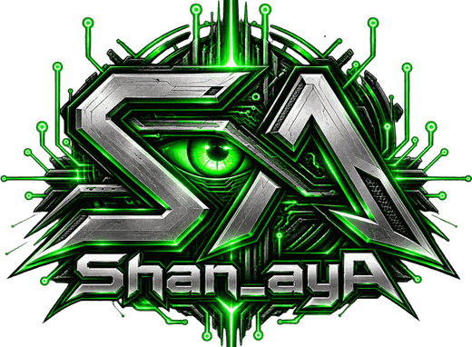

<h1 align="center">RecalBoxDMD — RawEdition</h1>

  <b>Un verdadero marquee LED para tu mueble arcade Recalbox. El logo de cada juego se enciende en 15 ms — incluso con un fullset MAME de 30 000 juegos.</b>

  
  
  
  
  
  
  
  
  

  <a href="README.md">🇬🇧 English</a> · <a href="README.fr.md">🇫🇷 Français</a> · 🇪🇸 <b>Español</b>

> ## 🧪 Rama ALPHA — versiones de prueba
> Esta rama contiene las versiones **alfa** (firmware, demonio Raspberry Pi, caja de herramientas PC) para los **probadores de la Recalbox alfa**. Las funciones pueden estar incompletas o cambiar sin aviso. **No las instale en una Recalbox estable.** El manual de usuario completo está en la [rama estable](https://github.com/shan-aya/RecalBoxDMD/blob/main/README.es.md).

## 🔭 Novedades que hay que probar

- 📟 **Firmware ESP32**
  - **Orden de colores** del panel (6 órdenes) con una **vista previa R, G, B en directo** en el DMD — T01, **página Ajustes** reorganizada — T03
  - **Cambio de canal** alfa ↔ estable — T04, avisos de actualización limitados al canal alfa — T06
  - **GIF del juego durante la partida** (opción *Basic*, `/gifs_jeux`, exclusiones) — T10
  - Páginas web que vuelven solas tras una actualización — T07, **ajustes que sobreviven a los reinicios** (`config.ini` protegido) — T08, **cambio de Wi-Fi** — T09
- 🍓 **Demonio Raspberry Pi**
  - Orden de colores con vista previa en directo — T02, **nombres de archivo con acentos** (partición de medios en UTF-8) — T18, página Ajustes — T03, cambio de canal — T05, botón de actualización que se queda en alfa — T16
  - GIF del juego y **Playlist por Wi-Fi** — T10, T12
- 🧰 **Caja de herramientas PC**
  - **Personalización de logos** — T11, **etiqueta de destino** y Playlist por Wi-Fi — T12
  - Pestaña **Instalación** — T13, **Formatear en FAT32** — T14
  - **Avisos de compatibilidad** (insignia ⚠) — T15, temas de Recalbox (Modos 12 / 13) — T17, **Modo 17 y Modo 1 en una tarjeta Pi** — T19

## 🙋 Participar en las pruebas alfa

1. Únase al Discord: https://discord.gg/CYAyGJSvp4
2. Pulse el botón 🧪 del mensaje alfa (o escriba `/alpha`) para obtener el rol **Tester**: abre `#support-alpha` y `#alpha-tests`.
3. Instale la alfa: https://shan-aya.github.io/RecalBoxDMD/install-alpha/ (o cambie de canal en la página web *Ajustes*).
4. Elija pruebas en `#alpha-tests` (o en la tabla de abajo), hágalas y avise con `/alphatest`.

## 📮 Informar de un resultado (en Discord)

- Escriba **`/alphatest`** en cualquier canal y rellene: **prueba** (T01…), **resultado** (✅ funciona · ⚠️ funciona con un fallo · ❌ no funciona · ⏭️ no se puede probar), **dispositivo**, un **comentario** (obligatorio salvo ✅: versiones, qué hizo, qué ocurrió) y una **captura / registro** opcional.
- El bot publica su resultado en el post de la prueba de `#alpha-tests` y lo cuenta: **`/alphaprogress`** muestra lo que ha hecho.
- Un fallo que va más allá de una prueba: abra un post en `#support-alpha` con las versiones (firmware / Pi / toolkit / Recalbox), pasos, esperado y observado (un registro `/diag` ayuda).

## ✅ Plan de pruebas

Detalle de cada prueba (pasos y resultado esperado): [ALPHA-TESTS.es.md](ALPHA-TESTS.es.md).

| Prueba | Zona | Qué |
|---|---|---|
| **T01** | ESP32 | Orden de colores del panel y vista previa en directo (ESP32) |
| **T02** | Raspberry Pi | Orden de colores del panel y vista previa en directo (Raspberry Pi) |
| **T03** | ESP32 / Pi / Toolkit | Diseño de la página Ajustes |
| **T04** | ESP32 | Cambio de canal alfa ↔ estable (ESP32) |
| **T05** | Raspberry Pi | Cambio de canal alfa ↔ estable (Raspberry Pi) |
| **T06** | ESP32 / Pi / Toolkit | Los avisos de actualización se quedan en el canal alfa |
| **T07** | ESP32 | Las páginas web vuelven tras actualizar el firmware |
| **T08** | ESP32 | Los ajustes sobreviven a los reinicios |
| **T09** | ESP32 | Cambiar la red Wi-Fi |
| **T10** | ESP32 / Pi / Toolkit | GIF del juego durante la partida |
| **T11** | Toolkit | Personalización de logos |
| **T12** | Toolkit | Etiqueta de destino y Playlist por Wi-Fi |
| **T13** | Toolkit | Pestaña Instalación (Modo 1) |
| **T14** | Toolkit | Formatear una tarjeta SD en FAT32 |
| **T15** | Toolkit | Avisos de compatibilidad (insignia ⚠) en el toolkit |
| **T16** | Raspberry Pi | El botón de actualización de la Pi se queda en alfa |
| **T17** | Toolkit | Temas de Recalbox (Modos 12 / 13) |
| **T18** | Raspberry Pi | Nombres de archivo con acentos (partición de medios en UTF-8) |
| **T19** | Toolkit | Modo 17 y Modo 1 en una tarjeta Raspberry Pi |

## ⚠️ Conviene saber

- Espere **60 segundos** de funcionamiento normal entre dos cambios de canal o actualizaciones (una actualización que no ha funcionado 60 s es revertida por el gestor de arranque).
- T14 **borra** la tarjeta SD: use una tarjeta de repuesto.
- Las versiones alfa pueden cambiar varias veces al día; los números están en las insignias de arriba y en el [CHANGELOG](CHANGELOG.es.md).

## 📚 Documentos de esta rama

[ALPHA-TESTS](ALPHA-TESTS.es.md) (plan de pruebas) · [CHANGELOG](CHANGELOG.es.md) (qué cambia) · [CHANNELS](CHANNELS.md) (estable o alfa) · [QUICK-START](QUICK-START.es.md) · [UPGRADING](UPGRADING.es.md) · [FAQ](FAQ.es.md) · [RASPBERRY-PI](RASPBERRY-PI.es.md) · manual completo: [README estable](https://github.com/shan-aya/RecalBoxDMD/blob/main/README.es.md)
