<p align="center"></p>

<h1 align="center">RecalBoxDMD — RawEdition</h1>

<p align="center">
  <b>Un vrai panneau marquee LED pour votre borne d'arcade Recalbox.<br>Le logo de chaque jeu s'allume en 15 ms — même avec 30 000 jeux MAME.</b>
</p>

<p align="center">
  
  
  <a href="LICENSE"></a>
  
  
  
  
  <a href="https://buymeacoffee.com/shan_aya"></a>
</p>

<p align="center">
  <a href="README.md">🇬🇧 English</a> · 🇫🇷 <b>Français</b> · <a href="README.es.md">🇪🇸 Español</a>
</p>

<p align="center">
  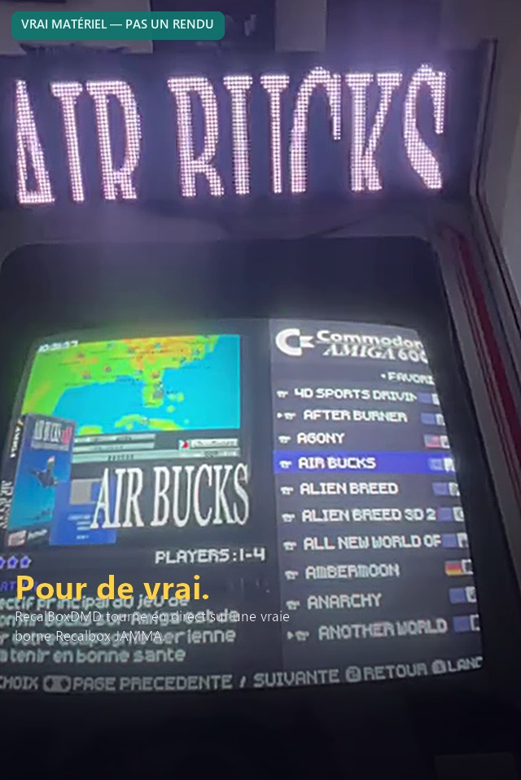
</p>

<p align="center">
  <a href="#-démarrer-en-5-minutes"><b>🚀 Démarrer</b></a> &nbsp;·&nbsp;
  <a href="#-installation-esp32"><b>🔌 Installer sur ESP32</b></a> &nbsp;·&nbsp;
  <a href="#-installation-raspberry-pi"><b>🥧 Installer sur Raspberry Pi</b></a> &nbsp;·&nbsp;
  <a href="#-la-boîte-à-outils-pc--le-centre-de-linstallation"><b>🧰 Boîte à outils</b></a> &nbsp;·&nbsp;
  <a href="#-la-configuration-web"><b>🌐 Config web</b></a> &nbsp;·&nbsp;
  <a href="https://shan-aya.github.io/RecalBoxDMD/"><b>✨ Page interactive</b></a>
</p>

<p align="center">
  <br>
  <sub>📹 Vraies images, pas un montage — le marquee suit la navigation en direct · <a href="medias/dmd_in_action.mp4">clip complet (MP4)</a></sub>
</p>

<p align="center">
  <a href="https://youtu.be/xF8O88XXSwU"></a><br>
  <sub>🎬 <b>La vidéo</b> — présentation, montage et installation, par Jamyz Gaming · <a href="https://youtu.be/xF8O88XXSwU">YouTube</a></sub>
</p>

> 🔄 **Vous aviez déjà une version antérieure ?** Lisez **[UPGRADING.fr.md](UPGRADING.fr.md)** (ce qui change, une seule étape optionnelle) et le **[CHANGELOG](CHANGELOG.fr.md)**.

---

## 📑 Sommaire

| | |
|---|---|
| **Comprendre** | [C'est quoi ?](#-cest-quoi-) · [Ce que vous pouvez afficher](#-ce-que-vous-pouvez-afficher) · [Comment ça marche](#-comment-ça-marche) |
| **Installer** | [Démarrer en 5 minutes](#-démarrer-en-5-minutes) · [Volet ESP32](#-installation-esp32) · [Volet Raspberry Pi](#-installation-raspberry-pi) · [Scripts Recalbox](#-les-scripts-recalbox-mode-9) |
| **Piloter** | [Boîte à outils PC — tous les modes](#-la-boîte-à-outils-pc--le-centre-de-linstallation) · [Configuration web](#-la-configuration-web) |
| **Explorer** | [Les écrans en détail](#-les-écrans-en-détail) · [Écrans en jeu & Pinball](#-écrans-en-jeu-recalbox-natif--pinball) · [Pack de 600 GIFs](#-le-pack-de-600-gifs) · [Diagnostic](#-diagnostic-wi-fi--recalbox) · [Tutoriels](#-tutoriels-pas-à-pas) |
| **Référence** | [Référence technique](#-référence-technique) · [Dépannage](#-dépannage) · [Crédits & licence](#-crédits--licence) |

---

## 🎮 C'est quoi ?

**RecalBoxDMD** transforme un **panneau LED 128×32** (deux modules HUB75 64×32 chaînés) en un vrai marquee pour votre borne **Recalbox**. Lancez un jeu : son logo s'allume en quelques millisecondes. Le reste du temps, le panneau joue vos GIF, affiche l'heure, la météo, un quiz, le classement du challenge Recalbox…

C'est un fork de [RetroBoxLED de Jamyz](https://github.com/Jamyz/RetroBoxLED), reconstruit autour d'un format pixel maison, le **raw565**, et d'une **boîte à outils PC** qui prépare toute la carte SD. Il règle un problème précis : sur les grosses collections (fullset MAME, FBNeo…), l'original en PNG/GIF gelait ou affichait un écran noir plusieurs secondes entre deux jeux.

|                            | PNG/GIF d'origine     | **RecalBoxDMD RawEdition**        |
|----------------------------|------------------------|-----------------------------------|
| Temps d'affichage par jeu  | 500 ms – 3 s+          | **5 – 15 ms**                     |
| RAM nécessaire (ESP32)     | 50 – 100 Ko            | **8 Ko**                          |
| Fullset MAME (30 000 jeux) | freeze 5-10 s          | **aucun freeze, aucun écran noir**|
| Mise en place              | manuelle, image par image | **boîte à outils PC, un clic** |

### Deux versions, un même DMD

| | 🔌 **ESP32** | 🥧 **Raspberry Pi** |
|---|---|---|
| Cerveau | ESP32 DevKit V1 + carte DMDos | Raspberry Pi 3B (validé) + carte d'interface HUB75 |
| Dalles | 2 × P4 64×32 | 2 × P5 64×32 |
| Installation | Flash du firmware (navigateur) + carte SD | Carte SD **vierge** préparée en une fois par la boîte à outils |
| Mises à jour | Wi-Fi (Mode 14 ou page web) | Wi-Fi (Mode 17 ou page web) |
| Scripts Recalbox, pages web, widgets, thèmes | **identiques** | **identiques** |

> ### 🚀 L'essentiel
> Pointez la **boîte à outils PC** vers votre dossier ROMs et cliquez sur **Démarrer** (**Mode 1 — AUTO**). Elle enchaîne tout, toute seule — détection de la version Recalbox, conversion raw565, caches, images par défaut, scripts Recalbox — jusqu'à une carte SD prête à l'emploi. **Insérez-la dans le DMD, allumez : c'est terminé.** Aucune configuration fichier par fichier, jamais.

---

## 🖼️ Ce que vous pouvez afficher

Le panneau mélange **deux univers**, à doser comme vous voulez depuis la page web *Widgets* :

<table>
<tr>
<td width="50%" valign="top">

### 🎬 La playlist & le marquee
- ⚡ **Marquee du jeu en direct** — fixe ou animé, par jeu ou par système, images de repli (4 fournies, ou la vôtre).
- 🎞️ **~600 GIF rétro gratuits** + onglet *Playlist* pour composer vos rotations d'attente.
- 🏆 **Écrans en jeu** — Hi-Score, Infos du jeu, RetroAchievements, Challenge Recalbox.
- 🎨 **Le DMD suit votre thème Recalbox** — logos de systèmes selon le thème, la langue et la région, à la volée.
- 🎯 **Pinball** — les tables Visual Pinball affichent leur DMD.
- 🎮 **Mode natif Recalbox** — EmulationStation pilote directement le panneau.

</td>
<td width="50%" valign="top">

### 🧩 Les widgets
Des écrans vivants, dessinés sur un **ciel qui suit le vrai soleil et la météo de votre lieu**.
- 🕰️ **15 horloges** — 10 thèmes pixel-art + 5 animées
- 📅 Date · 🌅 Éphéméride · ⏳ Compte à rebours
- 🌦️ Météo · 🌀 8 ambiances
- 💬 Citations & quiz
- 🏆 **3 widgets Recalbox** — challenge, récompenses, santé

Chaque widget : **désactivé**, **à la place de l'horloge** ou **en plus**, avec sa durée. Tous les N GIF ou toutes les N minutes — ou **widgets seuls**, une horloge de bureau vivante.

</td>
</tr>
</table>

<p align="center">
  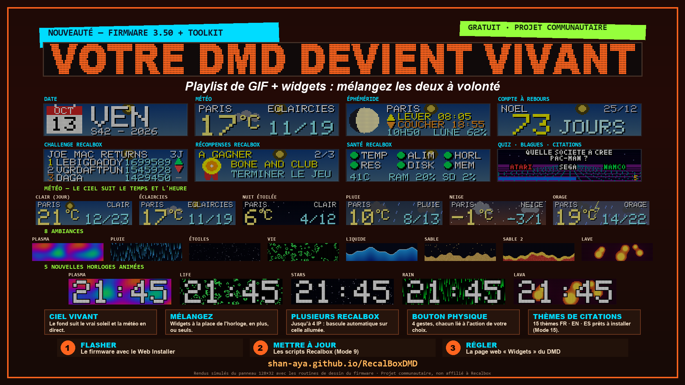
</p>

<p align="center">
  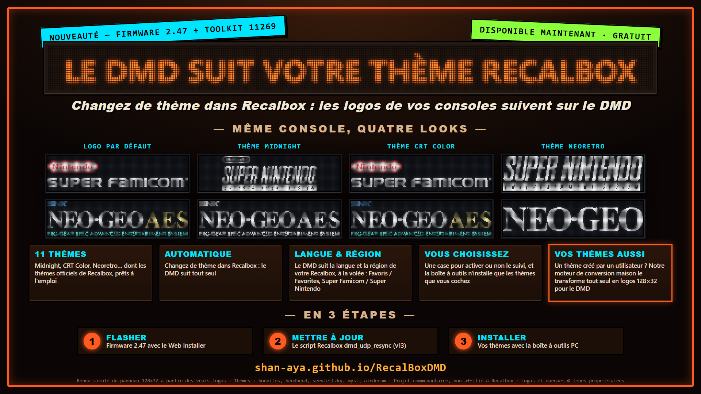
  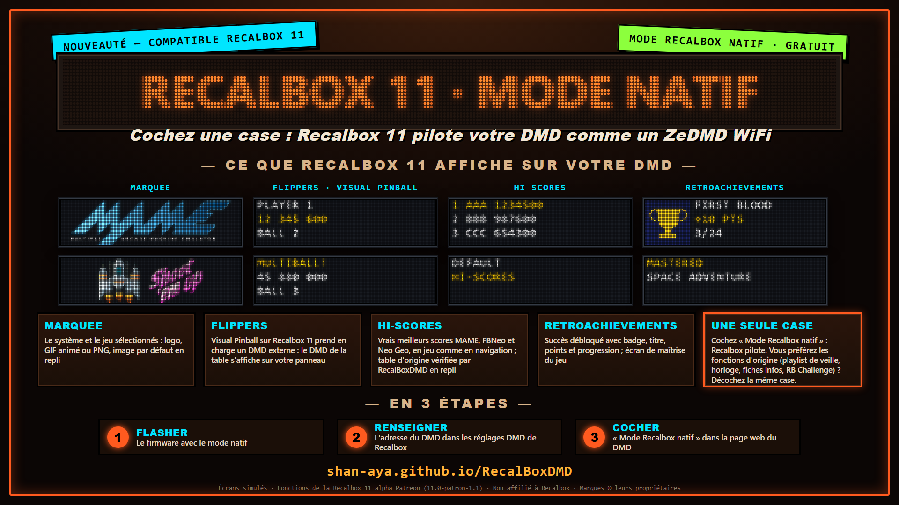
</p>

<p align="center">
  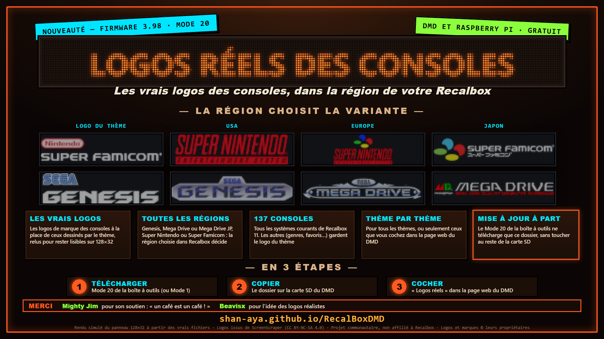
</p>

<p align="center">
  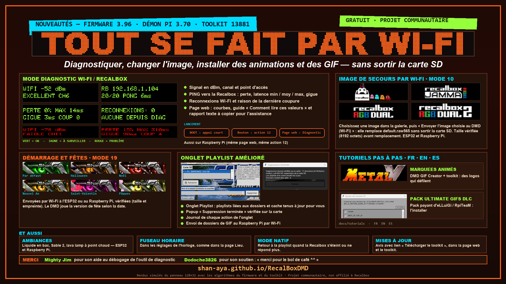
</p>

👉 Le détail de chaque écran : [Les écrans en détail](#-les-écrans-en-détail).

### Et aussi
- 🔁 **Plusieurs Recalbox, un seul DMD** — jusqu'à 4 IP ; le DMD **bascule seul** sur celle qui est allumée.
- 🔘 **Bouton physique** (GPIO 21) — appui court / double / long / très long, chacun avec l'action de votre choix.
- 📶 **Diagnostic Wi-Fi / Recalbox** — signal, point d'accès, perte, latence et gigue vers la Recalbox, sur la dalle (appui court sur BOOT, ou une action du bouton) et sur une page web qui explique comment lire les valeurs. [Détails](#-diagnostic-wi-fi--recalbox).
- 🌗 **Planificateur de luminosité** — 24 plages, une par heure.
- ⬆️ **Mises à jour sans câble** — firmware et démon Pi depuis la page web ou la boîte à outils, avec retour arrière automatique.
- 🛡️ **`config.ini` blindé** — écriture atomique, sauvegarde vérifiée, refus d'une page vide.

---

## ⚙️ Comment ça marche

```
┌───────────────────────────────┐   UDP    ┌────────────────────────────────────────┐
│           RECALBOX            │ ───────▶ │  DMD (ESP32 ou Raspberry Pi) + LED     │
│ Lance un jeu → un script      │          │                                        │
│ envoie « mame/kof98 »         │          │ 1. /systems/mame/kof98.raw565(pack)    │
│ (jeu, fin de jeu, veille,     │          │ 2. sinon : index games_cache.bin       │
│  hi-score, succès…)           │          │ 3. sinon : _defaults/mame.raw565       │
└───────────────────────────────┘          │ 4. sinon : _defaults/default.raw565    │
                                           │        ⏱ 5-15 ms, quelle que soit      │
┌───────────────────────────────┐          │          la taille de la collection    │
│  BOÎTE À OUTILS PC (Windows)  │  carte   └────────────────────────────────────────┘
│ gamelist.xml → raw565, caches,│   SD
│ images par défaut, scripts,   │ ────────▶   (ou, pour le Pi : la carte entière,
│ thèmes, GIF, copie SD…        │              système compris)
└───────────────────────────────┘
```

Le DMD est un afficheur « bête » de bout en bout : **toute la logique** (quoi envoyer, quand, combien de temps) vit dans de petits scripts côté Recalbox, jamais dans le firmware.

---

## 🚀 Démarrer en 5 minutes

<table align="center">
<tr><td align="center" width="70"><h2>1️⃣</h2></td><td>

**[Installez la boîte à outils PC](#installer-la-boîte-à-outils)** — c'est elle qui fait tout le travail.
Scrapez vos jeux dans Recalbox, choisissez votre dossier ROMs, cliquez sur **Démarrer**.

</td></tr>
<tr><td align="center"><h2>2️⃣</h2></td><td>

**Montez le matériel et mettez le firmware** — ESP32 : [assemblage + flash](#-installation-esp32) (~5 min, sans soudure). Raspberry Pi : [la boîte à outils prépare la carte](#-installation-raspberry-pi).

</td></tr>
<tr><td align="center"><h2>3️⃣</h2></td><td>

**Insérez la carte SD, allumez.**
Le premier démarrage vous guide pour le Wi-Fi, puis la **[page de configuration web](#-la-configuration-web)** prend le relais pour tout le reste.

</td></tr>
<tr><td align="center"><h2>4️⃣</h2></td><td>

**Installez les [scripts Recalbox](#-les-scripts-recalbox-mode-9)** (Mode 9 — le Mode 1 le fait déjà) et lancez un jeu : le logo s'affiche. 🎉

</td></tr>
</table>

### Installer la boîte à outils

Téléchargez-la sur la **[page Releases](https://github.com/shan-aya/RecalBoxDMD/releases)** (Windows 10/11 ; les binaires ne sont pas dans le dépôt, seulement publiés là-bas) :

| Option | Pour qui | Comment |
|---|---|---|
| **A — Installateur** *(recommandé)* | tout le monde | `RecalBoxDMD_Toolkit_Setup.exe` : menu Démarrer, désinstalleur |
| **B — Portable** | sans installation | `RecalBoxDMD_GUI.exe` : un fichier, aucun Python |
| **C — `.msi`** | déploiement scripté / GPO | `msiexec /i "RecalBoxDMD Toolkit-1.0.0-win64.msi"` |
| **D — Sources Python** | curieux, développeurs | dossier `tools/` → `install_and_run.bat` (ou `pip install Pillow Markdown && python run_gui.py`) |

**Premier lancement** : scrapez vos jeux dans Recalbox (bouton **« Comment scraper ? »** de l'outil) → onglet *Main* → choisissez votre version Recalbox et votre dossier ROMs (ex. `D:\Recalbox\share\roms`) → **Démarrer**. Le bouton clignotant propose ensuite de copier sur votre carte SD.

---

## 🔌 Installation ESP32

> **Volet 1/2** — le DMD à base d'ESP32 + carte DMDos. *(Vous avez un Raspberry Pi ? → [Volet Raspberry Pi](#-installation-raspberry-pi).)*

### 1. Le matériel

🛒 **Où acheter la carte DMDos :**
-  **France** — [Benfactory.fr](https://benfactory.fr/produit/dmdos/) · carte DMDos + ESP32 · code promo **`retrobat10`** (−10 %)
-  **Espagne** — [Mortaca Store](https://www.mortaca.com/) · guide et actualités sur [dmdos.net](https://www.dmdos.net/)

| Composant | Référence | Prix indicatif |
|---|---|---|
| 🧠 Microcontrôleur | ESP32 DevKit V1 USB-C (38 broches) | ~5 € |
| 🖥️ Panneau LED | 2× HUB75 RGB **P4, 64×32, 256×128 mm**, côte à côte (→ 128×32) | ~15-25 € / panneau |
| 🔌 Carte de connexion | **DMDos Board V3** (recommandée : lecteur SD intégré, aucune soudure) | ~15 € |
| 💾 Lecteur SD | Micro SD SPI (intégré à la DMDos Board) — **carte ≥ 8 Go, FAT32** | ~2 € |
| ⚡ Alimentation | 5 V 4 A+ | ~10 € |

<p align="center"></p>

### 2. L'assemblage (~5 minutes, sans soudure)

Identique au guide officiel de **[dmdos.net](https://www.dmdos.net/)** (Mortaca) — un tournevis suffit :

1. **Assemblez les deux panneaux** avec les pièces de jonction fournies (vis M3 non incluses).
2. **Positionnez la carte DMDos** sur le connecteur **entrée** (la carte ne fonctionne que de ce côté).
3. **Câblez l'alimentation** : rouge↔rouge, noir↔noir d'après la sérigraphie, puis reliez les deux panneaux avec la nappe fournie.
4. **Carte SD, ESP32, alimentation** : insérez la carte SD préparée, posez l'ESP32 flashé sur la carte, alimentez par l'USB-C.

<p align="center">
  <a href="https://www.dmdos.net/#montaje"></a>
  <a href="https://www.dmdos.net/#montaje"></a>
  <a href="https://www.dmdos.net/#montaje"></a>
  <a href="https://www.dmdos.net/#montaje"></a><br>
  <sub>Les miniatures renvoient vers le guide officiel pas-à-pas · <a href="https://www.dmdos.net/#hardware">Hardware</a> · <a href="https://www.dmdos.net/#montaje">Assembly</a> · <a href="https://www.dmdos.net/#mueble">Frame</a></sub>
</p>

> ⚠️ Le site DMDos propose son propre firmware, distinct. **Ne flashez pas le firmware DMDos** : seuls le **matériel** et le **guide de montage** sont réutilisés ; firmware et contenu de la carte SD viennent de ce dépôt.
> 🖨️ Boîtier imprimable en 3D par **Janibol** ([Retromojones](https://www.youtube.com/@retromojones)) sur [Thingiverse](https://www.thingiverse.com/thing:6704880).

### 3. Le firmware

**🌐 Le plus simple — depuis le navigateur** (rien à installer)

> 👉 **[Ouvrir l'installateur Web RecalBoxDMD](https://shan-aya.github.io/RecalBoxDMD/install/)**

Avec **Chrome ou Edge**, branchez l'ESP32 en USB, cliquez sur **Installer**, choisissez le port COM : une minute. Cochez **« Erase device »** pour une première installation (ou en venant d'un autre firmware, ex. DMDos). La page affiche la version qu'elle installe.

<details>
<summary><b>🛠️ Autres méthodes : Arduino IDE · esptool · brochage</b></summary>

**Arduino IDE** (compiler / personnaliser) — ouvrez `RecalBox_DMD.ino`, installez les bibliothèques ci-dessous, puis *Outils → ESP32 Dev Module*, flash **4 Mo**, partition **Minimal SPIFFS (1.9MB APP with OTA/190KB SPIFFS)** (deux emplacements de firmware, requis pour les mises à jour Wi-Fi).

| Bibliothèque | Utilité |
|---|---|
| [ESP32-HUB75-MatrixPanel-I2S-DMA](https://github.com/mrfaptastic/ESP32-HUB75-MatrixPanel-I2S-DMA) | Pilotage DMA du panneau |
| [AnimatedGIF](https://github.com/bitbank2/AnimatedGIF) | Décodage GIF (repli) |
| [pngle](https://github.com/kikuchan/pngle) | Décodage PNG (repli, inclus) |
| [WiFiManager](https://github.com/tzapu/WiFiManager) | Configuration Wi-Fi |
| [Adafruit GFX Library](https://github.com/adafruit/Adafruit-GFX-Library) | Texte / formes |
| [ArduinoJson](https://github.com/bblanchon/ArduinoJson) | Config & page web |

**`esptool.py`** — les binaires précompilés sont dans [`binaries/`](binaries/) :

```bash
esptool.py --chip esp32 --port COM3 --baud 921600 write_flash -z 0x10000 RecalBoxDMD_app.bin
# ou, en un seul fichier :
esptool.py --chip esp32 --port COM3 write_flash 0x0 RecalBoxDMD_merged.bin
```

**Brochage par défaut**

| Carte SD (SPI) | GPIO |  | HUB75 | GPIO |  | HUB75 | GPIO |
|---|---|---|---|---|---|---|---|
| CS | 5 | | CLK | 16 | | R1 / R2 | 25 / 14 |
| MOSI | 23 | | OE | 15 | | G1 / G2 | 26 / 12 |
| MISO | 19 | | LAT | 4 | | B1 / B2 | 27 / 13 |
| SCLK | 18 | | A/B/C/D | 33 / 32 / 22 / 17 | | E | -1 |

</details>

### 4. La carte SD et le premier démarrage

1. Lancez le **[Mode 1 de la boîte à outils](#-la-boîte-à-outils-pc--le-centre-de-linstallation)** : il construit toute la carte SD et propose de la copier.
2. Carte dans le DMD, allumez : le titre `RawEdition v…` s'affiche, puis la playlist de veille.
3. **Wi-Fi renseigné dans le Mode 1** → le DMD rejoint votre réseau seul. **Sinon** il ouvre son point d'accès Wi-Fi : connectez-vous-y et suivez la page (réseau 2,4 GHz + IP de la Recalbox).
4. Ouvrez la **[page de configuration web](#-la-configuration-web)** (l'IP s'affiche sur le panneau) pour tout régler.
5. Lancez un jeu sur la Recalbox : le panneau passe sur son marquee.

---

## 🥧 Installation Raspberry Pi

> **Volet 2/2** — le même DMD, avec un **Raspberry Pi** à la place de l'ESP32. *(Vous avez un ESP32 ? → [Volet ESP32](#-installation-esp32).)*

<p align="center">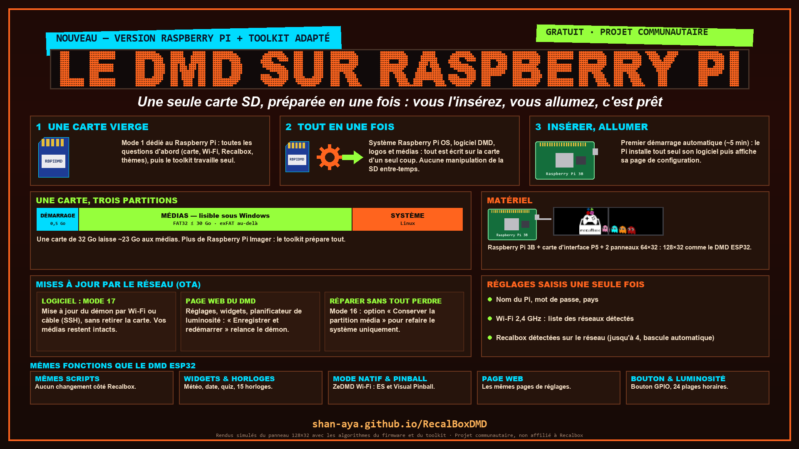</p>

> ✅ **Validé : Raspberry Pi 3B** (Raspberry Pi OS Lite 32 bits « Bookworm »).
> ⚠️ **Prévu, non testé : Pi 4 / 400 / CM4, Pi 2, Zero 2.** Le logiciel règle `gpio_slowdown` selon le modèle (Pi 4 : 4 ; Pi 2/3 : 2 ; Pi 1/Zero : 1) ; si votre Pi scintille, ajustez `gpio_slowdown=1..4` dans `config.ini`.

### 1. Le matériel
- **Raspberry Pi 3B** + une **carte d'interface HUB75** (type RPI2DMD : mapping GPIO « regular », horloge RTC DS1307 optionnelle).
- **Deux dalles P5 64×32** chaînées (128×32), balayage 1/16 : `--led-cols=64 --led-rows=32 --led-chain=2 --led-pwm-bits=11`.
- Un bouton physique optionnel entre GPIO 21 et GND.
- Le son du Pi est désactivé et un cœur est réservé à l'affichage (`isolcpus=3`) : l'installation s'en charge.

### 2. L'installation — tout depuis la boîte à outils

1. Lancez la **boîte à outils PC** et choisissez la cible **Raspberry Pi** en haut de la fenêtre.
2. **Mode 1** : posez toutes les questions d'emblée (carte, Wi-Fi, utilisateur / SSH, Recalbox, thèmes…), puis l'assistant travaille seul, **depuis une carte SD vierge** : formatage, Raspberry Pi OS Lite, logiciel du DMD, logos convertis dans une partition `RBPIDMD`. Windows demande l'autorisation administrateur (écriture disque directe) ; le contenu de la carte est effacé **après confirmation**.
3. Carte dans le Pi, alimentez, **attendez 2 à 3 minutes** : le DMD affiche *Page de configuration* et son adresse (ou ouvrez `http://rbpidmd.local/`). Sans Wi-Fi valide, le Pi ouvre le réseau **RecalBox-DMD-Config** (192.168.4.1) : configurez-le depuis un téléphone.
4. Renseignez l'IP de votre Recalbox dans les réglages Wi-Fi, puis lancez le **[Mode 9](#-les-scripts-recalbox-mode-9)** : les scripts Recalbox sont **les mêmes** que pour l'ESP32.

Une carte, trois partitions : **démarrage** (0,5 Go) · **médias** (FAT32 ≤ 30 Go, exFAT au-delà — lisible sous Windows) · **système** (Linux). Plus besoin de Raspberry Pi Imager.

### 3. Les modes dédiés au Pi

| Mode | Rôle |
|---|---|
| **16** | **Préparer une carte** — remplace Raspberry Pi Imager : télécharge Raspberry Pi OS Lite (SHA-256 vérifié), l'écrit, y met Wi-Fi / utilisateur / SSH et le logiciel du DMD. Option *Conserver la partition média* pour refaire le système seul. |
| **17** | **Installer ou mettre à jour** le logiciel sur un Pi déjà démarré (trouvé via `rbpidmd.local`, sinon balayage) et copier le contenu de la carte SD du DMD (copie incrémentale ; la configuration n'est jamais écrasée). |

Le logiciel du Pi est **téléchargé depuis GitHub** (release `pi-v…`, SHA-256 vérifié) ; sans réseau, la copie du PC est utilisée.

### 4. Mettre à jour
- **Depuis la page web** (v3.59+) : la page **Réglages** avertit d'une nouvelle version et propose **Mettre à jour maintenant** — téléchargement, vérification SHA-256, installation, redémarrage du service et **retour automatique à la version précédente** si le démarrage échoue (~1 min).
- **Mode 17**, ou à la main : `RecalBoxDMD_pi_payload.zip` de la dernière release `pi-v…`, puis `sudo bash install.sh`.

📖 Détails, compilation, licence (GPL-2.0+) et limites connues : **[RASPBERRY-PI.fr.md](RASPBERRY-PI.fr.md)**.

---

## 📜 Les scripts Recalbox (Mode 9)

*Commun à l'ESP32 et au Raspberry Pi.* Le DMD n'affiche que ce que la Recalbox lui dit : le lien est un ensemble de petits **scripts** exécutés par Recalbox à ses évènements (jeu lancé, jeu terminé, économiseur d'écran…). Le **Mode 1** les installe ; le **Mode 9** les installe ou les **met à jour** (refaites-le après chaque mise à jour de la boîte à outils).

<p align="center">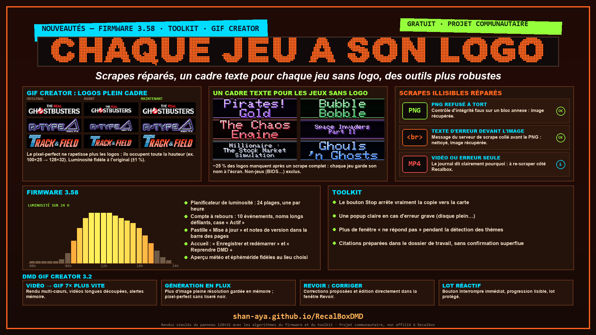</p>

**Comment :** *Avancé* → *SCRIPTS RECALBOX* → **Mode 9** → saisissez l'**IP ou le nom** de la Recalbox (plusieurs possibles, séparées par des virgules : chacune est installée) → **Installer / Mettre à jour**. Copie par le partage réseau, ou en SSH si le partage est bloqué. Recalbox injoignable : une copie prête reste dans `recalbox_userscripts` (à copier à la main dans `share/userscripts`).

| Catégorie | Contenu |
|---|---|
| **Scripts d'évènements** (automatiques) | pont *marquee* · *hi-score / infos jeu / Challenge RB* · *RetroAchievements* · `dmd_vpx_config` (règle Visual Pinball **seulement** si *Mode Pinball (VPX)* est coché sur le DMD) · aides dans `dmd_helpers/` |
| **Widgets Recalbox** (automatiques) | `dmd_rbwidgets` envoie toutes les 2 min un résumé du **challenge**, des **récompenses** et de la **santé** de la Recalbox |
| **Scripts manuels** (menu *Scripts utilisateur*) | **WiFi Recovery DMD** · **Config Web DMD** · **Reboot DMD** · **Luminosité DMD +10 % / −10 %** |
| **Fichiers hi-score `.hi`** | ~3000 fichiers (FBNeo, MAME 0.278) ajoutés à `share/saves` — **un `.hi` existant n'est jamais écrasé** |

> **Redémarrez EmulationStation** (ou la Recalbox) après l'installation, sinon le menu *Scripts utilisateur* reste grisé : Recalbox ne cherche les scripts qu'à son démarrage.

---

## 🧰 La boîte à outils PC — le centre de l'installation

C'est l'application Windows (FR / EN / ES, 9 habillages visuels) qui **construit tout** : carte SD, scripts, thèmes, GIF, mises à jour — pour l'ESP32 comme pour le Raspberry Pi. Manuel complet : [`HELP.fr.md`](tools/RecalBoxDMD_tool_v14286/HELP.fr.md) (aussi dans l'onglet *Aide*).

| Main · SNES | Paramètres · Dreamcast |
|---|---|
|  |  |
| **Main · Mega Drive** | **Playlist · Neo Geo** |
|  |  |

### Les six onglets

| Onglet | Rôle |
|---|---|
| **Main** | Le **Mode 1** automatique : dossier ROMs, systèmes, version Recalbox, **DÉMARRER** |
| **Playlist** | Composer vos playlists de veille depuis la carte SD ou des dossiers de GIF du PC |
| **Avancé** | Les modes 2 à 18 un par un, en catégories |
| **Logs** | Toute la sortie texte, avec filtre de niveau — à copier pour signaler un souci |
| **Paramètres** | Langue, thème de couleurs, profil de version Recalbox, seuil « L » (systèmes lents) |
| **Aide** | Le manuel, ouvrable dans le navigateur |

En bas, **Pause / Reprise · Passe · Stop** (Stop arrête vraiment la copie). Le numéro dans la barre de titre est le **build** : donnez-le quand vous demandez de l'aide. Au lancement, un **avis** signale toolkit, firmware, scripts ou citations plus récents (lien *Notes de version*).

### ⭐ Mode 1 — AUTO : tout, d'un clic

Après **DÉMARRER**, les questions sont toutes posées d'emblée (vous laissez ensuite le PC travailler) :

1. **Wi-Fi du DMD** *(facultatif)* — réseau **2,4 GHz**, mot de passe vérifié par le PC ; IP fixe optionnelle (une seule méthode : réservation routeur **ou** IP fixe).
2. **Recalbox** — détection sur le réseau, confirmation de l'IP, **autres Recalbox** (4 au total, séparées par des virgules).
3. **Image de secours** — choisie ou importée (redimensionnée automatiquement).
4. **Images système** — anglais, français et espagnol installés ; le DMD prend la langue de votre Recalbox.
5. **Thèmes Recalbox** — activer le suivi, cocher les thèmes à copier (ceux de votre Recalbox pré-cochés).
6. **Carte SD** — lecteur FAT32, 8 Go minimum.
7. **Thèmes de citations** — aperçu, puis Mode 15 sur la carte choisie.
8. **Pack de GIF gratuit** — ~600 GIF, téléchargés en tâche de fond.
9. **GIF personnalisés** — passage par l'onglet *Playlist*.

Puis le pipeline : préparation → **scripts Recalbox** (Mode 9) → extraction des marquees depuis les `gamelist.xml` → conversion raw565 → `games_cache.bin`, `_defaults`, logos de thèmes, GIF, playlists, `systems_cache.dat` → **copie SD reprenable** (une copie interrompue reprend où elle s'est arrêtée). De quelques minutes à longtemps selon la collection (un set MAME de 30 000 jeux est le cas lent).

### Tous les modes (onglet Avancé)

| Catégorie | Mode | Ce qu'il fait |
|---|---|---|
| ⭐ *(onglet Main)* | **1 — AUTO** | Tout le pipeline ci-dessus (ESP32 **ou** Pi : pour un Pi, carte vierge → carte prête) |
| 📥 **Télécharger depuis GitHub** | **2 — `_defaults`** | Extrait les marquees *et* télécharge les images par défaut (logos des systèmes, genres, secours) |
| | **11 — Pack 600 GIF** | Télécharge le pack gratuit dans `gifs/` |
| | **13 — Thèmes Recalbox** | Télécharge les logos des thèmes choisis dans le dossier de travail |
| | **20 — Logos réels** | Télécharge **uniquement** le dossier `logos-reels` (vrais logos des consoles, variantes USA / Europe / Japon) dans le dossier de travail, pour le mettre à jour sans toucher au reste de la SD |
| | **15 — Thèmes de citations** | 15 thèmes prêts (citations, biscuit chinois, blagues, devinettes, quiz rétro) × 3 langues, directement sur la SD |
| 🗂️ **Gamelist** | **3 — Extraction** | Extrait les marquees/logos selon votre profil de version Recalbox |
| | **8 — Images manquantes** | Rapport par système/jeu de ce qui manque réellement (ROMs / travail / SD) |
| | **18 — Cartes texte seules** | Régénère **uniquement** les cartes texte (nom du jeu) des jeux sans image, en `.raw565` |
| 🖼️ **Outils d'images** | **4 — PNG/GIF → raw565** | PNG → `.raw565`, GIF → `.raw565pack` + `.meta` |
| | **5 — 128×32** | Redimensionne seulement, sans conversion |
| | **10 — Image de secours** | Choisit/réinitialise l'image affichée quand rien ne correspond, et l'**envoie au DMD par Wi-Fi** (ESP32 et Pi) sans sortir la carte SD |
| 🧮 **Caches** | **6 — `games_cache.bin`** | Index bigramme (703 entrées par système) |
| | **7 — `systems_cache.dat`** | Index systèmes + flags lent/rapide **« L »/« N »** |
| 📜 **Scripts Recalbox** | **9 — Installer les scripts** | [Voir plus haut](#-les-scripts-recalbox-mode-9) |
| 🎨 **Thèmes Recalbox** | **12 — Gestion des thèmes** | Fenêtre qui compare GitHub / votre Recalbox / la carte SD, met à jour les périmés, convertit ceux que GitHub n'a pas |
| 🔄 **Firmware du DMD** | **14 — Mise à jour Wi-Fi** | Trouve le DMD, compare à la dernière version, met à jour sans câble (~2 min, retour arrière auto) |
| | **19 — Animations de démarrage (Wi-Fi)** | Envoie par Wi-Fi au DMD (ESP32 ou Pi) l'animation par défaut et les cinq animations de fête (Halloween, Noël, Nouvel An, Saint-Valentin, Pâques), vérifiées (taille et empreinte) |
| 🥧 **Raspberry Pi** | **16 — Préparer une carte** · **17 — Installer / mettre à jour** | [Voir le volet Raspberry Pi](#-installation-raspberry-pi) |

<details>
<summary><b>📚 Détail des modes qui méritent une explication</b> (Modes 12-13 thèmes · 14 firmware · 15 citations · outils annexes)</summary>

**Thèmes Recalbox (Modes 12 et 13).** Le DMD affiche les logos système du thème utilisé dans Recalbox. Le **Mode 13** télécharge depuis GitHub les thèmes choisis (mêmes questions qu'au Mode 1). Le **Mode 12** ouvre la gestion des thèmes : elle compare GitHub, votre Recalbox et la **carte SD** (la référence), signale les thèmes plus anciens ou jamais convertis, et les met à jour (**Mettre à jour les périmés**) ou convertit ceux que GitHub n'a pas (**Convertir la sélection**). Un thème déjà à jour n'est jamais retéléchargé. Les logos prêts du paquet GitHub sont utilisés quand la version correspond (quelques secondes) ; sinon la boîte à outils **convertit depuis votre Recalbox** (qui reste la référence). Chaque thème est préparé dans le dossier de travail puis copié ; si la copie est interrompue, **Copier vers la SD (n)** reprend. **Langue et région sont automatiques** : toutes les variantes sont installées et le DMD prend celles de votre Recalbox, qui suit en quelques secondes si vous les changez (firmware ≥ 2.38, script `dmd_udp_resync` v8 du Mode 9). Les thèmes propres à Recalbox (`recalbox-next`, `recalbox-240p`) sont aussi proposés ; s'ils ne peuvent pas venir du paquet, ils sont téléchargés depuis GitLab et convertis sur votre PC pour votre usage personnel (licence). Les logos sont réduits comme le fait Recalbox 11 pour son DMD (lettres non déformées, niveaux de gris conservés).

**Logos réels (Mode 20, firmware 3.98).** À la place des logos dessinés par le thème, le DMD peut afficher les **vrais logos des consoles** (logos de marque issus de ScreenScraper, CC BY-NC-SA 4.0, relus pour rester lisibles sur 128×32) : 137 systèmes, avec des variantes USA / Europe / Japon choisies par la **région réglée dans votre Recalbox**, même si le thème n'a pas de variante pour cette région (Genesis / Mega Drive, Super Nintendo / Super Famicom…). Le dossier est `systems/_defaults/_themes/logos-reels/`. Activez-le dans la page web du DMD (page **Affichage** → *Logos réels des consoles*) : *Tous les thèmes* ou *Seulement les thèmes cochés* — la liste se construit toute seule (thèmes installés sur la SD + thèmes déjà annoncés par votre Recalbox), avec une option pour cocher automatiquement les nouveaux thèmes. La variante de langue du thème garde la priorité ; les logos absents du set (genres, favoris…) gardent le logo du thème. Le **Mode 20** ne télécharge que ce dossier depuis GitHub (les Modes 1 et 13 le proposent aussi, pré-coché) ; copiez-le sur la carte SD avec le panneau habituel. ESP32 et Raspberry Pi — sur un Raspberry Pi (démon 3.74 ou plus), le Mode 20 envoie les logos directement par Wi-Fi, sans copie sur la carte SD.

**Mise à jour du firmware par Wi-Fi (Mode 14).** Depuis le firmware 2.44, le DMD se met à jour depuis GitHub : le Mode 14 le trouve, compare les versions et, sur *Mettre à jour maintenant*, lui fait télécharger la nouvelle version (~2 min ; écran éteint un moment, redémarrages multiples, ne coupez pas l'alimentation). Taille et SHA-256 sont vérifiés ; retour automatique à l'ancienne version si la nouvelle ne démarre pas. Le bouton de la page web fait la même chose. Après une mise à jour, refaites le Mode 9 si de nouveaux scripts sont annoncés.

**Thèmes de citations (Mode 15).** La fenêtre liste les thèmes par langue avec leur état sur la SD : *à installer*, *à jour*, *mise à jour disponible*, *modifié par vous* (jamais pré-coché). Un fichier que vous avez modifié est d'abord copié dans `widgets/quotes/_backup/<date>/` ; rien n'est supprimé, vos propres thèmes ne sont jamais touchés ; le DMD les utilise tout de suite.

**Outils annexes.** **« Comment scraper ? »** (captures annotées selon votre version), **« Nettoyer les dossiers avant scrape »** (uniquement les images scrapées, jamais ROMs ni `gamelist.xml`), **survol** des modes 2/11/13/15 pour un aperçu, **seuil « L »** réglable (5 000 fichiers convertis par défaut ; augmentez si votre SD est rapide).

**Profils de scraping.**

| Profil | Réglage du scraper Recalbox | Lu |
|---|---|---|
| **10.x / 11** *(recommandé)* | type de logo = **CLEAR** | `media/wheels/`, balise `<logo>` |
| **9.x** | vignette = **MARQUEE** | `media/thumbnails/`, balise `<thumbnail>` |
| **legacy** | image = **LOGO DÉTOURÉ** ou **MARQUEE** | `media/images/`, balise `<image>` |

</details>

### L'onglet Playlist

Une **playlist** = les GIF que le DMD joue quand rien ne se passe sur la Recalbox. Cochez un dossier entier, ou cliquez son nom pour choisir fichier par fichier (survol = aperçu animé) ; **Ajouter un dossier PC…** importe vos GIF ; **Construire la playlist** l'enregistre sous un nom ; **Supprimer** nettoie ; **Régénérer le cache playlist** reconstruit `cache_master_gifs.dat`. *Quelle* playlist est active se choisit dans la page web du DMD. **Envoyer au Pi (Wi-Fi)…** (Raspberry Pi) envoie vos dossiers de GIF par Wi-Fi, sans sortir la carte. Après **Supprimer**, une popup *Suppression terminée* donne le résultat vérifié sur la carte, et chaque action de l'onglet est écrite dans l'onglet **Logs** (réglez *Niveau* sur *Tout*). Pour un gros pack (~11 000 GIF) : [tutoriel ULTIMATE](docs/tutorials/ultimate-gif-pack.fr.md).

---

## 🌐 La configuration web

Tapez l'IP du DMD (affichée sur le panneau ; ou `rbpidmd.local` pour un Pi) dans le navigateur d'un **téléphone ou d'un PC** : un site de configuration complet, **trilingue**, à pages rapides, avec aide intégrée. **Aucune application, aucune recompilation, aucune manipulation de la carte SD.** Chaque réglage s'applique à chaud, et la config est écrite sur la carte (`config.ini`).

<p align="center">
  
  
  
  
</p>

### Les pages

| Page | Ce qu'on y règle |
|---|---|
| 🏠 **Accueil** | Le menu : un bouton par page, **⚙ Réglages** en premier. *Enregistrer & Redémarrer*, *Reprendre DMD* |
| ⚙ **Réglages** | **Luminosité** (aperçu en direct poussé sur le panneau pendant que vous bougez le curseur) · démarrage silencieux/normal · **Mode Pinball (VPX)** · alertes **RetroAchievements** · **mode Recalbox natif** · **version du firmware** + *Mettre à jour*. L'enregistrement est confirmé sur la ligne 2 du DMD |
| 💡 **Affichage & Playlists** | Écrans en jeu · **veille Recalbox** (suivre le logo du jeu pendant les économiseurs « démos / clips », ou playlist simple) · **thème Recalbox** (suivre le thème actif ou logos par défaut) · playlist par défaut + aléatoire · **créer / modifier / supprimer des playlists** à partir des dossiers de GIF de la SD |
| 📶 **Wi-Fi** | Scan et choix du réseau, mot de passe, IP statique (passerelle / masque / DNS) · **IP des Recalbox** (jusqu'à 4, séparées par des virgules) + **Recalbox cible** (*Automatique* ou 1-4) ; la Recalbox active est affichée |
| ⏰ **Horloge** | Activation, **thème avec aperçu instantané sur le panneau**, couleur néon, intervalle (en GIF ou minutes), durée, fuseau horaire |
| ✨ **Widgets et Horloge** | Le **mélange** (état et durée de chaque widget, déclencheur, ordre, fond *playlist / widgets seuls*), ambiances et couleurs, thème de citations, **Aperçu** de chaque widget sur le panneau |
| 📍 **Lieu** · 📅 **Événements** | Lieu pour le ciel / éphéméride / météo · événements du compte à rebours (annuels ou uniques) |
| 💬 **Citations** | Créer, modifier, **importer un `.txt`** ou supprimer vos thèmes de citations / quiz |
| 🔘 **Bouton** | L'action de chaque geste du bouton physique |
| 💿 **Médias** | Parcourir / supprimer les dossiers de GIF de la SD, **envoyer des GIF** depuis le navigateur (quelques fichiers ; en masse, utilisez la boîte à outils) |
| 📡 **Diagnostic** | Lance / arrête le **mode diagnostic** : signal, PING vers la Recalbox, courbes, guide de lecture, rapport texte — voir [Diagnostic Wi-Fi / Recalbox](#-diagnostic-wi-fi--recalbox) |

### Le plus utile à savoir

- 🔔 **Un bandeau en haut de chaque page** annonce un firmware, des scripts Recalbox (→ Mode 9) ou une boîte à outils plus récents. La vérification est faite par **votre navigateur** : le DMD n'a besoin d'aucun accès Internet.
- 👁️ **Aperçu en direct** : luminosité, thème d'horloge et widgets se jouent tout de suite sur le panneau physique.
- 🆘 **Secours Wi-Fi** : sans réseau valide, le DMD ouvre son propre point d'accès (Pi : **RecalBox-DMD-Config**, 192.168.4.1) ; le script manuel *WiFi Recovery DMD* le relance à distance.
- 🛡️ **Config à l'épreuve des coupures** : écriture atomique (`config.tmp` puis échange), sauvegarde vérifiée avant de répondre *OK*, refus d'enregistrer des champs Wi-Fi / playlist vides.
- 🔗 **Pages directes** : `/config/widgets`, `/config/button`, `/config/clock`, `/config/network`, `/config/media`, `/config/quotes`…
- 🖧 **Console Telnet** pour le diagnostic : `telnet <ip>` puis `help`.

<details>
<summary><b>📝 Le fichier <code>config.ini</code> (référence — inutile de le toucher à la main)</b></summary>

Il est créé par la boîte à outils (Mode 1) ou par le DMD lui-même, puis tout se modifie depuis la page web. Pour référence :

```ini
info=1                        # 0 = pas d'info au démarrage
brightness=40                 # luminosité 0-100 %
playlist=RecalBox_intros.txt  # lue depuis /playlist
random=1                      # 0 = ordre, 1 = aléatoire

# Wi-Fi
wifi_enabled=1
wifi_ssid=mon_wifi
wifi_password=mon_mot_de_passe
wifi_static_enabled=1
wifi_static_ip=192.168.1.240
wifi_gateway=192.168.1.1
wifi_subnet=255.255.255.0

# Liaison Recalbox (UDP)
recalbox_ip=192.168.1.104     # la Recalbox ACTIVE
recalbox_ips=192.168.1.104,192.168.1.105   # jusqu'à 4 ; bascule sur la première qui répond
recalbox_target=0             # 0 = automatique, 1..4 = impose cette Recalbox

# Pinball (VPX) & veille Recalbox
feat_vpinball_dmd=0           # 1 = tables VPX en direct (au prochain redémarrage)
feat_demo_follow=1            # 1 = suivre le logo pendant la veille « démos »
feat_clip_follow=1            # idem « clips vidéo »

[CLOCK]
CLOCK_ENABLED=1
CLOCK_THEME=-1                # -1 = aléatoire, 0 = Mario ... 9 = Level 1-1
CLOCK_INTERVAL=5              # nombre de GIF avant l'horloge
CLOCK_DURATION=60             # secondes
TZ=CET-1CEST,M3.5.0,M10.5.0/3

[BUTTON]                      # page /config/button
BTN_ENABLED=1                 # GPIO 21 vers GND
BTN_ACT_SHORT=11
BTN_ACT_DOUBLE=6
BTN_ACT_LONG=2
BTN_ACT_VLONG=10

[WIDGETS]                     # page /config/widgets ; WIDGET_MODE_n : 0 off, 1 à la place de l'horloge, 2 en plus
WIDGET_BG=0                   # 0 = playlist de GIF, 1 = widgets seuls
WIDGET_TRIGGER=0              # 0 = tous les N GIF, 1 = toutes les N minutes
WIDGET_AMB=8                  # ambiance (1 plasma ... 8 lampe à lave)
WIDGET_LAT=43.3852
WIDGET_LON=5.7081
WIDGET_PLACE=Maison
WIDGET_MODE_8=2               # 8 challenge, 9 récompenses, 10 santé (Recalbox)
WIDGET_DUR_9=30
```

</details>

---

## 📡 Diagnostic Wi-Fi / Recalbox

Un DMD qui saccade, perd la Recalbox ou « décroche » ? Le **mode diagnostic** (firmware 3.96, démon Pi 3.70) mesure en direct la qualité du Wi-Fi et de la liaison avec la Recalbox, sur la dalle comme sur une page web.

<p align="center">
  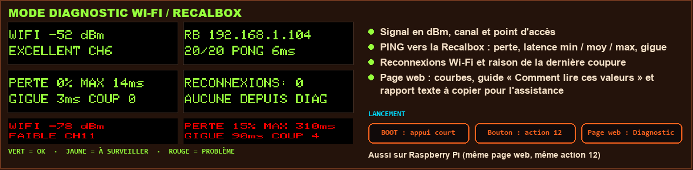
</p>

### Le lancer

| Depuis | Comment |
|---|---|
| **Bouton BOOT de l'ESP32** | appui court (sans bouton physique à câbler) |
| **Bouton physique** (GPIO 21) | action 12 « Diagnostic Wi-Fi / Recalbox » de la page *Bouton* |
| **Page web** | bouton 🩺 **Diagnostic** du menu d'accueil (`/config/diag`) |

Il tourne en boucle jusqu'à un nouvel appui. Il s'arrête aussi quand vous quittez la page, changez d'onglet ou fermez le navigateur (8 s sans signe de vie de la page).

### Ce qu'il mesure

Une fois par seconde, sur une fenêtre glissante des 20 derniers tests :

- le **signal** (dBm) et sa qualité, le **canal** et le **point d'accès** (BSSID) ;
- un **PING vers la Recalbox** : **perte**, latence **min / moyenne / max**, **gigue**, âge du dernier paquet, coupures UDP ;
- sur l'ESP32, les **reconnexions Wi-Fi avec la raison de la dernière déconnexion** et l'historique des 8 dernières connexions (quel point d'accès, et quand).

### Lire la dalle

Quatre pages de 4 s, en couleur (les textes de la dalle sont en français, abrégés) :

| Page | Exemple | Couleur |
|---|---|---|
| Signal | `WIFI -52 dBm` / `EXCELLENT CH6` | vert ≥ −67 dBm · jaune ≥ −75 · rouge en dessous (Excellent ≥ −55, Bon ≥ −67, Moyen ≥ −75, Faible ≥ −82) |
| Liaison Recalbox | `RB 192.168.1.104` / `20/20 PONG 6ms` | vert / jaune / rouge selon la perte et la latence |
| Perte et gigue | `PERTE 0% MAX 14ms` / `GIGUE 3ms COUP 0` | vert : 0 % de perte et moyenne < 80 ms · jaune : ≤ 10 % et < 200 ms · rouge au-delà |
| Reconnexions | `RECONNEXIONS: 0` / `AUCUNE DEPUIS DIAG` | vert si aucune, jaune sinon |

### La page web

Les valeurs en direct, **deux courbes** (signal et latence), un guide **« Comment lire ces valeurs »** (seuils, causes probables, que faire) et un **rapport texte** à copier ou télécharger pour joindre à une demande d'aide.

### Quelques constats typiques

- **Bon signal mais beaucoup de pertes** : le problème vient plutôt de la Recalbox ou du réseau (box, répéteur, CPL) que du DMD.
- **Signal faible** (sous environ −75 dBm) : rapprochez le DMD de la box.
- **Deux adresses de point d'accès qui alternent** : le DMD passe d'un point d'accès à l'autre d'un réseau maillé ou d'un répéteur.

Plus de détails dans la [FAQ](FAQ.fr.md).

### Raspberry Pi

Même mode diagnostic (action 12 et même page web). Pas de bouton BOOT sur le Pi ; l'historique des reconnexions n'existe que **pendant un diagnostic** ; en Ethernet, la dalle affiche « ETHERNET / PAS DE WIFI ».

> 🙏 Merci à **Mighty Jim** pour son aide précieuse au débogage de l'outil de diagnostic.

---

## 🧩 Les écrans en détail

### 🕰️ Horloges — 10 thèmes pixel-art + 5 animées

Affichées entre les jeux (intervalle / durée réglables) ou en continu, avec **aperçu instantané sur le panneau** quand vous en choisissez une. Thèmes pixel-art : Super Mario · Tetris · Pac-Man · Space Invaders · Pong · Neon · Matrix · Fire · Rainbow · Level 1-1 (défilant). Horloges animées : **Plasma · Life · Stars · Rain · Lava**.

<p align="center">
   
   
  <br>
   
   
  <br>
   
   
  
</p>

### 🧩 Les widgets

Page web **Widgets** (`/config/widgets`). Chacun est **désactivé**, **à la place de l'horloge** (il alterne avec elle dans le créneau principal) ou **en plus** (joué après), avec sa durée en secondes. **Déclencheur** : tous les N GIF ou toutes les N minutes ; créneau principal en tourniquet ou aléatoire ; extras tous ou N tirés au hasard. **Fond** : playlist de GIF ou **widgets seuls**. Un jeu, une page web ou une commande reprend l'écran à tout moment ; le bouton **Aperçu** joue un widget tout de suite.

| Widget | Ce qu'il montre | Nécessite |
|---|---|---|
| 🕰️ **Horloge** | 10 thèmes pixel-art + 5 animées, couleurs réglables | — |
| 📅 **Date** | carte de calendrier avec jour de la semaine ; dimanches et jours fériés en couleur | heure (NTP) |
| 🌅 **Éphéméride** | lever, coucher, durée du jour, **phase de la lune** | lieu |
| ⏳ **Compte à rebours** | jours restants avant vos événements (10 max, annuel ou unique) | heure |
| 🌀 **Ambiance** | 8 animations : plasma, pluie, étoiles, jeu de la vie, liquide, sable, **sable 2**, **lampe à lave** ; couleurs réglables | — |
| 🌦️ **Météo** | température, ▲▼ min/max, conditions ; noms de lieu longs défilants | lieu + Internet (open-meteo.com, toutes les 30 min) |
| 💬 **Citations et quiz** | citations, blagues, devinettes, **quiz à 3 choix**, fonds illustrés | — |
| 🏆 **Recalbox : challenge** | challenge en cours, jours restants, **top 3 avec ▲▼**, votre rang et vos GG | scripts Recalbox |
| 🎁 **Recalbox : récompenses** | ce que vous pouvez gagner (avatar, badge, titre) et comment | scripts Recalbox |
| 🩺 **Recalbox : santé** | voyants température, alimentation, horloge, réseau, disque, mémoire | scripts Recalbox |

**Le ciel** suit le **vrai lever / coucher du soleil** de votre lieu et la météo en direct (soleil, lune, étoiles, nuages, pluie, neige, orage) derrière date, météo, éphéméride et compte à rebours ; les trois widgets Recalbox ont une **illustration** en fond.

<p align="center">
  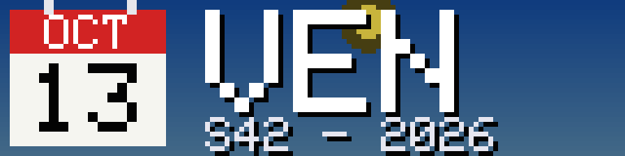 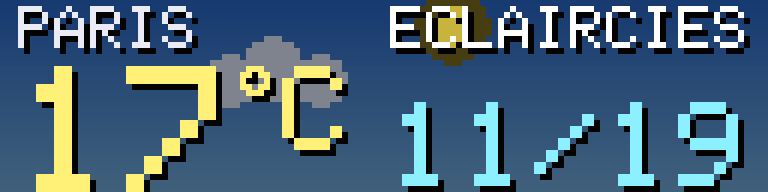 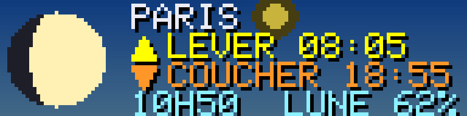 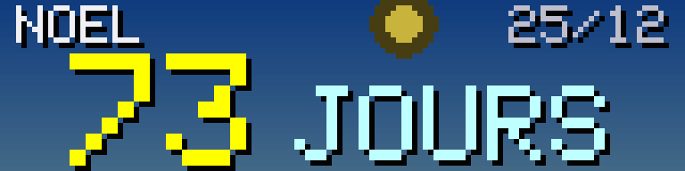 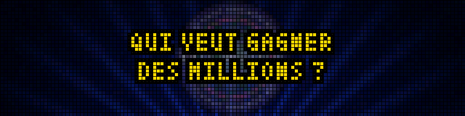<br>
  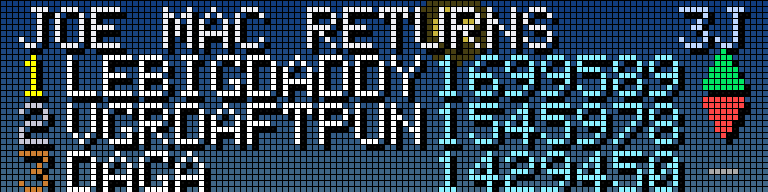 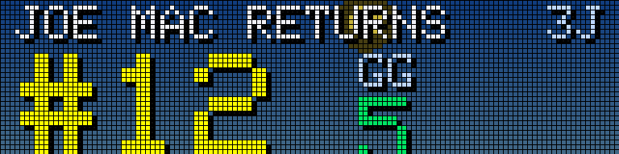 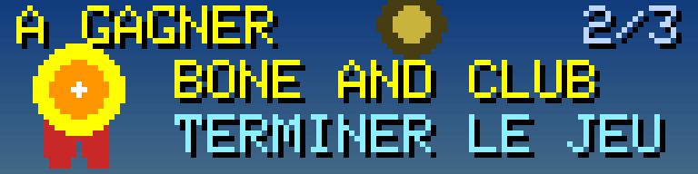 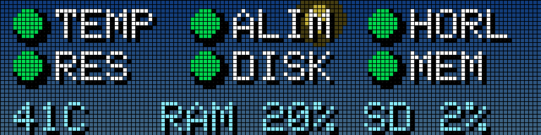 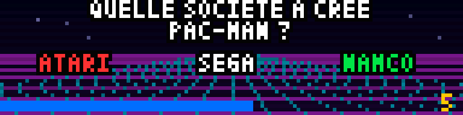<br>
         <br>
  <sub>Rendus simulés du panneau 128×32, dessinés avec les propres routines du firmware.</sub>
</p>

<details>
<summary><b>💬 Citations et quiz — format des fichiers, thèmes, fonds</b></summary>

**Un thème = un fichier texte, une citation par ligne**, quatre formats :

| Ligne | Ce que montre le panneau |
|---|---|
| `Texte du biscuit` | le texte, centré et à la ligne |
| `Texte \| Auteur` | la citation, puis l'auteur |
| `Question ? \| Réponse` | devinette / blague : réponse révélée après une pause |
| `Question ? \| A / B / C \| 3` | **quiz à 3 choix** (rouge / blanc / vert), barre de décompte, puis la bonne réponse clignote et **reste affichée** |

- **Prêts à l'emploi** : le **Mode 15** installe 15 thèmes de 50 entrées (FR/EN/ES) dans `widgets/quotes/<langue>/` ; des thèmes intégrés par langue existent aussi (bouton *Restaurer*).
- **Les vôtres** : page *Widgets → Citations* (créer, modifier, supprimer, **importer un `.txt`**, 64 Ko max, accents convertis) ou `.txt` déposés dans `/widgets/quotes/<langue>/`.
- **Fonds illustrés** : une image raw565 128×32 (`/widgets/quotes/bg/<thème>.raw565`, 8 192 octets) devient le fond ; un `<thème>.col` optionnel règle couleurs, ombre/contour, luminosité et zone de texte. Les fonds d'origine sont **embarqués dans le firmware**.
- La **durée du widget** est un nombre de citations jouées d'affilée.

</details>

<details>
<summary><b>🏆 Widgets Recalbox · 🔁 Plusieurs Recalbox · 🔘 Bouton physique</b></summary>

**Widgets Recalbox.** Un petit script sur la Recalbox lit ses propres fichiers (challenge, classement, mouvements, lignes `[Health]` du journal, température, mémoire, disque) et envoie un résumé au DMD en UDP (`CMD=rbw`) **toutes les 2 minutes** (`dmd_rbwidgets[watch](permanent).sh` + `dmd_helpers/dmd_rbwidgets.py`, installés par le Mode 9). Sans données reçues, les widgets sont sautés sans bruit. Durées par défaut : challenge 15 s, **récompenses 30 s** (8 s minimum par récompense, textes longs défilants), santé 15 s.

**Plusieurs Recalbox, un seul DMD.** Listez jusqu'à **4 IP** (page Wi-Fi, ou `recalbox_ips=`) et choisissez **Cible = Automatique** ou une Recalbox imposée. Le DMD reste sur celle qui répond ; quand elle s'éteint, il **sonde les autres et bascule seul**, sans reconfiguration ni redémarrage. Les paquets de l'autre Recalbox listée sont ignorés pour ne jamais mélanger deux consoles. La boîte à outils (Modes 1 et 9) accepte aussi plusieurs IP.

**Bouton physique.** Un bouton entre **GPIO 21 et GND** (pull-up interne). La page **Bouton** associe une action à chaque geste : **court**, **double**, **long** (~1,5 s), **très long** (~5 s) — GIF suivant, pause/reprise, horloge tout de suite, luminosité, écran éteint, écran d'infos, URL de config, redémarrer… (les actions de maintenance seulement sur le très long).

</details>

### 🎞️ Marquee, images de repli, thème Recalbox

- **Marquee par jeu ou par système**, fixe (`.raw565`) ou animé (`.raw565pack`). Pour un jeu sans image, **un cadre texte** avec son nom (Mode 18) ; sinon une **image de repli** — 4 fournies ou la vôtre.
- **Le DMD suit le thème Recalbox actif** : logos de systèmes du thème, dans la langue et la région de votre Recalbox, à la volée (firmware ≥ 2.38).

<p align="center">
   
   
</p>

---

## 🏆 Écrans en jeu, Recalbox natif & Pinball

### Écrans superposés en jeu

<p align="center">
   
   
</p>

Pendant qu'un jeu tourne réellement (jamais en veille / playlist), le panneau alterne le marquee avec jusqu'à **quatre** écrans — plein écran, non bloquants, et **auto-limités** : chacun revient au marquee sur un minuteur qui vit **entièrement sur le DMD**, pour qu'un script lent ou en échec ne le bloque jamais.

- 🏆 **Hi-Score (MAME / FBNeo)** — décode le fichier de score de l'émulateur lui-même (`.hi`) via un manifeste communautaire converti de **hi2txt-xml** (4 087 jeux). Pas de lecture RAM, pas de recette par jeu : si un jeu n'est pas couvert ou si son fichier est absent, **rien n'est affiché — jamais un score erroné**.
- ℹ️ **Infos jeu** — description, genre, développeur, année, tirés de votre `gamelist.xml`.
- 🎖️ **RetroAchievements** — s'affiche dès qu'un succès est débloqué.
- 📅 **Challenge RB** — le classement officiel du Challenge mensuel Recalbox, lu depuis le partage Recalbox.

**Zéro configuration côté DMD** : installez les scripts (Mode 9) et tout fonctionne pour chaque jeu qui a des données.

### 🎮 Mode DMD natif Recalbox

Avec Recalbox 11, **EmulationStation peut piloter directement le panneau**, qui se comporte alors comme un **ZeDMD-WiFi**. Activez *mode Recalbox natif* dans **Réglages**. Quand la Recalbox s'éteint ou ne répond plus, le DMD revient tout seul à sa playlist.

> **Mettre à jour le firmware en mode natif** : avec un firmware **3.84 ou plus ancien**, la mise à jour depuis la page web échoue (`echec:heure` : l'heure n'est pas synchronisée dans ce mode). Décochez *mode Recalbox natif*, **Enregistrer & Redémarrer**, lancez la mise à jour, puis recochez-le. Depuis la 3.85, rien à faire.

### 🎯 Tables Visual Pinball (VPX)

Le DMD parle le protocole **ZeDMD-WiFi** (poignée de main HTTP, puis images en **UDP port 3333**) du plugin **DMDUtil** de Visual Pinball : lancez une table depuis Recalbox, le DMD affiche l'image DMD de la table en direct. *Aucun redémarrage* ; playlist et écrans Recalbox suspendus pendant la table ; retour à la normale à la fin de la partie (les scripts préviennent le DMD) ou ~5 s après la dernière image ; luminosité restaurée. Les grands DMD (ex. 192×64) sont réduits à 128×32, les tables colorisées s'affichent en couleur.

**Mise en place (une seule fois)** — coché par défaut depuis le firmware 3.58 :

1. **Sur le DMD** : *Mode Pinball (VPX)* coché dans **Réglages**, puis *Enregistrer & Redémarrer*.
2. **Sur la Recalbox** — `/recalbox/share/system/configs/vpinball/VPinballX-configgen.ini` :
   ```ini
   [Plugin.DMDUtil]
   Enable = 1
   ZeDMDWiFiEnabled = 1
   ZeDMDWiFiAddr = 192.168.1.240
   ```
   (`192.168.1.240` = **l'IP de ce DMD** ; pas de commentaire en fin de ligne.) **Automatique avec le Mode 9** : le script `dmd_vpx_config` (v4) écrit ce qui manque à chaque démarrage, avant chaque lancement et après chaque partie — jamais pendant une table. L'adresse est celle de l'option ZeDMD de Recalbox (`dmd.zedmd.wifi`) ou, à défaut, du DMD qui répond (une adresse périmée est corrigée) ; il remet aussi l'option « DMD externe » sur ZeDMD avant chaque lancement (Recalbox l'efface sinon), sans toucher à un autre afficheur que vous auriez choisi. **Cocher l'option est ce qui l'autorise** ; pour le couper définitivement, créez `/recalbox/share/userscripts/dmd_helpers/vpx_autoconfig.disabled` (journal : `/recalbox/share/system/logs/dmd_vpx_config.log`).
3. **Scripts Recalbox** (Mode 9) : le DMD quitte le mode Pinball instantanément à la fin d'une partie.

> ⚠️ Modifiez ce `.ini` **uniquement quand aucune table ne tourne** : VPX le réécrit à sa fermeture. Une mise à jour de Recalbox peut aussi le réinitialiser. Vérification : `vpinball.log` doit contenir `ZeDMD WiFi enabled, connected to <IP>`.

**Selon la table** : *tables à afficheur alphanumérique* (Bally/Williams) → plugin **AlphaDMD** (`[Plugin.AlphaDMD]` → `Enable = 1`) ; *tables colorisées Serum* → `[Plugin.Serum]` / `SerumPath = <dossier de la table>/altcolor` dans le `.ini` de la table (sinon `Serum: No colorization file found`).

**Compatibilité** : testé sur DMD 128×32 (Batman), Big Bang Bar (192×64), 6 tables alphanumériques sur 8 (Black Hole et Farfalla non gérées par AlphaDMD), une table colorisée (Diner). Rien à afficher pour les tables électromécaniques et celles qui utilisent PinUP Player (ex. Batman 66). **Testé uniquement avec Recalbox** ; un Visual Pinball Standalone avec les mêmes réglages `ZeDMDWiFi*` devrait fonctionner (non testé).

---

## 🎞️ Le pack de 600 GIFs

Le **Mode 11** (ou le bouton *Pack 600 GIFs* de l'onglet Playlist) télécharge ~**600 GIF rétro** depuis ce dépôt (`carte SD/gifs/`) — pas de site externe, pas de compte :

| | | |
|---|---|---|
| Arcade | Consoles | Ordinateurs |
| Flipper (court) | Flipper (histoire) | Logo |
| Halloween | Noël | Autre / test |

Pointez une playlist vers n'importe quel sous-ensemble (onglet Playlist). Les GIF animés suivent le même chemin rapide `.raw565pack` que les marquees : lecture fluide même sur l'ESP32.

> ℹ️ Une catégorie (`XXX_Mature`) contient des pixel-arts à thème adulte, entièrement optionnelle, jamais sélectionnée par défaut.

**D'où vient ce pack ?** C'est l'**échantillon gratuit** de la collection « pixel perfect » d'**eLLuiGi** ([RpiTeaM](https://rpiteam.carrd.co/)), redistribué avec autorisation. La collection complète — **« ULTIMATE GIFS DLC »**, ~11 000 animations (1 441 Arcade, 3 601 Consoles, 849 Ordinateurs…) — est distribué en **charityware** par son créateur : [rpiteam.carrd.co](https://rpiteam.carrd.co/) · [sujet du forum](https://www.neo-arcadia.com/forum/viewtopic.php?t=67065).

📖 **Tutoriel pas à pas, avec captures** : [installer le pack ULTIMATE GIFS DLC sur la carte du DMD](docs/tutorials/ultimate-gif-pack.fr.md).

> ✅ Ajoutez toujours des GIF via l'**onglet Playlist** de la boîte à outils ou la page **Médias** de la config web — **jamais en copiant directement sur la SD** : c'est ce qui reconstruit la playlist et le cache lus par le firmware.

---

## 📚 Tutoriels pas à pas

| Tutoriel | Ce que vous obtenez |
|---|---|
| [Marquees animés](docs/tutorials/animated-marquees.fr.md) | DMD GIF Creator + boîte à outils : une carte SD avec des marquees animés (`.raw565pack`) pour les jeux de votre choix |
| [Installer le pack ULTIMATE GIFS DLC](docs/tutorials/ultimate-gif-pack.fr.md) | ~11 000 GIF d'eLLuiGi / RpiTeaM sur la carte du DMD, avec playlists et cache cohérents |

Chaque tutoriel est disponible en 🇬🇧 🇫🇷 🇪🇸, avec des captures d'écran réelles.

---

## 🔬 Référence technique

<details>
<summary><b>Le format raw565 · le cache bigramme · le système de masque</b></summary>

**`.raw565`** — image fixe : `128 × 32 × 2 = 8 192 octets` de RGB565 brut, lue en une opération SD et envoyée directement. **`.raw565pack` + `.meta`** — image animée : trames concaténées + délais par trame (`uint16`, ms) chargés une fois en RAM ; une ouverture SD + un seek par trame, **zéro décodage GIF sur l'appareil**.

**Cache bigramme** (`games_cache.bin`) — index de 703 entrées par système (une par préfixe de 2 lettres, ex. `KO` pour `kof98`) : on ne liste jamais un dossier de dizaines de milliers de fichiers.

**Système de masque** — un système marqué **« L »** (au-delà du seuil, 5 000 fichiers par défaut — MAME, FBNeo…) affiche *immédiatement* son image par défaut pendant qu'une tâche de fond localise et décode la vraie : le panneau **ne reste jamais noir**.

</details>

<details>
<summary><b>La structure de la carte SD</b></summary>

```
📁 CARTE SD (FAT32)
├── config.ini
├── systems/
│   ├── <système>/
│   │   ├── <jeu>.raw565             ← marquee fixe
│   │   ├── <jeu>.raw565pack         ← marquee animée (trames)
│   │   └── <jeu>.meta                ← marquee animée (timings)
│   └── _defaults/
│       ├── default.raw565            ← repli global
│       └── <système>.raw565          ← repli par système (langue choisie)
├── gifs/                             ← playlists d'attente (le pack 600 GIF atterrit ici)
│   ├── Arcade/  Consoles/  Computers/  Pinball_Short/  Pinball_Story/
│   └── Halloween/  XMAS/  Logo/  Other/ ...
├── widgets/
│   └── quotes/
│       ├── <fr|en|es>/<thème>.txt       ← thèmes de citations / quiz
│       └── bg/<thème>.raw565 (+ .col)   ← fonds illustrés
├── playlists/<nom_playlist>.txt
├── games_cache.bin                   ← index bigramme
└── systems_cache.dat                 ← index systèmes + flags L/N
```

Sur un Raspberry Pi, ce contenu vit dans la partition média `RBPIDMD`.

</details>

<details>
<summary><b>La liaison UDP, étape par étape</b></summary>

```
Recalbox → marquee[rungame,endgame,...].sh → UDP → DMD → panneau LED

1. Vous lancez "King of Fighters '98"
2. Le script détecte l'événement et publie "mame/kof98"
3. Le DMD cherche, dans l'ordre :
   a. /systems/mame/kof98.raw565 (ou .raw565pack)   ← instantané
   b. index bigramme de games_cache.bin              ← accéléré
   c. /systems/_defaults/mame.raw565                 ← repli système
   d. /systems/_defaults/default.raw565              ← repli global
4. Affiché en moins de 15 ms
```

</details>

<details>
<summary><b>La structure du dépôt</b></summary>

```
binaries/        ← images firmware ESP32 précompilées (bootloader / partitions / app / fusionnée)
raspberry-pi/    ← démon du Raspberry Pi (C++17, GPL-2.0+) et ses guides
tools/           ← boîte à outils PC (GUI Python FR/EN/ES), scripts Recalbox, paquet de thèmes, hi-score
carte SD/        ← contenu de carte SD prêt à copier (GIF, images par défaut, widgets, playlists)
medias/          ← captures, GIF de démo, plaquettes, kit presse
docs/            ← GitHub Pages : page de présentation (shan-aya.github.io/RecalBoxDMD) + installateur Web (…/install/)
history/         ← versions archivées
```

</details>

---

## 🩺 Dépannage

Gels, affichage corrompu, boucles Wi-Fi, DMD désynchronisé de Recalbox : consultez d'abord la **[FAQ & Dépannage](FAQ.fr.md)** (alimentation USB, qualité de la microSD, révision du chip ESP32…).

| Problème | Solution |
|---|---|
| « Pillow n'est pas installé » | Installé au premier lancement ; sinon `pip install Pillow` |
| « API GitHub inaccessible » | Les téléchargements demandent Internet ; réessayez plus tard (limite de débit possible) |
| Aucun lecteur amovible détecté | Vérifiez que la carte SD est visible dans l'Explorateur Windows (FAT32, ≥ 8 Go) |
| L'ESP32 n'affiche rien | Alimentation (5 V 4 A min.), `config.ini` à la racine de la SD, câblage HUB75 ; testez le Telnet `help` |
| ESP32 non détecté (pas de port COM) | Pilotes USB : [CP2102](https://www.silabs.com/developers/usb-to-uart-bridge-vcp-drivers) ou [CH340/CH341](https://learn.sparkfun.com/tutorials/how-to-install-ch340-drivers/all) |
| Le Pi scintille | Ajustez `gpio_slowdown=1..4` dans `config.ini` ; voir [RASPBERRY-PI.fr.md](RASPBERRY-PI.fr.md) |
| Affichage lent / écran noir entre les jeux | Avez-vous lancé le **Mode 1** ? Le système est-il flagué `L` dans `systems_cache.dat` ? Augmentez le seuil si votre SD est rapide |
| Mauvaise image (jaquette au lieu du logo) | Vérifiez le profil **version Recalbox**, utilisez **« Comment scraper ? »**, puis le **Mode 8** |
| Rien ne s'affiche quand un jeu démarre | Scripts absents ou anciens → **Mode 9**, puis redémarrez EmulationStation ; vérifiez l'IP de la Recalbox dans la page web |
| Menu *Scripts utilisateur* grisé | Redémarrez EmulationStation (ou la Recalbox) |
| Wi-Fi instable, pertes, jeux qui n'affichent pas toujours | Lancez le **diagnostic** (appui court sur BOOT, ou page *Diagnostic*) et lisez [Diagnostic Wi-Fi / Recalbox](#-diagnostic-wi-fi--recalbox) |

Toujours bloqué ? Copiez l'onglet **Logs** et le numéro de **build**, et ouvrez un ticket sur la [page GitHub](https://github.com/shan-aya/RecalBoxDMD).

---

## 🙏 Crédits & licence

- **Projet original RetroBoxLED** : [Jamyz](https://github.com/Jamyz/RetroBoxLED) — base du firmware ESP32 et idée d'origine
- **RawEdition** : **Shan_ayA** — format raw565, cache bigramme, masque, boîte à outils PC, thèmes horloge, widgets, version Raspberry Pi
- **Inspiration** : [RetroPixelLED](https://github.com/fjgordillo86/RetroPixelLED) par fjgordillo86 · **Affichage Pi** : [rpi-rgb-led-matrix](https://github.com/hzeller/rpi-rgb-led-matrix) de Henner Zeller
- **Pack de 600 GIF** : **eLLuiGi** / [RpiTeaM](https://rpiteam.carrd.co/)
- **Manifeste Hi-Score** : converti du format communautaire **hi2txt-xml** (projet `hiscore.dat` de MAME) — 4 087 jeux
- **Matériel & montage** : [Mortaca — DMDos Board](https://www.mortaca.com/) / [dmdos.net](https://www.dmdos.net/) · boutique FR : [Benfactory.fr](https://benfactory.fr/produit/dmdos/) (code `retrobat10`)
- **Boîtier 3D** : Janibol — [Retromojones](https://www.youtube.com/@retromojones)
- **Communauté** : [Recalbox](https://www.recalbox.com/)
- **Remerciements** : **Mighty Jim** pour son aide au débogage de l'outil de diagnostic · **Dodoche3826** pour son soutien — « merci pour le bol de café ^^ »
- **Développement** : écrit avec l'assistance de [Claude](https://www.anthropic.com/claude) (Anthropic) — code assisté par IA sur l'ensemble du firmware et de la boîte à outils PC

📜 [CHANGELOG](CHANGELOG.fr.md) · [FAQ](FAQ.fr.md) · [UPGRADING](UPGRADING.fr.md) · [QUICK-START](QUICK-START.fr.md) · [Raspberry Pi](RASPBERRY-PI.fr.md) — sous licence [MIT](LICENSE) (le démon Raspberry Pi : GPL-2.0+).

🔔 **Être prévenu des nouvelles versions** : *Watch → Custom → Releases* sur GitHub, ou le [flux des releases](https://github.com/shan-aya/RecalBoxDMD/releases.atom). La boîte à outils et la config web vous avertissent aussi, et le [Web Installer](https://shan-aya.github.io/RecalBoxDMD/install/) affiche la version du firmware.

☕ Si ce projet vous est utile : [offrez-moi un café](https://buymeacoffee.com/shan_aya) ou [faites un don via PayPal](https://www.paypal.com/paypalme/felysaya)

<p align="center"><i>RecalBoxDMD RawEdition — Recalbox + un vrai panneau LED marquee, instantané même avec 30 000 jeux MAME.</i> 🎮⚡</p>
