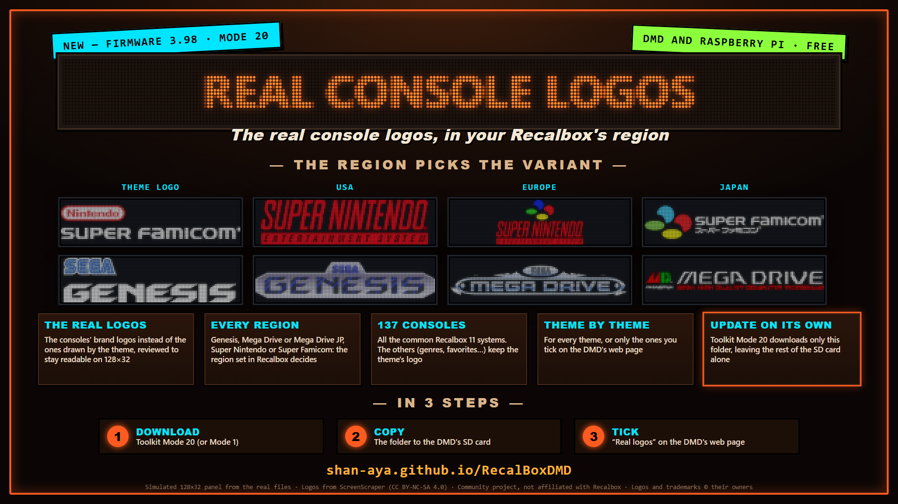
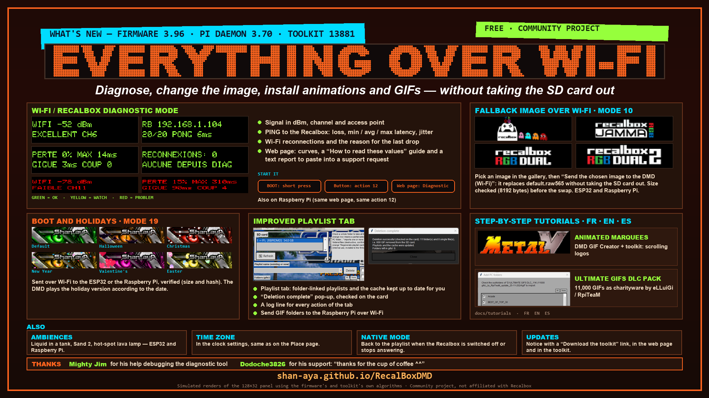
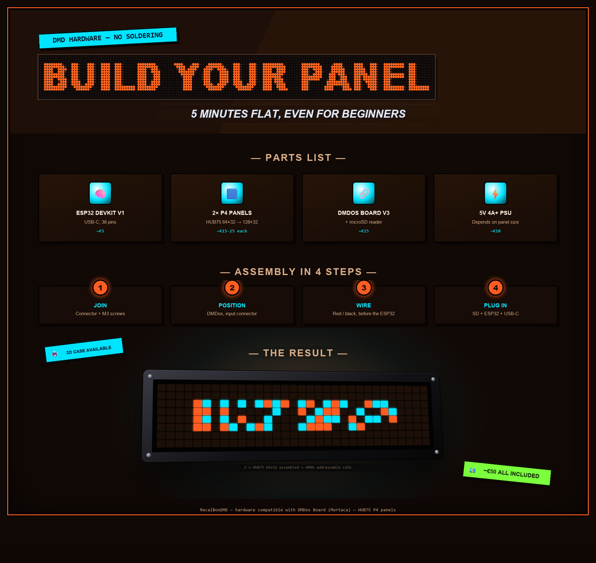
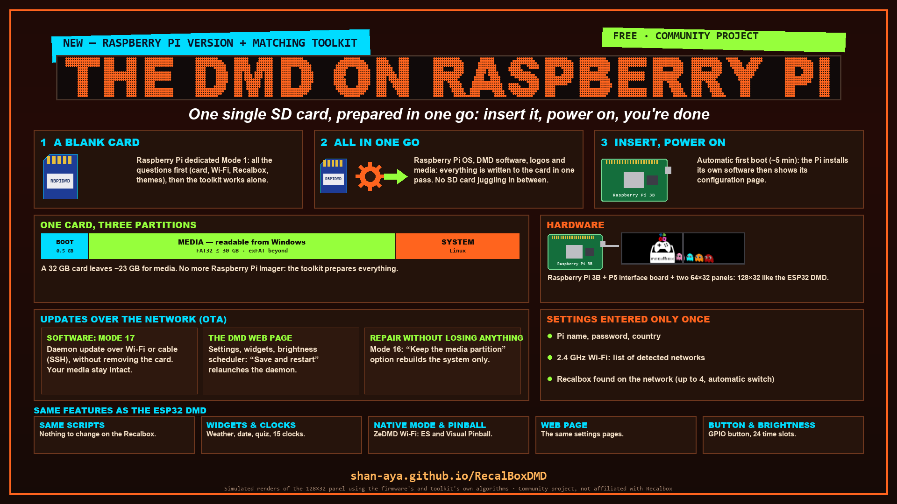
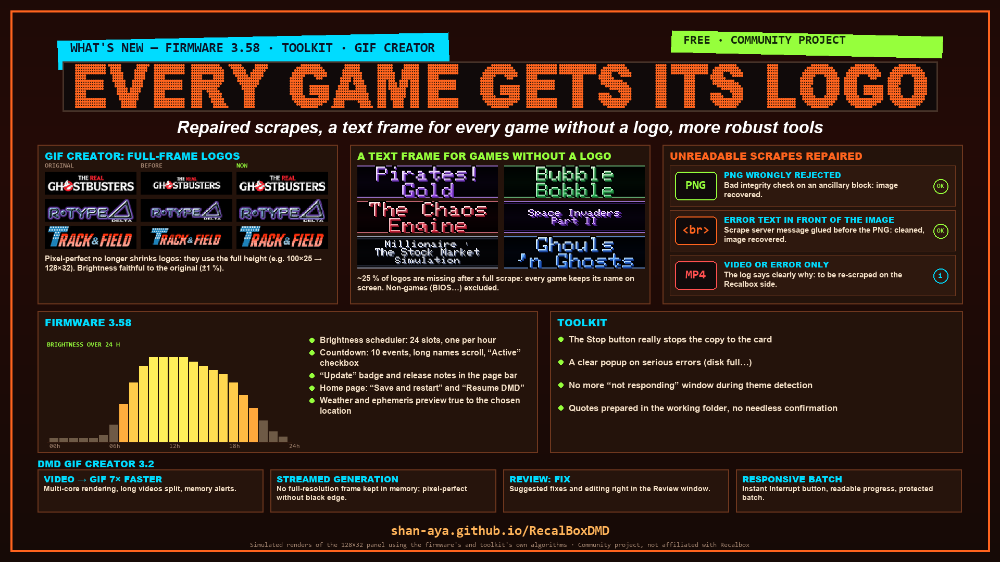
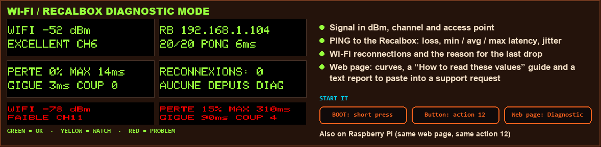

<p align="center"></p>

<h1 align="center">RecalBoxDMD — RawEdition</h1>

<p align="center">
  <b>A real LED marquee for your Recalbox arcade cabinet.<br>Every game's logo lights up in 15 ms — even with a 30,000-game MAME fullset.</b>
</p>

<p align="center">
  
  
  <a href="LICENSE"></a>
  
  
  
  
  <a href="https://buymeacoffee.com/shan_aya"></a>
</p>

<p align="center">
  🇬🇧 <b>English</b> · <a href="README.fr.md">🇫🇷 Français</a> · <a href="README.es.md">🇪🇸 Español</a>
</p>

<p align="center">
  
</p>

<p align="center">
  <a href="#-get-started-in-5-minutes"><b>🚀 Get started</b></a> &nbsp;·&nbsp;
  <a href="#-esp32-setup"><b>🔌 ESP32 setup</b></a> &nbsp;·&nbsp;
  <a href="#-raspberry-pi-setup"><b>🥧 Raspberry Pi setup</b></a> &nbsp;·&nbsp;
  <a href="#-the-pc-toolkit--the-heart-of-the-installation"><b>🧰 PC Toolkit</b></a> &nbsp;·&nbsp;
  <a href="#-web-configuration"><b>🌐 Web config</b></a> &nbsp;·&nbsp;
  <a href="https://shan-aya.github.io/RecalBoxDMD/"><b>✨ Interactive page</b></a>
</p>

<p align="center">
  <br>
  <sub>📹 Real footage, not a mock-up — the marquee follows your browsing live · <a href="medias/dmd_in_action.mp4">full clip (MP4)</a></sub>
</p>

<p align="center">
  <a href="https://youtu.be/xF8O88XXSwU"></a><br>
  <sub>🎬 <b>The video</b> — presentation, assembly and installation, by Jamyz Gaming · <a href="https://youtu.be/xF8O88XXSwU">YouTube</a></sub>
</p>

> 🔄 **Already running an earlier version?** Read **[UPGRADING.md](UPGRADING.md)** (what changes, one optional step) and the **[CHANGELOG](CHANGELOG.md)**.

---

## 📑 Contents

| | |
|---|---|
| **Understand** | [What is this?](#-what-is-this) · [What you can display](#-what-you-can-display) · [How it works](#-how-it-works) |
| **Install** | [Get started in 5 minutes](#-get-started-in-5-minutes) · [ESP32 track](#-esp32-setup) · [Raspberry Pi track](#-raspberry-pi-setup) · [Recalbox scripts](#-the-recalbox-scripts-mode-9) |
| **Control** | [PC Toolkit — every mode](#-the-pc-toolkit--the-heart-of-the-installation) · [Web configuration](#-web-configuration) |
| **Explore** | [Screens in detail](#-screens-in-detail) · [In-game screens & Pinball](#-in-game-screens-native-recalbox--pinball) · [The 600-GIF pack](#-the-600-gif-pack) · [Diagnostic](#-wi-fi--recalbox-diagnostic) · [Tutorials](#-step-by-step-tutorials) |
| **Reference** | [Technical reference](#-technical-reference) · [Troubleshooting](#-troubleshooting) · [Credits & license](#-credits--license) |

---

## 🎮 What is this?

**RecalBoxDMD** turns a **128×32 LED panel** (two chained 64×32 HUB75 modules) into a real marquee for your **Recalbox** cabinet. Launch a game: its logo lights up within a few milliseconds. The rest of the time the panel plays your GIFs, shows the time, the weather, a quiz, the Recalbox challenge ranking…

It is a fork of [Jamyz's RetroBoxLED](https://github.com/Jamyz/RetroBoxLED), rebuilt around a home-made pixel format, **raw565**, and a **PC toolkit** that prepares the whole SD card. It fixes one specific problem: on big collections (MAME fullset, FBNeo…), the original PNG/GIF firmware would freeze or show a black screen for several seconds between games.

|                            | Original PNG/GIF       | **RecalBoxDMD RawEdition**        |
|----------------------------|------------------------|-----------------------------------|
| Display time per game      | 500 ms – 3 s+          | **5 – 15 ms**                     |
| RAM needed (ESP32)         | 50 – 100 KB            | **8 KB**                          |
| MAME fullset (30,000 games)| 5-10 s freezes         | **no freeze, no black screen**    |
| Setup                      | manual, image by image | **PC toolkit, one click**         |

### Two versions, one DMD

| | 🔌 **ESP32** | 🥧 **Raspberry Pi** |
|---|---|---|
| Brain | ESP32 DevKit V1 + DMDos board | Raspberry Pi 3B (validated) + HUB75 interface board |
| Panels | 2 × P4 64×32 | 2 × P5 64×32 |
| Installation | Flash the firmware (browser) + SD card | **Blank** SD card prepared in one go by the toolkit |
| Updates | Wi-Fi (Mode 14 or web page) | Wi-Fi (Mode 17 or web page) |
| Recalbox scripts, web pages, widgets, themes | **identical** | **identical** |

> ### 🚀 The short version
> Point the **PC toolkit** at your ROMs folder and click **Start** (**Mode 1 — AUTO**). It chains everything on its own — Recalbox version detection, raw565 conversion, caches, default images, Recalbox scripts — all the way to a ready-to-use SD card. **Put it in the DMD, power on: done.** No file-by-file configuration, ever.

---

## 🖼️ What you can display

The panel mixes **two worlds**, in whatever proportion you like, from the *Widgets* web page:

<table>
<tr>
<td width="50%" valign="top">

### 🎬 The playlist & the marquee
- ⚡ **Live game marquee** — still or animated, per game or per system, fallback images (4 provided, or your own).
- 🎞️ **~600 free retro GIFs** + a *Playlist* tab to compose your attract rotations.
- 🏆 **In-game screens** — Hi-Score, Game Info, RetroAchievements, Recalbox Challenge.
- 🎨 **The DMD follows your Recalbox theme** — system logos per theme, language and region, on the fly.
- 🎯 **Pinball** — Visual Pinball tables show their DMD.
- 🎮 **Native Recalbox mode** — EmulationStation drives the panel directly.

</td>
<td width="50%" valign="top">

### 🧩 The widgets
Living screens, drawn on a **sky that follows the real sun and weather at your location**.
- 🕰️ **15 clocks** — 10 pixel-art themes + 5 animated
- 📅 Date · 🌅 Ephemeris · ⏳ Countdown
- 🌦️ Weather · 🌀 8 ambiances
- 💬 Quotes & quizzes
- 🏆 **3 Recalbox widgets** — challenge, rewards, health

Each widget: **off**, **instead of the clock** or **in addition**, with its own duration. Every N GIFs or every N minutes — or **widgets only**, a living desk clock.

</td>
</tr>
</table>

<p align="center">
  
</p>

<p align="center">
  
  
</p>

<p align="center">
  
</p>

<p align="center">
  
</p>

👉 Every screen in detail: [Screens in detail](#-screens-in-detail).

### And also
- 🔁 **Several Recalbox, one DMD** — up to 4 IPs; the DMD **switches by itself** to the one that is on.
- 🔘 **Physical button** (GPIO 21) — short / double / long / very long press, each with the action of your choice.
- 📶 **Wi-Fi / Recalbox diagnostic** — signal, access point, loss, latency and jitter towards the Recalbox, on the panel (short press on BOOT, or a button action) and on a web page that explains how to read the values. [Details](#-wi-fi--recalbox-diagnostic).
- 🌗 **Brightness scheduler** — 24 slots, one per hour.
- ⬆️ **Cable-free updates** — firmware and Pi daemon from the web page or the toolkit, with automatic rollback.
- 🛡️ **Bulletproof `config.ini`** — atomic writes, verified saves, refusal of an empty page.

---

## ⚙️ How it works

```
┌───────────────────────────────┐   UDP    ┌────────────────────────────────────────┐
│           RECALBOX            │ ───────▶ │  DMD (ESP32 or Raspberry Pi) + LEDs    │
│ Launch a game → a script      │          │                                        │
│ sends "mame/kof98"            │          │ 1. /systems/mame/kof98.raw565(pack)    │
│ (game, end of game, sleep,    │          │ 2. else: games_cache.bin index         │
│  hi-score, achievements…)     │          │ 3. else: _defaults/mame.raw565         │
└───────────────────────────────┘          │ 4. else: _defaults/default.raw565      │
                                           │        ⏱ 5-15 ms, whatever the         │
┌───────────────────────────────┐          │          collection size               │
│   PC TOOLKIT (Windows)        │   SD     └────────────────────────────────────────┘
│ gamelist.xml → raw565, caches,│  card
│ default images, scripts,      │ ────────▶   (or, for the Pi: the whole card,
│ themes, GIFs, SD copy…        │              operating system included)
└───────────────────────────────┘
```

The DMD is a "dumb" display end to end: **all the logic** (what to send, when, for how long) lives in small Recalbox-side scripts, never in the firmware.

---

## 🚀 Get started in 5 minutes

<table align="center">
<tr><td align="center" width="70"><h2>1️⃣</h2></td><td>

**[Install the PC toolkit](#install-the-toolkit)** — it does all the work.
Scrape your games in Recalbox, choose your ROMs folder, click **Start**.

</td></tr>
<tr><td align="center"><h2>2️⃣</h2></td><td>

**Build the hardware and put the firmware on** — ESP32: [assembly + flash](#-esp32-setup) (~5 min, no soldering). Raspberry Pi: [the toolkit prepares the card](#-raspberry-pi-setup).

</td></tr>
<tr><td align="center"><h2>3️⃣</h2></td><td>

**Insert the SD card, power on.**
The first boot guides you through Wi-Fi, then the **[web configuration page](#-web-configuration)** takes over for everything else.

</td></tr>
<tr><td align="center"><h2>4️⃣</h2></td><td>

**Install the [Recalbox scripts](#-the-recalbox-scripts-mode-9)** (Mode 9 — Mode 1 already does it) and launch a game: the logo appears. 🎉

</td></tr>
</table>

### Install the toolkit

Download it from the **[Releases page](https://github.com/shan-aya/RecalBoxDMD/releases)** (Windows 10/11; the binaries are not in the repository, only published there):

| Option | For whom | How |
|---|---|---|
| **A — Installer** *(recommended)* | everyone | `RecalBoxDMD_Toolkit_Setup.exe`: Start menu, uninstaller |
| **B — Portable** | no installation | `RecalBoxDMD_GUI.exe`: one file, no Python |
| **C — `.msi`** | scripted / GPO deployment | `msiexec /i "RecalBoxDMD Toolkit-1.0.0-win64.msi"` |
| **D — Python sources** | the curious, developers | `tools/` folder → `install_and_run.bat` (or `pip install Pillow Markdown && python run_gui.py`) |

**First launch**: scrape your games in Recalbox (the tool's **"How to scrape?"** button) → *Main* tab → pick your Recalbox version and ROMs folder (e.g. `D:\Recalbox\share\roms`) → **Start**. The blinking button then offers to copy to your SD card.

---

## 🔌 ESP32 setup

> **Track 1/2** — the ESP32 + DMDos board DMD. *(Got a Raspberry Pi? → [Raspberry Pi track](#-raspberry-pi-setup).)*

### 1. The hardware

🛒 **Where to buy the DMDos board:**
-  **France** — [Benfactory.fr](https://benfactory.fr/produit/dmdos/) · DMDos board + ESP32 · promo code **`retrobat10`** (−10 %)
-  **Spain** — [Mortaca Store](https://www.mortaca.com/) · guide and news on [dmdos.net](https://www.dmdos.net/)

| Component | Reference | Indicative price |
|---|---|---|
| 🧠 Microcontroller | ESP32 DevKit V1 USB-C (38 pins) | ~€5 |
| 🖥️ LED panel | 2× HUB75 RGB **P4, 64×32, 256×128 mm**, side by side (→ 128×32) | ~€15-25 / panel |
| 🔌 Connection board | **DMDos Board V3** (recommended: built-in SD reader, no soldering) | ~€15 |
| 💾 SD reader | Micro SD SPI (built into the DMDos Board) — **card ≥ 8 GB, FAT32** | ~€2 |
| ⚡ Power supply | 5 V 4 A+ | ~€10 |

<p align="center"></p>

### 2. Assembly (~5 minutes, no soldering)

Same as the official **[dmdos.net](https://www.dmdos.net/)** guide (Mortaca) — a screwdriver is all you need:

1. **Join the two panels** with the supplied junction pieces (M3 screws not included).
2. **Position the DMDos board** on the **input** connector (the board only works on that side).
3. **Wire the power**: red↔red, black↔black following the silkscreen, then link the two panels with the supplied ribbon cable.
4. **SD card, ESP32, power**: insert the prepared SD card, plug the flashed ESP32 onto the board, power through the USB-C port.

<p align="center">
  <a href="https://www.dmdos.net/#montaje"></a>
  <a href="https://www.dmdos.net/#montaje"></a>
  <a href="https://www.dmdos.net/#montaje"></a>
  <a href="https://www.dmdos.net/#montaje"></a><br>
  <sub>Thumbnails link to the official step-by-step guide · <a href="https://www.dmdos.net/#hardware">Hardware</a> · <a href="https://www.dmdos.net/#montaje">Assembly</a> · <a href="https://www.dmdos.net/#mueble">Frame</a></sub>
</p>

> ⚠️ The DMDos site ships its own, separate firmware. **Do not flash the DMDos firmware**: only the **hardware** and the **assembly guide** are reused; the firmware and the SD card contents come from this repository.
> 🖨️ 3D-printable case by **Janibol** ([Retromojones](https://www.youtube.com/@retromojones)) on [Thingiverse](https://www.thingiverse.com/thing:6704880).

### 3. The firmware

**🌐 The easiest way — from the browser** (nothing to install)

> 👉 **[Open the RecalBoxDMD Web Installer](https://shan-aya.github.io/RecalBoxDMD/install/)**

With **Chrome or Edge**, plug the ESP32 in via USB, click **Install**, pick the COM port: one minute. Tick **"Erase device"** for a first install (or when coming from another firmware, e.g. DMDos). The page shows the version it installs.

<details>
<summary><b>🛠️ Other methods: Arduino IDE · esptool · pinout</b></summary>

**Arduino IDE** (compile / customise) — open `RecalBox_DMD.ino`, install the libraries below, then *Tools → ESP32 Dev Module*, **4 MB** flash, partition scheme **Minimal SPIFFS (1.9MB APP with OTA/190KB SPIFFS)** (two firmware slots, required for Wi-Fi updates).

| Library | Purpose |
|---|---|
| [ESP32-HUB75-MatrixPanel-I2S-DMA](https://github.com/mrfaptastic/ESP32-HUB75-MatrixPanel-I2S-DMA) | DMA panel driver |
| [AnimatedGIF](https://github.com/bitbank2/AnimatedGIF) | GIF decoding (fallback) |
| [pngle](https://github.com/kikuchan/pngle) | PNG decoding (fallback, bundled) |
| [WiFiManager](https://github.com/tzapu/WiFiManager) | Wi-Fi setup |
| [Adafruit GFX Library](https://github.com/adafruit/Adafruit-GFX-Library) | Text / shapes |
| [ArduinoJson](https://github.com/bblanchon/ArduinoJson) | Config & web page |

**`esptool.py`** — the precompiled binaries are in [`binaries/`](binaries/):

```bash
esptool.py --chip esp32 --port COM3 --baud 921600 write_flash -z 0x10000 RecalBoxDMD_app.bin
# or, as a single file:
esptool.py --chip esp32 --port COM3 write_flash 0x0 RecalBoxDMD_merged.bin
```

**Default pinout**

| SD card (SPI) | GPIO |  | HUB75 | GPIO |  | HUB75 | GPIO |
|---|---|---|---|---|---|---|---|
| CS | 5 | | CLK | 16 | | R1 / R2 | 25 / 14 |
| MOSI | 23 | | OE | 15 | | G1 / G2 | 26 / 12 |
| MISO | 19 | | LAT | 4 | | B1 / B2 | 27 / 13 |
| SCLK | 18 | | A/B/C/D | 33 / 32 / 22 / 17 | | E | -1 |

</details>

### 4. The SD card and first boot

1. Run **[the toolkit's Mode 1](#-the-pc-toolkit--the-heart-of-the-installation)**: it builds the whole SD card and offers to copy it.
2. Card in the DMD, power on: the `RawEdition v…` title shows, then the idle playlist.
3. **Wi-Fi entered in Mode 1** → the DMD joins your network by itself. **Otherwise** it opens its own Wi-Fi access point: connect to it and follow the page (2.4 GHz network + the Recalbox's IP).
4. Open the **[web configuration page](#-web-configuration)** (the IP is shown on the panel) to set everything.
5. Launch a game on the Recalbox: the panel switches to its marquee.

---

## 🥧 Raspberry Pi setup

> **Track 2/2** — the same DMD, with a **Raspberry Pi** instead of the ESP32. *(Got an ESP32? → [ESP32 track](#-esp32-setup).)*

<p align="center"></p>

> ✅ **Validated: Raspberry Pi 3B** (Raspberry Pi OS Lite 32-bit "Bookworm").
> ⚠️ **Planned, untested: Pi 4 / 400 / CM4, Pi 2, Zero 2.** The software sets `gpio_slowdown` per model (Pi 4: 4; Pi 2/3: 2; Pi 1/Zero: 1); if your Pi flickers, adjust `gpio_slowdown=1..4` in `config.ini`.

### 1. The hardware
- **Raspberry Pi 3B** + a **HUB75 interface board** (RPI2DMD type: "regular" GPIO mapping, optional DS1307 RTC clock).
- **Two P5 64×32 panels** chained (128×32), 1/16 scan: `--led-cols=64 --led-rows=32 --led-chain=2 --led-pwm-bits=11`.
- An optional physical button between GPIO 21 and GND.
- The Pi's audio is disabled and one core is reserved for the display (`isolcpus=3`): the installation takes care of it.

### 2. The installation — all from the toolkit

1. Launch the **PC toolkit** and pick the **Raspberry Pi** target at the top of the window.
2. **Mode 1**: answer all the questions up front (card, Wi-Fi, user / SSH, Recalbox, themes…), then the wizard works alone, **starting from a blank SD card**: formatting, Raspberry Pi OS Lite, DMD software, converted logos in an `RBPIDMD` partition. Windows asks for administrator permission (direct disk write); the card's contents are erased **after confirmation**.
3. Card in the Pi, power on, **wait 2 to 3 minutes**: the DMD shows *Configuration page* and its address (or open `http://rbpidmd.local/`). Without valid Wi-Fi the Pi opens the **RecalBox-DMD-Config** network (192.168.4.1): configure it from a phone.
4. Enter your Recalbox's IP in the Wi-Fi settings, then run **[Mode 9](#-the-recalbox-scripts-mode-9)**: the Recalbox scripts are **the same** as for the ESP32.

One card, three partitions: **boot** (0.5 GB) · **media** (FAT32 ≤ 30 GB, exFAT beyond — readable from Windows) · **system** (Linux). No more Raspberry Pi Imager.

### 3. The Pi-specific modes

| Mode | Role |
|---|---|
| **16** | **Prepare a card** — replaces Raspberry Pi Imager: downloads Raspberry Pi OS Lite (SHA-256 checked), writes it, adds Wi-Fi / user / SSH and the DMD software. *Keep the media partition* option redoes the system alone. |
| **17** | **Install or update** the software on a Pi that is already running (found via `rbpidmd.local`, otherwise a scan) and copy the DMD SD card contents (incremental copy; the configuration is never overwritten). |

The Pi software is **downloaded from GitHub** (`pi-v…` release, SHA-256 checked); offline, the copy on the PC is used.

### 4. Updating
- **From the web page** (v3.59+): the **Settings** page warns about a new version and offers **Update now** — download, SHA-256 check, install, service restart and **automatic rollback** to the previous version if startup fails (~1 min).
- **Mode 17**, or by hand: `RecalBoxDMD_pi_payload.zip` from the latest `pi-v…` release, then `sudo bash install.sh`.

📖 Details, building from source, license (GPL-2.0+) and known limits: **[RASPBERRY-PI.md](RASPBERRY-PI.md)**.

---

## 📜 The Recalbox scripts (Mode 9)

*Common to the ESP32 and the Raspberry Pi.* The DMD only shows what Recalbox tells it: the link is a set of small **scripts** that Recalbox runs on its events (game launched, game ended, screensaver…). **Mode 1** installs them; **Mode 9** installs or **updates** them (run it again after each toolkit update).

<p align="center"></p>

**How:** *Advanced* → *RECALBOX SCRIPTS* → **Mode 9** → enter the Recalbox's **IP or name** (several allowed, comma-separated: each one gets the scripts) → **Install / Update**. Copied through the network share, or over SSH if the share is blocked. Recalbox unreachable: a ready copy stays in `recalbox_userscripts` (copy it by hand into `share/userscripts`).

| Category | Contents |
|---|---|
| **Event scripts** (automatic) | *marquee* bridge · *hi-score / game info / RB Challenge* · *RetroAchievements* · `dmd_vpx_config` (sets up Visual Pinball **only** if *Pinball mode (VPX)* is ticked on the DMD) · helpers in `dmd_helpers/` |
| **Recalbox widgets** (automatic) | `dmd_rbwidgets` sends a summary of the **challenge**, **rewards** and Recalbox **health** every 2 min |
| **Manual scripts** (*User scripts* menu) | **DMD WiFi Recovery** · **DMD Web Config** · **DMD Reboot** · **DMD Brightness +10 % / −10 %** |
| **Hi-score `.hi` files** | ~3000 files (FBNeo, MAME 0.278) added to `share/saves` — **an existing `.hi` is never overwritten** |

> **Restart EmulationStation** (or the Recalbox) after installing, otherwise the *User scripts* menu stays greyed out: Recalbox only looks for scripts at startup.

---

## 🧰 The PC Toolkit — the heart of the installation

The Windows application (FR / EN / ES, 9 visual skins) that **builds everything**: SD card, scripts, themes, GIFs, updates — for the ESP32 and the Raspberry Pi alike. Full manual: [`HELP.md`](tools/RecalBoxDMD_tool_v14286/HELP.md) (also in the *Help* tab).

| Main · SNES | Settings · Dreamcast |
|---|---|
|  |  |
| **Main · Mega Drive** | **Playlist · Neo Geo** |
|  |  |

### The six tabs

| Tab | Role |
|---|---|
| **Main** | The automatic **Mode 1**: ROMs folder, systems, Recalbox version, **START** |
| **Playlist** | Compose your idle playlists from the SD card or PC GIF folders |
| **Advanced** | Modes 2 to 18 one by one, in categories |
| **Logs** | All the text output, with a level filter — copy it to report a problem |
| **Settings** | Language, colour theme, Recalbox version profile, "L" threshold (slow systems) |
| **Help** | The manual, openable in the browser |

At the bottom, **Pause / Resume · Skip · Stop** (Stop really stops the copy). The number in the title bar is the **build**: quote it when asking for help. At launch, a **notice** flags newer toolkit, firmware, scripts or quotes (*Release notes* link).

### ⭐ Mode 1 — AUTO: everything, in one click

After **START**, all the questions are asked up front (then you let the PC work):

1. **DMD Wi-Fi** *(optional)* — **2.4 GHz** network, password verified by the PC; optional static IP (one method only: router reservation **or** static IP).
2. **Recalbox** — network detection, IP confirmation, **other Recalbox** (4 in total, comma-separated).
3. **Fallback image** — chosen or imported (resized automatically).
4. **System images** — English, French and Spanish all installed; the DMD uses your Recalbox's language.
5. **Recalbox themes** — enable following, tick the themes to copy (your Recalbox's are pre-ticked).
6. **SD card** — FAT32 drive, 8 GB minimum.
7. **Quote themes** — preview, then Mode 15 on the chosen card.
8. **Free GIF pack** — ~600 GIFs, downloaded in the background.
9. **Custom GIFs** — detour through the *Playlist* tab.

Then the pipeline: preparation → **Recalbox scripts** (Mode 9) → marquee extraction from the `gamelist.xml` files → raw565 conversion → `games_cache.bin`, `_defaults`, theme logos, GIFs, playlists, `systems_cache.dat` → **resumable SD copy** (an interrupted copy resumes where it stopped). From a few minutes to a long while depending on the collection (a 30,000-game MAME set is the slow case).

### Every mode (Advanced tab)

| Category | Mode | What it does |
|---|---|---|
| ⭐ *(Main tab)* | **1 — AUTO** | The whole pipeline above (ESP32 **or** Pi: for a Pi, blank card → ready card) |
| 📥 **Download from GitHub** | **2 — `_defaults`** | Extracts marquees *and* downloads the default images (system logos, genres, fallback) |
| | **11 — 600-GIF pack** | Downloads the free pack into `gifs/` |
| | **13 — Recalbox themes** | Downloads the chosen themes' logos into the work folder |
| | **20 — Real console logos** | Downloads **only** the `logos-reels` folder (real console logos, USA / Europe / Japan variants) into the work folder, to update it without touching the rest of the SD |
| | **15 — Quote themes** | 15 ready-made themes (quotes, fortune cookie, jokes, riddles, retro quizzes) × 3 languages, straight onto the SD |
| 🗂️ **Gamelist** | **3 — Extraction** | Extracts marquees/logos according to your Recalbox version profile |
| | **8 — Missing images** | Per-system/game report of what is really missing (ROMs / work / SD) |
| | **18 — Text cards only** | Regenerates **only** the text cards (game name) for games without an image, as `.raw565` |
| 🖼️ **Image tools** | **4 — PNG/GIF → raw565** | PNG → `.raw565`, GIF → `.raw565pack` + `.meta` |
| | **5 — 128×32** | Only resizes, no conversion |
| | **10 — Fallback image** | Picks/resets the image shown when nothing else matches, and **sends it to the DMD over Wi-Fi** (ESP32 and Pi) without taking the SD card out |
| 🧮 **Caches** | **6 — `games_cache.bin`** | Bigram index (703 entries per system) |
| | **7 — `systems_cache.dat`** | Systems index + slow/fast flags **"L"/"N"** |
| 📜 **Recalbox scripts** | **9 — Install the scripts** | [See above](#-the-recalbox-scripts-mode-9) |
| 🎨 **Recalbox themes** | **12 — Theme management** | Window comparing GitHub / your Recalbox / the SD card, updates outdated ones, converts those GitHub lacks |
| 🔄 **DMD firmware** | **14 — Wi-Fi update** | Finds the DMD, compares with the latest version, updates without a cable (~2 min, automatic rollback) |
| | **19 — Boot animations (Wi-Fi)** | Sends the default animation and the five holiday animations (Halloween, Christmas, New Year, Valentine's, Easter) to the DMD (ESP32 or Pi) over Wi-Fi, verified (size and hash) |
| 🥧 **Raspberry Pi** | **16 — Prepare a card** · **17 — Install / update** | [See the Raspberry Pi track](#-raspberry-pi-setup) |

<details>
<summary><b>📚 Detail of the modes that deserve an explanation</b> (Modes 12-13 themes · 14 firmware · 15 quotes · side tools)</summary>

**Recalbox themes (Modes 12 and 13).** The DMD shows the system logos of the theme you use in Recalbox. **Mode 13** downloads the chosen themes from GitHub (same questions as Mode 1). **Mode 12** opens theme management: it compares GitHub, your Recalbox and the **SD card** (the reference), flags themes that are older or never converted, and updates them (**Update outdated**) or converts those GitHub lacks (**Convert selection**). A theme already up to date is never re-downloaded. Ready-made logos from the GitHub package are used when the version matches (a few seconds); otherwise the toolkit **converts from your Recalbox** (which stays the reference). Each theme is prepared in the work folder then copied; if the copy is interrupted, **Copy to SD (n)** resumes. **Language and region are automatic**: every variant is installed and the DMD uses your Recalbox's, following within seconds if you change them (firmware ≥ 2.38, Mode 9's `dmd_udp_resync` v8 script). Recalbox's own themes (`recalbox-next`, `recalbox-240p`) are offered too; if they cannot come from the package they are downloaded from GitLab and converted on your PC for personal use (licence). Logos are shrunk the way Recalbox 11 does for its own DMD (undistorted letters, grey levels kept).

**Real console logos (Mode 20, firmware 3.98).** Instead of the logos drawn by the theme, the DMD can show the **real console logos** (brand logos taken from ScreenScraper, CC BY-NC-SA 4.0, reviewed to stay readable on 128×32): 137 systems, with USA / Europe / Japan variants picked by the **region set in your Recalbox**, even when the theme has no variant for that region (Genesis / Mega Drive, Super Nintendo / Super Famicom…). It sits in `systems/_defaults/_themes/logos-reels/`. Enable it on the DMD's web page (**Display** page → *Real console logos*): *All themes* or *Only the ticked themes* — the list is built by the DMD itself (themes installed on the SD + themes your Recalbox has already announced), with an option to tick new themes automatically. The theme's own language variant keeps priority; logos missing from the set (genres, favorites…) keep the theme's logo. **Mode 20** downloads only this folder from GitHub (Mode 1 and Mode 13 also offer it as a pre-ticked item); copy it to the SD card with the usual panel. ESP32 and Raspberry Pi — on a Raspberry Pi (daemon 3.74 or later), Mode 20 sends the logos straight over Wi-Fi, no SD card copy needed.

**Firmware update over Wi-Fi (Mode 14).** Since firmware 2.44 the DMD updates from GitHub: Mode 14 finds it, compares versions and, on *Update now*, has it download the new version (~2 min; the screen goes dark for a while, several reboots, do not cut the power). Size and SHA-256 are checked; automatic rollback to the old version if the new one does not boot. The web page button does the same. After an update, run Mode 9 again if new scripts are announced.

**Quote themes (Mode 15).** The window lists the themes per language with their SD state: *to install*, *up to date*, *update available*, *modified by you* (never pre-ticked). A file you modified is first copied to `widgets/quotes/_backup/<date>/`; nothing is deleted, your own themes are never touched; the DMD uses them right away.

**Side tools.** **"How to scrape?"** (annotated screenshots for your version), **"Clean folders before scrape"** (scraped images only, never ROMs or `gamelist.xml`), **hover** over modes 2/11/13/15 for a preview, adjustable **"L" threshold** (5,000 converted files by default; raise it if your SD is fast).

**Scraping profiles.**

| Profile | Recalbox scraper setting | Read |
|---|---|---|
| **10.x / 11** *(recommended)* | logo type = **CLEAR** | `media/wheels/`, `<logo>` tag |
| **9.x** | thumbnail = **MARQUEE** | `media/thumbnails/`, `<thumbnail>` tag |
| **legacy** | image = **CLEAR LOGO** or **MARQUEE** | `media/images/`, `<image>` tag |

</details>

### The Playlist tab

A **playlist** = the GIFs the DMD plays when nothing is happening on the Recalbox. Tick a whole folder, or click its name to choose file by file (hover = animated preview); **Add PC folder…** imports your GIFs; **Build playlist** saves it under a name; **Delete** cleans up; **Regenerate playlist cache** rebuilds `cache_master_gifs.dat`. *Which* playlist is active is chosen in the DMD's web page. **Send to Pi (Wi-Fi)…** (Raspberry Pi) sends your GIF folders over Wi-Fi without taking the card out. After **Delete**, a *Deletion complete* pop-up shows the result checked on the card, and every action of the tab is written to the **Logs** tab (set *Level* to *All*). For a big pack (~11,000 GIFs): [ULTIMATE tutorial](docs/tutorials/ultimate-gif-pack.md).

---

## 🌐 Web configuration

Type the DMD's IP (shown on the panel; or `rbpidmd.local` for a Pi) into the browser of a **phone or PC**: a complete, **trilingual** configuration site with fast pages and built-in help. **No app, no recompiling, no touching the SD card.** Every setting applies live, and the config is written to the card (`config.ini`).

<p align="center">
  
  
  
  
</p>

### The pages

| Page | What you set there |
|---|---|
| 🏠 **Home** | The menu: one button per page, **⚙ Settings** first. *Save & Restart*, *Resume DMD* |
| ⚙ **Settings** | **Brightness** (live preview pushed to the panel while you move the slider) · quiet/normal boot · **Pinball mode (VPX)** · **RetroAchievements** alerts · **native Recalbox mode** · **firmware version** + *Update*. Saving is confirmed on the DMD's line 2 |
| 💡 **Display & Playlists** | In-game screens · **Recalbox sleep** (follow the game's logo during the "game demos / video clips" screensavers, or plain playlist) · **Recalbox theme** (follow the active theme or default logos) · **Real console logos** (all themes, or only the ticked ones) · default playlist + shuffle · **create / edit / delete playlists** from the GIF folders on the SD |
| 📶 **Wi-Fi** | Network scan and choice, password, static IP (gateway / mask / DNS) · **Recalbox IPs** (up to 4, comma-separated) + **target Recalbox** (*Automatic* or 1-4); the active Recalbox is shown |
| ⏰ **Clock** | Enable, **theme with instant preview on the panel**, neon colour, interval (in GIFs or minutes), duration, time zone |
| ✨ **Widgets and Clock** | The **mix** (each widget's state and duration, trigger, order, background *playlist / widgets only*), ambiances and colours, quote theme, **Preview** of each widget on the panel |
| 📍 **Place** · 📅 **Events** | Location for sky / ephemeris / weather · countdown events (yearly or one-off) |
| 💬 **Quotes** | Create, edit, **import a `.txt`** or delete your quote / quiz themes |
| 🔘 **Button** | The action of each gesture of the physical button |
| 💿 **Media** | Browse / delete the SD's GIF folders, **upload GIFs** from the browser (a few files; in bulk, use the toolkit) |
| 📡 **Diagnostic** | Starts / stops the **diagnostic mode**: signal, PING to the Recalbox, curves, reading guide, text report — see [Wi-Fi / Recalbox diagnostic](#-wi-fi--recalbox-diagnostic) |

### Good to know

- 🔔 **A banner at the top of every page** announces a newer firmware, Recalbox scripts (→ Mode 9) or toolkit. The check is done by **your browser**: the DMD needs no Internet access.
- 👁️ **Live preview**: brightness, clock theme and widgets play right away on the physical panel.
- 🆘 **Wi-Fi rescue**: without a valid network the DMD opens its own access point (Pi: **RecalBox-DMD-Config**, 192.168.4.1); the manual *DMD WiFi Recovery* script relaunches it remotely.
- 🛡️ **Power-cut-proof config**: atomic write (`config.tmp` then swap), save verified before answering *OK*, refusal to save empty Wi-Fi / playlist fields.
- 🔗 **Direct pages**: `/config/widgets`, `/config/button`, `/config/clock`, `/config/network`, `/config/media`, `/config/quotes`…
- 🖧 **Telnet console** for diagnostics: `telnet <ip>` then `help`.

<details>
<summary><b>📝 The <code>config.ini</code> file (reference — no need to touch it by hand)</b></summary>

It is created by the toolkit (Mode 1) or by the DMD itself, then everything is changed from the web page. For reference:

```ini
info=1                        # 0 = no info at boot
brightness=40                 # brightness 0-100 %
playlist=RecalBox_intros.txt  # read from /playlist
random=1                      # 0 = in order, 1 = shuffled

# Wi-Fi
wifi_enabled=1
wifi_ssid=my_wifi
wifi_password=my_password
wifi_static_enabled=1
wifi_static_ip=192.168.1.240
wifi_gateway=192.168.1.1
wifi_subnet=255.255.255.0

# Recalbox link (UDP)
recalbox_ip=192.168.1.104     # the ACTIVE Recalbox
recalbox_ips=192.168.1.104,192.168.1.105   # up to 4; switches to the first that answers
recalbox_target=0             # 0 = automatic, 1..4 = force this Recalbox

# Pinball (VPX) & Recalbox sleep
feat_vpinball_dmd=0           # 1 = live VPX tables (at next restart)
feat_demo_follow=1            # 1 = follow the logo during the "game demos" sleep
feat_clip_follow=1            # same for "video clips"

[CLOCK]
CLOCK_ENABLED=1
CLOCK_THEME=-1                # -1 = random, 0 = Mario ... 9 = Level 1-1
CLOCK_INTERVAL=5              # number of GIFs before the clock
CLOCK_DURATION=60             # seconds
TZ=CET-1CEST,M3.5.0,M10.5.0/3

[BUTTON]                      # /config/button page
BTN_ENABLED=1                 # GPIO 21 to GND
BTN_ACT_SHORT=11
BTN_ACT_DOUBLE=6
BTN_ACT_LONG=2
BTN_ACT_VLONG=10

[WIDGETS]                     # /config/widgets page; WIDGET_MODE_n: 0 off, 1 instead of the clock, 2 in addition
WIDGET_BG=0                   # 0 = GIF playlist, 1 = widgets only
WIDGET_TRIGGER=0              # 0 = every N GIFs, 1 = every N minutes
WIDGET_AMB=8                  # ambiance (1 plasma ... 8 lava lamp)
WIDGET_LAT=43.3852
WIDGET_LON=5.7081
WIDGET_PLACE=Home
WIDGET_MODE_8=2               # 8 challenge, 9 rewards, 10 health (Recalbox)
WIDGET_DUR_9=30
```

</details>

---

## 📡 Wi-Fi / Recalbox diagnostic

A DMD that stutters, loses the Recalbox or “drops out”? The **diagnostic mode** (firmware 3.96, Pi daemon 3.70) measures the quality of the Wi-Fi and of the link to the Recalbox live, on the panel and on a web page.

<p align="center">
  
</p>

### Starting it

| From | How |
|---|---|
| **ESP32 BOOT button** | short press (no physical button to wire) |
| **Physical button** (GPIO 21) | action 12 “Wi-Fi / Recalbox diagnostic” on the *Button* page |
| **Web page** | the 🩺 **Diagnostic** button of the home menu (`/config/diag`) |

It loops until you press again. It also stops when you leave the page, switch tab or close the browser (8 s without a sign of life from the page).

### What it measures

Once per second, over a sliding window of the last 20 tests:

- the **signal** (dBm) and its quality, the **channel** and the **access point** (BSSID);
- a **PING to the Recalbox**: **loss**, **min / average / max** latency, **jitter**, age of the last packet, UDP gaps;
- on the ESP32, the **Wi-Fi reconnections with the reason for the last disconnection** and the history of the last 8 connections (which access point, and when).

### Reading the panel

Four pages of 4 s each, in colour (the panel texts are in French, abbreviated):

| Page | Example | Colour |
|---|---|---|
| Signal | `WIFI -52 dBm` / `EXCELLENT CH6` | green ≥ −67 dBm · yellow ≥ −75 · red below (Excellent ≥ −55, Good ≥ −67, Fair ≥ −75, Weak ≥ −82) |
| Recalbox link | `RB 192.168.1.104` / `20/20 PONG 6ms` | green / yellow / red according to loss and latency |
| Loss and jitter | `PERTE 0% MAX 14ms` / `GIGUE 3ms COUP 0` | green: 0 % loss and average < 80 ms · yellow: ≤ 10 % and < 200 ms · red beyond |
| Reconnections | `RECONNEXIONS: 0` / `AUCUNE DEPUIS DIAG` | green if none, yellow otherwise |

### The web page

Live values, **two curves** (signal and latency), a **“How to read these values”** guide (thresholds, likely causes, what to do) and a **text report** to copy or download and attach to a support request.

### Typical findings

- **Good signal but many losses**: the problem is more likely the Recalbox or the network (router, repeater, powerline) than the DMD.
- **Weak signal** (below about −75 dBm): move the DMD closer to the router.
- **Two access-point addresses alternating**: the DMD is hopping between access points of a mesh network or a repeater.

More in the [FAQ](FAQ.md).

### Raspberry Pi

Same diagnostic mode (action 12 and the same web page). No BOOT button on the Pi; the reconnection history only exists **during a diagnostic**; on Ethernet the panel shows “ETHERNET / PAS DE WIFI”.

> 🙏 Thanks to **Mighty Jim** for his valuable help debugging the diagnostic tool.

---

## 🧩 Screens in detail

### 🕰️ Clocks — 10 pixel-art themes + 5 animated

Shown between games (adjustable interval / duration) or continuously, with an **instant preview on the panel** when you pick one. Pixel-art themes: Super Mario · Tetris · Pac-Man · Space Invaders · Pong · Neon · Matrix · Fire · Rainbow · Level 1-1 (scrolling). Animated clocks: **Plasma · Life · Stars · Rain · Lava**.

<p align="center">
   
   
  <br>
   
   
  <br>
   
   
  
</p>

### 🧩 The widgets

**Widgets** web page (`/config/widgets`). Each one is **off**, **instead of the clock** (it alternates with it in the main slot) or **in addition** (played after it), with its duration in seconds. **Trigger**: every N GIFs or every N minutes; main slot round-robin or random; extras all or N drawn at random. **Background**: GIF playlist or **widgets only**. A game, a web page or a command takes the screen back at any time; the **Preview** button plays a widget right away.

| Widget | What it shows | Needs |
|---|---|---|
| 🕰️ **Clock** | 10 pixel-art themes + 5 animated, adjustable colours | — |
| 📅 **Date** | calendar card with the weekday; Sundays and public holidays in colour | time (NTP) |
| 🌅 **Ephemeris** | sunrise, sunset, day length, **moon phase** | location |
| ⏳ **Countdown** | days left to your events (10 max, yearly or one-off) | time |
| 🌀 **Ambiance** | 8 animations: plasma, rain, stars, game of life, liquid, sand, **sand 2**, **lava lamp**; adjustable colours | — |
| 🌦️ **Weather** | temperature, ▲▼ min/max, conditions; long place names scroll | location + Internet (open-meteo.com, every 30 min) |
| 💬 **Quotes and quizzes** | quotes, jokes, riddles, **3-choice quizzes**, illustrated backgrounds | — |
| 🏆 **Recalbox: challenge** | current challenge, days left, **top 3 with ▲▼**, your rank and GGs | Recalbox scripts |
| 🎁 **Recalbox: rewards** | what you can win (avatar, badge, title) and how | Recalbox scripts |
| 🩺 **Recalbox: health** | temperature, power, clock, network, disk, memory indicators | Recalbox scripts |

**The sky** follows your location's **real sunrise / sunset** and live weather (sun, moon, stars, clouds, rain, snow, storm) behind date, weather, ephemeris and countdown; the three Recalbox widgets have an **illustration** behind them.

<p align="center">
      <br>
      <br>
         <br>
  <sub>Simulated renders of the 128×32 panel, drawn with the firmware's own drawing routines.</sub>
</p>

<details>
<summary><b>💬 Quotes and quizzes — file format, themes, backgrounds</b></summary>

**One theme = one text file, one quote per line**, four formats:

| Line | What the panel shows |
|---|---|
| `Fortune cookie text` | the text, centred and wrapped |
| `Text \| Author` | the quote, then the author |
| `Question? \| Answer` | riddle / joke: the answer is revealed after a pause |
| `Question? \| A / B / C \| 3` | **3-choice quiz** (red / white / green), countdown bar, then the right answer flashes and **stays on screen** |

- **Ready to use**: **Mode 15** installs 15 themes of 50 entries (FR/EN/ES) into `widgets/quotes/<language>/`; built-in themes per language also exist (*Restore* button).
- **Your own**: *Widgets → Quotes* page (create, edit, delete, **import a `.txt`**, 64 KB max, accents converted) or `.txt` files dropped into `/widgets/quotes/<language>/`.
- **Illustrated backgrounds**: a 128×32 raw565 image (`/widgets/quotes/bg/<theme>.raw565`, 8,192 bytes) becomes the background; an optional `<theme>.col` sets colours, shadow/outline, brightness and text area. The original backgrounds are **embedded in the firmware**.
- The **widget's duration** is a number of quotes played in a row.

</details>

<details>
<summary><b>🏆 Recalbox widgets · 🔁 Several Recalbox · 🔘 Physical button</b></summary>

**Recalbox widgets.** A small script on the Recalbox reads its own files (challenge, ranking, movements, `[Health]` journal lines, temperature, memory, disk) and sends a summary to the DMD over UDP (`CMD=rbw`) **every 2 minutes** (`dmd_rbwidgets[watch](permanent).sh` + `dmd_helpers/dmd_rbwidgets.py`, installed by Mode 9). Without received data, the widgets are skipped silently. Default durations: challenge 15 s, **rewards 30 s** (8 s minimum per reward, long texts scroll), health 15 s.

**Several Recalbox, one DMD.** List up to **4 IPs** (Wi-Fi page, or `recalbox_ips=`) and choose **Target = Automatic** or a forced Recalbox. The DMD stays on the one that answers; when it goes off, it **probes the others and switches by itself**, with no reconfiguration or restart. Packets from the other listed Recalbox are ignored so two consoles never get mixed. The toolkit (Modes 1 and 9) accepts several IPs too.

**Physical button.** A button between **GPIO 21 and GND** (internal pull-up). The **Button** page assigns an action to each gesture: **short**, **double**, **long** (~1.5 s), **very long** (~5 s) — next GIF, pause/resume, clock now, brightness, screen off, info screen, config URL, restart… (maintenance actions only on the very long press).

</details>

### 🎞️ Marquee, fallback images, Recalbox theme

- **Marquee per game or per system**, still (`.raw565`) or animated (`.raw565pack`). For a game with no image, **a text card** with its name (Mode 18); otherwise a **fallback image** — 4 provided or your own.
- **The DMD follows the active Recalbox theme**: the theme's system logos, in your Recalbox's language and region, on the fly (firmware ≥ 2.38).

<p align="center">
   
   
</p>

---

## 🏆 In-game screens, native Recalbox & Pinball

### In-game overlay screens

<p align="center">
   
   
</p>

While a game is actually running (never in idle / playlist), the panel alternates the marquee with up to **four** screens — full-screen, non-blocking and **self-limiting**: each returns to the marquee on a timer that lives **entirely on the DMD**, so a slow or failing script can never lock it up.

- 🏆 **Hi-Score (MAME / FBNeo)** — decodes the emulator's own score file (`.hi`) through a community manifest converted from **hi2txt-xml** (4,087 games). No RAM reading, no per-game recipe: if a game is not covered or its file is missing, **nothing is displayed — never a wrong score**.
- ℹ️ **Game info** — description, genre, developer, year, taken from your `gamelist.xml`.
- 🎖️ **RetroAchievements** — shown as soon as an achievement unlocks.
- 📅 **RB Challenge** — the official Recalbox monthly Challenge ranking, read from the Recalbox share.

**Zero configuration on the DMD side**: install the scripts (Mode 9) and everything works for every game that has data.

### 🎮 Native Recalbox DMD mode

With Recalbox 11, **EmulationStation can drive the panel directly**, which then behaves as a **ZeDMD-WiFi**. Enable *native Recalbox mode* in **Settings**. When the Recalbox shuts down or stops answering, the DMD goes back to its playlist by itself.

> **Updating the firmware in native mode**: with firmware **3.84 or older**, updating from the web page fails (`echec:heure`: the clock is not synchronised in this mode). Untick *native Recalbox mode*, **Save & Restart**, run the update, then tick it again. From 3.85 on, nothing to do.

### 🎯 Visual Pinball (VPX) tables

The DMD speaks the **ZeDMD-WiFi** protocol (HTTP handshake, then frames over **UDP port 3333**) used by Visual Pinball's **DMDUtil** plugin: launch a table from Recalbox and the DMD shows the table's own DMD image live. *No restart*; playlist and Recalbox screens suspended during the table; back to normal when the game ends (the scripts tell the DMD) or ~5 s after the last frame; brightness restored. Large DMDs (e.g. 192×64) are scaled down to 128×32, colourised tables display in colour.

**Setup (once)** — ticked by default since firmware 3.58:

1. **On the DMD**: *Pinball mode (VPX)* ticked in **Settings**, then *Save & Restart*.
2. **On the Recalbox** — `/recalbox/share/system/configs/vpinball/VPinballX-configgen.ini`:
   ```ini
   [Plugin.DMDUtil]
   Enable = 1
   ZeDMDWiFiEnabled = 1
   ZeDMDWiFiAddr = 192.168.1.240
   ```
   (`192.168.1.240` = **this DMD's IP**; no trailing comment on the line.) **Automatic with Mode 9**: the `dmd_vpx_config` script (v4) writes what is missing at every boot, before every launch and after every game — never while a table runs. The address is the one of Recalbox's ZeDMD option (`dmd.zedmd.wifi`) or, failing that, of the DMD that answers (a stale address is corrected); it also sets the "external DMD" option back to ZeDMD before each launch (Recalbox clears it otherwise), without touching another display you may have chosen. **Ticking the option is what authorises it**; to switch it off for good, create `/recalbox/share/userscripts/dmd_helpers/vpx_autoconfig.disabled` (log: `/recalbox/share/system/logs/dmd_vpx_config.log`).
3. **Recalbox scripts** (Mode 9): the DMD leaves Pinball mode instantly when a game ends.

> ⚠️ Edit this `.ini` **only when no table is running**: VPX rewrites it on exit. A Recalbox update can also reset it. Check: `vpinball.log` must contain `ZeDMD WiFi enabled, connected to <IP>`.

**Per table type**: *alphanumeric-display tables* (Bally/Williams) → **AlphaDMD** plugin (`[Plugin.AlphaDMD]` → `Enable = 1`); *Serum colourised tables* → `[Plugin.Serum]` / `SerumPath = <table folder>/altcolor` in the table's `.ini` (otherwise `Serum: No colorization file found`).

**Compatibility**: tested on 128×32 DMD tables (Batman), Big Bang Bar (192×64), 6 of 8 alphanumeric tables (Black Hole and Farfalla are not handled by AlphaDMD), one colourised table (Diner). Nothing to show for electromechanical tables and those that use PinUP Player (e.g. Batman 66). **Tested with Recalbox only**; a Visual Pinball Standalone with the same `ZeDMDWiFi*` settings should work (untested).

---

## 🎞️ The 600-GIF pack

**Mode 11** (or the *600-GIF pack* button in the Playlist tab) downloads ~**600 retro GIFs** from this repository (`carte SD/gifs/`) — no external site, no account:

| | | |
|---|---|---|
| Arcade | Consoles | Computers |
| Pinball (short) | Pinball (story) | Logo |
| Halloween | Christmas | Other / test |

Point a playlist at any subset (Playlist tab). Animated GIFs follow the same `.raw565pack` fast path as the marquees: smooth playback even on the ESP32.

> ℹ️ One category (`XXX_Mature`) holds adult-themed pixel art, entirely optional, never selected by default.

**Where does this pack come from?** It is the **free sample** of **eLLuiGi**'s ([RpiTeaM](https://rpiteam.carrd.co/)) "pixel perfect" collection, redistributed with permission. The full collection — the **"ULTIMATE GIFS DLC"**, ~11,000 animations (1,441 Arcade, 3,601 Consoles, 849 Computers…) — is distributed as **charityware** by its creator: [rpiteam.carrd.co](https://rpiteam.carrd.co/) · [forum thread](https://www.neo-arcadia.com/forum/viewtopic.php?t=67065).

📖 **Step-by-step tutorial, with screenshots**: [installing the ULTIMATE GIFS DLC pack on the DMD card](docs/tutorials/ultimate-gif-pack.md).

> ✅ Always add GIFs through the toolkit's **Playlist tab** or the web config's **Media** page — **never by copying straight onto the SD**: that is what rebuilds the playlist and the cache the firmware reads.

---

## 📚 Step-by-step tutorials

| Tutorial | What you get |
|---|---|
| [Animated marquees](docs/tutorials/animated-marquees.md) | DMD GIF Creator + the toolkit: an SD card with animated marquees (`.raw565pack`) for the games you choose |
| [Installing the ULTIMATE GIFS DLC pack](docs/tutorials/ultimate-gif-pack.md) | ~11,000 GIFs by eLLuiGi / RpiTeaM on the DMD card, with playlists and cache kept consistent |

Every tutorial comes in 🇬🇧 🇫🇷 🇪🇸, with real screenshots.

---

## 🔬 Technical reference

<details>
<summary><b>The raw565 format · the bigram cache · the mask system</b></summary>

**`.raw565`** — still image: `128 × 32 × 2 = 8,192 bytes` of raw RGB565, read in one SD operation and sent straight to the panel. **`.raw565pack` + `.meta`** — animated image: concatenated frames + per-frame delays (`uint16`, ms) loaded once into RAM; one SD open + one seek per frame, **zero GIF decoding on the device**.

**Bigram cache** (`games_cache.bin`) — an index of 703 entries per system (one per 2-letter prefix, e.g. `KO` for `kof98`): a folder of tens of thousands of files is never listed.

**Mask system** — a system flagged **"L"** (above the threshold, 5,000 files by default — MAME, FBNeo…) shows its default image *immediately* while a background task locates and decodes the real one: the panel **never goes black**.

</details>

<details>
<summary><b>The SD card layout</b></summary>

```
📁 SD CARD (FAT32)
├── config.ini
├── systems/
│   ├── <system>/
│   │   ├── <game>.raw565            ← still marquee
│   │   ├── <game>.raw565pack        ← animated marquee (frames)
│   │   └── <game>.meta              ← animated marquee (timings)
│   └── _defaults/
│       ├── default.raw565           ← global fallback
│       └── <system>.raw565          ← per-system fallback (chosen language)
├── gifs/                            ← idle playlists (the 600-GIF pack lands here)
│   ├── Arcade/  Consoles/  Computers/  Pinball_Short/  Pinball_Story/
│   └── Halloween/  XMAS/  Logo/  Other/ ...
├── widgets/
│   └── quotes/
│       ├── <fr|en|es>/<theme>.txt       ← quote / quiz themes
│       └── bg/<theme>.raw565 (+ .col)   ← illustrated backgrounds
├── playlists/<playlist_name>.txt
├── games_cache.bin                  ← bigram index
└── systems_cache.dat                ← systems index + L/N flags
```

On a Raspberry Pi, this content lives in the `RBPIDMD` media partition.

</details>

<details>
<summary><b>The UDP link, step by step</b></summary>

```
Recalbox → marquee[rungame,endgame,...].sh → UDP → DMD → LED panel

1. You launch "King of Fighters '98"
2. The script detects the event and publishes "mame/kof98"
3. The DMD looks, in order, for:
   a. /systems/mame/kof98.raw565 (or .raw565pack)   ← instant
   b. games_cache.bin bigram index                   ← fast
   c. /systems/_defaults/mame.raw565                 ← system fallback
   d. /systems/_defaults/default.raw565              ← global fallback
4. Displayed in under 15 ms
```

</details>

<details>
<summary><b>The repository layout</b></summary>

```
binaries/        ← precompiled ESP32 firmware images (bootloader / partitions / app / merged)
raspberry-pi/    ← the Raspberry Pi daemon (C++17, GPL-2.0+) and its guides
tools/           ← PC toolkit (Python GUI FR/EN/ES), Recalbox scripts, theme package, hi-score
carte SD/        ← ready-to-copy SD card contents (GIFs, default images, widgets, playlists)
medias/          ← screenshots, demo GIFs, flyers, press kit
docs/            ← GitHub Pages: showcase page (shan-aya.github.io/RecalBoxDMD) + Web installer (…/install/)
history/         ← archived versions
```

</details>

---

## 🩺 Troubleshooting

Freezes, corrupted display, Wi-Fi loops, a DMD out of sync with Recalbox: check the **[FAQ & Troubleshooting](FAQ.md)** first (USB power, microSD quality, ESP32 chip revision…).

| Problem | Solution |
|---|---|
| "Pillow is not installed" | Installed on first launch; otherwise `pip install Pillow` |
| "GitHub API unreachable" | Downloads need Internet; retry later (rate limit possible) |
| No removable drive detected | Check that the SD card is visible in Windows Explorer (FAT32, ≥ 8 GB) |
| The ESP32 shows nothing | Power (5 V 4 A min.), `config.ini` at the SD root, HUB75 wiring; try Telnet `help` |
| ESP32 not detected (no COM port) | USB drivers: [CP2102](https://www.silabs.com/developers/usb-to-uart-bridge-vcp-drivers) or [CH340/CH341](https://learn.sparkfun.com/tutorials/how-to-install-ch340-drivers/all) |
| The Pi flickers | Adjust `gpio_slowdown=1..4` in `config.ini`; see [RASPBERRY-PI.md](RASPBERRY-PI.md) |
| Slow display / black screen between games | Did you run **Mode 1**? Is the system flagged `L` in `systems_cache.dat`? Raise the threshold if your SD is fast |
| Wrong image (box art instead of logo) | Check the **Recalbox version** profile, use **"How to scrape?"**, then **Mode 8** |
| Nothing shows when a game starts | Missing or old scripts → **Mode 9**, then restart EmulationStation; check the Recalbox IP in the web page |
| *User scripts* menu greyed out | Restart EmulationStation (or the Recalbox) |
| Unstable Wi-Fi, losses, games that do not always show | Run the **diagnostic** (short press on BOOT, or the *Diagnostic* page) and read [Wi-Fi / Recalbox diagnostic](#-wi-fi--recalbox-diagnostic) |

Still stuck? Copy the **Logs** tab and the **build** number, and open an issue on the [GitHub page](https://github.com/shan-aya/RecalBoxDMD).

---

## 🙏 Credits & license

- **Original RetroBoxLED project**: [Jamyz](https://github.com/Jamyz/RetroBoxLED) — the ESP32 firmware base and the original idea
- **RawEdition**: **Shan_ayA** — raw565 format, bigram cache, mask system, PC toolkit, clock themes, widgets, Raspberry Pi version
- **Inspiration**: [RetroPixelLED](https://github.com/fjgordillo86/RetroPixelLED) by fjgordillo86 · **Pi display**: [rpi-rgb-led-matrix](https://github.com/hzeller/rpi-rgb-led-matrix) by Henner Zeller
- **600-GIF pack**: **eLLuiGi** / [RpiTeaM](https://rpiteam.carrd.co/)
- **Hi-Score manifest**: converted from the community **hi2txt-xml** format (MAME's `hiscore.dat` project) — 4,087 games
- **Hardware & assembly**: [Mortaca — DMDos Board](https://www.mortaca.com/) / [dmdos.net](https://www.dmdos.net/) · French shop: [Benfactory.fr](https://benfactory.fr/produit/dmdos/) (code `retrobat10`)
- **3D case**: Janibol — [Retromojones](https://www.youtube.com/@retromojones)
- **Community**: [Recalbox](https://www.recalbox.com/)
- **Thanks**: **Mighty Jim** for his help debugging the diagnostic tool · **Dodoche3826** for his support — “thanks for the cup of coffee ^^”
- **Development**: written with the assistance of [Claude](https://www.anthropic.com/claude) (Anthropic) — AI-assisted code across the whole firmware and PC toolkit

📜 [CHANGELOG](CHANGELOG.md) · [FAQ](FAQ.md) · [UPGRADING](UPGRADING.md) · [QUICK-START](QUICK-START.md) · [Raspberry Pi](RASPBERRY-PI.md) — licensed under [MIT](LICENSE) (the Raspberry Pi daemon: GPL-2.0+).

🔔 **Get notified of new releases**: *Watch → Custom → Releases* on GitHub, or the [releases feed](https://github.com/shan-aya/RecalBoxDMD/releases.atom). The toolkit and the web config warn you too, and the [Web Installer](https://shan-aya.github.io/RecalBoxDMD/install/) shows the firmware version it installs.

☕ If this project is useful to you: [buy me a coffee](https://buymeacoffee.com/shan_aya) or [donate via PayPal](https://www.paypal.com/paypalme/felysaya)

<p align="center"><i>RecalBoxDMD RawEdition — Recalbox + a real LED marquee panel, instant even with 30,000 MAME games.</i> 🎮⚡</p>
