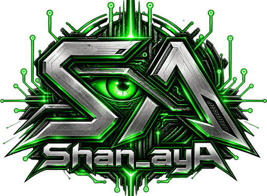

<h1 align="center">RecalBoxDMD — RawEdition</h1>

  <b>A real LED marquee for your Recalbox arcade cabinet. Every game's logo lights up in 15 ms — even with a 30,000-game MAME fullset.</b>

  
  
  
  
  
  
  
  
  

  🇬🇧 <b>English</b> · <a href="README.fr.md">🇫🇷 Français</a> · <a href="README.es.md">🇪🇸 Español</a>

> ## 🧪 ALPHA branch — test builds
> This branch holds the **alpha** versions (firmware, Raspberry Pi daemon, PC Toolkit) for the **Recalbox alpha testers**. Features here can be unfinished or change without notice. **Do not install them on a stable Recalbox.** The full user manual is on the [stable branch](https://github.com/shan-aya/RecalBoxDMD/blob/main/README.md).

## 🔭 What is new and needs testing

- 📟 **ESP32 firmware**
  - Panel **colour order** (6 orders) with a **live R, G, B preview** on the DMD — T01, tidied **Settings page** — T03
  - **Channel switch** alpha ↔ stable — T04, update notices limited to the alpha channel — T06
  - **Game GIFs while playing** (option *Basic*, `/gifs_jeux`, exclusions) — T10
  - Web pages that come back by themselves after an update — T07, **settings that survive restarts** (`config.ini` protected) — T08, **Wi-Fi change** — T09
- 🍓 **Raspberry Pi daemon**
  - Colour order with live preview — T02, **accented file names** (UTF-8 media partition) — T18, Settings page — T03, channel switch — T05, update button staying on alpha — T16
  - Game GIFs and **Playlist over Wi-Fi** — T10, T12
- 🧰 **PC Toolkit**
  - **Logo customization** — T11, **target badge** and Playlist over Wi-Fi — T12
  - **Installation** tab — T13, **Format as FAT32** — T14
  - **Compatibility notices** (⚠ badge) — T15, Recalbox themes (Modes 12 / 13) — T17, **Mode 17 and Mode 1 on a Pi card** — T19

## 🙋 Take part in the alpha tests

1. Join the Discord: https://discord.gg/CYAyGJSvp4
2. Press the 🧪 button in the alpha message (or type `/alpha`) to get the **Tester** role — it opens `#support-alpha` and `#alpha-tests`.
3. Install the alpha: https://shan-aya.github.io/RecalBoxDMD/install-alpha/ (or switch channel in the web page *Settings*).
4. Pick tests in `#alpha-tests` (or the table below), do them, report with `/alphatest`.

## 📮 Report a result (on Discord)

- Type **`/alphatest`** in any channel and fill in: **test** (T01…), **result** (✅ works · ⚠️ works with a problem · ❌ does not work · ⏭️ cannot test), **device**, a **comment** (required unless ✅: versions, what you did, what happened) and an optional **screenshot / log**.
- The bot posts your result in the test's post in `#alpha-tests` and counts it: **`/alphaprogress`** shows what you have done.
- A bug that goes beyond a test: open a post in `#support-alpha` with versions (firmware / Pi / toolkit / Recalbox), steps, expected, observed (a `/diag` log helps).

## ✅ Test plan

Details of each test (steps and expected result): [ALPHA-TESTS.md](ALPHA-TESTS.md).

| Test | Area | What |
|---|---|---|
| **T01** | ESP32 | Panel colour order and live preview (ESP32) |
| **T02** | Raspberry Pi | Panel colour order and live preview (Raspberry Pi) |
| **T03** | ESP32 / Pi / Toolkit | Settings page layout |
| **T04** | ESP32 | Switch channel alpha ↔ stable (ESP32) |
| **T05** | Raspberry Pi | Switch channel alpha ↔ stable (Raspberry Pi) |
| **T06** | ESP32 / Pi / Toolkit | Update notices stay in the alpha channel |
| **T07** | ESP32 | Web pages come back after a firmware update |
| **T08** | ESP32 | Settings survive restarts |
| **T09** | ESP32 | Change the Wi-Fi network |
| **T10** | ESP32 / Pi / Toolkit | Game GIFs while playing |
| **T11** | Toolkit | Logo customization |
| **T12** | Toolkit | Target badge and Playlist over Wi-Fi |
| **T13** | Toolkit | Installation tab (Mode 1) |
| **T14** | Toolkit | Format an SD card as FAT32 |
| **T15** | Toolkit | Compatibility notices (⚠ badge) in the toolkit |
| **T16** | Raspberry Pi | Pi update button stays on alpha |
| **T17** | Toolkit | Recalbox themes (Modes 12 / 13) |
| **T18** | Raspberry Pi | Accented file names (UTF-8 media partition) |
| **T19** | Toolkit | Mode 17 and Mode 1 on a Raspberry Pi card |

## ⚠️ Good to know

- Wait **60 seconds** of normal running between two channel switches or updates (an update that has not run 60 s is rolled back by the bootloader).
- T14 **erases** the SD card: use a spare card.
- Alpha builds can be replaced several times a day; the version numbers are in the badges above and in the [CHANGELOG](CHANGELOG.md).

## 📚 Documents of this branch

[ALPHA-TESTS](ALPHA-TESTS.md) (test plan) · [CHANGELOG](CHANGELOG.md) (what changed) · [CHANNELS](CHANNELS.md) (stable vs alpha) · [QUICK-START](QUICK-START.md) · [UPGRADING](UPGRADING.md) · [FAQ](FAQ.md) · [RASPBERRY-PI](RASPBERRY-PI.md) · full manual: [stable README](https://github.com/shan-aya/RecalBoxDMD/blob/main/README.md)
