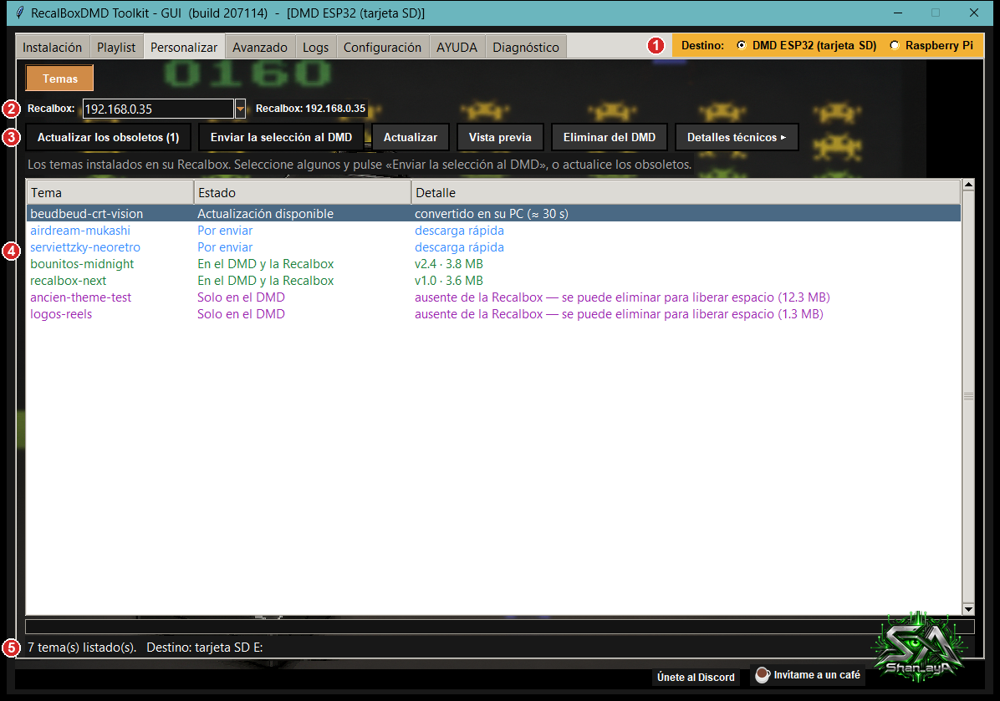

# 🎨 Página «Temas» del toolkit — los logotipos de su tema de Recalbox en el DMD

[🇬🇧 English](themes-page.md) · [🇫🇷 Français](themes-page.fr.md) · **🇪🇸 Español**

> El DMD muestra los logotipos del tema que usa en Recalbox. La página **Temas** (toolkit → pestaña **Personalizar** → **Temas**) muestra cómo está cada tema y permite **enviarlo** al DMD, **actualizarlo** o **borrarlo**, sin línea de comandos. Sustituye a los antiguos Modos 12 y 13.

## Antes de empezar

• **Toolkit al día** (versión 207114 o posterior).  
• **Recalbox encendida** en la misma red: la página lee de ella sus temas instalados.  
• **DMD ESP32**: la **tarjeta SD del DMD en el PC**. **Raspberry Pi**: la Pi encendida y con Wi-Fi (los temas se envían por Wi-Fi, sin tarjeta).  
• Elija su DMD con **Destino**, arriba a la derecha (marca 1).

## Abrir la página

Toolkit → pestaña **Personalizar** → **Temas**. La página se rellena sola.  
**1** Destino: la tarjeta SD del DMD ESP32 o una Raspberry Pi.  
**2** La Recalbox leída (cambie la dirección si hace falta).  
**3** Los botones de acción.  
**4** Sus temas, uno por línea, con su **estado** y su tamaño.  
**5** La barra de estado: cuántos temas y en qué destino.

## Entender los estados

🟢 **En el DMD y la Recalbox** — todo bien (versión y tamaño indicados).  
🔵 **Por enviar** — instalado en la Recalbox, aún no en el DMD. «descarga rápida» = logotipos ya preparados; «convertido en su PC (≈ 30 s)» = el toolkit los fabrica.  
🟠 **Actualización disponible** — la copia del DMD es más antigua.  
🟣 **Solo en el DMD** — ausente de su Recalbox: puede **eliminarlo** para liberar espacio (tamaño indicado).  
• **Por actualizar en la Recalbox** — la propia Recalbox tiene una versión más antigua (actualícela con el gestor de temas de Recalbox).  
• **Destino ausente** — tarjeta SD no detectada o Pi inaccesible: conéctela y pulse **Actualizar**.

## Los botones

**Actualizar los obsoletos (n)** — actualiza de una vez todos los temas «Actualización disponible».  
**Enviar la selección al DMD** — pulse uno o varios temas de la lista (Ctrl/Mayús para varios) y después este botón. En tarjeta SD, **expulse la tarjeta antes de retirarla**.  
**Actualizar** — vuelve a leer la Recalbox y el destino (úselo tras conectar la tarjeta).  
**Vista previa** — muestra una hoja de control de los logotipos del tema seleccionado.  
**Eliminar del DMD** — quita el tema seleccionado del DMD. Una **confirmación** indica el espacio liberado. Si el tema sigue en la Recalbox podrá reenviarlo más tarde; si no, el borrado es definitivo.  
**Detalles técnicos** — columnas adicionales (idiomas, regiones…) para los curiosos.

## Idioma y región: nada que elegir

Todas las variantes (idiomas de los textos, regiones de las consolas) se instalan en el DMD. Sigue los ajustes de su Recalbox y se adapta si los cambia más tarde. Recalbox 10 y Recalbox 11 tienen cada una su juego de logotipos: el toolkit elige solo el adecuado.

## Preguntas frecuentes

**Todos mis temas pasan a «Actualización disponible»: ¿es normal?**

Sí. El proyecto publicó una nueva versión del paquete de logotipos (juegos separados para Recalbox 10 y 11, una marca invisible en cada logotipo). Pulse **Actualizar los obsoletos** una vez y todo vuelve a verde.

**El DMD no muestra los logotipos de mi tema**

Mire la línea del tema: **Por enviar** → pulse **Enviar la selección al DMD**. **Destino ausente** → conecte la tarjeta SD (o encienda la Pi) y pulse **Actualizar**. Si el tema no está en la lista, compruebe que la Recalbox está encendida y que el tema está instalado en ella. Recuerde que el DMD solo muestra el tema **activo en Recalbox**.

**¿Dónde están los Modos 12 y 13?**

Sustituidos por esta página más sencilla: pestaña **Personalizar** → **Temas**. El Modo 1 sigue ofreciendo los temas al preparar una tarjeta.

**Mi tarjeta SD está llena, ¿qué borro?**

Empiece por los temas **Solo en el DMD** (🟣): ya no están en su Recalbox y se indica su tamaño. Selecciónelos y pulse **Eliminar del DMD**: la confirmación muestra el espacio liberado.

---

*Esta ficha también está en el servidor de Discord del proyecto: escriba `/fiche`.*
