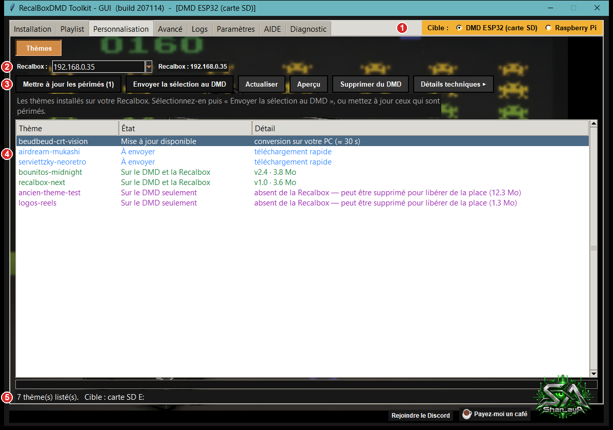

# 🎨 Page « Thèmes » du toolkit — les logos de votre thème Recalbox sur le DMD

[🇬🇧 English](themes-page.md) · **🇫🇷 Français** · [🇪🇸 Español](themes-page.es.md)

> Le DMD affiche les logos du thème que vous utilisez dans Recalbox. La page **Thèmes** (toolkit → onglet **Personnalisation** → **Thèmes**) montre où en est chaque thème et vous permet de l'**envoyer** au DMD, de le **mettre à jour** ou de le **supprimer**, sans aucune ligne de commande. Elle remplace les anciens Modes 12 et 13.

## Avant de commencer

• **Toolkit à jour** (build 207114 ou plus récent).  
• **Recalbox allumée** sur le même réseau : la page y lit vos thèmes installés.  
• **DMD ESP32** : la **carte SD du DMD dans le PC**. **Raspberry Pi** : le Pi allumé et en Wi-Fi (les thèmes partent par Wi-Fi, sans carte).  
• Choisissez votre DMD avec **Cible** en haut à droite (repère 1).

## Ouvrir la page

Toolkit → onglet **Personnalisation** → **Thèmes**. La page se remplit toute seule.  
**1** Cible : carte SD du DMD ESP32 ou Raspberry Pi.  
**2** La Recalbox lue (changez l'adresse si besoin).  
**3** Les boutons d'action.  
**4** La liste de vos thèmes, un par ligne, avec son **état** et sa taille.  
**5** La barre d'état : combien de thèmes, sur quelle cible.

## Comprendre les états

🟢 **Sur le DMD et la Recalbox** — tout est bon (version et taille indiquées).  
🔵 **À envoyer** — installé sur la Recalbox, pas encore sur le DMD. « téléchargement rapide » = logos déjà prêts ; « conversion sur votre PC (≈ 30 s) » = le toolkit les fabrique.  
🟠 **Mise à jour disponible** — la copie du DMD est plus ancienne.  
🟣 **Sur le DMD seulement** — absent de votre Recalbox : vous pouvez le **supprimer** pour libérer de la place (la taille est indiquée).  
• **À mettre à jour sur la Recalbox** — c'est la Recalbox elle-même qui a une version plus ancienne (mettez-la à jour avec le gestionnaire de thèmes de Recalbox).  
• **Cible absente** — carte SD non détectée ou Pi injoignable : branchez-la puis **Actualiser**.

## Les boutons

**Mettre à jour les périmés (n)** — met à jour d'un coup tous les thèmes « Mise à jour disponible ».  
**Envoyer la sélection au DMD** — cliquez un ou plusieurs thèmes dans la liste (Ctrl/Maj pour plusieurs), puis ce bouton. Sur carte SD, **éjectez la carte avant de la retirer**.  
**Actualiser** — relit la Recalbox et la cible (à utiliser après avoir branché la carte).  
**Aperçu** — affiche une planche de contrôle des logos du thème sélectionné.  
**Supprimer du DMD** — retire le thème sélectionné du DMD. Une **confirmation** indique la place libérée. Si le thème est encore sur la Recalbox, vous pourrez le renvoyer plus tard ; sinon la suppression est définitive.  
**Détails techniques** — colonnes supplémentaires (langues, zones…) pour les curieux.

## Langue et région : rien à choisir

Toutes les variantes (langues des textes, régions des consoles) sont installées sur le DMD. Il prend celles des réglages de votre Recalbox, et suit si vous les changez plus tard. Recalbox 10 et Recalbox 11 ont chacune leur jeu de logos : le toolkit choisit tout seul le bon.

## Questions fréquentes

**Tous mes thèmes passent en « Mise à jour disponible » : c'est normal ?**

Oui. Le projet a publié une nouvelle version du paquet de logos (jeux de logos séparés pour Recalbox 10 et 11, marque invisible sur chaque logo). Cliquez **Mettre à jour les périmés** une fois : tout redevient vert.

**Le DMD n'affiche pas les logos de mon thème**

Regardez la ligne du thème : **À envoyer** → cliquez **Envoyer la sélection au DMD**. **Cible absente** → branchez la carte SD (ou allumez le Pi) puis **Actualiser**. Si le thème n'est pas dans la liste, vérifiez que la Recalbox est allumée et que le thème y est installé. Pensez aussi que le DMD n'affiche que le thème **actif dans Recalbox**.

**Où sont passés les Modes 12 et 13 ?**

Remplacés par cette page, plus simple : onglet **Personnalisation** → **Thèmes**. Le Mode 1 propose toujours les thèmes quand vous préparez une carte.

**Ma carte SD est pleine, que supprimer ?**

Commencez par les thèmes **Sur le DMD seulement** (🟣) : ils ne sont plus sur votre Recalbox, leur taille est indiquée. Sélectionnez-les puis **Supprimer du DMD** : la confirmation affiche la place libérée.

---

*Cette fiche est aussi disponible sur le serveur Discord du projet : tapez `/fiche`.*
