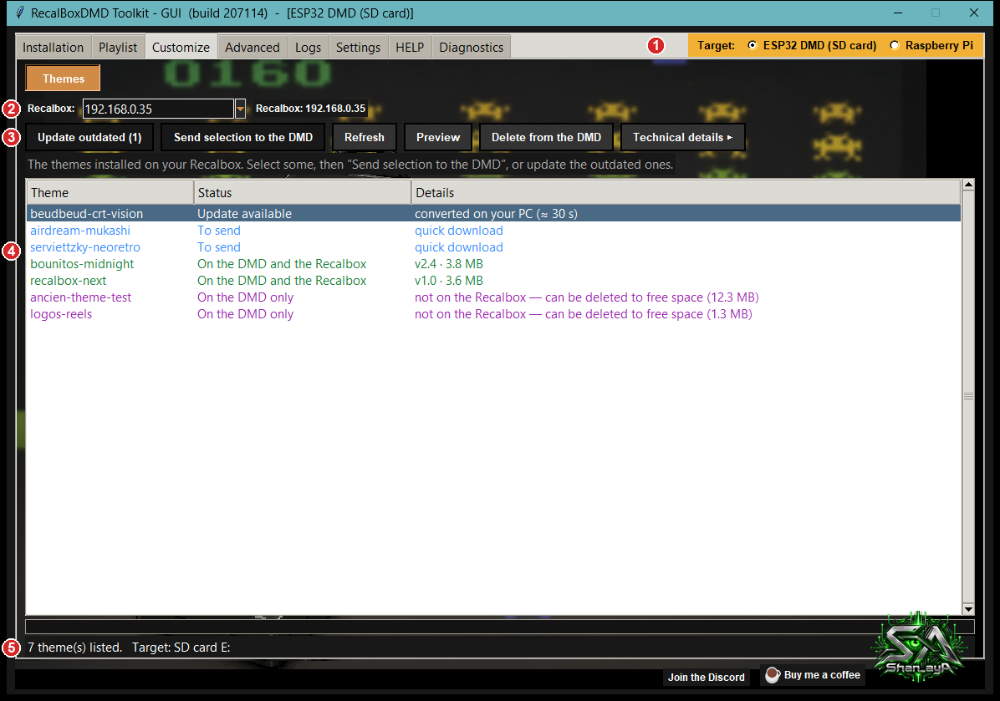

# 🎨 The toolkit "Themes" page — your Recalbox theme logos on the DMD

**🇬🇧 English** · [🇫🇷 Français](themes-page.fr.md) · [🇪🇸 Español](themes-page.es.md)

> The DMD shows the logos of the theme you use in Recalbox. The **Themes** page (toolkit → **Customize** tab → **Themes**) shows where each theme stands and lets you **send** it to the DMD, **update** it or **delete** it, with no command line. It replaces the former Modes 12 and 13.

## Before you start

• **Up-to-date toolkit** (build 207114 or newer).  
• **Recalbox switched on** on the same network: the page reads your installed themes from it.  
• **ESP32 DMD**: the **DMD's SD card in the PC**. **Raspberry Pi**: the Pi switched on and on Wi-Fi (themes are sent over Wi-Fi, no card).  
• Pick your DMD with **Target** at the top right (marker 1).

## Open the page

Toolkit → **Customize** tab → **Themes**. The page fills in by itself.  
**1** Target: the ESP32 DMD's SD card or a Raspberry Pi.  
**2** The Recalbox being read (change the address if needed).  
**3** The action buttons.  
**4** Your themes, one per line, with their **status** and size.  
**5** The status bar: how many themes, on which target.

## Reading the statuses

🟢 **On the DMD and the Recalbox** — all good (version and size shown).  
🔵 **To send** — installed on the Recalbox, not on the DMD yet. "quick download" = logos already prepared; "converted on your PC (≈ 30 s)" = the toolkit builds them.  
🟠 **Update available** — the DMD's copy is older.  
🟣 **On the DMD only** — not on your Recalbox: you can **delete** it to free space (size shown).  
• **To update on the Recalbox** — the Recalbox itself has an older version (update it with Recalbox's theme manager).  
• **No target** — SD card not detected or Pi unreachable: plug it in, then **Refresh**.

## The buttons

**Update outdated (n)** — updates every "Update available" theme in one go.  
**Send selection to the DMD** — click one or more themes in the list (Ctrl/Shift for several), then this button. On an SD card, **eject the card before removing it**.  
**Refresh** — reads the Recalbox and the target again (use it after plugging the card in).  
**Preview** — shows a check sheet of the selected theme's logos.  
**Delete from the DMD** — removes the selected theme from the DMD. A **confirmation** shows the space freed. If the theme is still on the Recalbox you can send it again later; otherwise deletion is final.  
**Technical details** — extra columns (languages, regions…) for the curious.

## Language and region: nothing to choose

All variants (text languages, console regions) are installed on the DMD. It follows your Recalbox settings, and keeps up if you change them later. Recalbox 10 and Recalbox 11 each have their own logo set: the toolkit picks the right one by itself.

## Frequently asked questions

**All my themes show "Update available": is that normal?**

Yes. The project published a new version of the logo package (separate logo sets for Recalbox 10 and 11, an invisible mark on every logo). Click **Update outdated** once and everything turns green again.

**The DMD does not show my theme's logos**

Look at the theme's line: **To send** → click **Send selection to the DMD**. **No target** → plug the SD card in (or switch the Pi on) then **Refresh**. If the theme is not in the list, check the Recalbox is on and the theme is installed there. Remember the DMD only shows the theme that is **active in Recalbox**.

**Where did Modes 12 and 13 go?**

Replaced by this simpler page: **Customize** tab → **Themes**. Mode 1 still offers the themes when you prepare a card.

**My SD card is full, what can I delete?**

Start with the themes **On the DMD only** (🟣): they are no longer on your Recalbox, and their size is shown. Select them then **Delete from the DMD**: the confirmation shows the space freed.

---

*This sheet is also available on the project's Discord server: type `/fiche`.*
