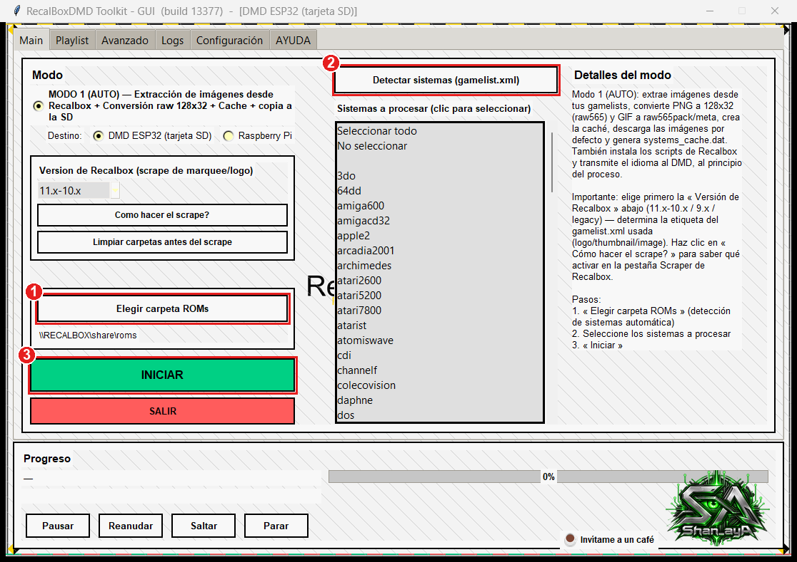
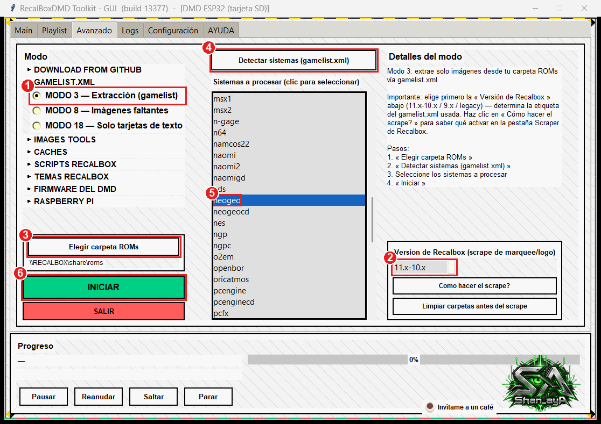
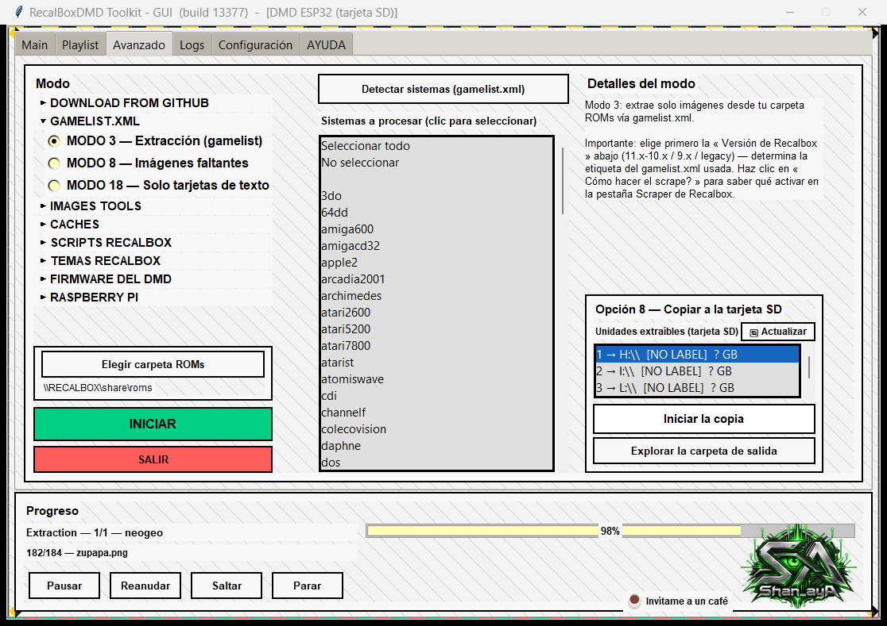
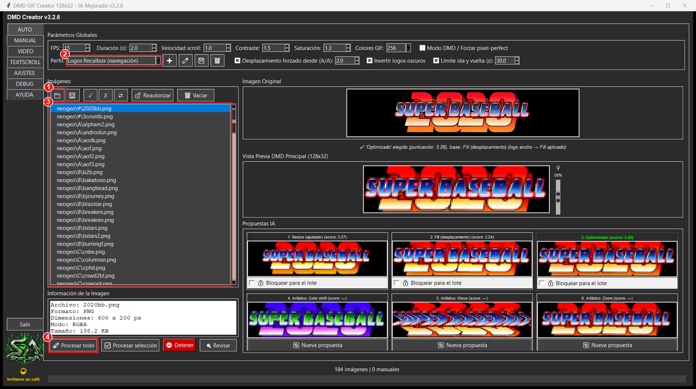
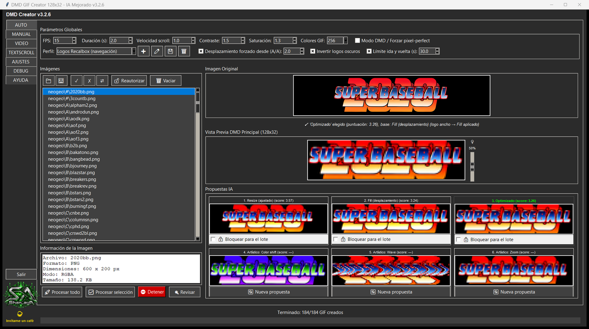
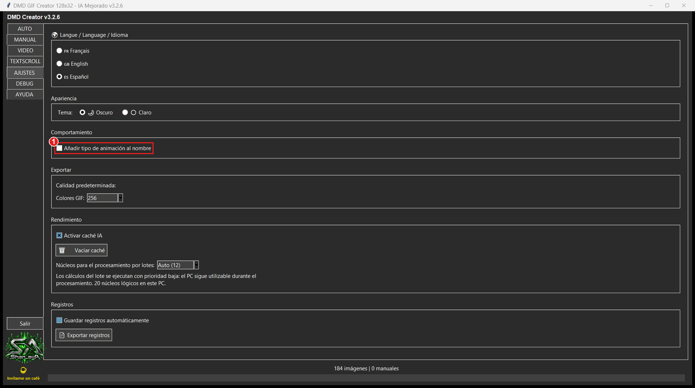
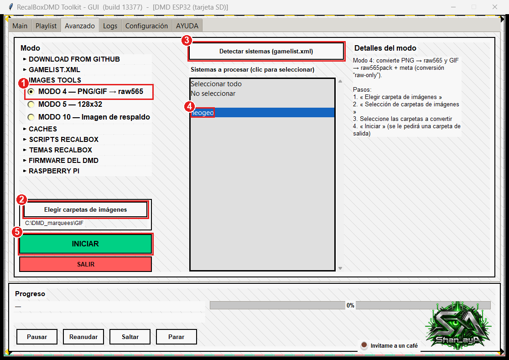
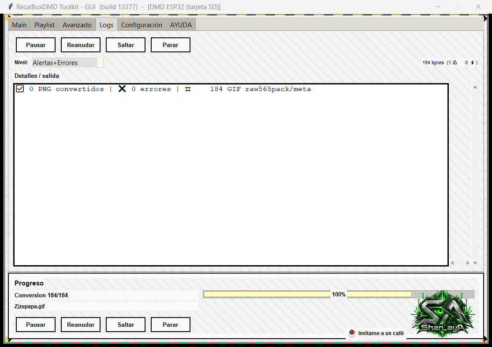
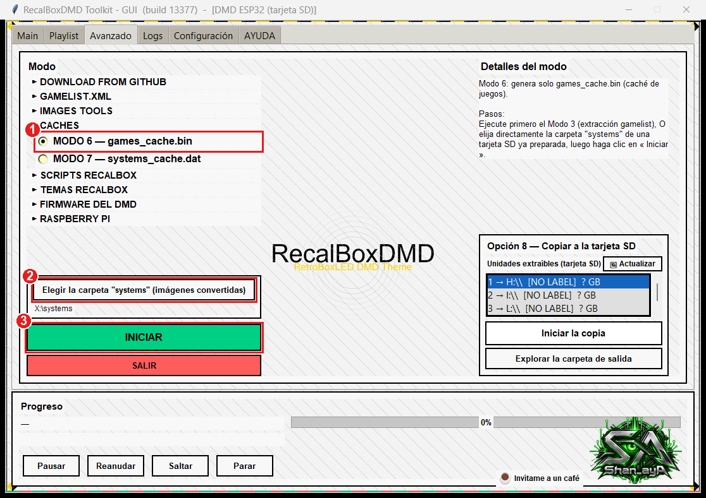
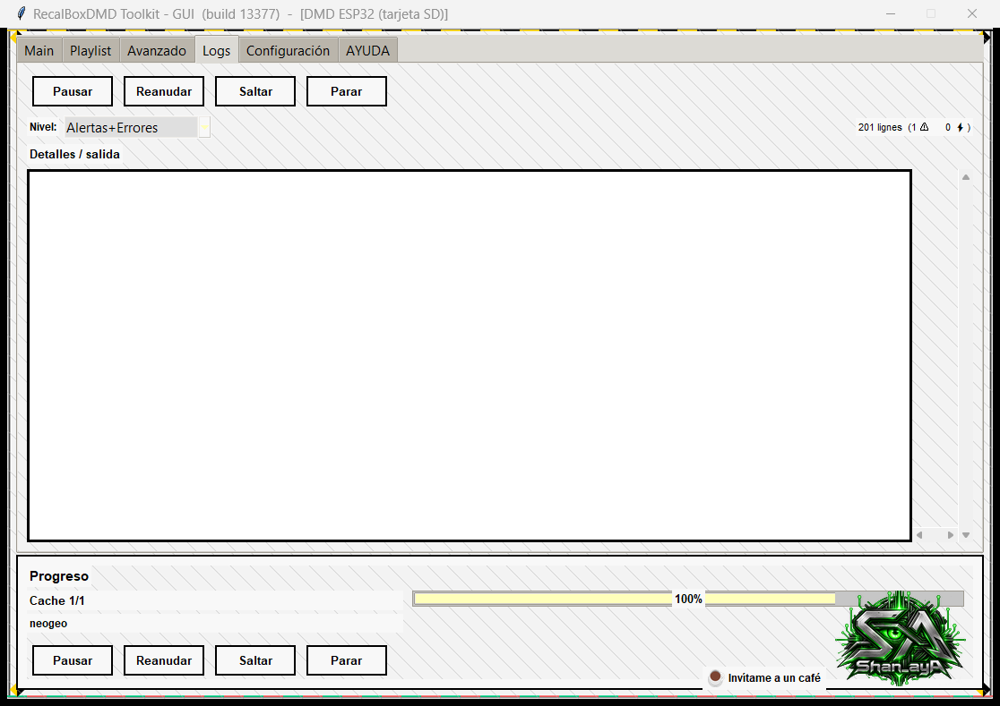

# Marquesinas animadas en el DMD — DMD GIF Creator + el Toolkit, paso a paso

🇬🇧 [English](animated-marquees.md) · 🇫🇷 [Français](animated-marquees.fr.md) · 🇪🇸 **Español**

**Objetivo:** obtener una tarjeta SD que contenga, para los juegos que elijas, una **marquesina animada** (`.raw565pack` + `.meta`) junto a la imagen fija habitual (`.raw565`).

Todas las capturas proceden de una ejecución real (Neo-Geo, 184 juegos → **96 marquesinas animadas**). Las marcas rojas numeradas de las capturas corresponden a los pasos numerados.

---

## 1. Cómo funciona (2 minutos)

| Archivo en la tarjeta SD | Qué es | Tamaño |
|---|---|---|
| `juego.raw565` | marquesina fija | 8 192 bytes |
| `juego.raw565pack` + `juego.meta` | animación: todos los fotogramas (8 192 bytes cada uno) + el retardo de cada fotograma (2 bytes por fotograma) | 8 KB × número de fotogramas |

* Si un juego tiene ambos, **el DMD reproduce la animación**.
* El DMD también lee un índice, `games_cache.bin`, que indica para cada juego «animado» o «fijo». Hay que reconstruirlo tras añadir animaciones (Modo 6, paso 6).
* Dos programas hacen el trabajo. **Son independientes** y ninguno abre al otro: simplemente se pasan carpetas de uno a otro:
  * **DMD GIF Creator** ([descarga](https://github.com/shan-aya/DMD_GIF_creator/releases/latest)) convierte imágenes en GIF de 128×32. Los logotipos anchos se desplazan.
  * **RecalBoxDMD Toolkit** extrae las imágenes originales de tu Recalbox (Modo 3), convierte los GIF en `.raw565pack` (Modo 4) y reconstruye el índice (Modo 6).

> **¿Por qué partir de las imágenes originales?** El Modo 1 reduce cada imagen a 128×32 y borra la original. Si le das esas imágenes de 128×32 a GIF Creator, solo sabe hacer GIF *fijos* (probado: 183 de 183 GIF con un solo fotograma). Desde las imágenes originales (logotipos de unos 600×200) hace desplazar los logotipos anchos (96 de 184 en Neo-Geo). Por eso el paso 1 vuelve a extraer los originales — **sin tocar tu tarjeta SD**.

---

## 2. Antes de empezar

* **RecalBoxDMD Toolkit** (build 13377 o posterior) y **DMD GIF Creator** v3.2.6 o posterior, en el mismo PC.
* Tu **Recalbox encendida**, en la misma red, con sus juegos **scrapeados** (el toolkit lee las imágenes de los `gamelist.xml`, igual que el Modo 1).
* La **tarjeta SD del DMD**, legible en este PC (la creada por el Modo 1). Abajo su letra es `E:` — usa la tuya.
* Espacio en disco. Ejemplo Neo-Geo: imágenes originales 28 MB, GIF 16 MB, `.raw565pack` 38 MB. Una marquesina animada pesa unos **8 KB por fotograma** (408 KB de media aquí, 2,2 MB la más larga). **No** empieces por un sistema de 12 000 juegos: elige los que te interesen.

## 3. ¿Cuál es tu caso?

| Tu situación | Qué hacer |
|---|---|
| **A — Ya hiciste el Modo 1, pero no conservaste la carpeta temporal del toolkit: solo queda la tarjeta SD** | Ve directamente al [paso 1](#paso-1--extraer-las-imágenes-originales-modo-3). |
| **B — Nunca has hecho el Modo 1** | Haz primero la [parte B](#parte-b--crear-primero-la-tarjeta-sd-modo-1) y sigue con el paso 1. |

Tras la parte B estás en la situación A: todo el método solo necesita la tarjeta SD, nunca la carpeta temporal de una sesión anterior.

## 4. Preparar dos carpetas

Crea (en cualquier sitio excepto `Temp`):

```
C:\DMD_marquees\
   GIF\        ← DMD GIF Creator escribirá aquí (paso 2)
   RAWPACK\    ← el Modo 4 escribirá aquí (paso 3)
```

La carpeta de trabajo del toolkit es `%LOCALAPPDATA%\Temp\RecalBoxDMD` (pégala en la barra de direcciones del Explorador). El toolkit la vacía al cerrarse y a veces Windows o herramientas de limpieza (por ejemplo Microsoft PC Manager). Haz los pasos **de una sola vez** y mantén `GIF` y `RAWPACK` fuera de `Temp`.

---

## Parte B — Crear primero la tarjeta SD (Modo 1)

Solo si nunca has hecho el Modo 1. La guía completa está en la pestaña **AYUDA** del toolkit (secciones 4 y 5); en resumen:



1. Pestaña **Main** → **Elegir carpeta ROMs** (el recurso compartido de tu Recalbox, por ejemplo `\\RECALBOX\share\roms`).
2. **Detectar sistemas (gamelist.xml)** y haz clic en los sistemas deseados.
3. **INICIAR** y responde a las preguntas (Wi-Fi del DMD, Recalbox, tarjeta SD…). Al final la tarjeta SD está lista.

Cuando termine, **pon tu tarjeta SD en el PC y sigue con el paso 1.**

---

## Paso 1 — Extraer las imágenes originales (Modo 3)



En el toolkit, pestaña **Avanzado**:

1. Elige **MODO 3 — Extracción (gamelist)**.
2. Ajusta **Versión de Recalbox (scrape marquee/logo)**: la **misma que usaste en el Modo 1** (decide qué imagen se lee).
3. **Elegir carpeta ROMs** → la carpeta de juegos de tu Recalbox.
4. **Detectar sistemas (gamelist.xml)**.
5. Haz clic en el o los **sistemas** a animar (aquí `neogeo`).
6. **INICIAR** (responde *Sí* a la pregunta sobre el idioma de las descripciones).



El toolkit copia las imágenes originales a su carpeta de trabajo. Compruébalo en el Explorador:

```
%LOCALAPPDATA%\Temp\RecalBoxDMD\systems\neogeo\A\aof.png
                                          \neogeo\B\bakatono.png   …
```

> ⚠️ El Modo 3 **vacía primero** `%LOCALAPPDATA%\Temp\RecalBoxDMD\systems`. Esa carpeta es solo una zona de trabajo — tu tarjeta SD y tu Recalbox no se tocan.

## Paso 2 — Crear los GIF (DMD GIF Creator)

Abre **DMD GIF Creator** y quédate en la pestaña **AUTO**.



1. Pulsa el **botón de carpeta** (📁) y elige **`%LOCALAPPDATA%\Temp\RecalBoxDMD\systems`** — la carpeta que *contiene* las carpetas de sistemas, no `neogeo` en sí. El programa reconstruye el mismo árbol (`neogeo\A\…`) en la salida.
2. En **Perfil**, elige **Logos Recalbox (navegación)**. Ajusta 15 imágenes por segundo, fuerza el desplazamiento de los logotipos anchos (desde 2:1) y limita una ida y vuelta a 30 s.
3. La lista muestra tus imágenes (`neogeo\A\aof.png`…). Haz clic en una para previsualizarla: aparecen las 6 propuestas; el lote usa la mejor.
4. Pulsa **Procesar todo** (o selecciona imágenes y usa **Procesar selección**). Se abre una ventana: elige **`C:\DMD_marquees\GIF`** (carpeta *distinta* y vacía).

Unos 20 segundos después (184 imágenes) aparece un resumen: *184 GIF creados — puntuación de calidad 93,6/100*. Aquí 96 GIF están animados (los logotipos anchos se desplazan) y 88 tienen un solo fotograma (logotipos que ya caben en la pantalla).



Ejemplo de GIF producido (Neo-Geo *Metal Slug X*):


**Un ajuste que comprobar** — pestaña **AJUSTES**: **Añadir tipo de animación al nombre** debe seguir **sin marcar**. Si no, los archivos se renombran (`juego_scroll.gif`) y el DMD no los encontrará.



> ¿Solo algunos juegos? Haz clic en ellos en la lista y usa **Procesar selección**, o borra antes las imágenes que sobran de `…\systems` (son copias en la carpeta de trabajo). Los logotipos que se quedan fijos se pueden animar uno a uno en la pestaña **MANUAL**: exporta el GIF con el **mismo nombre y en la misma carpeta** (`GIF\neogeo\A\aof.gif`) y sigue con el paso 3.

## Paso 3 — Convertir los GIF en `.raw565pack` (Modo 4)



De vuelta en el toolkit, pestaña **Avanzado**:

1. Elige **MODO 4 — PNG/GIF → raw565**.
2. **Elegir carpetas de imágenes** → **`C:\DMD_marquees\GIF`** (el padre de la carpeta `neogeo`).
3. **Detectar sistemas (gamelist.xml)** — lista los sistemas encontrados en la carpeta de GIF.
4. Haz clic en `neogeo`.
5. **INICIAR**. Una ventana pide una **carpeta de salida**: elige **`C:\DMD_marquees\RAWPACK`**.



La pestaña **Logs** termina con *184 GIF raw565pack/meta*. Ahora tienes:

```
C:\DMD_marquees\RAWPACK\systems\neogeo\A\androdun.raw565pack   (417 792 bytes = 51 fotogramas)
                                         androdun.meta         (102 bytes)
```

> ⚠️ **Nunca elijas la tarjeta SD ni la carpeta de trabajo del toolkit como carpeta de salida.** Antes de convertir, el Modo 4 **vacía** `<carpeta de salida>\systems\<sistema>` para los sistemas seleccionados.

## Paso 4 — Quitar los packs de un solo fotograma (opcional, recomendado)

Un logotipo fijo da un GIF de un fotograma, es decir un pack de 8 192 bytes: inútil (el `.raw565` normal ya está en la tarjeta SD). En PowerShell:

```powershell
Get-ChildItem 'C:\DMD_marquees\RAWPACK\systems' -Recurse -Filter *.raw565pack |
  Where-Object Length -eq 8192 |
  ForEach-Object { Remove-Item -LiteralPath $_.FullName
                   Remove-Item -LiteralPath ([IO.Path]::ChangeExtension($_.FullName,'.meta')) }
```

Aquí quita 88 packs y conserva las **96 animaciones reales** (38 MB).

## Paso 5 — Copiar las animaciones a la tarjeta SD

Pon la tarjeta SD en el PC. En un símbolo del sistema (sustituye `E:` por tu tarjeta):

```bat
robocopy "C:\DMD_marquees\RAWPACK\systems" "E:\systems" *.raw565pack *.meta /E
```

Solo se añaden los archivos `.raw565pack` y `.meta`; tus imágenes fijas (`.raw565`) se quedan como están. (Con el Explorador: copia el contenido de `RAWPACK\systems` en `E:\systems` combinando las carpetas.)

```
E:\systems\neogeo\A\androdun.raw565       ← imagen fija, ya estaba
                    androdun.raw565pack   ← animación nueva
                    androdun.meta         ← nuevo, sus retardos
```

## Paso 6 — Reconstruir el índice (Modo 6)

Sin este paso el DMD sigue mostrando las imágenes fijas: su índice no conoce las animaciones.



Pestaña **Avanzado**:

1. Elige **MODO 6 — games_cache.bin**.
2. **Elegir la carpeta "systems" (imágenes convertidas)** → **`E:\systems`** (la de la tarjeta SD).
3. **INICIAR**. El toolkit lee toda la carpeta `systems` (cuenta unos minutos con una tarjeta grande).



El nuevo `games_cache.bin` se escribe en la carpeta de trabajo del toolkit. **Cópialo en la raíz de la tarjeta SD sustituyendo el anterior:**

```bat
copy "%LOCALAPPDATA%\Temp\RecalBoxDMD\games_cache.bin" E:\games_cache.bin
```

> ⚠️ **No** uses el botón **Iniciar la copia** de esta ventana: copia *toda* la carpeta de trabajo, incluidas las imágenes originales extraídas por el Modo 3, a tu tarjeta SD.

## Paso 7 — Probar

Expulsa la tarjeta, ponla en el DMD y enciende. Navega en tu Recalbox hasta un juego de Neo-Geo con logotipo ancho (por ejemplo `androdun`, `legendos`, `aof3`): la marquesina ahora se desplaza. Los juegos sin animación conservan su imagen fija.

---

## Solución de problemas

| Síntoma | Causa y solución |
|---|---|
| El DMD sigue mostrando imágenes fijas | No se copió `games_cache.bin` (paso 6), o los packs no están en `systems\<sistema>\<Letra>\` junto al `.raw565`, o no se reinició el DMD. |
| GIF Creator: «las carpetas de entrada y salida deben ser distintas» | La carpeta de salida no debe ser `…\systems`. Usa `C:\DMD_marquees\GIF`. |
| GIF Creator: «la carpeta de salida no está vacía» | Estás rehaciendo un lote: responde *Sí*, los archivos se reemplazan. |
| Modo 4: la lista muestra `A`, `B`, `C`… como sistemas | Elegiste la carpeta `neogeo` en sí. Elige su **padre** (`C:\DMD_marquees\GIF`). |
| Modo 4: «ningún sistema detectado» | La carpeta no tiene GIF ni PNG en sus subcarpetas: revisa el paso 2. |
| Los nombres de archivo cambiaron (`juego_scroll.gif`) | Estaba marcada la opción «añadir tipo de animación al nombre»: desmárcala y repite el paso 2. |
| La tarjeta está llena / la copia es muy lenta | Una animación cuesta 8 KB por fotograma: anima menos sistemas, o menos los largos (perfil: baja el **límite de ida y vuelta**). |
| Quitar la animación de un juego | Borra su `.raw565pack` **y** su `.meta` en la tarjeta SD y repite el paso 6 (Modo 6). |
| Rehacer todo para un sistema | Repite los pasos 1 a 6: los Modos 3 y 4 parten de una carpeta limpia. |

**Raspberry Pi:** la partición de contenido es un volumen FAT32 que se abre desde Windows; el método debería aplicarse igual (no probado en esta guía).

## Chuleta

1. **Modo 3** (Avanzado) → originales en `%LOCALAPPDATA%\Temp\RecalBoxDMD\systems`.
2. **GIF Creator**, pestaña AUTO, perfil *Logos Recalbox (navegación)*, cargar esa carpeta → **Procesar todo** → `C:\DMD_marquees\GIF`.
3. **Modo 4**, carpeta `C:\DMD_marquees\GIF`, salida `C:\DMD_marquees\RAWPACK`.
4. Borrar los packs de 8 192 bytes (opcional).
5. `robocopy "C:\DMD_marquees\RAWPACK\systems" "E:\systems" *.raw565pack *.meta /E`
6. **Modo 6** sobre `E:\systems`, luego copiar `games_cache.bin` en `E:\`.
7. Tarjeta SD en el DMD.
