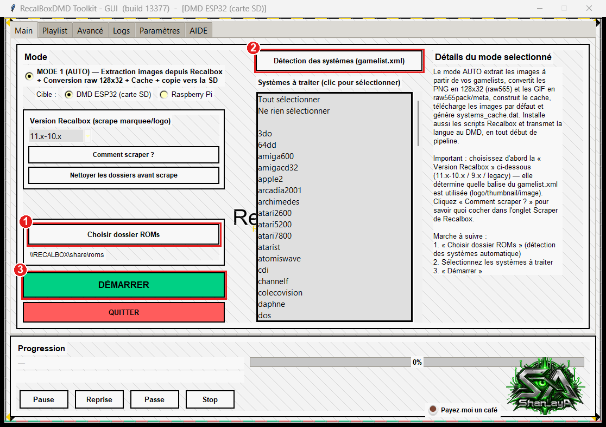
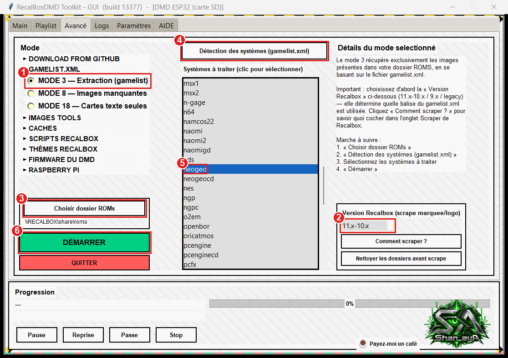
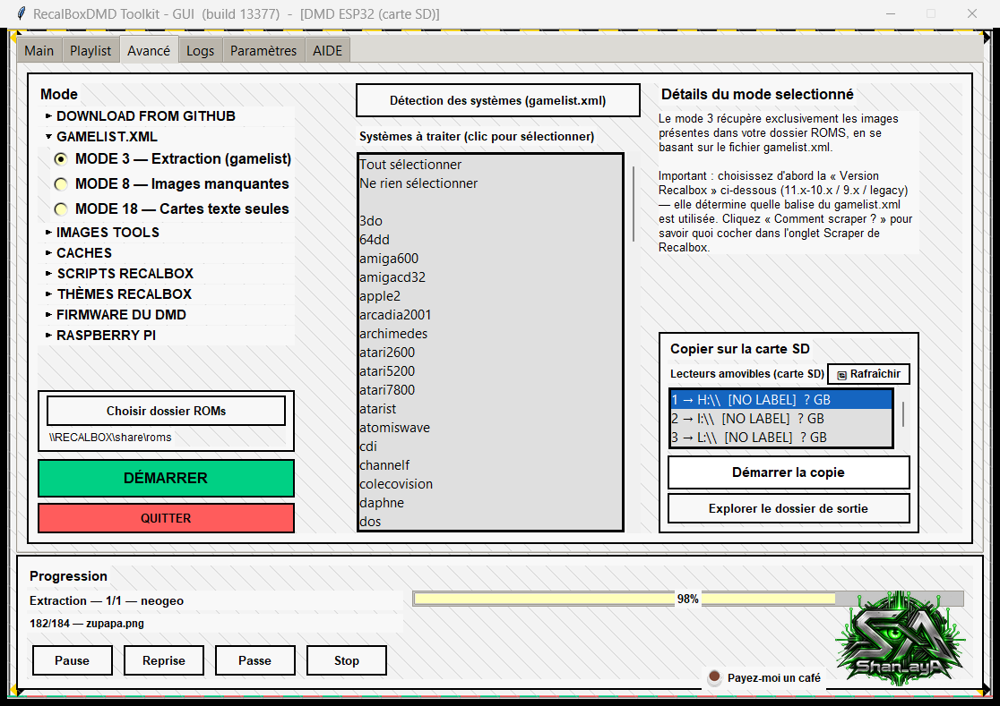
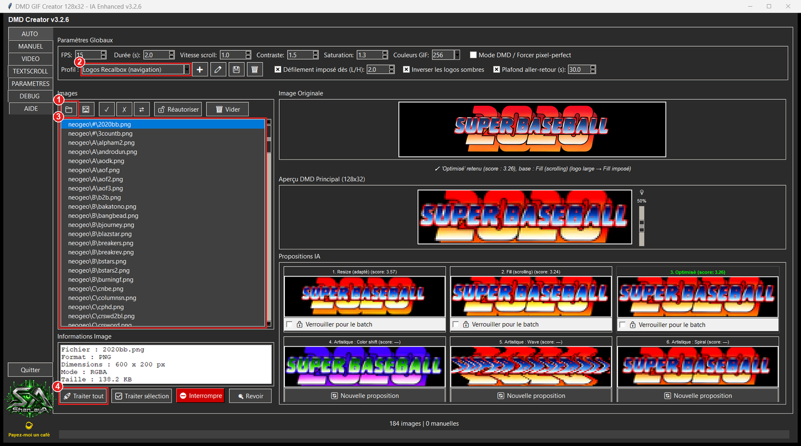
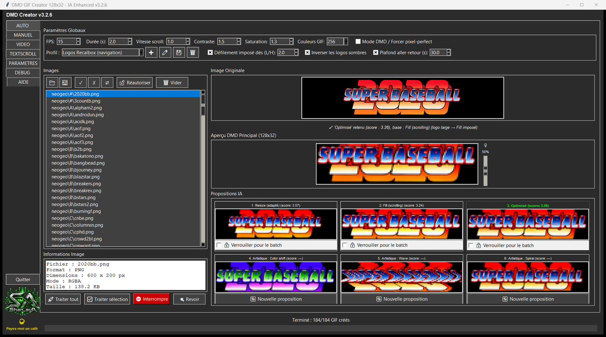
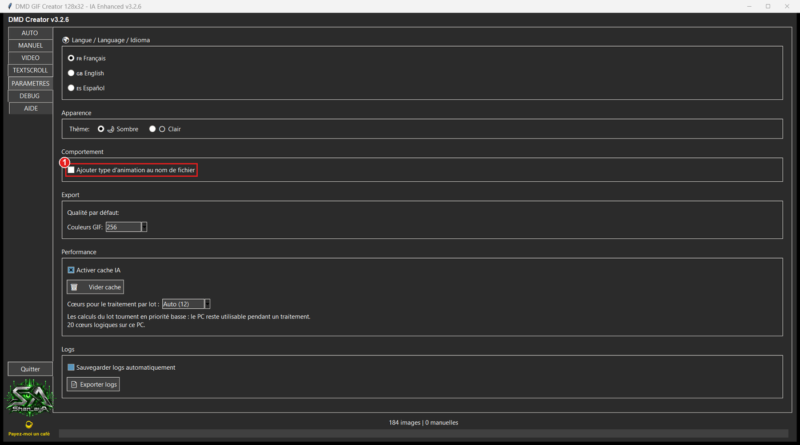
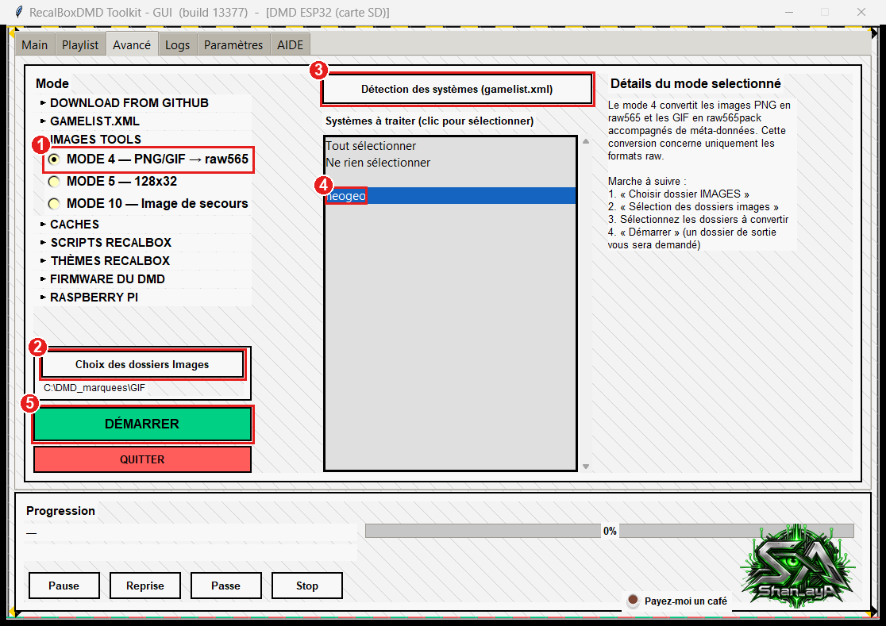
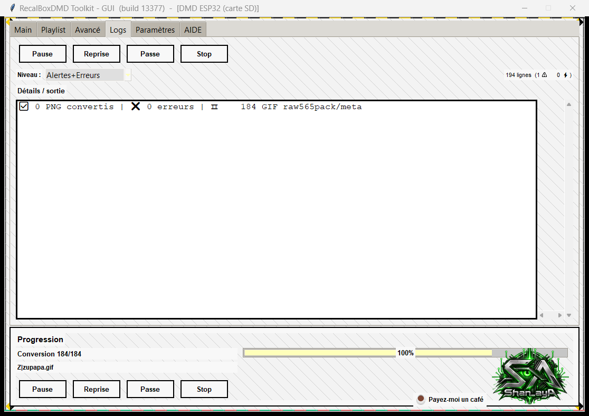
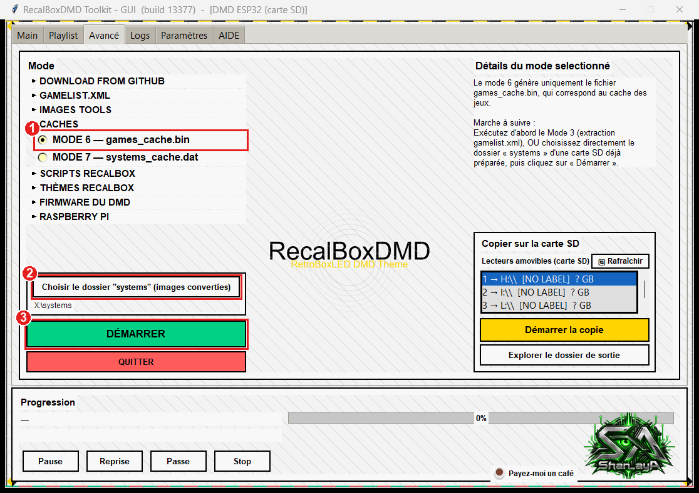
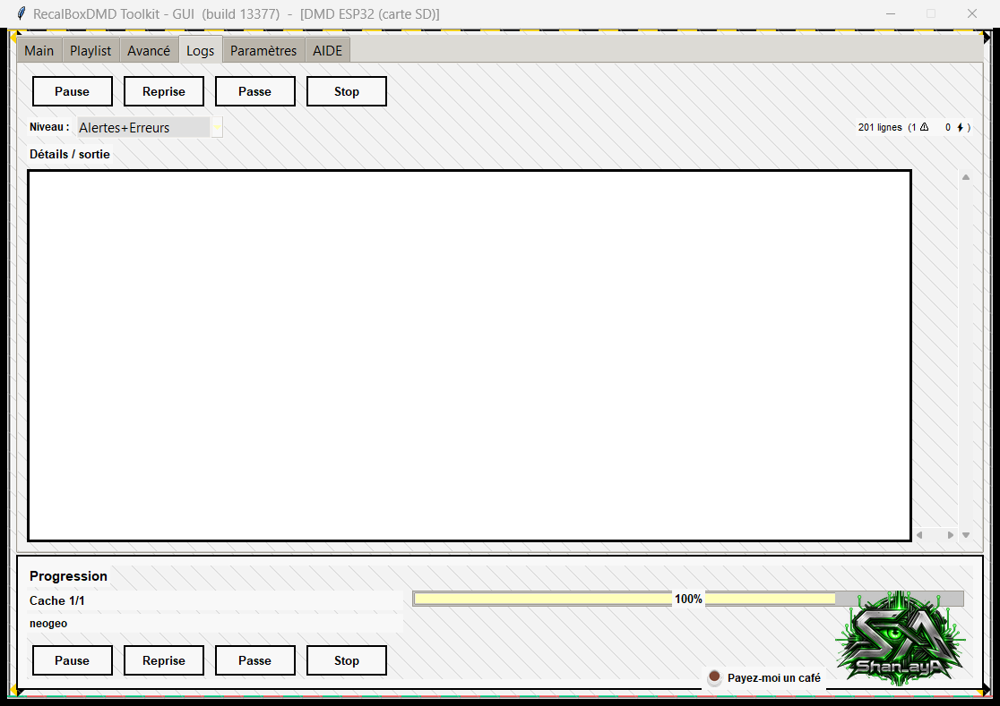

# Marquees animés sur le DMD — DMD GIF Creator + le Toolkit, pas à pas

🇬🇧 [English](animated-marquees.md) · 🇫🇷 **Français** · 🇪🇸 [Español](animated-marquees.es.md)

**Objectif :** obtenir une carte SD qui contient, pour les jeux de votre choix, un **marquee animé** (`.raw565pack` + `.meta`) à côté de l'image fixe habituelle (`.raw565`).

Toutes les captures viennent d'un vrai déroulé (Neo-Geo, 184 jeux → **96 marquees animés**). Les repères rouges numérotés des captures correspondent aux étapes numérotées.

---

## 1. Comment ça marche (2 minutes)

| Fichier sur la carte SD | Rôle | Taille |
|---|---|---|
| `jeu.raw565` | marquee fixe | 8 192 octets |
| `jeu.raw565pack` + `jeu.meta` | animation : toutes les images (8 192 octets chacune) + le délai de chaque image (2 octets par image) | 8 Ko × nombre d'images |

* Si un jeu a les deux, **le DMD joue l'animation**.
* Le DMD lit aussi un index, `games_cache.bin`, qui dit pour chaque jeu « animé » ou « fixe ». Il faut le reconstruire après l'ajout d'animations (Mode 6, étape 6).
* Deux programmes font le travail. **Ils sont séparés** et aucun ne lance l'autre : on se passe simplement des dossiers de l'un à l'autre :
  * **DMD GIF Creator** ([téléchargement](https://github.com/shan-aya/DMD_GIF_creator/releases/latest)) transforme des images en GIF 128×32. Les logos larges défilent.
  * **RecalBoxDMD Toolkit** extrait les images d'origine de votre Recalbox (Mode 3), convertit les GIF en `.raw565pack` (Mode 4) et reconstruit l'index (Mode 6).

> **Pourquoi repartir des images d'origine ?** Le Mode 1 réduit chaque image à 128×32 puis supprime l'originale. Si vous donnez ces images 128×32 à GIF Creator, il ne sait faire que des GIF *fixes* (testé : 183 GIF sur 183 avec une seule image). À partir des images d'origine (logos d'environ 600×200) il fait défiler les logos larges (96 sur 184 en Neo-Geo). C'est pourquoi l'étape 1 réextrait les originaux — **sans toucher à votre carte SD**.

---

## 2. Avant de commencer

* **RecalBoxDMD Toolkit** (build 13377 ou plus récent) et **DMD GIF Creator** v3.2.6 ou plus récent, sur le même PC.
* Votre **Recalbox allumée**, sur le même réseau, avec ses jeux **scrapés** (le toolkit lit les images des `gamelist.xml`, exactement comme le Mode 1).
* La **carte SD du DMD**, lisible sur ce PC (celle faite par le Mode 1). Ci-dessous sa lettre est `E:` — remplacez par la vôtre.
* De la place disque. Exemple Neo-Geo : images d'origine 28 Mo, GIF 16 Mo, `.raw565pack` 38 Mo. Un marquee animé pèse environ **8 Ko par image** (408 Ko en moyenne ici, 2,2 Mo pour le plus long). Ne commencez **pas** par un système de 12 000 jeux : choisissez ceux qui vous intéressent.

## 3. Quel est votre cas ?

| Votre situation | Que faire |
|---|---|
| **A — Mode 1 déjà fait, mais le dossier temporaire du toolkit n'a pas été conservé : il ne reste que la carte SD** | Allez directement à l'[étape 1](#étape-1--extraire-les-images-dorigine-mode-3). |
| **B — Mode 1 jamais fait** | Faites d'abord la [partie B](#partie-b--fabriquer-dabord-la-carte-sd-mode-1), puis continuez à l'étape 1. |

Après la partie B vous êtes dans la situation A : toute la méthode n'a besoin que de la carte SD, jamais du dossier temporaire d'une session précédente.

## 4. Préparer deux dossiers

Créez (n'importe où sauf dans `Temp`) :

```
C:\DMD_marquees\
   GIF\        ← DMD GIF Creator écrira ici (étape 2)
   RAWPACK\    ← le Mode 4 écrira ici (étape 3)
```

Le dossier de travail du toolkit est `%LOCALAPPDATA%\Temp\RecalBoxDMD` (collez-le dans la barre d'adresse de l'Explorateur). Il est vidé par le toolkit à la fermeture et parfois par Windows ou des outils de nettoyage (par exemple Microsoft PC Manager). Faites les étapes **d'une seule traite** et gardez `GIF` et `RAWPACK` hors de `Temp`.

---

## Partie B — Fabriquer d'abord la carte SD (Mode 1)

Seulement si vous n'avez jamais fait le Mode 1. Le guide complet est dans l'onglet **AIDE** du toolkit (sections 4 et 5) ; en bref :



1. Onglet **Main** → **Choisir dossier ROMs** (le partage de votre Recalbox, par exemple `\\RECALBOX\share\roms`).
2. **Détection des systèmes (gamelist.xml)**, puis cliquez les systèmes voulus.
3. **DÉMARRER** et répondez aux questions (Wi-Fi du DMD, Recalbox, carte SD…). À la fin la carte SD est prête.

Quand c'est terminé, **mettez votre carte SD dans le PC et continuez à l'étape 1.**

---

## Étape 1 — Extraire les images d'origine (Mode 3)



Dans le toolkit, onglet **Avancé** :

1. Choisissez **MODE 3 — Extraction (gamelist)**.
2. Réglez **Version Recalbox (scrape marquee/logo)** : la **même que celle utilisée au Mode 1** (elle décide quelle image est lue).
3. **Choisir dossier ROMs** → le dossier des jeux de votre Recalbox.
4. **Détection des systèmes (gamelist.xml)**.
5. Cliquez le ou les **systèmes** à animer (ici `neogeo`).
6. **DÉMARRER** (répondez *Oui* à la question sur la langue des descriptions).



Le toolkit copie les images d'origine dans son dossier de travail. Vérifiez dans l'Explorateur :

```
%LOCALAPPDATA%\Temp\RecalBoxDMD\systems\neogeo\A\aof.png
                                          \neogeo\B\bakatono.png   …
```

> ⚠️ Le Mode 3 **vide d'abord** `%LOCALAPPDATA%\Temp\RecalBoxDMD\systems`. Ce dossier n'est qu'une zone de travail — votre carte SD et votre Recalbox ne sont pas touchées.

## Étape 2 — Créer les GIF (DMD GIF Creator)

Lancez **DMD GIF Creator** et restez sur l'onglet **AUTO**.



1. Cliquez le **bouton dossier** (📁) et choisissez **`%LOCALAPPDATA%\Temp\RecalBoxDMD\systems`** — le dossier qui *contient* les dossiers de systèmes, pas `neogeo` lui-même. Le programme reconstruit le même arbre (`neogeo\A\…`) en sortie.
2. Dans **Profil**, choisissez **Logos Recalbox (navigation)**. Il règle 15 images par seconde, force le défilement des logos larges (à partir de 2:1) et plafonne un aller-retour à 30 s.
3. La liste affiche vos images (`neogeo\A\aof.png`…). Cliquez-en une pour la prévisualiser : les 6 propositions apparaissent ; le lot utilise la meilleure.
4. Cliquez **Traiter tout** (ou sélectionnez des images et utilisez **Traiter sélection**). Une fenêtre s'ouvre : choisissez **`C:\DMD_marquees\GIF`** (dossier *différent* et vide).

Une vingtaine de secondes plus tard (184 images) un bilan s'affiche : *184 GIF créés — score qualité 93,6/100*. Ici 96 GIF sont animés (les logos larges défilent) et 88 n'ont qu'une image (logos qui tiennent déjà dans l'écran).



Exemple de GIF produit (Neo-Geo *Metal Slug X*) :


**Un réglage à vérifier** — onglet **PARAMETRES** : **Ajouter type d'animation au nom de fichier** doit rester **décoché**. Sinon les fichiers sont renommés (`jeu_scroll.gif`) et le DMD ne les trouvera pas.



> Seulement certains jeux ? Cliquez-les dans la liste et utilisez **Traiter sélection**, ou supprimez d'abord les images inutiles de `…\systems` (ce sont des copies dans le dossier de travail). Les logos qui restent fixes peuvent être animés un par un dans l'onglet **MANUEL** : exportez le GIF sous le **même nom et dans le même dossier** (`GIF\neogeo\A\aof.gif`), puis passez à l'étape 3.

## Étape 3 — Convertir les GIF en `.raw565pack` (Mode 4)



De retour dans le toolkit, onglet **Avancé** :

1. Choisissez **MODE 4 — PNG/GIF → raw565**.
2. **Choix des dossiers Images** → **`C:\DMD_marquees\GIF`** (le parent du dossier `neogeo`).
3. **Détection des systèmes (gamelist.xml)** — liste les systèmes trouvés dans le dossier de GIF.
4. Cliquez `neogeo`.
5. **DÉMARRER**. Une fenêtre demande un **dossier de sortie** : choisissez **`C:\DMD_marquees\RAWPACK`**.



L'onglet **Logs** se termine par *184 GIF raw565pack/meta*. Vous avez maintenant :

```
C:\DMD_marquees\RAWPACK\systems\neogeo\A\androdun.raw565pack   (417 792 octets = 51 images)
                                         androdun.meta         (102 octets)
```

> ⚠️ **Ne choisissez jamais la carte SD ni le dossier de travail du toolkit comme dossier de sortie.** Avant de convertir, le Mode 4 **vide** `<dossier de sortie>\systems\<système>` pour les systèmes sélectionnés.

## Étape 4 — Retirer les packs d'une seule image (facultatif, conseillé)

Un logo fixe donne un GIF d'une image, donc un pack de 8 192 octets : inutile (le `.raw565` normal est déjà sur la carte SD). Dans PowerShell :

```powershell
Get-ChildItem 'C:\DMD_marquees\RAWPACK\systems' -Recurse -Filter *.raw565pack |
  Where-Object Length -eq 8192 |
  ForEach-Object { Remove-Item -LiteralPath $_.FullName
                   Remove-Item -LiteralPath ([IO.Path]::ChangeExtension($_.FullName,'.meta')) }
```

Ici cela retire 88 packs et garde les **96 vraies animations** (38 Mo).

## Étape 5 — Copier les animations sur la carte SD

Mettez la carte SD dans le PC. Dans une invite de commandes (remplacez `E:` par votre carte) :

```bat
robocopy "C:\DMD_marquees\RAWPACK\systems" "E:\systems" *.raw565pack *.meta /E
```

Seuls les fichiers `.raw565pack` et `.meta` sont ajoutés ; vos images fixes (`.raw565`) restent telles quelles. (Avec l'Explorateur : copiez le contenu de `RAWPACK\systems` sur `E:\systems` en fusionnant les dossiers.)

```
E:\systems\neogeo\A\androdun.raw565       ← image fixe, déjà là
                    androdun.raw565pack   ← nouvelle animation
                    androdun.meta         ← nouveau, ses délais
```

## Étape 6 — Reconstruire l'index (Mode 6)

Sans cette étape le DMD continue d'afficher les images fixes : son index ignore les animations.



Onglet **Avancé** :

1. Choisissez **MODE 6 — games_cache.bin**.
2. **Choisir le dossier "systems" (images converties)** → **`E:\systems`** (celui de la carte SD).
3. **DÉMARRER**. Le toolkit lit tout le dossier `systems` (comptez quelques minutes pour une grosse carte).



Le nouveau `games_cache.bin` est écrit dans le dossier de travail du toolkit. **Copiez-le à la racine de la carte SD en remplaçant l'ancien :**

```bat
copy "%LOCALAPPDATA%\Temp\RecalBoxDMD\games_cache.bin" E:\games_cache.bin
```

> ⚠️ N'utilisez **pas** le bouton **Démarrer la copie** de cette fenêtre : il copie *tout* le dossier de travail, y compris les images d'origine extraites par le Mode 3, sur votre carte SD.

## Étape 7 — Essayer

Éjectez la carte, mettez-la dans le DMD et allumez. Naviguez dans votre Recalbox jusqu'à un jeu Neo-Geo au logo large (par exemple `androdun`, `legendos`, `aof3`) : le marquee défile maintenant. Les jeux sans animation gardent leur image fixe.

---

## Dépannage

| Symptôme | Cause et solution |
|---|---|
| Le DMD affiche toujours des images fixes | `games_cache.bin` n'a pas été copié (étape 6), ou les packs ne sont pas dans `systems\<système>\<Lettre>\` à côté du `.raw565`, ou le DMD n'a pas été redémarré. |
| GIF Creator : « les dossiers d'entrée et de sortie doivent être différents » | Le dossier de sortie ne doit pas être `…\systems`. Utilisez `C:\DMD_marquees\GIF`. |
| GIF Creator : « le dossier de sortie n'est pas vide » | Vous refaites un lot : répondez *Oui*, les fichiers sont remplacés. |
| Mode 4 : la liste affiche `A`, `B`, `C`… comme systèmes | Vous avez choisi le dossier `neogeo` lui-même. Choisissez son **parent** (`C:\DMD_marquees\GIF`). |
| Mode 4 : « aucun système détecté » | Le dossier ne contient ni GIF ni PNG dans ses sous-dossiers : vérifiez l'étape 2. |
| Les noms de fichiers ont changé (`jeu_scroll.gif`) | L'option « ajouter type d'animation au nom » était cochée : décochez-la et refaites l'étape 2. |
| La carte est pleine / copie trop lente | Une animation coûte 8 Ko par image : animez moins de systèmes, ou moins les longs (profil : baisser le **plafond d'aller-retour**). |
| Retirer l'animation d'un jeu | Supprimez son `.raw565pack` **et** son `.meta` sur la carte SD, puis refaites l'étape 6 (Mode 6). |
| Tout refaire pour un système | Relancez les étapes 1 à 6 : les Modes 3 et 4 repartent d'un dossier propre. |

**Raspberry Pi :** la partition de contenu est un volume FAT32 ouvrable depuis Windows ; la méthode devrait s'y appliquer de la même façon (non testé dans ce guide).

## Aide-mémoire

1. **Mode 3** (Avancé) → originaux dans `%LOCALAPPDATA%\Temp\RecalBoxDMD\systems`.
2. **GIF Creator**, onglet AUTO, profil *Logos Recalbox (navigation)*, charger ce dossier → **Traiter tout** → `C:\DMD_marquees\GIF`.
3. **Mode 4**, dossier `C:\DMD_marquees\GIF`, sortie `C:\DMD_marquees\RAWPACK`.
4. Supprimer les packs de 8 192 octets (facultatif).
5. `robocopy "C:\DMD_marquees\RAWPACK\systems" "E:\systems" *.raw565pack *.meta /E`
6. **Mode 6** sur `E:\systems`, puis copier `games_cache.bin` dans `E:\`.
7. Carte SD dans le DMD.
