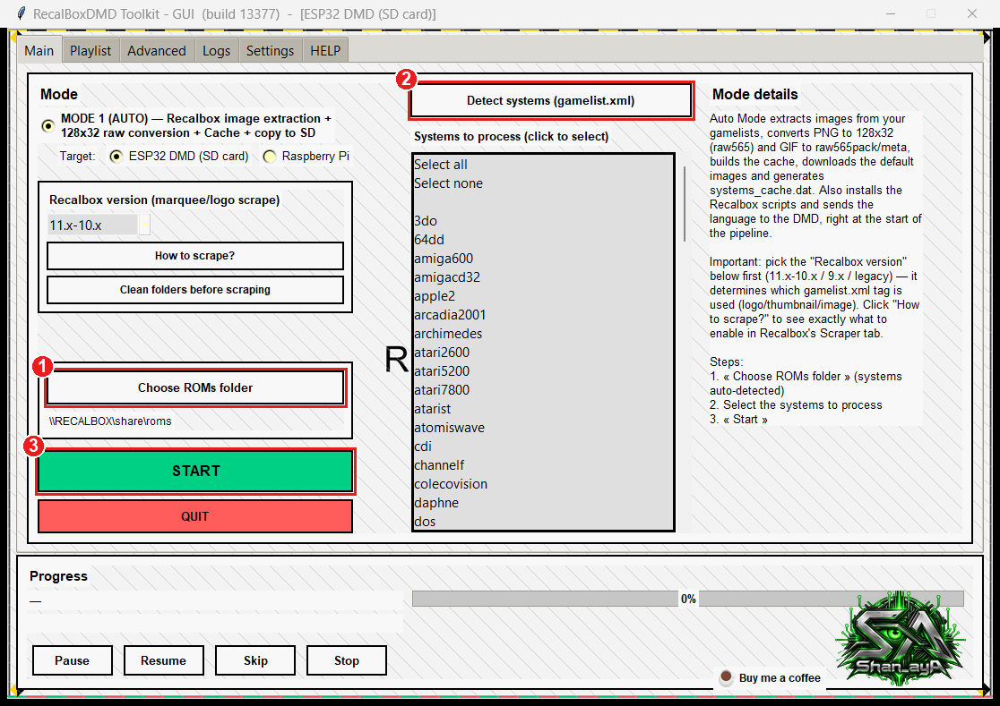
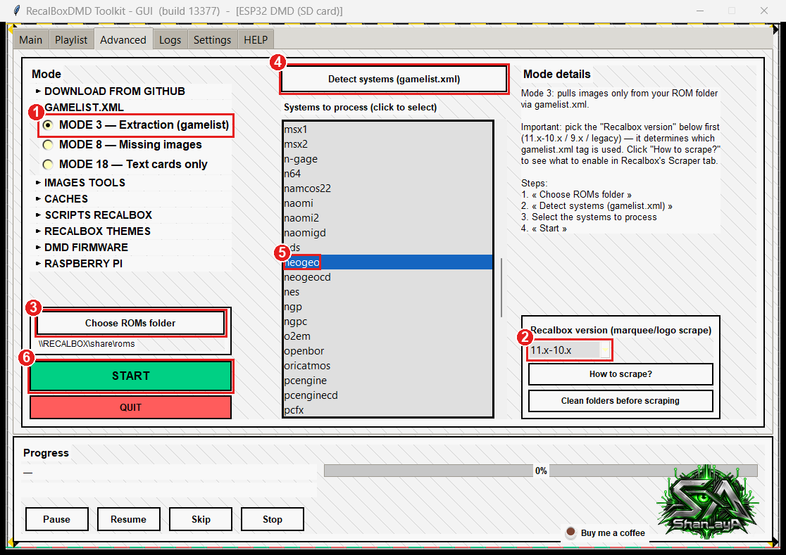
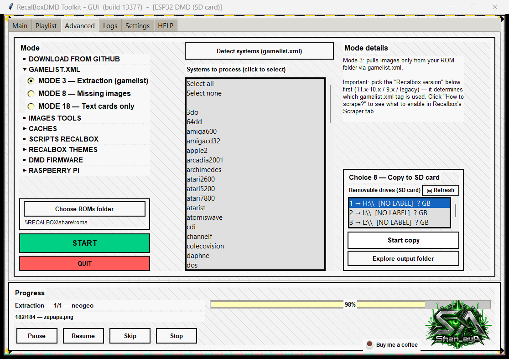
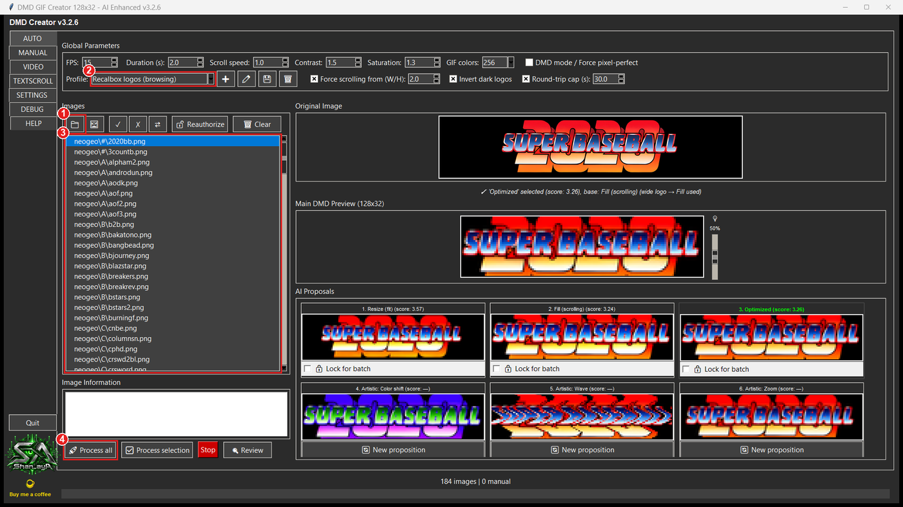
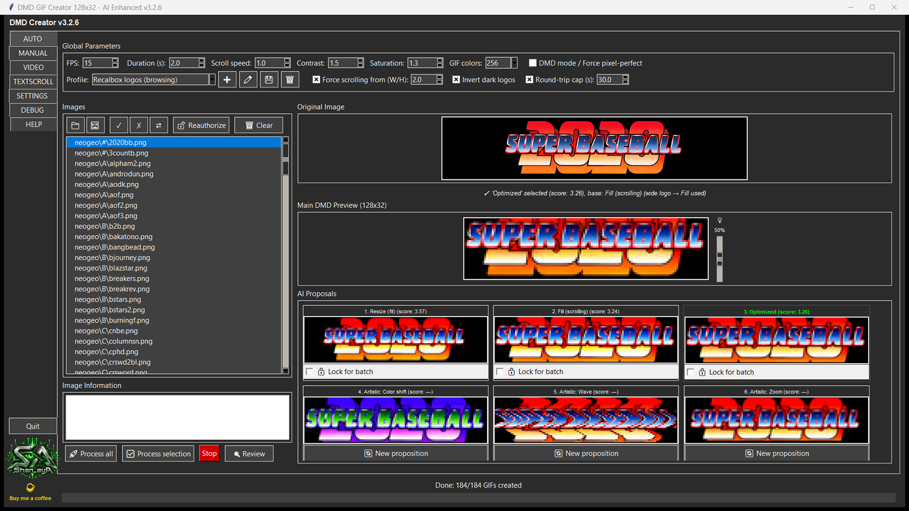
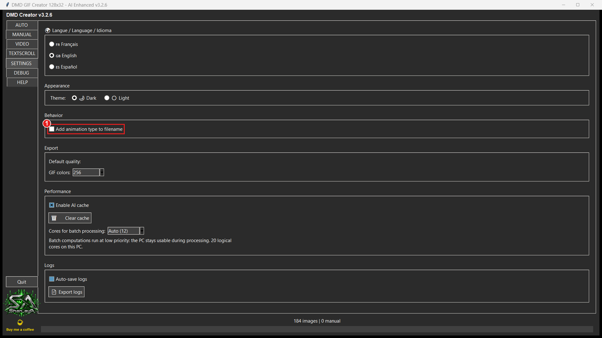
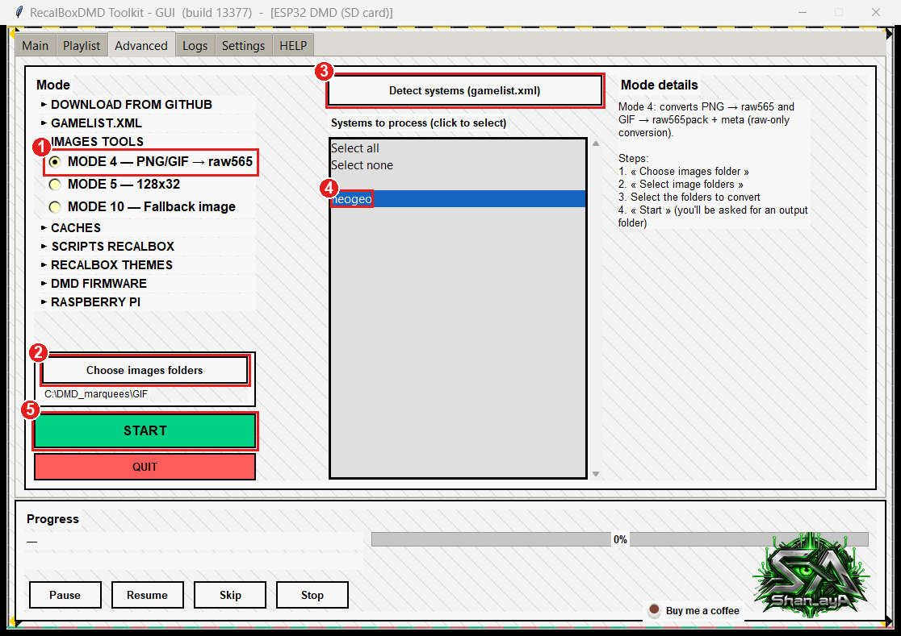
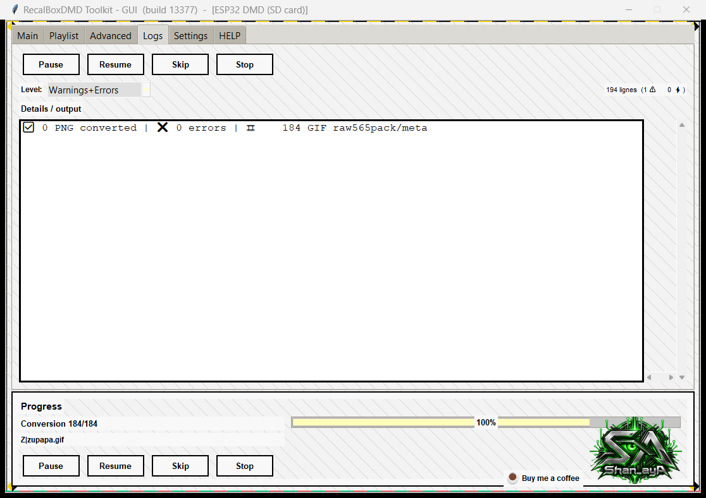
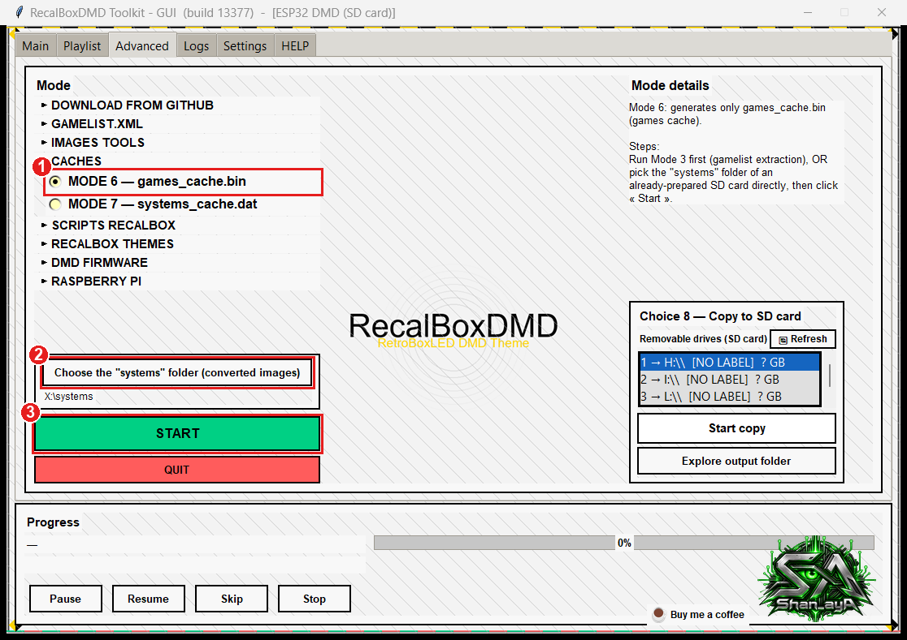
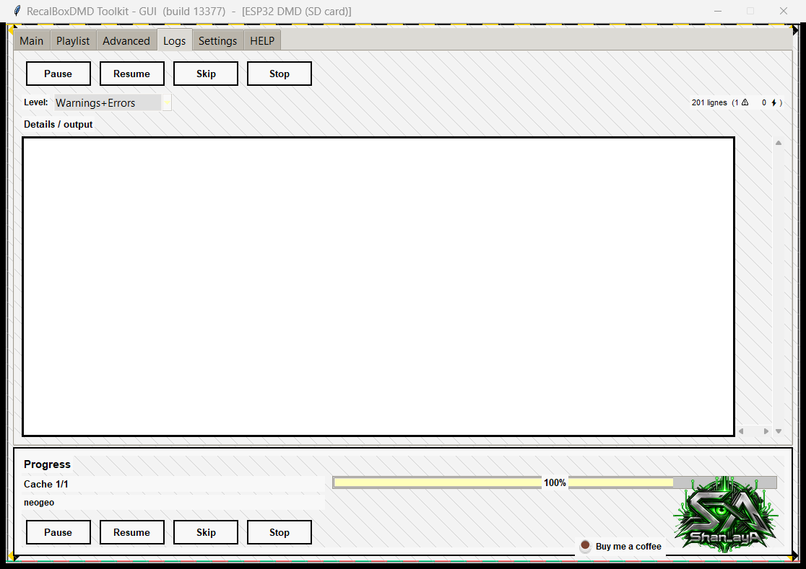

# Animated marquees on the DMD — DMD GIF Creator + the Toolkit, step by step

🇬🇧 **English** · 🇫🇷 [Français](animated-marquees.fr.md) · 🇪🇸 [Español](animated-marquees.es.md)

**Goal:** end up with an SD card that holds, for the games you choose, an **animated marquee** (`.raw565pack` + `.meta`) next to the usual still image (`.raw565`).

Every screenshot below comes from a real run (Neo-Geo, 184 games → **96 animated marquees**). The numbered red markers on the screenshots match the numbered steps.

---

## 1. How it works (2 minutes)

| File on the SD card | What it is | Size |
|---|---|---|
| `game.raw565` | still marquee | 8 192 bytes |
| `game.raw565pack` + `game.meta` | animation: every frame (8 192 bytes each) + the delay of each frame (2 bytes per frame) | 8 KB × number of frames |

* If a game has both, **the DMD plays the animation**.
* The DMD also reads an index, `games_cache.bin`, that says for each game "animated" or "still". It must be rebuilt after you add animations (Mode 6, step 6).
* Two programs do the work. **They are separate** and neither launches the other — you simply hand folders from one to the other:
  * **DMD GIF Creator** ([download](https://github.com/shan-aya/DMD_GIF_creator/releases/latest)) turns images into 128×32 GIFs. Wide logos scroll.
  * **RecalBoxDMD Toolkit** extracts the original images from your Recalbox (Mode 3), converts GIFs into `.raw565pack` (Mode 4) and rebuilds the index (Mode 6).

> **Why start again from the original images?** Mode 1 shrinks every image to 128×32 and then deletes the original. If you give GIF Creator those 128×32 images it can only make *still* GIFs (tested: 183 of 183 GIFs had a single frame). From the original images (about 600×200 logos) it makes scrolling animations for the wide logos (96 of 184 on Neo-Geo). That is why step 1 extracts the originals again — **it does not touch your SD card**.

---

## 2. Before you start

* **RecalBoxDMD Toolkit** (build 13377 or later) and **DMD GIF Creator** v3.2.6 or later, both on the same PC.
* Your **Recalbox switched on**, on the same network, with its games **scraped** (the toolkit reads the images of the `gamelist.xml` files, exactly like Mode 1).
* The **DMD's SD card**, readable on this PC (the one made by Mode 1). Below its drive letter is written `E:` — use yours.
* Free disk space. Neo-Geo example: original images 28 MB, GIFs 16 MB, `.raw565pack` 38 MB. An animated marquee weighs about **8 KB per frame** (408 KB on average here, 2.2 MB for the longest). Do **not** start with a 12 000-game system: choose the systems you care about.

## 3. Which path is yours?

| Your situation | What to do |
|---|---|
| **A — Mode 1 already done, but you did not keep the toolkit's temporary folder: only the SD card is left** | Go straight to [step 1](#step-1--extract-the-original-images-mode-3). |
| **B — Mode 1 never done** | Do [part B](#part-b--make-the-sd-card-first-mode-1) first, then continue with step 1. |

After part B you are in situation A: the whole method only needs the SD card, never the temporary folder of an earlier session.

## 4. Prepare two folders

Create (anywhere except in `Temp`):

```
C:\DMD_marquees\
   GIF\        ← DMD GIF Creator will write here (step 2)
   RAWPACK\    ← Mode 4 will write here (step 3)
```

The toolkit's own working folder is `%LOCALAPPDATA%\Temp\RecalBoxDMD` (paste that in the Explorer address bar). It is emptied by the toolkit when you quit and sometimes by Windows or cleaning tools (for example Microsoft PC Manager). Do the steps **in one sitting** and keep `GIF` and `RAWPACK` outside `Temp`.

---

## Part B — Make the SD card first (Mode 1)

Only if you have never done Mode 1. The full guide is in the toolkit's **HELP** tab (sections 4 and 5); in short:



1. **Main** tab → **Choose ROMs folder** (your Recalbox share, for example `\\RECALBOX\share\roms`).
2. **Detect systems (gamelist.xml)**, then click the systems you want.
3. **START** and answer the questions (Wi-Fi of the DMD, Recalbox, SD card…). At the end the SD card is ready.

When it says "Done", **put your SD card in the PC and carry on with step 1.**

---

## Step 1 — Extract the original images (Mode 3)



In the toolkit, **Advanced** tab:

1. Select **MODE 3 — Extraction (gamelist)**.
2. Check the **Recalbox version** box: it must be the **same as the one you used in Mode 1** (it decides which image is read).
3. **Choose ROMs folder** → your Recalbox games folder.
4. **Detect systems (gamelist.xml)**.
5. Click the **system(s)** you want to animate (here `neogeo`).
6. **START** (answer *Yes* to the question about the description language).



The toolkit copies the original images into its working folder. Check it in Explorer:

```
%LOCALAPPDATA%\Temp\RecalBoxDMD\systems\neogeo\A\aof.png
                                          \neogeo\B\bakatono.png   …
```

> ⚠️ Mode 3 **empties** `%LOCALAPPDATA%\Temp\RecalBoxDMD\systems` first. That folder is only a work area — your SD card and your Recalbox are not touched.

## Step 2 — Create the GIFs (DMD GIF Creator)

Start **DMD GIF Creator** and stay on the **AUTO** tab.



1. Click the **folder button** (📁) and choose **`%LOCALAPPDATA%\Temp\RecalBoxDMD\systems`** — the folder that *contains* the system folders, not `neogeo` itself. The program rebuilds the same tree (`neogeo\A\…`) in its output.
2. In **Profile**, choose **Recalbox logos (browsing)**. It sets 15 images per second, forces scrolling for wide logos (from 2:1) and caps a back-and-forth at 30 s.
3. The list shows your images (`neogeo\A\aof.png`…). Click one to preview it: the 6 proposals appear; the batch uses the best one.
4. Click **Process all** (or select some images and use **Process selection**). A folder window opens: choose **`C:\DMD_marquees\GIF`** (it must be a *different, empty* folder).

About 20 seconds later (184 images) you get a summary: *184 GIFs created — quality score 93.6/100*. Here, 96 GIFs are animated (the wide logos scroll) and 88 have a single frame (logos that already fit the screen).



Example of a produced GIF (Neo-Geo *Metal Slug X*):


**One setting to check** — **SETTINGS** tab: **Add animation type to filename** must stay **unticked**. Otherwise the files are renamed (`game_scroll.gif`) and the DMD will not find them.



> Only some games? Click them in the list and use **Process selection**, or delete the unwanted images from `…\systems` first (these are copies in the working folder). Logos that stay still can be animated one by one in the **MANUAL** tab: export the GIF under the **same name and in the same folder** (`GIF\neogeo\A\aof.gif`), then carry on with step 3.

## Step 3 — Convert the GIFs into `.raw565pack` (Mode 4)



Back in the toolkit, **Advanced** tab:

1. Select **MODE 4 — PNG/GIF → raw565**.
2. **Choose images folders** → **`C:\DMD_marquees\GIF`** (the parent of the `neogeo` folder).
3. **Detect systems (gamelist.xml)** — it lists the systems found in the GIF folder.
4. Click `neogeo`.
5. **START**. A window asks for an **output folder**: choose **`C:\DMD_marquees\RAWPACK`**.



The **Logs** tab ends with *184 GIF raw565pack/meta*. You now have:

```
C:\DMD_marquees\RAWPACK\systems\neogeo\A\androdun.raw565pack   (417 792 bytes = 51 frames)
                                         androdun.meta         (102 bytes)
```

> ⚠️ **Never choose the SD card or the toolkit's working folder as the output folder.** Before converting, Mode 4 **empties** `<output folder>\systems\<system>` for the selected systems.

## Step 4 — Remove the one-frame packs (optional, recommended)

A still logo gives a GIF with one frame, hence a pack of 8 192 bytes: useless (the normal `.raw565` is already on the SD card). In PowerShell:

```powershell
Get-ChildItem 'C:\DMD_marquees\RAWPACK\systems' -Recurse -Filter *.raw565pack |
  Where-Object Length -eq 8192 |
  ForEach-Object { Remove-Item -LiteralPath $_.FullName
                   Remove-Item -LiteralPath ([IO.Path]::ChangeExtension($_.FullName,'.meta')) }
```

Here it removes 88 packs and keeps the **96 real animations** (38 MB).

## Step 5 — Copy the animations onto the SD card

Put the SD card in the PC. In a command prompt (replace `E:` with your SD card):

```bat
robocopy "C:\DMD_marquees\RAWPACK\systems" "E:\systems" *.raw565pack *.meta /E
```

Only `.raw565pack` and `.meta` files are added; your still images (`.raw565`) stay as they are. (With Explorer: copy the content of `RAWPACK\systems` onto `E:\systems`, merge the folders.)

```
E:\systems\neogeo\A\androdun.raw565       ← still image, already there
                    androdun.raw565pack   ← new animation
                    androdun.meta         ← new, its delays
```

## Step 6 — Rebuild the index (Mode 6)

Without this step the DMD keeps playing the still images: its index does not know about the animations.



**Advanced** tab:

1. Select **MODE 6 — games_cache.bin**.
2. **Choose the "systems" folder (converted images)** → **`E:\systems`** (the folder of the SD card).
3. **START**. The toolkit reads the whole `systems` folder (allow a few minutes for a big card).



The new `games_cache.bin` is written to the toolkit's working folder. **Copy it to the root of the SD card, replacing the old one:**

```bat
copy "%LOCALAPPDATA%\Temp\RecalBoxDMD\games_cache.bin" E:\games_cache.bin
```

> ⚠️ Do **not** use the **Start copy** button of this window: it copies the *whole* working folder, including the original images extracted by Mode 3, onto your SD card.

## Step 7 — Try it

Eject the card, put it in the DMD and switch on. Browse your Recalbox to a Neo-Geo game that has a wide logo (for example `androdun`, `legendos`, `aof3`): the marquee now scrolls. Games without animation keep their still image.

---

## Troubleshooting

| Symptom | Cause and fix |
|---|---|
| The DMD still shows still images | `games_cache.bin` was not copied (step 6), or the packs are not in `systems\<system>\<Letter>\` next to the `.raw565`, or the DMD was not restarted. |
| GIF Creator: "input and output folders must be different" | The output folder must not be `…\systems`. Use `C:\DMD_marquees\GIF`. |
| GIF Creator: "the output folder is not empty" | You are redoing a batch: answer *Yes*, the files are replaced. |
| Mode 4: the list shows `A`, `B`, `C`… as systems | You picked the `neogeo` folder itself. Pick its **parent** (`C:\DMD_marquees\GIF`). |
| Mode 4: "no system detected" | The folder holds no GIF/PNG in its sub-folders: check step 2. |
| The file names changed (`game_scroll.gif`) | The "add animation type to filename" option was ticked: untick it and redo step 2. |
| The card is full / too slow to copy | Animations cost 8 KB per frame: animate fewer systems, or the long ones less (profile: lower **round-trip cap**). |
| Remove the animation of one game | Delete its `.raw565pack` **and** `.meta` on the SD card, then redo step 6 (Mode 6). |
| Redo everything for a system | Run steps 1 to 6 again: Mode 3 and Mode 4 start from a clean folder. |

**Raspberry Pi:** the card's content partition is a FAT32 volume you can open from Windows; the method should apply to it the same way (not tested in this guide).

## Cheat sheet

1. **Mode 3** (Advanced) → originals in `%LOCALAPPDATA%\Temp\RecalBoxDMD\systems`.
2. **GIF Creator**, AUTO tab, profile *Recalbox logos (browsing)*, load that folder → **Process all** → `C:\DMD_marquees\GIF`.
3. **Mode 4**, folder `C:\DMD_marquees\GIF`, output `C:\DMD_marquees\RAWPACK`.
4. Delete the 8 192-byte packs (optional).
5. `robocopy "C:\DMD_marquees\RAWPACK\systems" "E:\systems" *.raw565pack *.meta /E`
6. **Mode 6** on `E:\systems`, then copy `games_cache.bin` to `E:\`.
7. SD card in the DMD.
