# Instalar el pack ULTIMATE GIFS DLC (≈ 11 000 GIFs) en la tarjeta del DMD — paso a paso

🇬🇧 [English](ultimate-gif-pack.md) · 🇫🇷 [Français](ultimate-gif-pack.fr.md) · 🇪🇸 **Español**

**Objetivo:** pasar del pack gratuito de 600 GIFs (instalado por el Modo 1 / Modo 11) a la colección completa **ULTIMATE GIFS DLC** de **eLLuiGi / RpiTeaM** — 11 004 animaciones pixel-perfect en 17 categorías — manteniendo coherentes las playlists y la caché.

Todas las capturas proceden de una ejecución real sobre una tarjeta de Raspberry Pi (partición `RBPIDMD`): pack de 600 GIFs eliminado y 11 004 GIFs copiados. El procedimiento es idéntico para la tarjeta SD de un DMD ESP32 (véase la [sección 2](#2-antes-de-empezar)).

---

## 0. Dónde conseguir el pack

El ULTIMATE GIFS DLC es la **colección de su creador, distribuida como charityware** (a cambio de una donación); no forma parte de este repositorio y no lo redistribuimos. La muestra gratuita de 600 GIFs es la que instala el Modo 11.

| | Enlace |
|---|---|
| Página del creador (RpiTeaM / eLLuiGi) | https://rpiteam.carrd.co/ |
| Hilo del foro «ULTIMATE PACK 11 000 GIFS DLC» (condiciones de acceso, novedades, actualizaciones) | https://www.neo-arcadia.com/forum/viewtopic.php?t=67065 |

Las condiciones de acceso las fija el creador y pueden cambiar: léelos en las páginas anteriores. El pack se entrega en un archivo (unos 0,9 GB comprimido, unos 1,5 GB descomprimido). **Descomprímelo primero en tu PC** — todo lo que sigue parte de la carpeta `gif` descomprimida.

---

## 1. Por qué usar la herramienta de PC para una playlist grande

Con 11 000 GIFs no se trata solo de «copiar archivos». Cada GIF que añades, borras o reemplazas en la tarjeta cambia las playlists que lo referencian, y el DMD lee un archivo de caché (`cache_master_gifs.dat`) para construir sus playlists rápidamente. El **RecalBoxDMD Toolkit (pestaña Playlist)** se encarga de todo esto:

* mantiene coherentes las **playlists asociadas a las carpetas** de la tarjeta: al añadir GIFs a una carpeta que una playlist usa entera, la playlist se actualiza; al borrar una carpeta o un archivo, se reparan todas las playlists que lo listaban;
* mantiene la **caché** (`cache_master_gifs.dat`): los archivos nuevos se añaden, los borrados se quitan y un botón la reconstruye por completo;
* copia los archivos con barra de progreso, ignora los idénticos, renombra los archivos distintos con el mismo nombre (`_2`, `_3`…) en lugar de sobrescribirlos, y escribe todo lo que hace en la pestaña **Logs**.

La página web de configuración del DMD también puede añadir GIFs y reconstruir playlists, pero es **mucho más lenta** que la herramienta de PC para grandes volúmenes: resérvala para **pequeñas adiciones** (unos pocos GIFs desde el móvil) y usa el toolkit para el pack.

> ⚠️ **No** copies el pack a la tarjeta con el Explorador de Windows. Los archivos llegarían, pero las playlists y la caché no lo sabrían.

---

## 2. Antes de empezar

* Una tarjeta de una **instalación completa correcta** (la del Modo 1 para un ESP32, o la del Modo 16 para un Raspberry Pi), con el pack de 600 GIFs ya instalado, legible en este PC.
* **RecalBoxDMD Toolkit** build 13579 o posterior (la ventana «Eliminación terminada» y el registro detallado de la pestaña Playlist que se muestran abajo aparecen a partir de ese build).
* Unos **2 GB libres** en la tarjeta (1,5 GB de GIFs + unos 1,5 MB de playlists y caché).
* El pack **descomprimido** en el PC (véase la sección 0).
* En la pestaña **Main** del toolkit, ajusta **Destino** al tipo de tarjeta con el que trabajas: *DMD ESP32 (tarjeta SD)* o *Raspberry Pi*. Esto decide qué tarjetas lista la pestaña Playlist (una tarjeta ESP32 se llama `RECALBOXDMD`, una de Pi `RBPIDMD`).

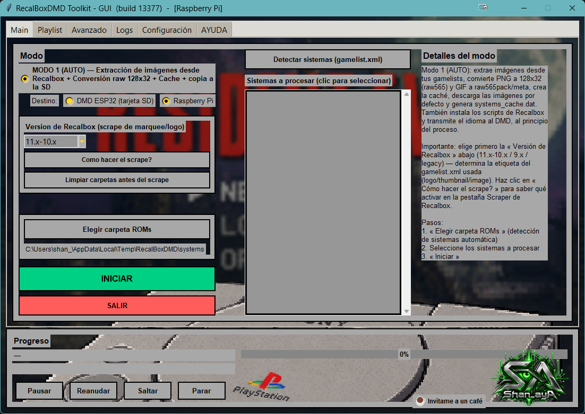

---

## 3. Contenido del pack

17 carpetas, 11 004 GIFs:

| Carpeta | GIFs | Contenido |
|---|---|---|
| `Arcade` | 1 441 | juegos de arcade |
| `Consoles` | 3 601 | Master System, Mega Drive, NES, SNES, Game Boy Advance… |
| `Computers` | 849 | Amiga, Atari ST, C64, MSX, ZX Spectrum… |
| `Pinball_Short` | 2 189 | pinballs coloreados (animaciones cortas) |
| `Pinball_Story` | 78 | pinballs coloreados (animaciones encadenadas como historia) |
| `Other` | 1 223 | temática videojuegos, hechas a medida |
| `Halloween` / `XMAS` | 720 / 190 | de temporada — actívalas solo en su época |
| `Quiz_Fr` | 163 | quizzes (en francés) |
| `The_80s_90s` | 152 | temática años 80-90 |
| `Movies` | 51 | cine |
| `BEST_OF_TOP_30` | 30 | una selección, ideal para una demo |
| `Happy_Birthday` | 10 | cumpleaños |
| `Logo_Rpi2dmd` | 72 | animaciones de transición RPi2DMD |
| `Vertical_DMD` | 165 | hechas para un reloj colocado en **vertical** — no para un panel 128×32 horizontal |
| `Test_Suite` | 2 | prueba del panel |
| `XXX_Mature` | 68 | contenido adulto, opcional |

---

## 4. Paso a paso

### Paso 1 — Abrir la pestaña Playlist

Inserta la tarjeta, abre la pestaña **Playlist** y elige la tarjeta en la lista **Tarjeta SD** (🔄 *Actualizar* si no aparece). A la izquierda aparecen las carpetas del pack de 600 GIFs.

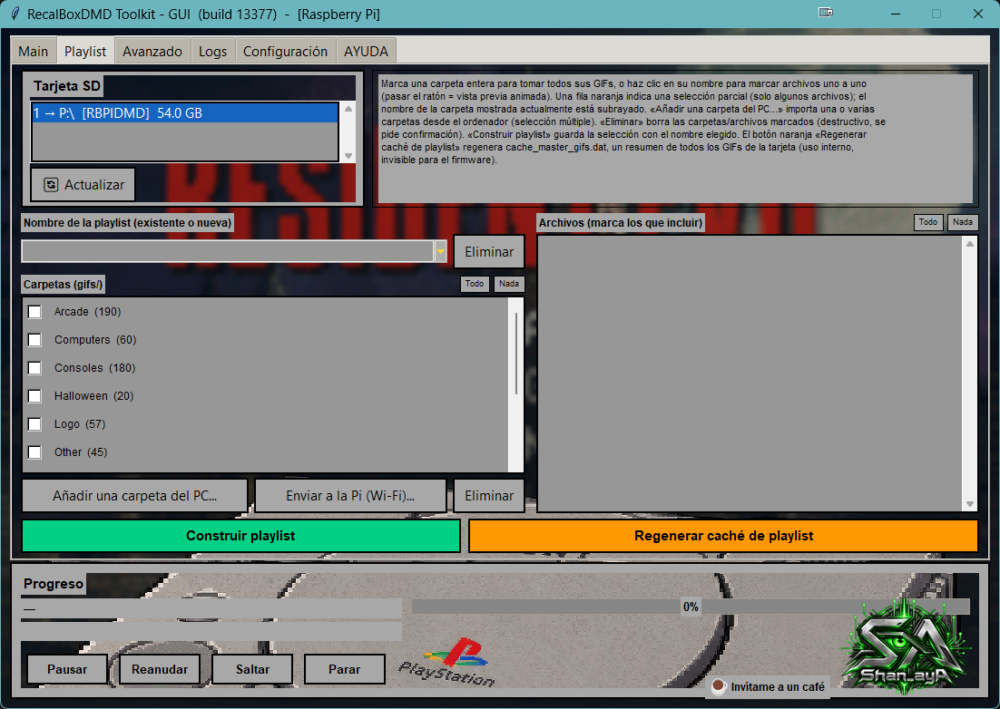

### Paso 2 — Eliminar el antiguo pack de 600 GIFs (recomendado)

El *Léeme* del pack pide **vaciar por completo la antigua carpeta `gif`** antes de copiar: la nueva versión tiene GIFs renombrados, logos añadidos dentro de animaciones y tiempos corregidos. En nuestra tarjeta de prueba, de los 600 GIFs del pack gratuito solo 366 eran idénticos en el pack Ultimate, 30 habían cambiado y 204 ya no existen con el mismo nombre (por ejemplo la carpeta `Logo` pasó a ser `Logo_Rpi2dmd`). Una simple fusión dejaría duplicados.

1. Pulsa **Todo** encima de la lista de carpetas para marcarlas todas.
2. Pulsa **Eliminar** (rojo, bajo la lista de carpetas).

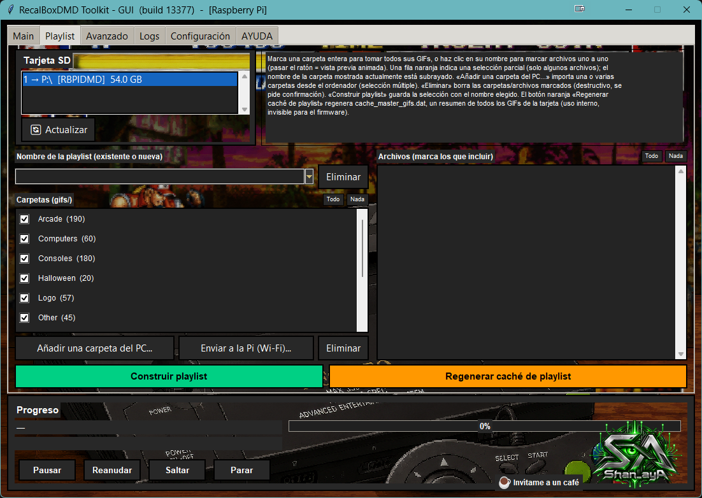

3. Lee la advertencia y responde **Sí**. Las entradas de playlists y de la caché que apuntaban a esos GIFs se quitan a la vez.

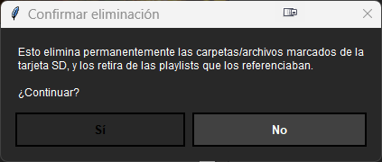

4. Una ventana **«Eliminación terminada»** confirma lo que se ha eliminado — el resultado se comprueba en la tarjeta, no se supone. Si un archivo no se pudo borrar (abierto en otro programa), la ventana dice cuál y puedes reintentar.

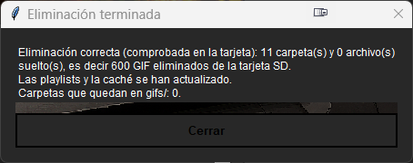

La lista de carpetas queda vacía.

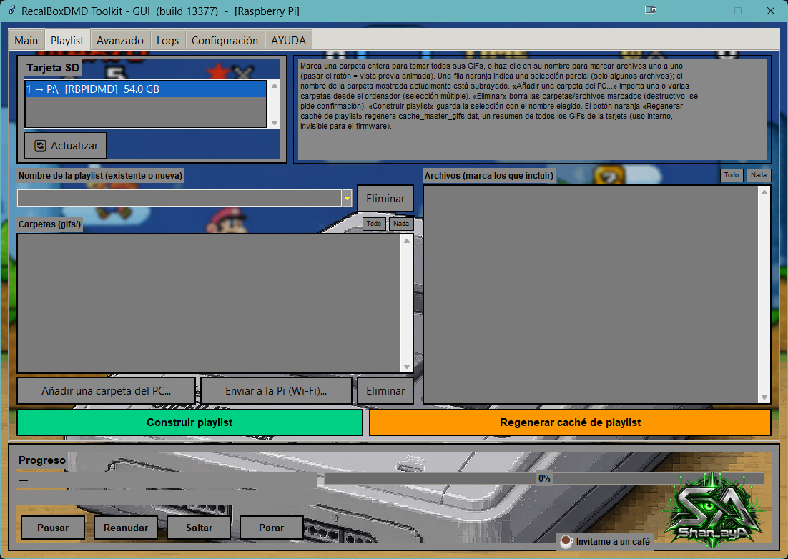

> ⚠️ **Marca solo las carpetas del pack de 600 GIFs.** *Todo* marca todo lo que hay en `gifs/`: si habías añadido GIFs propios, desmárcalos antes (o cópialos a otro sitio). El borrado es definitivo.
>
> ⚠️ **Tus playlists quedan vacías.** Si la playlist que el DMD reproduce por defecto era una de ellas, el DMD no tendrá nada que mostrar hasta que la reconstruyas (paso 6).

### Paso 3 — Añadir las carpetas del pack

1. Pulsa **Añadir una carpeta del PC…**
2. En la ventana de Windows, elige la carpeta **`gif`** del pack descomprimido (la que *contiene* `Arcade`, `Consoles`…).
3. Se abre una lista con las 17 carpetas encontradas, todas marcadas. Desmarca las que no quieras (por ejemplo `XXX_Mature`, `Vertical_DMD`, `Test_Suite`) y pulsa **OK**.

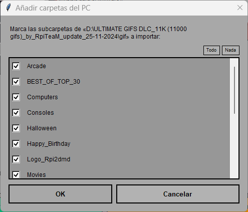

La copia empieza **sola** en cuanto pulsas **OK** — no hay un botón «copiar» aparte. Si desmarcas todo o pulsas **Cancelar**, no se copia nada (la pestaña Logs indica entonces «ajout annule»). Espera a la ventana de resumen de abajo antes de retirar la tarjeta: es la única señal de que la copia ha terminado.

> ℹ️ Excepción: durante la instalación completa (Modo 1) la pestaña Playlist se abre en un modo temporal donde **Añadir una carpeta del PC…** solo deja las carpetas en espera, y después hay que pulsar **Copiar selección**. Este tutorial empieza tras la instalación, donde la copia arranca automáticamente.
Empieza la copia. La barra de progreso indica la carpeta y el archivo en curso; la pestaña **Logs** lista cada paso.

En nuestro banco, el pack completo (11 004 GIFs, 1,5 GB) se copió en **unos 4 minutos** a una tarjeta de Raspberry Pi mediante un lector USB. Al final aparece un resumen.

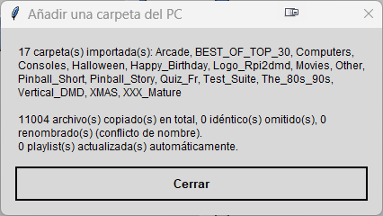

### Paso 4 — Comprobar el resultado

Las carpetas y su número de GIFs aparecen a la izquierda. Haz clic en el nombre de una carpeta para ver sus archivos a la derecha; pasa el ratón sobre un archivo para una vista previa animada.

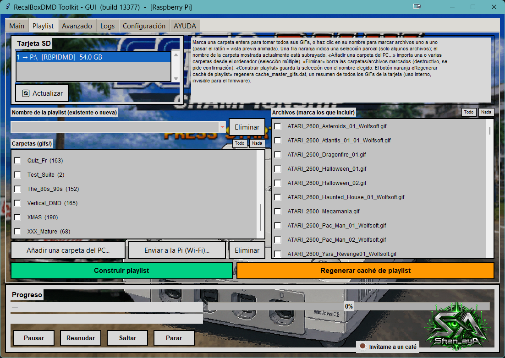

Debes encontrar exactamente las cifras de la tabla de la sección 3.

### Paso 5 — Reconstruir la caché

Pulsa el botón naranja **Regenerar caché de playlist**. Reescanea todo `gifs/` y reescribe `cache_master_gifs.dat` (17 carpetas, 11 004 archivos + 1 línea de cabecera en nuestra prueba). Es una red de seguridad barata tras un cambio grande, y elimina cualquier línea sobrante de un estado anterior de la tarjeta.

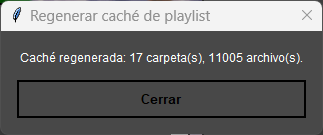

### Paso 6 — Construir tus playlists

Una playlist es una lista de GIFs que reproduce el DMD. Las playlists **por carpeta entera** son las más fáciles de mantener: el toolkit les añade solo los GIFs nuevos más adelante.

1. Marca las carpetas que quieres en la playlist.
2. Escribe un nombre en **Nombre de la playlist** (un nombre nuevo crea una playlist; uno existente la reemplaza).
3. Pulsa **Construir playlist**.

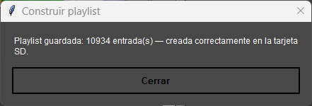

Sugerencias:

* Una playlist **`ALL`** con todas las carpetas que conserves: 11 004 entradas, unos 520 KB.
* Playlists **temáticas** (`Arcade`, `Pinball_Short`…) más cortas y fáciles de explorar.
* Una playlist `Halloween` y otra `XMAS` que activas en su época.

Después **elige la playlist activa** en la página web de configuración del DMD (página *Playlist*).

### Paso 7 — La pestaña Logs

Cada acción de la pestaña Playlist se escribe en la pestaña **Logs**: tarjeta elegida, carpeta elegida, carpetas encontradas y retenidas, copia de cada carpeta, eliminaciones (por carpeta, con los fallos), playlists construidas, caché reconstruida. Pon el filtro **Nivel** en **Todo** para verlas (por defecto solo se muestran avisos y errores).

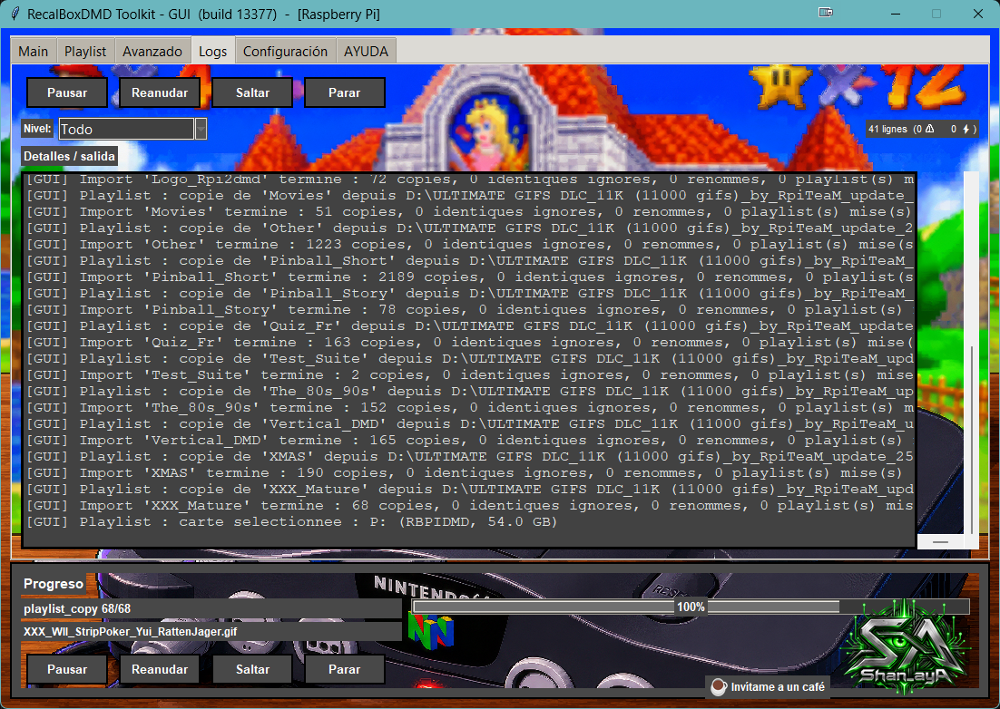

---

## Solución de problemas

| Síntoma | Causa y solución |
|---|---|
| La tarjeta no aparece en la pestaña Playlist | El **Destino** (pestaña Main) no corresponde a la tarjeta: *DMD ESP32* lista las tarjetas `RECALBOXDMD`, *Raspberry Pi* las `RBPIDMD`. Cámbialo y pulsa 🔄 *Actualizar*. |
| El DMD no muestra nada tras la actualización | La playlist que reproduce está vacía (se borró con el pack antiguo). Reconstrúyela (paso 6) y selecciónala en la página web. |
| Archivos que terminan en `_2`, `_3` | Ya había un archivo con el mismo nombre pero distinto contenido. Es el toolkit negándose a sobrescribir en silencio. Borra el antiguo si ya no lo necesitas. |
| Los GIFs nuevos no están en mi playlist | La playlist se construyó con archivos sueltos, no con carpetas enteras. Reconstrúyela con las carpetas marcadas. |
| Ventana «Eliminación incompleta» | Un archivo está abierto en otro programa (visor, análisis antivirus). Ciérralo y vuelve a eliminar. |
| Sin espacio | Hacen falta unos 1,5 GB + 2 MB. Desmarca `Vertical_DMD`, `Halloween`, `XMAS`… en el paso 3, o elimina otros GIFs. |
| Añadiste unos GIFs y la playlist no los incluye | Usa **Regenerar caché de playlist** y reconstruye la playlist. |

## Chuleta

1. Descomprimir el pack en el PC (enlaces: [creador](https://rpiteam.carrd.co/), [foro](https://www.neo-arcadia.com/forum/viewtopic.php?t=67065)).
2. Toolkit → **Main**: Destino = tu tipo de tarjeta → pestaña **Playlist** → elegir la tarjeta.
3. **Todo** → **Eliminar** → Sí (pack antiguo de 600, opcional pero recomendado).
4. **Añadir una carpeta del PC…** → carpeta `gif` del pack → OK (~4 min).
5. **Regenerar caché de playlist**.
6. Construir `ALL` (y playlists temáticas), luego elegir la activa en la página web del DMD.
