# Installer le pack ULTIMATE GIFS DLC (≈ 11 000 GIF) sur la carte du DMD — pas à pas

🇬🇧 [English](ultimate-gif-pack.md) · 🇫🇷 **Français** · 🇪🇸 [Español](ultimate-gif-pack.es.md)

**Objectif :** passer du pack gratuit de 600 GIF (installé par le Mode 1 / Mode 11) à la collection complète **ULTIMATE GIFS DLC** d'**eLLuiGi / RpiTeaM** — 11 004 animations pixel-perfect en 17 catégories — en gardant les playlists et le cache cohérents.

Toutes les captures viennent d'un vrai déroulé sur une carte de Raspberry Pi (partition `RBPIDMD`) : pack de 600 GIF supprimé, puis 11 004 GIF copiés. La procédure est identique pour la carte SD d'un DMD ESP32 (voir la [section 2](#2-avant-de-commencer)).

---

## 0. Où se procurer le pack

L'ULTIMATE GIFS DLC est la **collection payante de son créateur** ; il n'est pas dans ce dépôt et nous ne le redistribuons pas. L'échantillon gratuit de 600 GIF est celui que le Mode 11 installe.

| | Lien |
|---|---|
| Page du créateur (RpiTeaM / eLLuiGi) | https://rpiteam.carrd.co/ |
| Sujet du forum « ULTIMATE PACK 11 000 GIFS DLC » (conditions d'accès, nouveautés, mises à jour) | https://www.neo-arcadia.com/forum/viewtopic.php?t=67065 |

Les conditions d'accès et le prix sont fixés par le créateur et peuvent changer : lisez-les sur les pages ci-dessus. Le pack se présente en une archive (environ 0,9 Go compressée, environ 1,5 Go décompressée). **Décompressez-la d'abord sur votre PC** — tout ce qui suit part du dossier `gif` décompressé.

---

## 1. Pourquoi passer par l'outil PC pour une grosse playlist

Avec 11 000 GIF, il ne s'agit pas seulement de « copier des fichiers ». Chaque GIF ajouté, supprimé ou remplacé sur la carte modifie les playlists qui le référencent, et le DMD lit un fichier de cache (`cache_master_gifs.dat`) pour construire ses playlists vite. Le **RecalBoxDMD Toolkit (onglet Playlist)** s'occupe de tout cela :

* il garde en cohérence les **playlists associées aux dossiers** de la carte : quand vous ajoutez des GIF à un dossier qu'une playlist utilise en entier, la playlist est mise à jour ; quand vous supprimez un dossier ou un fichier, toutes les playlists qui le listaient sont réparées ;
* il tient à jour le **cache** (`cache_master_gifs.dat`) : les nouveaux fichiers sont ajoutés, les supprimés retirés, et un bouton le reconstruit entièrement ;
* il copie les fichiers avec une barre de progression, ignore les fichiers identiques, renomme les fichiers différents de même nom (`_2`, `_3`…) au lieu de les écraser, et écrit tout ce qu'il fait dans l'onglet **Logs**.

La page web de configuration du DMD sait aussi ajouter des GIF et reconstruire des playlists, mais c'est **beaucoup plus long** qu'avec l'outil PC pour de gros volumes : réservez-la aux **petits ajouts** (quelques GIF depuis votre téléphone) et utilisez le toolkit pour le pack.

> ⚠️ Ne copiez **pas** le pack sur la carte avec l'Explorateur Windows. Les fichiers arriveraient, mais les playlists et le cache n'en sauraient rien.

---

## 2. Avant de commencer

* Une carte issue d'une **installation complète réussie** (celle faite par le Mode 1 pour un ESP32, ou le Mode 16 pour un Raspberry Pi), avec le pack de 600 GIF déjà installé, lisible sur ce PC.
* **RecalBoxDMD Toolkit** build 13579 ou plus récent (la popup « Suppression terminée » et le journal détaillé de l'onglet Playlist montrés plus bas apparaissent à partir de ce build).
* Environ **2 Go libres** sur la carte (1,5 Go de GIF + environ 1,5 Mo de playlists et de cache).
* Le pack **décompressé** sur le PC (voir section 0).
* Dans l'onglet **Main** du toolkit, réglez **Cible** sur le type de carte avec laquelle vous travaillez : *DMD ESP32 (carte SD)* ou *Raspberry Pi*. Cela décide des cartes listées par l'onglet Playlist (une carte ESP32 s'appelle `RECALBOXDMD`, une carte Pi `RBPIDMD`).

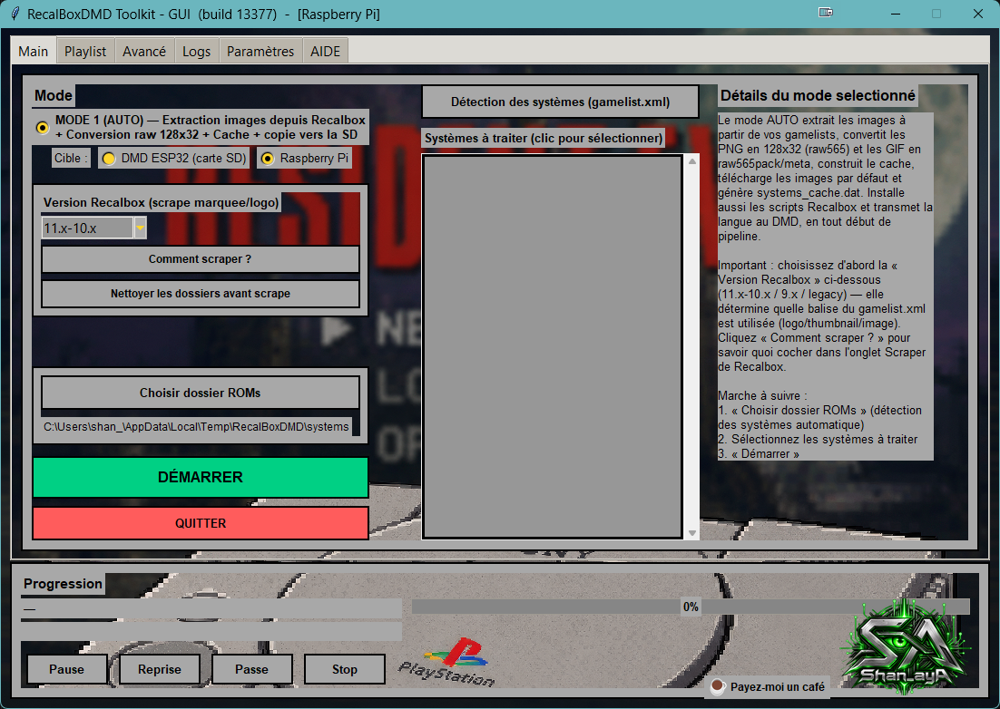

---

## 3. Contenu du pack

17 dossiers, 11 004 GIF :

| Dossier | GIF | Contenu |
|---|---|---|
| `Arcade` | 1 441 | jeux d'arcade |
| `Consoles` | 3 601 | Master System, Mega Drive, NES, SNES, Game Boy Advance… |
| `Computers` | 849 | Amiga, Atari ST, C64, MSX, ZX Spectrum… |
| `Pinball_Short` | 2 189 | flippers colorisés (animations courtes) |
| `Pinball_Story` | 78 | flippers colorisés (animations enchaînées en histoire) |
| `Other` | 1 223 | thème jeu vidéo, créées sur mesure |
| `Halloween` / `XMAS` | 720 / 190 | saisonniers — à activer seulement en saison |
| `Quiz_Fr` | 163 | quiz (français) |
| `The_80s_90s` | 152 | thème années 80-90 |
| `Movies` | 51 | cinéma |
| `BEST_OF_TOP_30` | 30 | une sélection, idéale pour une démo |
| `Happy_Birthday` | 10 | anniversaire |
| `Logo_Rpi2dmd` | 72 | animations de transition RPi2DMD |
| `Vertical_DMD` | 165 | faites pour une horloge placée **à la verticale** — pas pour une dalle 128×32 horizontale |
| `Test_Suite` | 2 | test de la dalle |
| `XXX_Mature` | 68 | contenu adulte, facultatif |

---

## 4. Pas à pas

### Étape 1 — Ouvrir l'onglet Playlist

Insérez la carte, ouvrez l'onglet **Playlist** et choisissez la carte dans la liste **Carte SD** (🔄 *Rafraîchir* si elle manque). Les dossiers du pack de 600 GIF apparaissent à gauche.

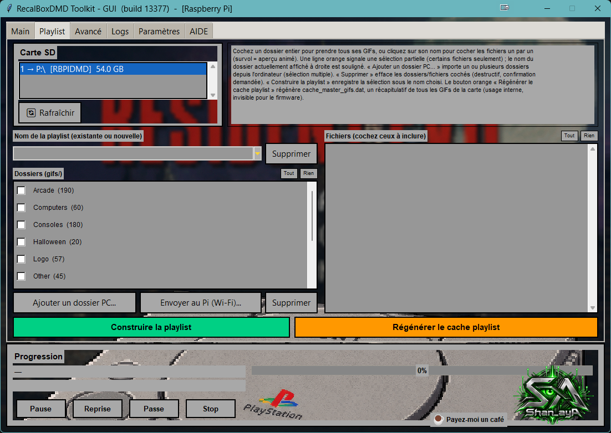

### Étape 2 — Supprimer l'ancien pack de 600 GIF (recommandé)

Le *Lisez-moi* du pack demande de **vider entièrement l'ancien dossier `gif`** avant de copier : la nouvelle version contient des GIF renommés, des logos ajoutés dans des animations et des timings corrigés. Sur notre carte de test, sur les 600 GIF du pack gratuit, 366 seulement étaient identiques dans le pack Ultimate, 30 avaient été modifiés et 204 n'existent plus sous le même nom (par exemple le dossier `Logo` est devenu `Logo_Rpi2dmd`). Une simple fusion laisserait des doublons.

1. Cliquez **Tout** au-dessus de la liste des dossiers pour tous les cocher.
2. Cliquez **Supprimer** (rouge, sous la liste des dossiers).

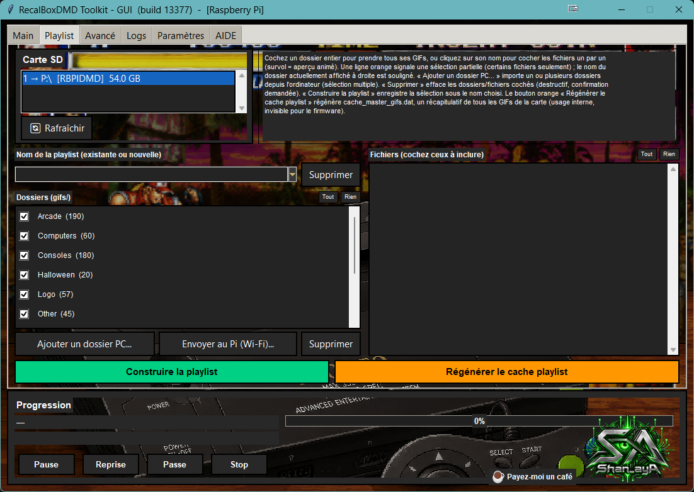

3. Lisez l'avertissement et répondez **Oui**. Les entrées de playlists et du cache qui pointaient vers ces GIF sont retirées en même temps.

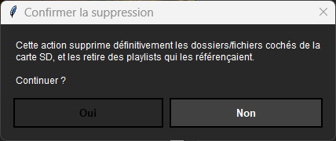

4. Une popup **« Suppression terminée »** confirme ce qui a été supprimé — le résultat est vérifié sur la carte, pas supposé. Si un fichier n'a pas pu être supprimé (ouvert dans un autre programme), la popup dit lequel et vous pouvez réessayer.

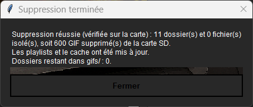

La liste des dossiers est maintenant vide.

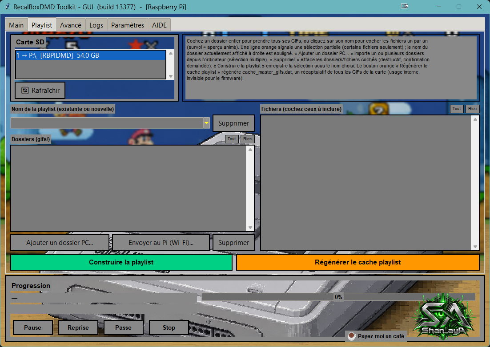

> ⚠️ **Ne cochez que les dossiers du pack de 600 GIF.** *Tout* coche tout ce qui est dans `gifs/` : si vous y aviez ajouté vos propres GIF, décochez-les d'abord (ou copiez-les ailleurs). La suppression est définitive.
>
> ⚠️ **Vos playlists sont maintenant vides.** Si la playlist jouée par défaut par le DMD était l'une d'elles, le DMD n'a plus rien à afficher tant que vous ne l'avez pas reconstruite (étape 6).

### Étape 3 — Ajouter les dossiers du pack

1. Cliquez **Ajouter un dossier PC…**
2. Dans la fenêtre Windows, choisissez le dossier **`gif`** du pack décompressé (celui qui *contient* `Arcade`, `Consoles`…).
3. Une liste des 17 dossiers trouvés s'ouvre, tous cochés. Décochez ceux dont vous ne voulez pas (par exemple `XXX_Mature`, `Vertical_DMD`, `Test_Suite`), puis **OK**.

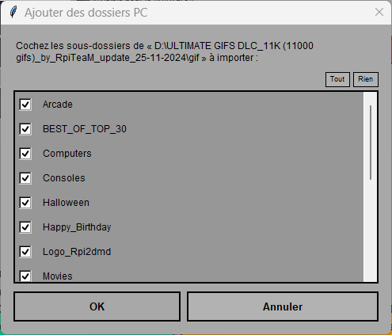

La copie démarre **toute seule** dès que vous cliquez **OK** — il n'y a pas de bouton « copier » séparé. Si vous décochez tout ou cliquez **Annuler**, rien n'est copié (l'onglet Logs indique alors « ajout annule »). Attendez la popup de récapitulatif ci-dessous avant de retirer la carte : c'est le seul signe que la copie est terminée.

> ℹ️ Exception : pendant l'installation complète (Mode 1), l'onglet Playlist s'ouvre en mode temporaire où **Ajouter un dossier PC…** ne fait que mettre les dossiers en attente, et il faut ensuite cliquer **Copier la sélection**. Ce tuto commence après l'installation, où la copie démarre automatiquement.
La copie démarre. La barre de progression indique le dossier et le fichier en cours ; l'onglet **Logs** liste chaque étape (ici, capture prise avec l'onglet Logs ouvert).

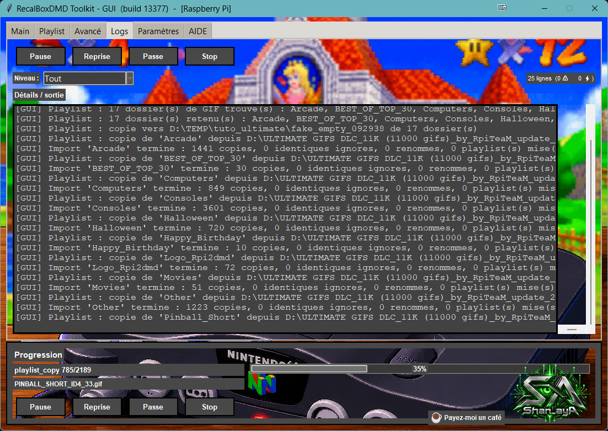

Sur notre banc, le pack complet (11 004 GIF, 1,5 Go) s'est copié en **environ 4 minutes** sur une carte de Raspberry Pi via un lecteur USB. À la fin, un récapitulatif s'affiche.

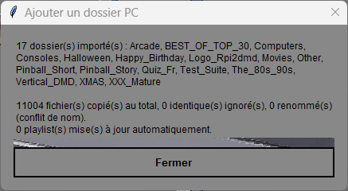

### Étape 4 — Vérifier le résultat

Les dossiers et leur nombre de GIF sont listés à gauche. Cliquez sur le nom d'un dossier pour voir ses fichiers à droite ; survolez un fichier pour un aperçu animé.

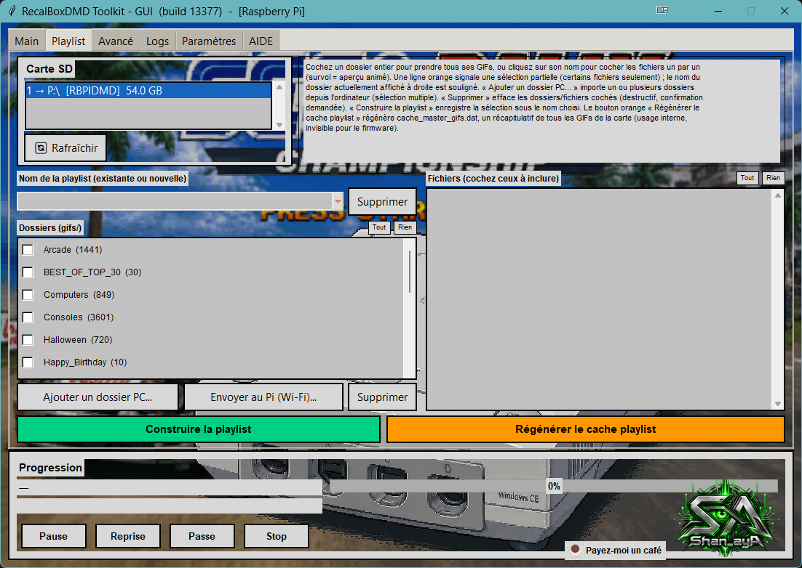
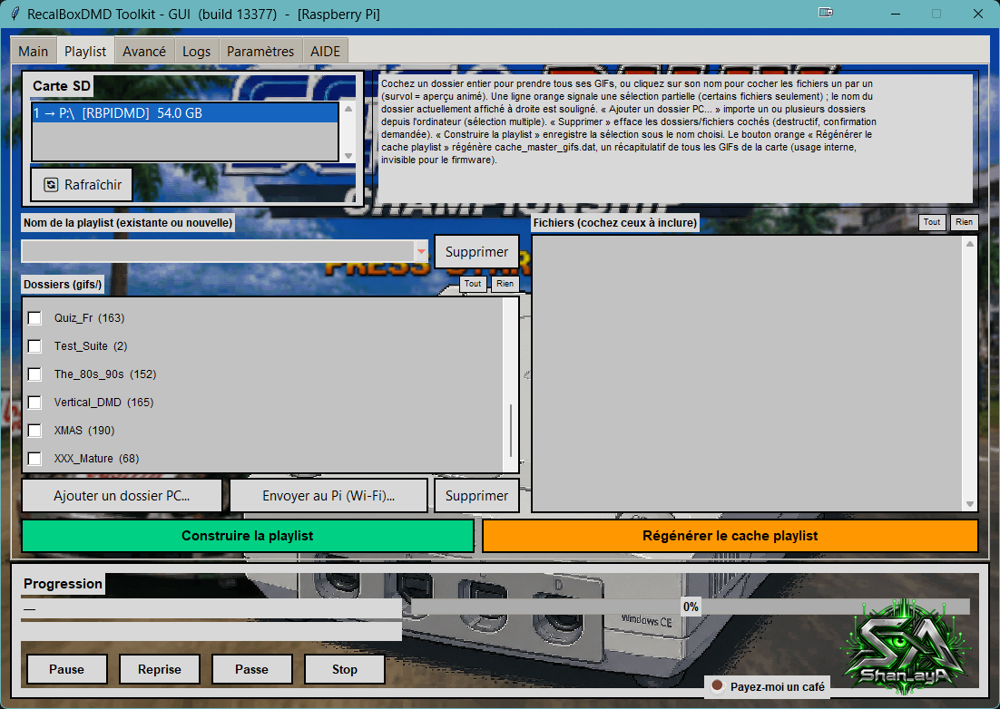
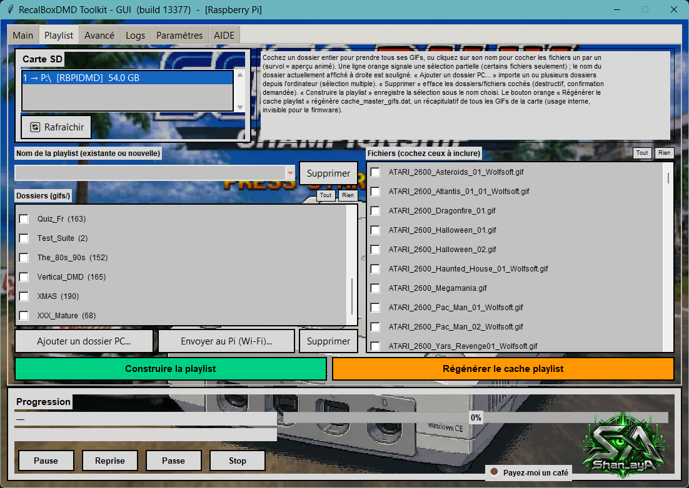

Vous devez retrouver exactement les nombres du tableau de la section 3.

### Étape 5 — Reconstruire le cache

Cliquez le bouton orange **Régénérer le cache playlist**. Il rescanne tout `gifs/` et réécrit `cache_master_gifs.dat` (17 dossiers, 11 004 fichiers + 1 ligne d'en-tête dans notre essai). C'est un filet de sécurité peu coûteux après un gros changement, qui élimine aussi toute ligne restante d'un ancien état de la carte.

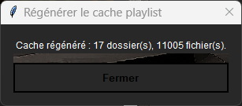

### Étape 6 — Construire vos playlists

Une playlist est une liste de GIF que le DMD joue. Les playlists **par dossier entier** sont les plus simples à maintenir : le toolkit y ajoute lui-même les nouveaux GIF plus tard.

1. Cochez les dossiers voulus dans la playlist.
2. Saisissez un nom dans **Nom de la playlist** (un nouveau nom crée une playlist ; un nom existant la remplace).
3. Cliquez **Construire la playlist**.

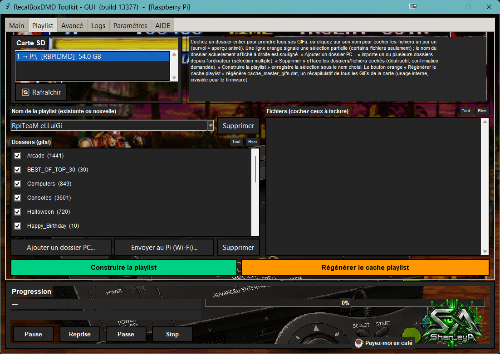
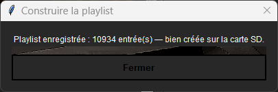

Suggestions :

* Une playlist **`ALL`** avec tous les dossiers conservés : 11 004 entrées, environ 520 Ko.
* Des playlists **thématiques** (`Arcade`, `Pinball_Short`…) plus courtes et plus faciles à parcourir.
* Une playlist `Halloween` et une `XMAS` que vous activez en saison.

Puis **choisissez la playlist active** dans la page web de configuration du DMD (page *Playlist*).

### Étape 7 — L'onglet Logs

Chaque action de l'onglet Playlist est écrite dans l'onglet **Logs** : carte choisie, dossier choisi, dossiers trouvés et retenus, copie de chaque dossier, suppressions (par dossier, avec les échecs), playlists construites, cache reconstruit. Réglez le filtre **Niveau** sur **Tout** pour les voir (par défaut seuls les avertissements et les erreurs sont affichés).

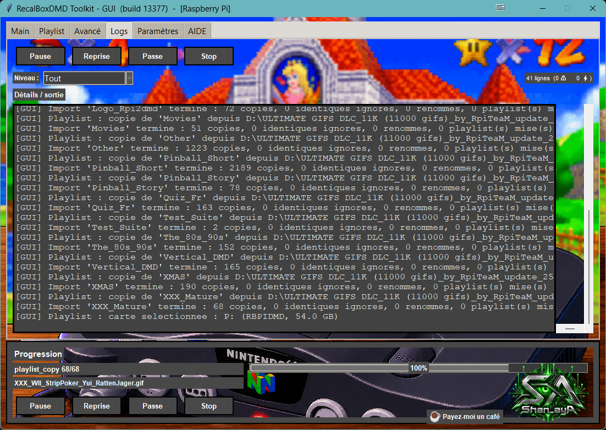

---

## Dépannage

| Symptôme | Cause et solution |
|---|---|
| La carte n'est pas listée dans l'onglet Playlist | La **Cible** (onglet Main) ne correspond pas à la carte : *DMD ESP32* liste les cartes `RECALBOXDMD`, *Raspberry Pi* les cartes `RBPIDMD`. Changez-la, puis 🔄 *Rafraîchir*. |
| Le DMD n'affiche rien après la mise à jour | La playlist qu'il joue est vide (supprimée avec l'ancien pack). Reconstruisez-la (étape 6) et sélectionnez-la dans la page web. |
| Fichiers terminés par `_2`, `_3` | Un fichier de même nom mais de contenu différent était déjà là. C'est le toolkit qui refuse d'écraser en silence. Supprimez l'ancien si vous n'en avez plus besoin. |
| Les nouveaux GIF ne sont pas dans ma playlist | La playlist avait été construite à partir de fichiers individuels, pas de dossiers entiers. Reconstruisez-la avec les dossiers cochés. |
| Popup « Suppression incomplète » | Un fichier est ouvert dans un autre programme (visionneuse, analyse antivirus). Fermez-le et supprimez à nouveau. |
| Plus de place | Il faut environ 1,5 Go + 2 Mo. Décochez `Vertical_DMD`, `Halloween`, `XMAS`… à l'étape 3, ou supprimez d'autres GIF. |
| Vous avez ajouté quelques GIF et la playlist n'a pas suivi | Utilisez **Régénérer le cache playlist**, puis reconstruisez la playlist. |

## Aide-mémoire

1. Décompresser le pack sur le PC (liens : [créateur](https://rpiteam.carrd.co/), [forum](https://www.neo-arcadia.com/forum/viewtopic.php?t=67065)).
2. Toolkit → **Main** : Cible = votre type de carte → onglet **Playlist** → choisir la carte.
3. **Tout** → **Supprimer** → Oui (ancien pack de 600, facultatif mais recommandé).
4. **Ajouter un dossier PC…** → dossier `gif` du pack → OK (~4 min).
5. **Régénérer le cache playlist**.
6. Construire `ALL` (et des playlists thématiques), puis choisir l'active dans la page web du DMD.
