# Installing the ULTIMATE GIFS DLC pack (≈ 11,000 GIFs) on the DMD card — step by step

🇬🇧 **English** · 🇫🇷 [Français](ultimate-gif-pack.fr.md) · 🇪🇸 [Español](ultimate-gif-pack.es.md)

**Goal:** go from the free pack of 600 GIFs (installed by Mode 1 / Mode 11) to the full **ULTIMATE GIFS DLC** by **eLLuiGi / RpiTeaM** — 11,004 pixel-perfect animations in 17 categories — with the playlists and the cache kept consistent.

All screenshots come from a real run on a Raspberry Pi card (`RBPIDMD` partition): the 600-GIF pack removed, then the 11,004 GIFs copied. The procedure is identical for the SD card of an ESP32 DMD (see [section 2](#2-before-you-start)).

---

## 0. Where to get the pack

The ULTIMATE GIFS DLC is the **creator's collection, distributed as charityware** (in return for a donation); it is not part of this repository and we do not redistribute it. The free 600-GIF sample is the one installed by Mode 11.

| | Link |
|---|---|
| Creator's page (RpiTeaM / eLLuiGi) | https://rpiteam.carrd.co/ |
| Forum thread "ULTIMATE PACK 11 000 GIFS DLC" (access conditions, news, updates) | https://www.neo-arcadia.com/forum/viewtopic.php?t=67065 |

The conditions of access are set by the creator and may change: read them on the pages above. The pack comes as one archive (about 0.9 GB compressed, about 1.5 GB once unzipped). **Unzip it on your PC first** — everything below starts from the unzipped `gif` folder.

---

## 1. Why use the PC toolkit for a big playlist

With 11,000 GIFs the question is not only "copy the files". Every GIF you add, remove or replace on the card changes the playlists that point to it, and the DMD reads a cache file (`cache_master_gifs.dat`) to build its playlists quickly. The **RecalBoxDMD Toolkit (Playlist tab)** takes care of all of this for you:

* it keeps the **playlists that are tied to a folder** of the card in step: when you add GIFs to a folder that a playlist uses as a whole, the playlist is updated; when you delete a folder or a file, every playlist that listed it is repaired;
* it maintains the **cache** (`cache_master_gifs.dat`): new files are appended, deleted ones are removed, and one button rebuilds it from scratch;
* it copies the files with a progress bar, skips identical files, renames different files with the same name (`_2`, `_3`…) instead of overwriting them, and writes everything it does in the **Logs** tab.

The DMD's own web configuration page can add GIFs and rebuild playlists too, but it is **much slower** than the PC tool for large volumes: keep it for **small additions** (a few GIFs from your phone), and use the toolkit for the pack.

> ⚠️ Do **not** copy the pack to the card with the Windows Explorer. The files would arrive, but the playlists and the cache would not know about them.

---

## 2. Before you start

* A card from a **successful full installation** (the one made by Mode 1 for an ESP32, or Mode 16 for a Raspberry Pi), with the 600-GIF pack already installed, readable on this PC.
* **RecalBoxDMD Toolkit** build 13579 or later (the "Deletion complete" pop-up and the detailed Playlist log shown below appear from that build).
* About **2 GB free** on the card (1.5 GB of GIFs + about 1.5 MB of playlists and cache).
* The pack **unzipped** on the PC (see section 0).
* In the toolkit's **Main** tab, set **Target** to the kind of card you are working on: *DMD ESP32 (SD card)* or *Raspberry Pi*. This decides which cards the Playlist tab lists (an ESP32 card is `RECALBOXDMD`, a Pi card is `RBPIDMD`).

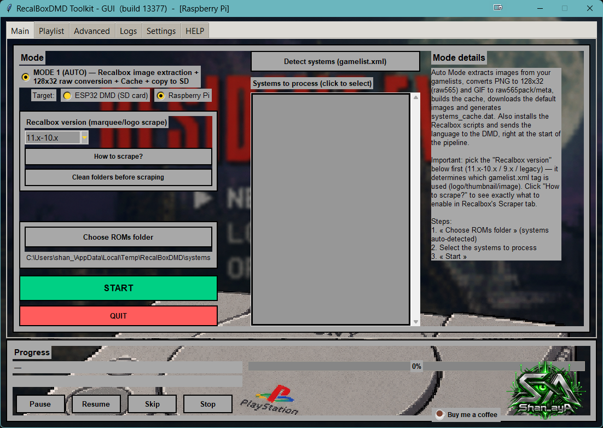

---

## 3. What is in the pack

17 folders, 11,004 GIFs:

| Folder | GIFs | Content |
|---|---|---|
| `Arcade` | 1,441 | arcade games |
| `Consoles` | 3,601 | Master System, Mega Drive, NES, SNES, Game Boy Advance… |
| `Computers` | 849 | Amiga, Atari ST, C64, MSX, ZX Spectrum… |
| `Pinball_Short` | 2,189 | colourised pinball (short animations) |
| `Pinball_Story` | 78 | colourised pinball (animations chained as a story) |
| `Other` | 1,223 | video-game themed, made to measure |
| `Halloween` / `XMAS` | 720 / 190 | seasonal — enable them only in season |
| `Quiz_Fr` | 163 | quizzes (French) |
| `The_80s_90s` | 152 | 80s–90s theme |
| `Movies` | 51 | cinema |
| `BEST_OF_TOP_30` | 30 | a selection, ideal for a demo |
| `Happy_Birthday` | 10 | birthday |
| `Logo_Rpi2dmd` | 72 | RPi2DMD transition animations |
| `Vertical_DMD` | 165 | made for a clock turned **vertically** — not for a 128×32 panel used horizontally |
| `Test_Suite` | 2 | panel test |
| `XXX_Mature` | 68 | adult content, optional |

---

## 4. Step by step

### Step 1 — Open the Playlist tab

Insert the card, open the **Playlist** tab and pick the card in the **SD card** list (🔄 *Refresh* if it is missing). The folders of the 600-GIF pack appear on the left.

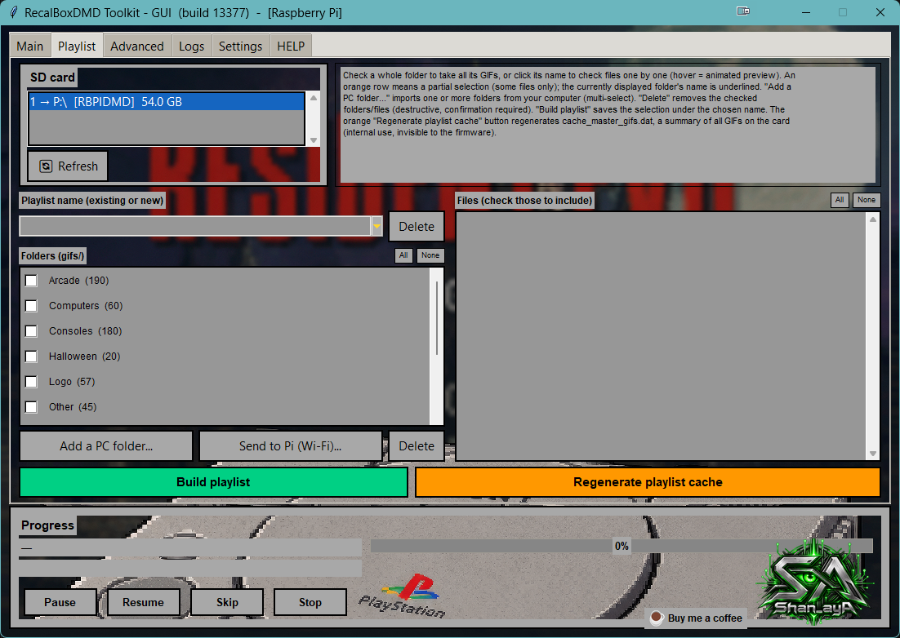

### Step 2 — Remove the old 600-GIF pack (recommended)

The pack's own *Read Me* asks to **empty the old `gif` folder completely** before copying: the new version has renamed GIFs, logos added inside animations and corrected timings. On our test card, of the 600 GIFs of the free pack only 366 were identical in the Ultimate pack, 30 had been changed and 204 no longer exist under the same name (for instance the `Logo` folder became `Logo_Rpi2dmd`). A plain merge would leave duplicates.

1. Click **All** above the folder list to tick every folder.
2. Click **Delete** (red, under the folder list).

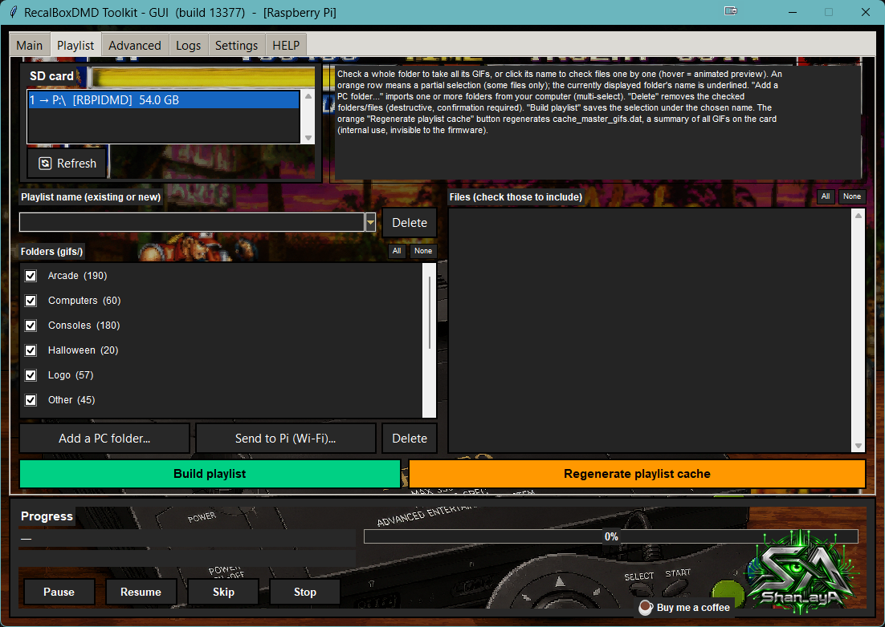

3. Read the warning and answer **Yes**. Playlists and cache entries that pointed to these GIFs are removed at the same time.

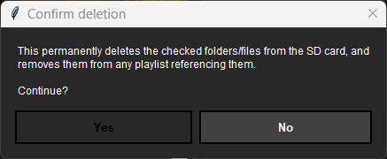

4. A **"Deletion complete"** pop-up confirms what was removed — the result is checked on the card, not assumed. If a file could not be deleted (open in another program), the pop-up says which one and you can try again.

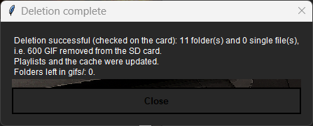

The folder list is now empty.

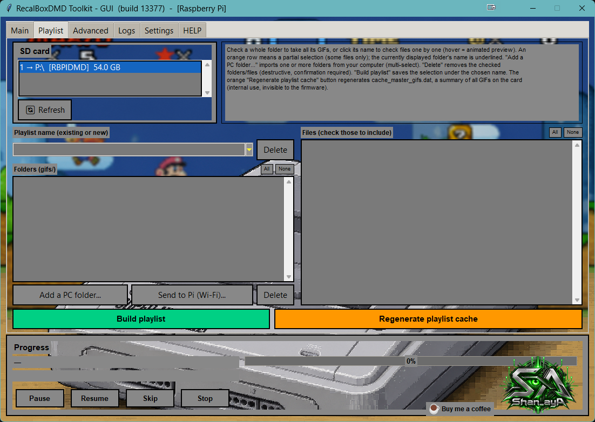

> ⚠️ **Only tick the folders of the 600-GIF pack.** *All* ticks everything that is in `gifs/`: if you added your own GIFs there, untick them first (or copy them elsewhere). Deletion is final.
>
> ⚠️ **Your playlists are now empty.** If the playlist that the DMD plays by default was one of them, the DMD has nothing to show until you rebuild it (step 6).

### Step 3 — Add the pack folders

1. Click **Add a PC folder…**
2. In the Windows window, choose the **`gif`** folder of the unzipped pack (the one that *contains* `Arcade`, `Consoles`…).
3. A list of the 17 folders found opens, all ticked. Untick the ones you do not want (for instance `XXX_Mature`, `Vertical_DMD`, `Test_Suite`), then **OK**.

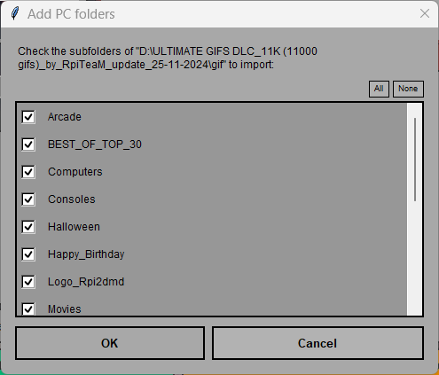

The copy starts **by itself** as soon as you click **OK** — there is no separate "copy" button. If you untick everything or click **Cancel**, nothing is copied (the Logs tab then says "ajout annule"). Wait for the summary pop-up below before removing the card: it is the only sign that the copy is finished.

> ℹ️ Exception: during the full installation (Mode 1) the Playlist tab opens in a temporary mode where **Add a PC folder…** only queues the folders, and you must then click **Copy selection**. This tutorial starts after the installation, where the copy begins automatically.
The copy starts. The progress bar shows the folder and the file being copied; the **Logs** tab lists every step.

On our bench the full pack (11,004 GIFs, 1.5 GB) took **about 4 minutes** to copy to a Raspberry Pi card through a USB reader. At the end a summary appears.

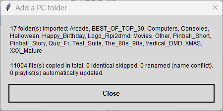

### Step 4 — Check the result

The folders and their GIF counts are listed on the left. Click a folder name to see its files on the right; hover a file for an animated preview.

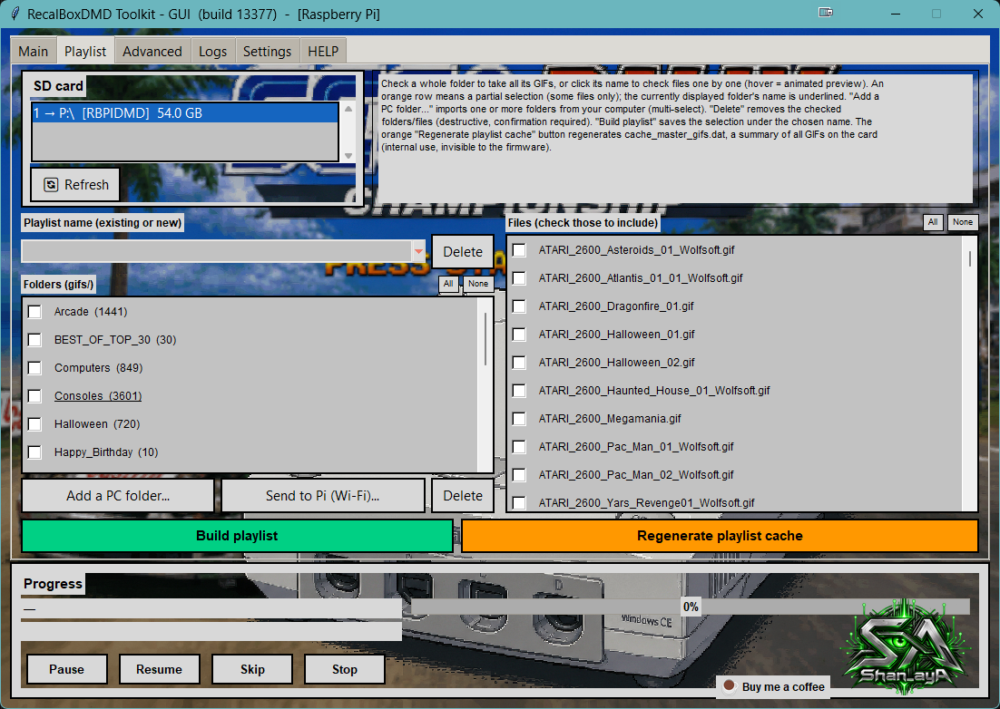

Expect exactly the counts of the table in section 3.

### Step 5 — Rebuild the cache

Click the orange **Regenerate playlist cache** button. It rescans the whole `gifs/` folder and rewrites `cache_master_gifs.dat` (17 folders, 11,004 files + 1 header line in our run). This is a cheap safety net after a big change, and it removes any leftover line from an older state of the card.

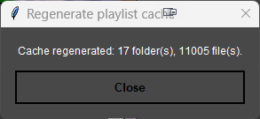

### Step 6 — Build your playlists

A playlist is a list of GIFs the DMD plays. **Whole-folder** playlists are the easiest to maintain: the toolkit adds new GIFs to them by itself later.

1. Tick the folders you want in the playlist.
2. Type a name in **Playlist name** (a new name creates a playlist; an existing name replaces it).
3. Click **Build the playlist**.

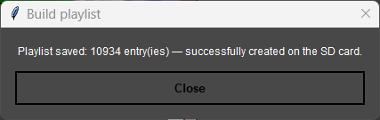

Suggestions:

* One **`ALL`** playlist with every folder you kept: 11,004 entries, about 520 KB.
* **Themed** playlists (`Arcade`, `Pinball_Short`…) that are shorter and easier to browse.
* A `Halloween` and an `XMAS` playlist that you activate in season.

Then **choose the active playlist** on the DMD's configuration web page (*Playlist* page).

### Step 7 — The Logs tab

Every action of the Playlist tab is written to the **Logs** tab: card chosen, folder picked, folders found and kept, copy of each folder, deletions (per folder, with failures), playlists built, cache rebuilt. Set the **Level** filter to **All** to see them (the default shows only warnings and errors).

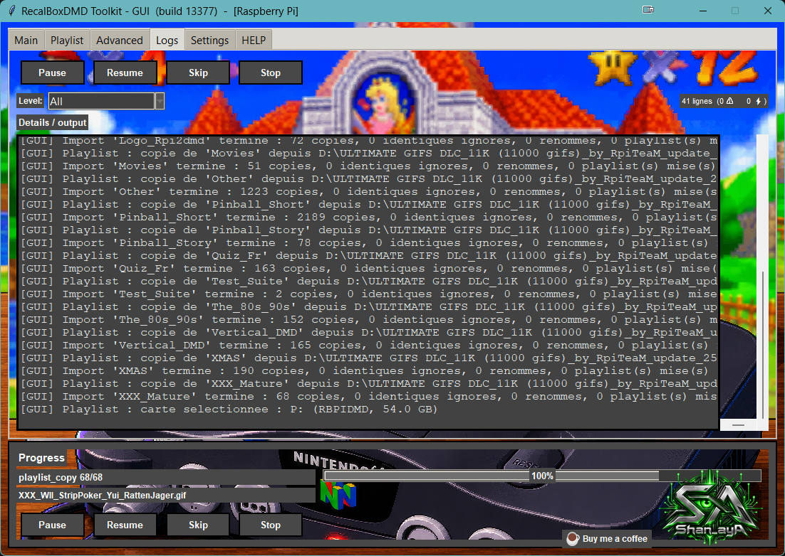

---

## Troubleshooting

| Symptom | Cause and fix |
|---|---|
| The card is not listed in the Playlist tab | The **Target** (Main tab) does not match the card: *DMD ESP32* lists `RECALBOXDMD` cards, *Raspberry Pi* lists `RBPIDMD` cards. Switch it, then 🔄 *Refresh*. |
| The DMD shows nothing after the update | The playlist it plays is empty (deleted with the old pack). Rebuild it (step 6) and select it on the web page. |
| Files ending in `_2`, `_3` | A file of the same name but different content was already there. This is the toolkit refusing to overwrite silently. Delete the old one if you do not need it. |
| New GIFs are not in my playlist | The playlist was built from a selection of individual files, not whole folders. Rebuild it with the folders ticked. |
| "Deletion incomplete" pop-up | A file is open in another program (viewer, antivirus scan). Close it and delete again. |
| Out of space | You need about 1.5 GB + 2 MB. Untick `Vertical_DMD`, `Halloween`, `XMAS`… in step 3, or remove other GIFs. |
| You added a few GIFs and the playlist did not follow | Use **Regenerate playlist cache**, then rebuild the playlist. |

## Cheat sheet

1. Unzip the pack on the PC (links: [creator](https://rpiteam.carrd.co/), [forum](https://www.neo-arcadia.com/forum/viewtopic.php?t=67065)).
2. Toolkit → **Main**: Target = your card type → **Playlist** tab → pick the card.
3. **All** → **Delete** → Yes (old 600 pack, optional but recommended).
4. **Add a PC folder…** → the pack's `gif` folder → OK (~4 min).
5. **Regenerate playlist cache**.
6. Build `ALL` (and themed playlists), then pick the active one on the DMD web page.
